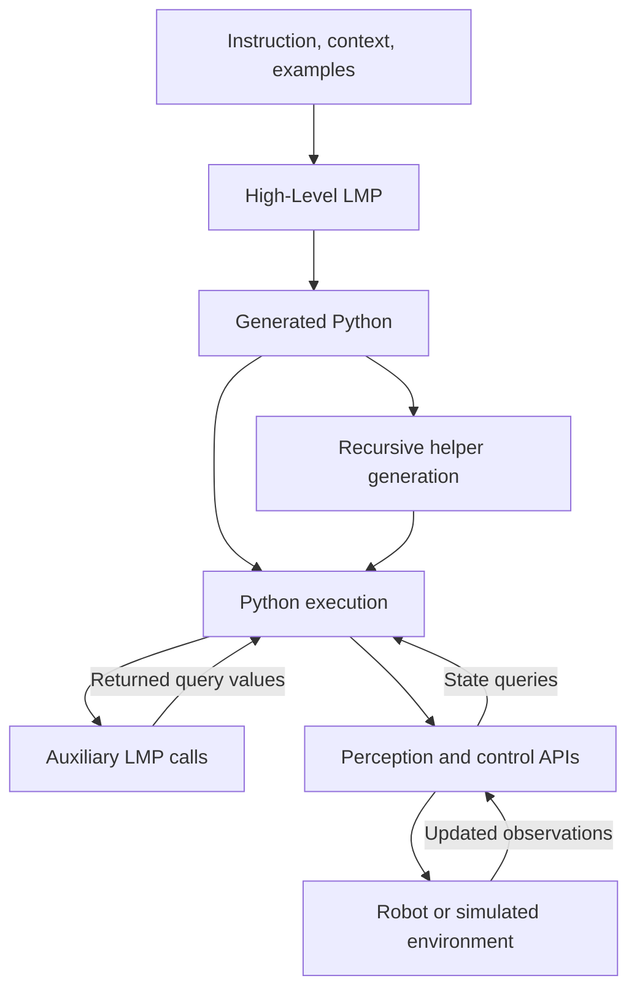
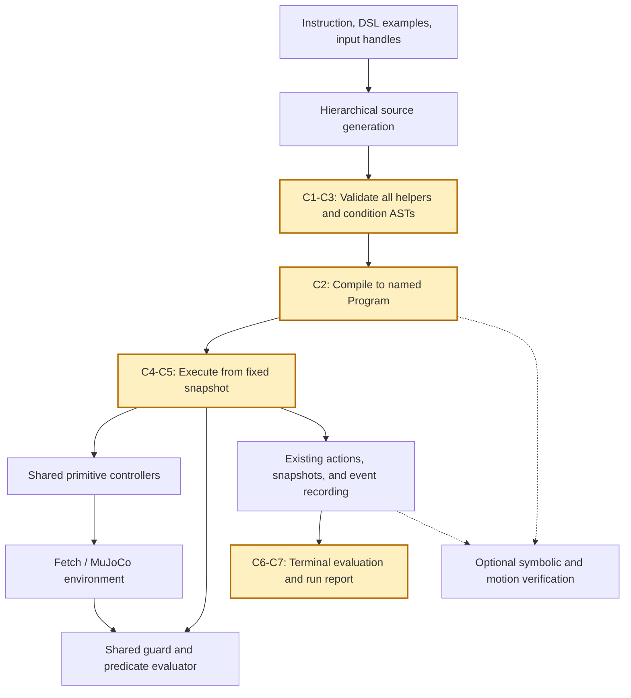

# Google CaP and the Proposed RoboVerify Integration

This document compares Google's original Code as Policies (CaP) tabletop
implementation with the proposed Stack integration. It specifies high-level
pseudocode and the concrete RoboVerify environment interfaces involved.
**The proposed generator, validator, compiler, and evaluator are not implemented
by this document.** The shared DSL is described in [DSL.md](DSL.md).

Source review: 2026-10-14. The Google code reviewed is pinned to
`8c116f61a61b4339cbbae92be89ff83d9897d4b5`. Pseudocode abstracts the implementation;
it is neither copied source nor directly executable Python.

## 1. Original Google CaP

CaP generates policy code from instructions and examples. Hierarchical generation
supplies missing helper functions. Generated programs can call perception/control
APIs and auxiliary language-model programs (LMPs). See the
[project introduction](https://code-as-policies.github.io/) and
[paper method](https://arxiv.org/html/2209.07753v4#S3).

The tabletop prompts provide language-based object, position, and question
parsing. These modules return objects, coordinates, or query values; their code
can inspect geometry and use numerical libraries. See the original
[object](https://code-as-policies.github.io/prompts/parse_obj_name.txt),
[position](https://code-as-policies.github.io/prompts/parse_position.txt), and
[question](https://code-as-policies.github.io/prompts/parse_question.txt) prompts.

The following abstracts `LMP`, `LMPFGen`, and `setup_LMP` in the official
[Interactive Demo](https://github.com/google-research/google-research/blob/8c116f61a61b4339cbbae92be89ff83d9897d4b5/code_as_policies/Interactive_Demo.ipynb).
It omits API transport retries, debug printing, and optional edit calls.

```python
# ORIGINAL: policy generation and execution share a callable namespace.
def invoke_lmp(module, instruction, context, arguments):
    prompt = assemble_prompt(module.examples, module.api_names,
                             module.optional_history, context, instruction)
    source = generate_code(prompt)
    helpers = resolve_missing_helpers(source, module.namespace)
    module.namespace.update(helpers)

    result, locals = execute_python(source, context,
                                    module.namespace, arguments)
    module.remember_source(source)
    if module.maintain_session:
        module.namespace.update(locals)
    return result


def resolve_missing_helpers(source, namespace):
    helpers = {}
    for call in unresolved_calls(source, namespace):
        definition = generate_function(call.signature)
        children = resolve_missing_helpers(function_body(definition),
                                           namespace | helpers)
        helpers.update(children)
        helpers[call.name] = bind_function(definition, namespace | helpers)
    return helpers


def setup_tabletop(env):
    namespace = numeric_libraries_and_environment_apis(env)
    for name in ["parse_obj_name", "parse_position", "parse_question",
                 "transform_shape_pts"]:
        namespace[name] = callable_lmp(name, namespace)
    return callable_lmp("tabletop_ui", namespace)


policy = setup_tabletop(env)
policy(instruction, object_context)
```

Auxiliary LMP calls can generate code during policy execution. The original
`exec_safe` performs basic filtering before Python execution; it does not enforce
RoboVerify DSL semantics. Helper dependency binding above summarizes the recursive
behavior rather than reproducing the notebook's intermediate function rebinding.



## 2. Changes for RoboVerify

**CHANGED** and **ADDED** comments identify modifications in the proposed
pseudocode. The diff below highlights the principal substitutions.

```diff
- Expose coordinates, numerical libraries, and tabletop composite actions.
+ [C1] Expose typed block handles, shared predicates, and Pick/Move/Release.
- Resolve helpers by binding generated Python functions for execution.
+ [C2] Resolve helper source, validate all bodies, and compile supported code.
- Query LMPs may return scene-dependent values during physical execution.
+ [C3] Generate condition ASTs before execution; evaluate them on current state.
- Preserve an interactive Python session when configured.
+ [C4] Freeze one generated policy and clear session state between trials.
- Execute generated Python against the original tabletop environment wrapper.
+ [C5] Execute Program through RoboVerify's existing controllers and recorder.
+ [C6] Evaluate terminal environment success separately from DSL trace validity.
+ [C7] Record generation/execution budgets, failures, and optional proof results.
```

| Change | Target behavior |
| --- | --- |
| **C1: Shared capabilities** | Stack actions are `Pick/Move/Release`; conditions use `ON/ON_star/Higher/Scattered/eq`, Boolean logic, and quantifiers over physical blocks. Action numbers must be explicit and finite. |
| **C2: Complete source validation** | Check the policy and every generated helper. Track types, bindings, condition provenance, and calls. Inline supported helpers with fresh names; reject unresolved calls and recursive helper cycles. Do not execute generated source while compiling. |
| **C3: Queries become formulas** | Auxiliary generation produces reusable typed conditions. It does not select concrete blocks from coordinates. Existing Get/While evaluation selects and binds current witnesses on each invocation/iteration. |
| **C4: Frozen trials** | Generate one policy per declared task/prompt configuration and test it on the fixed snapshot suite. Do not transfer bindings or generated session state from one scene to another. |
| **C5: Existing execution** | Lower to named instructions in `Program`, then reuse `prepare_program` and `record_execution`. Retain observation packing, action scaling, controller settings, and witness selection. |
| **C6: Independent evaluation** | Record completed execution, controller convergence, DSL pre/post validation, and the environment's terminal Stack success separately. |
| **C7: Explicit budgets and variants** | Bound model calls, tokens, helper expansion, control steps, loop iterations, and wall time. Verification-guided repairs, CEM, and repeated attempts are separate configurations. |

The first compiler target supports sequences, object-identity assignment, Get,
and flat While. Current `Program`/CFG has no If instruction and standard
`prepare_program` rejects nested loops. Reject these constructs explicitly until
support is added; do not silently rewrite their behavior. Query-helper expansion
must preserve variable scopes and the distinction between a loop witness and an
ordinary existential inside its condition.

The shared Stack environment factory currently fixes `b0` to physical ID 0.
Keep it as the supplied input handle. Runtime witness selection uses ascending
physical IDs internally; generated code must not inspect or sort those IDs.
Multiple legal witnesses remain permitted.



## 3. Proposed High-Level Pseudocode

Functions marked **NEW** describe interfaces to implement. Unmarked repository
calls below exist today. `suite` contains settled, task-compatible full snapshots
and identifying seeds; it does not provide expert program source to the model.

```python
# PROPOSED: generate and compile without access to a live environment.
def compile_cap_stack(instruction, dsl_spec, generation_budget):
    # CHANGED [C1, C4]: fresh generation state; DSL metadata only.
    session = new_generation_session()                         # NEW
    source = generate_code(instruction, dsl_spec, session,
                           generation_budget)                 # NEW

    # CHANGED [C2, C3]: retain source instead of binding/executing Python.
    bundle = resolve_helper_and_query_sources(
        source, dsl_spec, generation_budget,
        reject_forbidden_api_calls=True,
    )                                                         # NEW
    checked = validate_complete_call_graph(bundle, dsl_spec)   # NEW
    expanded = inline_helpers_with_fresh_names(checked)        # NEW
    program = lower_supported_ast_to_program(expanded)         # NEW

    # ADDED [C7]: save all prompts, responses, source, and generation costs.
    save_generation_artifacts(bundle, generation_budget)       # NEW
    return program


def evaluate_cap_stack(program, suite, num_blocks, limits):
    # ADDED [C1]: use the same Higher tolerance throughout the evaluation.
    with using_higher_tolerance(limits.higher_tolerance):
        definition = prepare_program(program, num_blocks)
        results = []

        for scene in suite:
            # CHANGED [C4, C5]: exact settled start, no reset or settling.
            trace = record_execution(
                definition,
                task="stack",
                seed=scene.seed,
                num_blocks=num_blocks,
                initial_snapshot=scene.snapshot,
                max_loop_iterations=limits.loop_iterations,
                timeout_seconds=limits.execution_seconds,
            )

            # ADDED [C6]: preserve status before validate_trace mutates it.
            execution_status = trace.metadata["status"]
            dsl_valid = validate_trace(trace)
            environment_success = check_terminal_stack(trace)  # NEW

            # ADDED [C6, C7]: retain separate outcomes and all failed trials.
            results.append(save_trial_result(
                trace, execution_status, dsl_valid,
                environment_success,
            ))                                                # NEW

        return results
```

`resolve_helper_and_query_sources` retains CaP's recursive helper generation.
For a language-based query, it generates a typed condition AST rather than a
scene-specific boolean or an object picked by the LLM. Unsupported dynamic query
strings or control structures fail compilation. State-dependent conditions are
still evaluated repeatedly by the robot runtime; the compiled policy remains
reactive without requiring runtime model calls.

`save_trial_result` records generation failure, invalid DSL, execution exception,
controller nonconvergence, timeout/loop exhaustion, and final-goal failure. Trial
acceptance requires normal completion, converged primitives, valid entry/final
DSL conditions, and terminal environment success. These fields remain available
separately. No failed scene is replaced with an easier one.

### 3.1 Terminal environment evaluation

**ADDED [C6]:** `validate_trace` checks shared task predicates. For Stack, its
postcondition is `forall x. ON_star(x,b0)`. The environment's success function
also requires the base near its resting table height and a complete, unique
geometric tower chain. Evaluate both; neither result substitutes for the other.

`record_execution` closes its environment before returning. A caller cannot
subsequently invoke that closed environment. A minimal proposed evaluator can
restore the saved terminal snapshot in a fresh instance of the same environment:

```python
# NEW evaluator using existing environment and snapshot interfaces.
def check_terminal_stack(trace):
    if not trace.snapshots:
        return None  # No terminal state is available.

    env = make_roboverify_stack_env(num_blocks=trace.num_blocks)
    try:
        final_obs = restore(env, trace.snapshots[-1])
        inner = inner_env(env)
        return bool(inner._is_success(final_obs))
    finally:
        env.close()
```

This restoration performs no additional controller steps or settling. A lower
cost alternative is a new terminal-evaluation callback inside
`record_execution`, immediately before it closes the environment. That callback
is not an existing parameter. In either implementation, evaluation overhead must
be recorded; a partial failed execution's terminal success does not make the
trial accepted. Evaluation exceptions must be recorded as evaluation failures.

## 4. Exact RoboVerify Environment Interfaces

### 4.1 Model-visible interface versus environment interface

The model receives the shared DSL interface. It does **not** receive the live
environment or simulator. The trusted runtime calls environment methods while
interpreting compiled instructions.

| Model-visible operation | Existing implementation | Actual environment access |
| --- | --- | --- |
| `Pick(b)` | `PickByName(b)` and `PrimitiveController.pick` | Resolve `symbolic_name_to_box_id`; read observations; repeatedly call `env.step(action)` |
| `Move(u,v,w,[dx,dy,dz])` | `MoveByName(u,v,w,target_offset=...)` and `PrimitiveController.move_relative` | Read current reference-block positions internally; target is `(X(u)+dx,Y(v)+dy,Z(w)+dz)`; call `env.step(action)` |
| `Release(b,h)` | `ReleaseByName(b,target_z=h)` and `PrimitiveController.release` | Read invocation-time block Z; open the gripper; retreat with frozen target XY and XYZ correction through `env.step(action)` |
| Identity assignment | `Assign(left,right)` | Update the runtime alias dictionary; no physical step |
| Get / While witness selection | `find_and_bind` and `While`/`Get` | Build a Scene from the current recorded observation and aliases; bind an enabled witness; no extra step for querying |
| Predicate formulas | `Term`, `Scene`, `evaluate` | Interpret shared predicates over internally extracted block positions; return predicate truth rather than raw geometry |

A host-provided `stack_one`, `stack_all`, `Put`, or `PickPlace` is not an
additional physical primitive. A model-generated helper may compose allowed
primitives, provided its entire body passes the compiler checks.

### 4.2 Concrete methods and properties

`env` is the `GymToGymnasium` wrapper returned by
`make_roboverify_stack_env`; `inner = inner_env(env)` is the underlying
`FetchPickAndPlaceConstruction`. Use the wrapper for physical steps so existing
recording hooks observe every action. Use `inner` for simulator state and
private observation/evaluation APIs.

| Interface | Caller and purpose | Required for Stack? |
| --- | --- | --- |
| `make_roboverify_stack_env(num_blocks=..., render_mode=...)` | Host: construct the same Fetch/MuJoCo environment used by RoboVerify | Yes |
| `env.reset()` → `(flat_obs, info)` | Host: initialize a fresh scene when creating the snapshot suite | Fresh scene preparation only; not during snapshot replay |
| `env.step(action)` → `(flat_obs, reward, terminated, truncated, info)` | Shared controllers: apply one four-component action and advance physics | Yes, through existing controllers/recorder |
| `inner._get_obs()` | Controller/recorder: read the current observation dictionary without advancing physics | Yes |
| `inner.flatten_observation(obs_dict)` | Controller/recorder: convert observations to the existing flat layout | Yes |
| `inner.num_blocks` | Trusted runtime: determine the physical object domain and check operands | Yes |
| `inner.symbolic_name_to_box_id` | Runtime: maintain `b0`, assignment aliases, and Get/While witness bindings | Yes |
| `inner.roboverify_base_block_id` | Host/evaluator: identify the designated base; current Stack factory chooses 0 | Yes; input identity, not a geometric selector |
| `inner.get_GT_state()` / `inner.set_GT_state(state)` | `capture`/`restore`: save and restore simulator state plus the environment goal | Yes for exact snapshot recording/replay |
| `inner.sim.data` arrays and `inner.sim.forward()` | Existing `capture`/`restore`: preserve controls, mocap, applied forces, userdata, and solver warm start | Yes, encapsulated in the snapshot helpers |
| `inner._is_success(flat_obs)` | New host evaluator: evaluate the final environment task result without a step | Yes for the proposed terminal success metric |
| `inner._roboverify_stack_tower_complete(positions)` | Existing implementation used through `_is_success`; checks the tower geometry | Indirectly; no duplicate CaP success implementation |
| `env.close()` | Host: release resources after rollout/evaluation | Yes |
| `inner.render(mode="rgb_array")` or `env.render()` | Host: optional video; wrapper render mode is configured at construction | Optional |
| `inner.table_surface_height` | Motion verification: physical table-plane world Z | Needed if configuring motion proofs; not an extra Stack action API |
| `inner.height_offset` | Environment: resting block-center Z used by Stack success checks | Used internally; distinct from table-plane Z |

The current shared primitive controller reads observations through
`env.flatten_observation(env.env._get_obs())`, relying on wrapper delegation.
The table above uses `inner` to make ownership explicit; integration should reuse
the controller rather than introduce a second observation or action path.

**Action format:** `action = [delta_x, delta_y, delta_z, finger_command]` is a
finite vector of shape `(4,)`. Existing `get_move_action` and
`bound_delta_action` scale XYZ uniformly and bound finger control. Do not treat
`env.step` as accepting Google's `{"pick": ..., "place": ...}` action dictionary.
The model emits DSL primitives, not these low-level vectors.

**Observation format:** `flat_obs` concatenates `observation` and `desired_goal`.
The first three entries are end-effector XYZ, entries `3:5` are finger positions,
and physical block `i` occupies position slice `10+12*i : 13+12*i`. Reuse
`scene_from_obs` and controller helpers; do not expose the array, desired goal,
reward, success flags, or controller feedback to generated policy conditions.

**Success information:** `env.step` provides `info["is_success"]`, but controllers
do not use it as a policy condition. Check the final state even if an earlier
step reported success. Assign/Get/loop exits can occur after the last physical
step, and zero-step programs have no step result to inspect.

**Bindings:** Get/While consume the current observation already held in the
trajectory. Stack uses the physical-block domain (`include_table=False`); `tbl`
is a nongeometric relation marker, not a Move reference. Preserve normal exits
and zero-iteration loops in the recorded events.

### 4.3 Prefer existing host helpers over direct simulator access

| Existing helper | Responsibility |
| --- | --- |
| `prepare_program(program,num_blocks)` | Check the supported Program shape, normalize operands, and create initial bindings and executable metadata |
| `record_execution(definition, ..., initial_snapshot=...)` | Create/close the environment, restore the start, execute within limits, and retain full-state traces and partial failures |
| `capture(env)` / `restore(env,snapshot)` | Exact simulator/goal/alias capture and restoration; observations alone are insufficient |
| `collect_recording(program,env,initial_observation=...)` | Invoke `Program.eval` and record actions, states, snapshots, and instruction/loop events |
| `validate_trace(trace)` | Check completion, primitive convergence, and the shared DSL task pre/postconditions; mutates trace metadata |
| `scene_from_obs(...)` / `evaluate(...)` / `find_and_bind(...)` | Shared condition semantics and current-state witness selection |
| `using_higher_tolerance(value)` | Scope the same Higher semantics across execution, evaluation, inference, and geometric verification |

`Program.eval` resets the environment when `initial_observation` is omitted.
Pass the restored observation through the recorder; otherwise the archived start
would be lost. For a fresh Stack suite, reproduce the existing 50-step gripper
hold once before saving state zero. For replay, never reset from the seed or
repeat settling. `GymToGymnasium.reset` does not implement seed handling by
itself; use the existing seed-management path in collection.

## 5. Verification Is an Explicit Additional Configuration

The baseline above measures generated-policy execution on fixed scenes. Optional
verification must use executions of that same candidate for invariant inference,
including loop heads and normal exits. Reuse `InvInference` and the existing
symbolic/motion stages only for supported program shapes and premises. Arbitrary
DSL-compliant primitive sequences do not automatically have a supported placement
summary or a motion proof.

The integrated verify CLI currently requires source-compatible demonstration
archives. Expert archives from a different executable cannot simply be passed as
CaP candidate traces. A verification adapter needs to respect the existing source,
trace, and CFG contracts. Verification-guided repair changes the experimental
configuration and must record additional model calls and executions.

Execution success, DSL trace validity, unbounded symbolic verification, and
motion-model verification remain separate results. Neither controller convergence
nor a model proof alone establishes physical task completion.

## 6. Repository Source Index

| Source | Interface verified for this document |
| --- | --- |
| [mcmc/synthesis.py](../mcmc/synthesis.py) | `make_roboverify_stack_env`, shared Stack factory settings |
| [environment/general_env.py](../environment/general_env.py) | `GymToGymnasium.reset`, `step`, and render behavior |
| [fpp_construction_env.py](../environment/cee_us_env/fpp_construction_env.py) | Observation flattening, bindings, GT state, task success, and table heights |
| [construction.py](../environment/cee_us_env/fpp_construction/construction.py) | `_get_obs` dictionary and block observation layout |
| [api/control.py](../api/control.py) | Shared primitive controllers, observation reads, action generation, and convergence |
| [api/instructions.py](../api/instructions.py) | Named primitives, Assign/Get/While, and alias resolution |
| [api/program.py](../api/program.py) | `Program.eval` and initial observation handling |
| [api/guard_eval.py](../api/guard_eval.py) | Current-state guard evaluation and witness binding |
| [predicates/scene.py](../predicates/scene.py) | Shared observation adapter and predicate interpretation |
| [util/actions.py](../util/actions.py), [util/on.py](../util/on.py) | Uniform action bounds, shared geometry, and Higher tolerance |
| [cfg/program_source.py](../cfg/program_source.py) | `prepare_program`, initial bindings, and fingerprints |
| [cfg/reset.py](../cfg/reset.py) | `inner_env`, `capture`, `restore`, and `collect_recording` |
| [cfg/collection.py](../cfg/collection.py) | `record_execution`, settling, deadlines, and `validate_trace` |
| [cfg/tasks.py](../cfg/tasks.py) | Shared Stack pre/postconditions |
| [cfg/VERIFICATION.md](../cfg/VERIFICATION.md), [inference guide](../inference_lib/README.md) | Existing proof scope, archive contracts, and collection/replay workflow |
