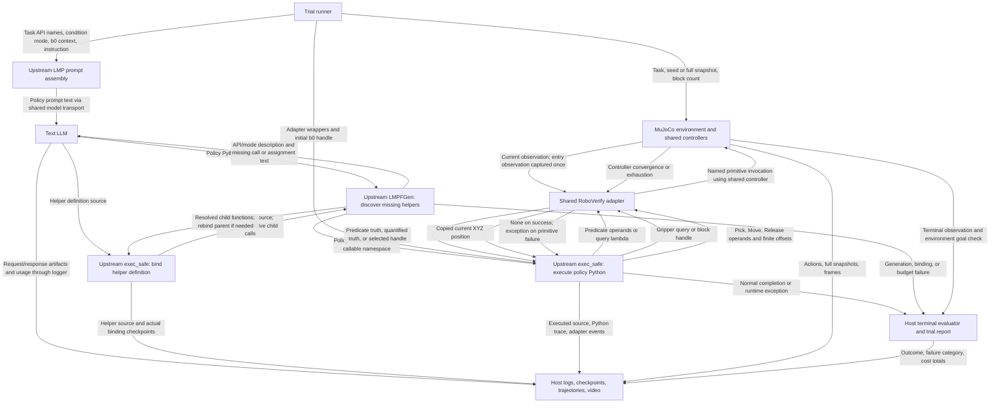
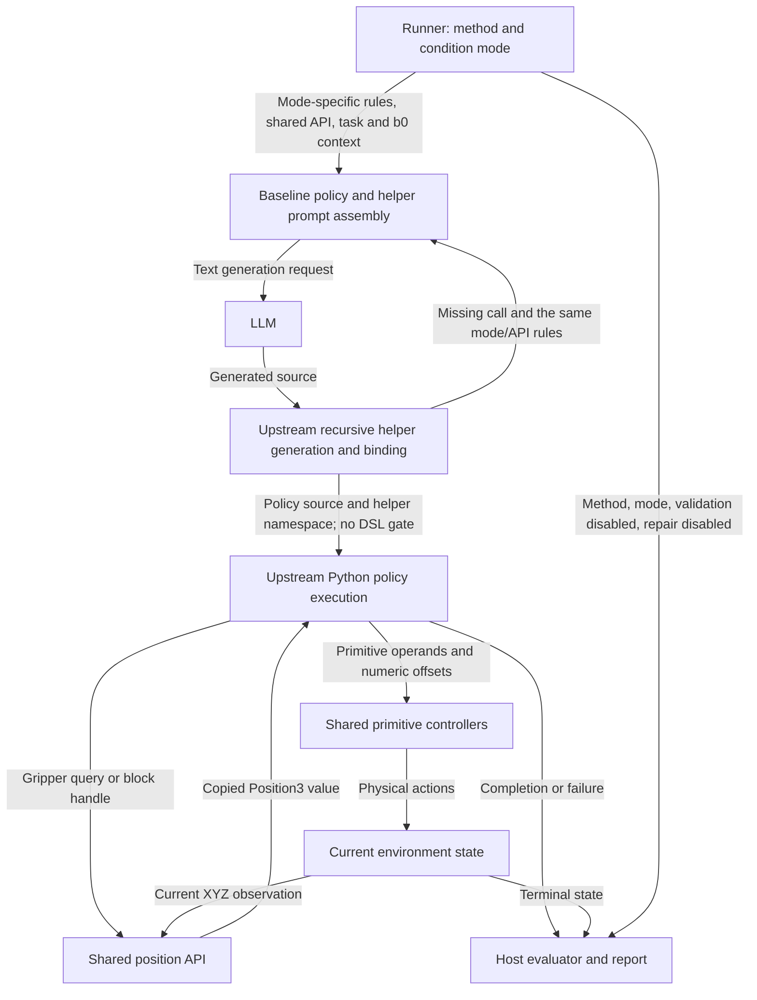

# Google baseline: observations and program flow

This describes the implemented `cap_google_baseline` path, reviewed on
2026-10-16. It distinguishes **text sent to the LLM**, **values available to the
generated Python policy**, and **environment data retained by the host**.
See [method 1](METHOD-1-FLOW.md) for the checked generation path and
[the shared DSL](DSL.md) for predicate and action semantics. Revision 1 adds
shared position observations and two prompt modes while retaining the pinned
upstream generation and execution algorithm.

## What the LLM receives

The model generates Python source from text. It does not receive a simulator
observation vector or a symbolic scene table. The standard runner creates a fresh
method instance and invokes it once per trial.

| Model request | Text actually assembled by the implementation |
| --- | --- |
| Initial policy | Code-generation instruction, task-filtered API description and selected condition-mode rules, the context `b0 is the input block.`, and the task instruction from `TASK_INSTRUCTIONS` or the caller's override. |
| Missing helper | Helper-definition instruction, the same API/mode description, and an unresolved call expression, possibly its enclosing assignment, extracted by the upstream parser. |
| Later policy invocation on the same instance | Upstream `maintain_session=True` adds previous executed policy source to the prompt. The standard runner makes only one invocation, so this history is initially empty. |

For Stack, the default task instruction is:

```text
Stack all blocks into a single tower rooted at the input block b0.
```

The API description supplies signatures and semantic guidance, including Move's
four arguments, reference-relative offsets, relational ON, the default Higher
tolerance, and Scattered's separation rule. This is interface knowledge, not an
observation of the sampled scene. The first policy prompt is identical to method
1's for the same instruction, context, available APIs, and condition mode.

The runner does not automatically insert `num_blocks`, a roster of all handles,
initial coordinates, predicate truth tables, seed, snapshot, or actual controller
configuration into the prompt. In particular, the API text states the default
Higher tolerance; changing the runtime tolerance does not interpolate its value
into that text. User-supplied instructions or direct-call context can contain
additional text, so these statements describe automatic inputs rather than a
filter on arbitrary user text.

Helper requests contain source-level expressions such as `ready(b0)`, not the
runtime value of `b0`. They do not automatically include the entire parent
policy, task instruction, other helper bodies, or environment state. Each HTTP
request carries its assembled prompt as one user text message; the transport does
not add previous responses or a conversation history. Upstream policy history,
when applicable, is explicitly assembled text.

## What the generated policy can observe

The shared adapter installs `b0` and task-available API callables in the Python
namespace. Other blocks are obtained through relational queries; the adapter
keeps the physical block enumeration and handle-to-ID mapping internally.

| Policy-facing interface | Returned information |
| --- | --- |
| `ON(a,b)`, `ON_star(a,b)`, `Higher(a,b)`, `Scattered(a,b)`, `eq(a,b)` | Boolean result computed from the current scene and object identities. |
| `ON_star_zero(a,b)` | Boolean result from frozen trial-entry geometry; exposed only for Reverse. |
| `exists(lambda ...: condition)`, `forall(lambda ...: condition)` | Boolean over the physical-block domain; multiple lambda parameters are allowed. |
| `get(lambda x: condition)` | One opaque block handle: the first matching witness in internal physical-ID order. Absence raises an error. |
| `get_gripper_position()`, `get_block_position(b)` | Copied current XYZ triple in world-frame metres, readable at literal components 0/1/2 under the advertised contract. |
| `Pick(b)`, `Move(u,v,w,[dx,dy,dz])`, `Release(b,h)` | `None` after convergence; primitive failure raises an exception. They do not return a perception vector or a success Boolean. |

Queries read current state without stepping physics. The adapter refreshes
observations for predicate evaluation; Reverse's entry observation remains
frozen. Query lambdas cannot execute actions through the adapter. For example,
`if Higher(b0,b0): ...` obtains its Boolean during Python execution. The LLM
writes that expression but never receives its evaluated truth value through the
current generation path.

This is the **advertised API boundary**, not a static compliance guarantee for
the baseline. It executes ordinary Python with upstream `exec_safe` filtering
(`import` and `__`, with `exec`/`eval` replaced); it does not run method 1's type,
provenance, attribute-access, or condition-role checker. Thus passing a rollout
must not be described as proof that its code obeyed the DSL or that the Python
namespace is a secure isolation boundary. Both methods are offered the same
adapter; their enforcement differs.

## Program flow and edge data

Every arrow is labeled with the information or outcome it carries. The LLM
node receives only generation requests. Runtime query results return to the
Python policy, and terminal results go to the host report.



The repeated LLM node represents separate policy/helper requests, identified by
their input and output labels. Helper definitions are bound before recursive
child resolution, and parents can be rebound after children exist; this preserves
the upstream algorithm. It is not a validate-all-before-binding pipeline.

The baseline has no checker-guided repair request. Original helper generation is
not a repair attempt. Transport retries resend generation requests within the
shared budget; runtime failures do not trigger policy regeneration. The runner
registers no auxiliary query LMPs, so executing a predicate or ordinary helper
does not invoke the model.

## Host-only observations and outcomes

Raw observation arrays, full simulator snapshots, physical IDs,
goals, rewards, controller errors, images/video, and terminal success are used
by the adapter, recorder, or evaluator. They are not automatically supplied to
the model. Position getters expose only the documented XYZ components to the
program. Saved artifacts are not automatically read back into prompts.

Physical success requires normal completion and the environment's terminal
success check; unconverged primitives fail execution. Stack/Unstack DSL
postconditions are separate diagnostics. Failures remain failures even when a
partial final scene satisfies the goal. Grid/Pyramid return `adapter_gap` before
any model request. No invariant inference, formal verification feedback, CEM,
or rollout-feedback repair is part of this baseline.

## Revision 1: shared positions and two prompt modes

Implemented on 2026-10-16. Both baseline and method 1 accept
`--condition-mode dsl_only|coordinate_predicates`, defaulting to `dsl_only`, and
share the runtime observation API described in
[Method1_Configuration.md](Method1_Configuration.md).

```text
O_t = (p_gripper(t), p_1(t), ..., p_n(t))
get_gripper_position() -> Position3
get_block_position(handle) -> Position3
```

Position3 contains copied current XYZ values in world-frame metres. Reads do not
advance physics or call the LLM. Re-read after actions; saved triples are
snapshots. The original predicate and primitive interfaces remain available.

| Baseline mode | Rules supplied in both policy and helper prompts |
| --- | --- |
| `dsl_only` | Read positions for action parameters; use only DSL predicates, identity, logic, quantifiers, and their compositions for loop/branch/selection conditions. |
| `coordinate_predicates` | Also allow LLM-generated coordinate predicates and general numeric conditions, including counters and comparisons without coordinate inputs. |

The selected mode changes prompt instructions, not the baseline execution
checker. This preserves the original Google CaP implementation as closely as
possible: keep the pinned `LMP`, `LMPFGen`, and `exec_safe` algorithms unchanged
and adapt prompts/API bindings through the compatibility layer. It remains on
upstream Python execution with no added DSL validation
or compliance repair. Thus a numeric branch generated in `dsl_only` may still
execute; this is a prompt violation, not something a new gate rejects. Retain
`validation=not_run`, `validation_enabled=false`, and
`refinement_enabled=false` for both modes. Shared adapter and budget checks
remain active. Method 1 enforces the same advertised rules through its checker
and interpreter.

This data flow summarizes the position interface and supplements the current implementation diagram above:



Coordinate query results return to the generated program, not to the LLM.
Model requests remain code-generation text. Record outcomes separately for all
four method/mode combinations. Implementation status and validation evidence
are in [revision_1.md](revision_1.md).

## Implementation references

- [Shared API text and task filtering](../contracts.py).
- [Baseline setup](../cap_google_baseline/method.py),
  [model and execution shims](../cap_google_baseline/compatibility.py), and
  [pinned LMP/LMPFGen source](../vendor/google_cap/core.py).
- [Adapter queries and primitive results](../adapter.py).
- [Trial lifecycle](../runner.py), [task instructions and scoring](../tasks.py),
  and [text request construction](../llm.py).
- [Prompt parity and generation tests](../tests/test_methods.py).
