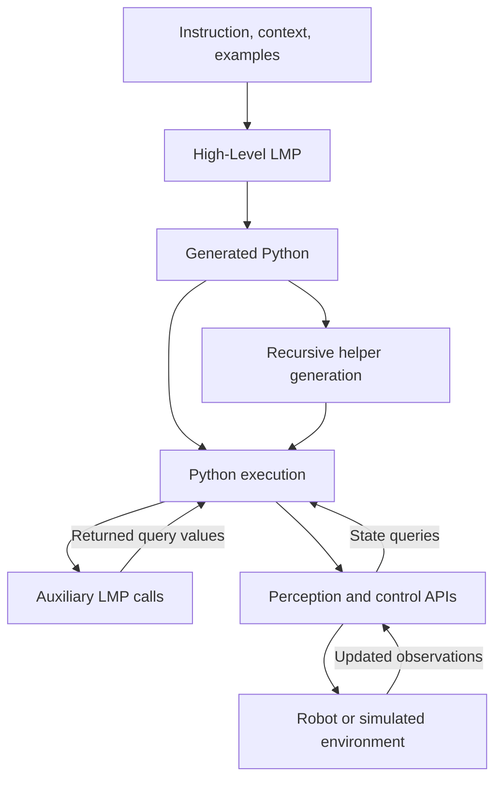
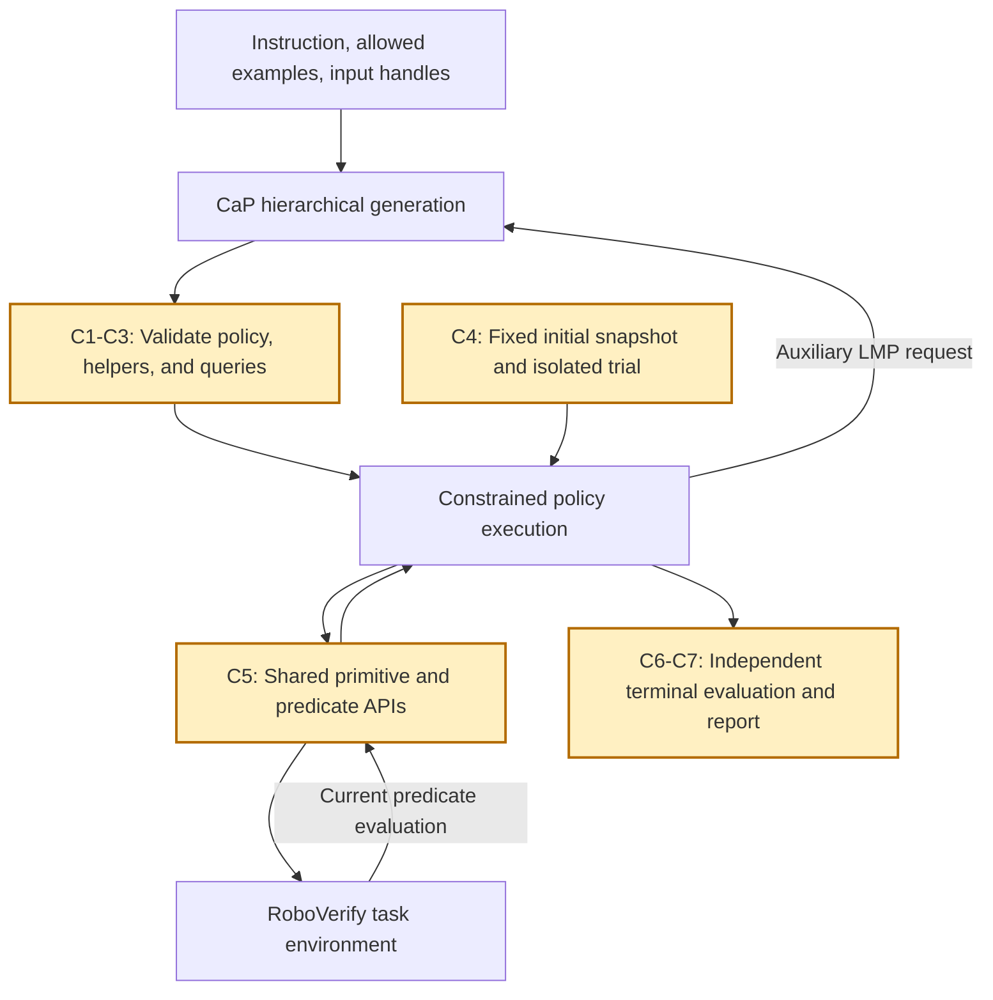
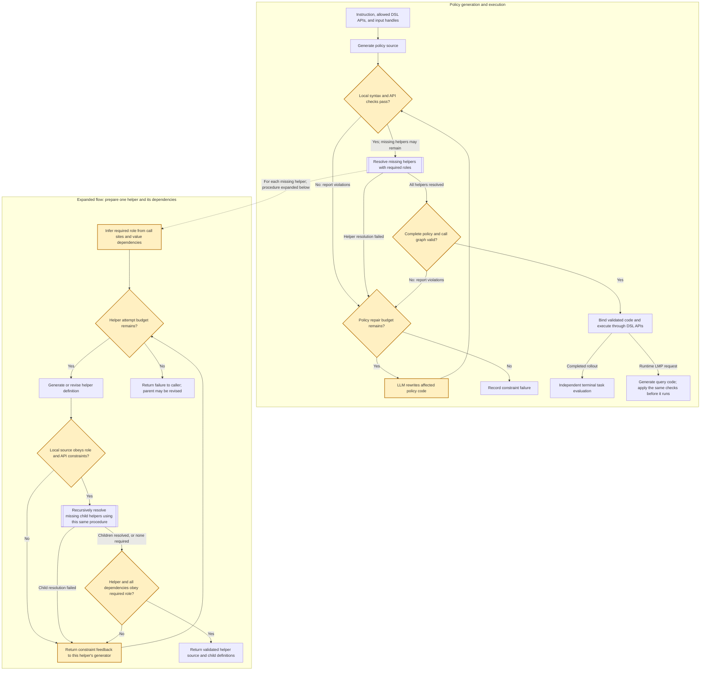
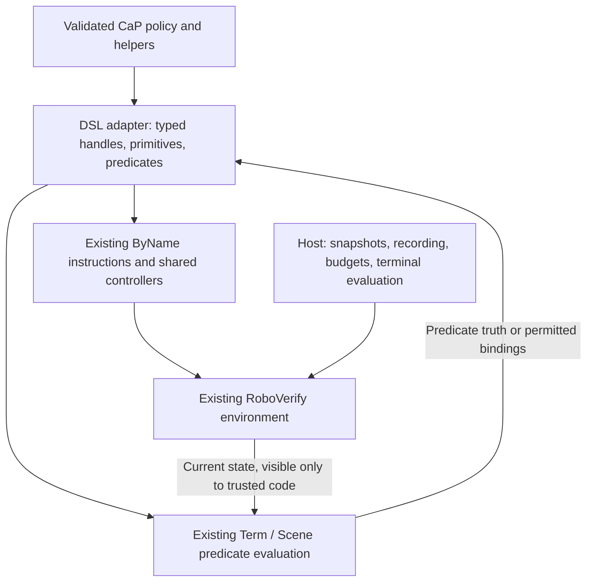

# Google CaP and the Proposed RoboVerify Integration

This document compares Google's original Code as Policies (CaP) tabletop
implementation with a proposed constrained baseline for RoboVerify's six tasks.
It also gives an optional Stack compiler prototype and the concrete RoboVerify
environment interfaces involved.
**Implementation update (2026-10-15):** `cap_google_baseline` and `cap_method_1`
now have code, shared text-model transport, logging/checkpoints, and a tower-task
adapter/runner. See [README.md](../README.md) for commands, the exact Python subset,
and validation limits. Plan 2, the optional Program compiler prototype, Goal
adapters, and optional runtime query-LMP configuration remain unimplemented.
The shared DSL is described in [DSL.md](DSL.md). The high-level design below also
describes those extension points; it is not a claim of six-task physical success.

**Revision 1 implemented (2026-10-16):** both methods expose current gripper/block
XYZ through shared read-only position getters and accept
`--condition-mode dsl_only|coordinate_predicates`. The default retains DSL-only
conditions; extended mode permits generated coordinate predicates and general
numeric conditions, including counters. Baseline modes are prompt-only; method 1
enforces its mode and retains interface-only repair. The pinned Google core is
unchanged. See [configuration](Method1_Configuration.md),
[baseline flow](BASELINE-FLOW.md), [method-1 flow](METHOD-1-FLOW.md), and
[implementation/validation](revision_1.md).

The original design and optional pseudocode below remain useful for architecture
and extension points. Coordinate-read exclusions and DSL-only condition
requirements in that original design are superseded by the mode-aware contract
above. The optional compiler, query-LMP configuration, and Goal adapters remain
unimplemented; numeric predicates have no automatic symbolic proof support.

Source review: 2026-10-14. The Google code reviewed is pinned to
`8c116f61a61b4339cbbae92be89ff83d9897d4b5`. Pseudocode abstracts the implementation;
it is neither copied source nor directly executable Python.

## 1. Original Google CaP

CaP generates policy code from instructions and examples. Hierarchical generation
supplies missing helper functions. Generated programs can call perception/control
APIs and auxiliary language-model programs (LMPs). See the
[project introduction](https://code-as-policies.github.io/) and
[paper method](https://arxiv.org/html/2209.07753v4#S3).

The tabletop prompts provide language-based object, position, and question
parsing. These modules return objects, coordinates, or query values; their code
can inspect geometry and use numerical libraries. See the original
[object](https://code-as-policies.github.io/prompts/parse_obj_name.txt),
[position](https://code-as-policies.github.io/prompts/parse_position.txt), and
[question](https://code-as-policies.github.io/prompts/parse_question.txt) prompts.

The following abstracts `LMP`, `LMPFGen`, and `setup_LMP` in the official
[Interactive Demo](https://github.com/google-research/google-research/blob/8c116f61a61b4339cbbae92be89ff83d9897d4b5/code_as_policies/Interactive_Demo.ipynb).
It omits API transport retries, debug printing, and optional edit calls.

```python
# ORIGINAL: policy generation and execution share a callable namespace.
def invoke_lmp(module, instruction, context, arguments):
    prompt = assemble_prompt(module.examples, module.api_names,
                             module.optional_history, context, instruction)
    source = generate_code(prompt)
    helpers = resolve_missing_helpers(source, module.namespace)
    module.namespace.update(helpers)

    # result: designated module output; locals: execution variables.
    result, locals = execute_python(source, context,
                                    module.namespace, arguments)
    module.remember_source(source)
    if module.maintain_session:
        module.namespace.update(locals)
    return result


def resolve_missing_helpers(source, namespace):
    helpers = {}
    for call in unresolved_calls(source, namespace):
        definition = generate_function(call.signature)
        children = resolve_missing_helpers(function_body(definition),
                                           namespace | helpers)
        helpers.update(children)
        helpers[call.name] = bind_function(definition, namespace | helpers)
    return helpers


def setup_tabletop(env):
    namespace = numeric_libraries_and_environment_apis(env)
    for name in ["parse_obj_name", "parse_position", "parse_question",
                 "transform_shape_pts"]:
        namespace[name] = callable_lmp(name, namespace)
    return callable_lmp("tabletop_ui", namespace)


policy = setup_tabletop(env)
policy(instruction, object_context)
```

`callable_lmp` represents a configured callable whose invocation runs
`invoke_lmp`. In the notebook, this is an `LMP` object and its `__call__`
method. `execute_python` abstracts execution plus extraction of the configured
output, usually `ret_val`; neither that output nor `locals` automatically
contains a terminal state or trajectory.

Auxiliary LMP calls can generate code during policy execution. The original
`exec_safe` performs basic filtering before Python execution; it does not enforce
RoboVerify DSL semantics. Helper dependency binding above summarizes the recursive
behavior rather than reproducing the notebook's intermediate function rebinding.



### 1.1 Google CaP baseline adapted to RoboVerify

**Status: implemented for the configuration documented in [README.md](../README.md).** Use
`cap_google_baseline` alongside the two constrained methods. It uses Google's
original LMP generation, recursive missing-helper generation, and Python
execution flow, connected to RoboVerify with minimal necessary changes. It does
not use Plan 1/2's DSL validator, role inference, checked interpreter, or
violation-guided repair. Whether it produces more invalid or unsuccessful
programs is an experimental hypothesis, not an assumed result.

Place its integration under `roboverify/synthesis/cap/cap_google_baseline/`.
Keep environment adaptation, model transport, logging/checkpoints, recording,
and the trial harness shared with `cap_method_1` and the future method 2. The
baseline must not call method 1's source-preparation or repair routines.

```text
synthesis/cap/
  cap_google_baseline/
    __init__.py
    method.py                 # Baseline setup and original invocation path
    compatibility.py          # Necessary model/environment integration shims
  cap_method_1/
    ...                       # Recursive DSL validation and local repair
  vendor/google_cap/
    ...                       # Pinned upstream source and provenance/license
  adapter.py                  # Shared RoboVerify primitive/predicate interface
  llm.py                      # Shared model transport and usage accounting
  logger.py                   # Shared CaP event/text logging
  checkpoints.py              # Shared source versions and artifact manifests
  recording.py               # Shared trajectories and video correlation
  runner.py                  # Shared trial preparation and evaluation
```

The baseline integration, shared modules, and pinned vendor source now occupy
these paths. The source-reuse rule is to retrieve the
official `code_as_policies` subtree/notebooks at the commit pinned in Section 1
rather than copying an unversioned third-party port or importing the entire
Google Research repository. Preserve upstream license/attribution, record the
exact source and extracted notebook cells, and keep extraction separate from
integration changes. The reviewed core lives in a notebook; it is not an
already packaged drop-in Python library. Keep a reviewable diff for any required
changes to extracted core code.

#### Interface and comparison scope

The default comparison uses the **same advertised RoboVerify DSL API** as Plan 1
and Plan 2, but has **no added static DSL enforcement or compliance-repair loop**.
Expose the same primitive controllers, predicates, input handles, action-offset
semantics, and task adapters. The shared read-only position getters are part of Revision 1. Do not add full
raw observation arrays, simulator access, or hand-written composite skills to
this variant. The absence
of the checker does not itself grant new environment capabilities.

Generated code can still attempt unsupported calls or construct conditions
outside the declared DSL. Let the original helper generator and execution path
handle them; record generation/runtime failures without invoking a new repair
mechanism. Adapter argument validation and common primitive-failure rules still
apply. A rollout that completes is scored by the same terminal task evaluator;
absence of a DSL check must not be reported as proof of DSL compliance. Any
post-hoc compliance analysis must be labeled separately and must not gate or
repair this baseline's execution.

A variant that restores Google's raw-perception/composite-action API would
change both capabilities and enforcement. It would be a separate experiment,
not the default `cap_google_baseline` described here. This baseline is an
adaptation to RoboVerify, not an exact reproduction of Google's tabletop setup.

#### Minimal changes from Google CaP

| Component | Treatment | Reason and boundary |
| --- | --- | --- |
| `LMP.build_prompt`, callable modules, history, configured return extraction | Preserve the original mechanism | Keep the original module invocation behavior. Declare the auxiliary modules used; do not change their configuration silently between methods. |
| `LMPFGen.create_new_fs_from_code` and helper generation | Preserve the original recursive algorithm | Do not add condition/body role inference or checker-driven local retries. Log generated definitions and dependency relationships. |
| `exec_safe` and helper binding | Preserve the original execution path and basic filtering | Do not replace it with the constrained interpreter or defer execution based on the new DSL validator. Instrument existing execution/binding boundaries. |
| `setup_LMP` / environment wrapper | Replace the tabletop bindings with the shared adapter | The original simulator and action dictionary do not match RoboVerify. Reuse its existing controllers and predicate semantics. |
| Prompt API descriptions, examples, and task context | Adapt to the actual available interface | Remove unavailable tabletop API assumptions; provide interface-correct examples without benchmark solutions. Use matched task instructions/API guidance across compared methods where applicable. Log every prompt difference. |
| Historical model API calls | Use the shared model-client compatibility layer | Preserve prompt content and intended generation settings; use the same selected model across variants and record the actual request. Transport retries do not become semantic code repair. |
| Optional upstream `fix_bugs` | Keep disabled in the default experiment | The original helper-generator default is false. Enabling its edit call is an explicit extra configuration, not Plan 1/2's repair loop. |
| Trial lifecycle and budgets | Connect the shared host runner | Use identical initial snapshots, task evaluators, controllers, and declared generation/execution limits. Bound original retry/generation behavior; record exhaustion rather than hanging indefinitely. |
| Logging, source checkpoints, and video | Add shared observational hooks | Save what the original method generated and executed, including failures; logging must not rewrite code, add task feedback, or run the robot twice. |

Use the same model and starting generation configuration when isolating the
effect of DSL enforcement/refinement. Log total calls/tokens and wall time,
including additional repair calls in Plans 1/2. Keep initial-state suites and
success denominators identical; report failures without removing difficult
trials. Declare whether generation is shared across scenes or repeated per
trial for every method.

#### Shared logger with baseline-specific events

Use the logging/checkpoint/video layer in Section 2.8 for all methods, with
`method="cap_google_baseline"` in the run configuration. Reuse the run-directory
contract and include the method in the slug/report. Add hooks around prompt/model
calls, helper generation/binding, Python execution, adapter calls, and trial
evaluation; a separate storage/logger implementation is unnecessary.

Store initial code, every generated helper, the assembled source versions, and
runtime-generated LMP code even if the original method executes definitions
before all dependencies exist. Record the actual execution order and namespace
versions rather than imposing Plan 1's validate-before-binding order. Checkpoint
validation status is `not_run`, with `validation_enabled=false` and
`refinement_enabled=false`; do not manufacture passing validation or repair
events. Ordinary helper generation is not a refinement attempt.

Use observational Python tracing if statement/helper/branch events are needed
on the original execution path, and record its overhead. Adapter/`env.step`
hooks provide shared primitive outcomes, environment traces, and videos. These
hooks must not route the baseline through the constrained interpreter. Retain
all printed output and artifact paths, and use the same host-only treatment of
environment information as the constrained methods.

## 2. Constrained CaP

### 2.1 Benchmark objective

Evaluate whether RoboVerify's synthesis/verification approach produces better
policies than CaP on **Stack, Unstack, Reverse, ReStack, Grid, and Pyramid** when
both methods have the same physical primitives and task-relevant predicates.
The immediate experiment measures constrained CaP's physical task success on
these six benchmarks. Better RoboVerify performance is a hypothesis to test,
not an assumed outcome or a consequence of having a proof.

Constrained CaP retains instruction-to-code generation, recursive helper
generation, and callable auxiliary LMPs. The required change is the interface
available to generated policies and queries. Compiling everything before a
rollout, removing runtime LMP calls, or requiring flat loops would be additional
method changes; they do not follow from restricting primitives and predicates.

### 2.2 Shared primitive and predicate boundary

| Interface | Constraint |
| --- | --- |
| Physical actions | Use only RoboVerify's `Pick`, `Move`, and `Release`, with the same operand meaning, shared controllers, tolerances, action scaling, and primitive step budgets. |
| Tower predicates | Expose `ON`, `ON_star`, `Higher`, `Scattered`, and object identity `eq`, according to the shared DSL vocabulary. Use the relational definition of `ON`. |
| Historical relation | Permit `ON_star_zero` where the task uses it, particularly Reverse; preserve its declared historical scope through all stages. |
| Goal interface | Grid/Pyramid require shared typed Goal handles, goal traversal/relations, and occupancy conditions. Finalize their semantics and execution adapters for both methods; do not invent CaP-only predicates. |
| Object access | Supply input handles such as `b0` and `h0`. Select other objects through allowed relational queries and bindings. Keep physical IDs inside the host; positions are available through the shared read-only getters. |
| Logic and code structure | Retain sequencing, identity assignment, predicate-based conditionals/loops, quantified queries, and generated helpers. Conditions and selections follow the configured mode: DSL-only or DSL plus general numeric predicates. |
| Numeric parameters | Permit explicit finite action offsets and computations that only parameterize allowed actions. In strict mode, numbers parameterize actions only; extended mode also permits numeric predicates and model-generated thresholds, without rollout optimization. |

Expose positions only through `get_gripper_position` and `get_block_position`.
Full raw observations, desired goals, images, reward/success flags, controller
feedback, and simulator objects remain host-only. Strict mode rejects numeric
conditions, including those hidden behind helper returns. Extended mode permits
pure coordinate computations and general numeric conditions such as counters.
Neither mode exposes physical-ID ordering. Method 1 enforces these rules; the
baseline supplies them in prompts without a DSL checker.

Do not supply composite physical skills such as `put_first_on_second`,
`stack_objects_in_order`, `PickPlace`, or an executable `Put`. CaP may generate a
placement helper itself, but its body must use only the shared primitives.
Release remains a gripper-opening/retreat primitive, not a complete placement
skill. Task-specific table/Goal references require a shared trusted adapter,
not additional raw-coordinate access.

### 2.3 Preserve CaP while enforcing the constraint

The following changes define the constrained baseline. **C1-C7** identify the
changes; implementation choices in Section 3 are only one possible prototype.

```diff
- Give generated programs the original tabletop perception/composite-action API.
+ [C1] Give them only the shared task-specific primitive/predicate interface.
- Bind generated helpers after the original basic Python filtering.
+ [C2] Validate every generated body and its complete call graph before execution.
- Let auxiliary LMPs use raw geometry to answer queries or select objects.
+ [C3] Let them generate allowed relational queries evaluated on current state.
- Reuse an interactive session without a benchmark trial boundary.
+ [C4] Preserve within-trial CaP behavior; isolate state between independent trials.
- Execute against Google's tabletop environment wrapper.
+ [C5] Execute against RoboVerify environments through the shared controllers.
+ [C6] Judge terminal task success independently, with the same task specification.
+ [C7] Report all trials, failures, and generation/execution costs per task.
```

Runtime auxiliary LMP calls remain allowed within declared budgets. Each newly
generated helper or query must pass the same checks before it can run. Queries
may return predicate truth or handles bound by conditions permitted in the
selected mode. Extended-mode selections can use the shared position getters. Their truth is
evaluated against the current environment state, not frozen at generation time.
Preserve the shared witness-selection semantics and allow multiple legal
witnesses. Generated code must not inspect the host's internal selection order.

A validated interpreter for constrained Python is a possible runtime. Lowering
supported code to existing `Program` instructions is another implementation
option. Neither option may silently remove legal CaP behavior. Current
`Program`/CFG lacks If support and `prepare_program` rejects nested loops; these
are adapter limitations to address or explicitly scope as a prototype, rather
than grounds to claim that a flat-While implementation evaluates all six tasks.

The baseline does not use RoboVerify invariant inference, solver counterexamples,
verification-guided code repair, or CEM to improve CaP policies. Static checking
enforces the shared interface and is not a task-correctness proof. Plan 1 in
Section 2.6 proposes bounded repair using only interface-violation feedback;
declare this extension and its budget when reporting constrained CaP. Repair
using rollout outcomes, task verification, or optimization feedback is a separate
assisted configuration.



### 2.4 Six-task scope and adapter readiness

| Task | Environment factory | Required benchmark semantics and remaining adapter work |
| --- | --- | --- |
| Stack | `make_roboverify_stack_env` | Stack all blocks on input `b0`; existing primitive execution and shared task conditions provide the first integration case. |
| Unstack | `make_roboverify_unstack_env` | Dismantle the tower onto the physical table; use a shared table-placement reference and final all-on-table check. |
| Reverse | `make_roboverify_reverse_env` | Reverse the complete original tower order; retain task-entry history. The standalone dismantling verifier is not a Reverse policy or evaluator. |
| ReStack | `make_roboverify_partial_stack_env` | Start with multiple towers and possibly an internal `b0`; finish with every block in a tower rooted at `b0`. The Partial standalone verifier is not this task's implementation. |
| Grid | `make_roboverify_grid_env` | Place blocks at specified grid goals; add shared Goal references, query semantics, and execution bindings. Declare the block-to-goal correspondence rule. |
| Pyramid | `make_roboverify_pyramid_env` | Place blocks at specified pyramid goals; needs the same Goal adaptation. The current environment has six blocks in a `3+2+1` layout. |

All six factories exist, but this is not yet an implemented six-task constrained
CaP benchmark. The shared `cfg/tasks.py` currently specifies only Stack/Unstack,
and Goal runtime support is incomplete. See [DSL.md](DSL.md) for the detailed
interface gaps. Finalize each task's shared input domain, vocabulary, action
references, preparation procedure, and terminal evaluator before reporting its
comparison. Infrastructure that cannot execute a task must be reported as an
adapter gap, not as a CaP policy failure or successful evaluation.

### 2.5 Evaluation protocol and outcomes

Use identical full initial snapshots, task inputs/targets, object counts,
controller settings, and execution limits for both methods. Preserve the current
Stack preparation/replay rule: settle once when constructing a fresh suite,
then restore saved starts without resetting from seeds or settling again.
Define the other tasks' preparation explicitly. Unstack end-to-end trials must
remain within 60 seconds, including runtime LMP requests.

Declare the model, prompts/examples, generation seeds, sampling settings, model
call/token budgets, and retry policy. State whether initial policy generation
is shared across scenes or repeated per trial; this is an experimental choice,
not a required capability restriction. Retain within-trial helper/session behavior
and clear scene-specific state between trials. Disclose each method's training
or demonstration inputs, keep test scenes held out, and do not provide complete
benchmark solutions or RoboVerify-generated policies as CaP prompt examples.

The primary metric is **physical task successes / all scheduled policy trials**,
reported separately for each of the six tasks. A success requires completed
execution within budget and the agreed final task condition, under the shared
primitive-convergence rule. Do not filter the denominator to legal, converged,
or completed CaP runs, and do not replace failed scenes. A generation failure
counts against its scheduled trials under the declared generation protocol.

Also report generation failure, invalid primitive/predicate use, runtime
exceptions, primitive nonconvergence, timeout/loop exhaustion, and final-goal
failure; include model calls/tokens, generation time, execution time, and action
counts. Record environment success and available DSL pre/post validation
separately. Transient success, controller convergence alone, or an abstract
Goal-marking result cannot establish physical task completion. Repeated policy
samples should retain their per-task outcomes and uncertainty; any aggregate
score must state how tasks are weighted. No new experimental results or claim
of RoboVerify superiority follows from this design document.

### 2.6 Plan 1: Recursive helper generation with constraint repair

**Status: core implementation available; optional query-LMP/session extensions
remain as documented in [README.md](../README.md).** Extend the recursive helper generation in
Section 1 with a bounded generate/check/repair loop for each helper. Original
CaP supplies missing function definitions recursively; the role checks and
constraint-driven repair below are our additions.

A helper's required role depends on how its result is used, including indirect
uses through assignments, arguments, returns, and other helpers:

| Required role | Allowed implementation |
| --- | --- |
| Condition | A side-effect-free expression under the selected mode: DSL predicates/identity/logic/queries, plus general numeric predicates in extended mode. All dependencies obey the same mode. |
| Body | Composition of shared control APIs, allowed predicates, and permitted local computation. Conditions and object selections inside the body still obey the condition restrictions. |

The body role permits actions; it does not require every helper to perform an
action. Numeric action parameters remain subject to Section 2.2. A helper used
in both roles must satisfy the stricter condition requirements. Role analysis
must follow value dependencies: `ready = check_ready(b); if ready: ...` requires
`check_ready` to satisfy the condition restrictions even though its call appears
in an assignment. Existing helpers and API calls must also be checked at each
use; membership in the namespace does not make `Pick` legal in a condition.

The diagram shows the policy-level flow and expands one helper-resolution call.
Yellow nodes mark the constraint checks and repair added to original CaP.
Every generation or repair consumes the shared budget; global budget exhaustion
terminates the attempt from either flow.



For a **condition** helper, the role check requires side-effect-free expressions
throughout its dependencies: DSL predicates in strict mode, or DSL and numeric
predicates in extended mode. For a **body** helper, it
allows DSL control APIs while imposing the condition role on internal guards
and selections. The recursive child call returns to its current parent; the
parent is accepted only after its dependencies pass. Returned definitions remain
source until the policy-level validation succeeds. A runtime LMP query resumes
its waiting caller only after its generated code passes the same validation.

#### Complete high-level pseudocode

Labels describe reuse of the reviewed Google notebook: **REUSE** preserves a
mechanism, **REFINE** modifies an existing mechanism, and **NEW** requires new
integration code. They do not imply that the notebook's historical model client
or prompts can be copied unchanged. All functions below are abstractions, not
implemented repository entry points.

The policy and each helper use the same bounded preparation routine. It repairs
the current source unit: either the top-level policy or one helper definition.
It recursively prepares children before accepting their parent. The shared
`budget` covers all model calls, repairs, dependency depth, and runtime LMP
requests; global exhaustion propagates without entering a local repair loop.

```python
# REFINE setup_LMP: retain callable modules; replace their exposed capabilities.
def setup_constrained_cap(env, task_spec, budget):
    namespace = build_dsl_namespace(env, task_spec)             # NEW
    # OPTIONAL: proposed configuration, not an existing repository field.
    # Default: no auxiliary query LMPs; recursive helper generation still works.
    for name in getattr(task_spec, "relational_query_modules", ()):
        namespace[name] = callable_lmp(
            name, namespace, role="condition", budget=budget
        )                                                     # REFINE
    return callable_lmp(
        "policy", namespace, role="body", budget=budget
    )                                                         # REFINE


# REFINE LMP.__call__: every module, including runtime queries, uses this path.
def invoke_lmp(module, instruction, context, arguments):
    check_module_inputs(module, context, arguments)            # NEW
    prompt = assemble_prompt(
        module.examples, module.api_names,
        module.optional_history, context, instruction
    )                                                         # REUSE structure
    source = generate_code(prompt, module.budget)              # REFINE budgets
    source = include_executable_context(module, context, source)

    source, helpers = prepare_checked_source(
        source, module.namespace, module.role, module.budget
    )                                                         # NEW

    # NEW: install only validated definitions in a checked execution scope.
    scope = prepare_execution_scope(module.namespace, helpers)
    result, locals = execute_checked(
        source, scope, arguments, module.return_spec, module.budget
    )                                                         # NEW runtime

    module.remember_source(source)                            # REUSE history
    publish_validated_helpers(module.namespace, helpers)       # REFINE
    if module.maintain_session:
        persist_checked_locals(module.namespace, locals)        # REFINE
    return result                                             # REUSE output


# NEW: repair the current policy source or helper definition using violations.
def prepare_checked_source(source, namespace, required_role, budget):
    for attempt in range(MAX_ATTEMPTS):
        budget.check_remaining()
        try:
            # NEW: deterministic checks; missing helpers are not violations.
            validate_local_constraints(source, namespace, required_role)

            # REFINE: recursively fill missing helpers under role constraints.
            helpers = resolve_missing_helpers(
                source, namespace, required_role, budget
            )

            # NEW: check all definitions, existing calls, and value dependencies.
            validate_complete_bundle(
                source, namespace | helpers, required_role
            )
            return source, helpers

        except ConstraintFailure as error:
            if attempt + 1 == MAX_ATTEMPTS:
                raise
            source = revise_source(
                source, violations=error.report,
                allowed_api=namespace.api_spec,
                required_role=required_role, budget=budget,
            )                                                 # NEW repair


# REFINE LMPFGen.create_new_fs_from_code: keep recursive helper expansion.
def resolve_missing_helpers(source, namespace, required_role, budget):
    helpers = {}
    for call in unresolved_calls(source, namespace):
        available = namespace | helpers
        if call.name in available:
            continue
        role = infer_required_role(source, call, required_role) # NEW
        definition = generate_function(
            call.signature, available.api_spec, role, budget
        )                                                     # REFINE FGen

        # RECURSION: preparation resolves this helper's children in turn.
        definition, children = prepare_checked_source(
            definition, available, role, budget
        )
        helpers.update(children)
        helpers[call.name] = definition                        # NEW: source only

    return helpers


# NEW host-side evaluation; the policy cannot access the env or evaluator.
env = prepare_trial_environment(task_spec, initial_snapshot)
try:
    policy = setup_constrained_cap(env, task_spec, budget)
    outcome = record_rollout(
        lambda: policy(instruction, object_context), env, budget
    )
    report_trial(outcome, evaluate_terminal_state(env, task_spec))
finally:
    env.close()
```

`task_spec.relational_query_modules` is an **optional proposed configuration**,
not an existing repository field or a finalized module list. It defaults to an
empty sequence in this pseudocode. It names auxiliary LMPs that generate query
code, not DSL predicates; predicates are already installed by
`build_dsl_namespace`. Plan 1's recursive helper generation works without these
modules. Generated ordinary helpers execute their checked code without a new
model request on each call. Declare the auxiliary LMP configuration in benchmark
results; leaving this list empty is a configuration choice, not a requirement to
remove runtime LMP capability from constrained CaP.

`callable_lmp` has the same meaning as in Section 1: calling it dispatches to
`invoke_lmp`. When configured, relational query modules return predicate-derived values or allowed
object bindings; their metadata includes output types as well as the no-action
role. The old coordinate-returning parsing prompts must be replaced. Queries
generated during execution use the same preparation routine before they run.

The recursion is `prepare_checked_source` -> `resolve_missing_helpers` ->
`prepare_checked_source` for each child. An empty unresolved-call set returns
`{}` naturally; it does not establish compliance on its own. Local validation
rejects definite violations while allowing declared missing-helper obligations;
complete validation requires every obligation to be resolved and every call to
meet its role. Neither validator asks an LLM to decide validity. Unsupported
syntax is reported explicitly under the declared restricted-Python contract.

`namespace` here abstracts API metadata, checked value types, and retained helper
source with validation summaries, rather than just a dictionary of raw Python
callables. Its union operation preserves that metadata. Definitions already
present in source are analyzed in their lexical scopes; shadowing protected APIs
is rejected. `validate_complete_bundle` combines requirements from all uses,
including existing helpers later used in a stricter role. Arguments, executable
context, query results, and persisted locals must not introduce unchecked values,
callables, or API rebinding. The trusted executor owns environment access and
enforces the checked subset; it is not the notebook's `exec_safe` unchanged.

`record_rollout` is a proposed host wrapper that records generation, constraint,
budget, and execution failures as trial outcomes, as well as trajectories.
Terminal success requires a completed rollout and the independent task check;
an initial or partially reached goal cannot turn a failed attempt into success.
Host environment preparation restores the supplied snapshot exactly. The host
can reuse the existing controller and snapshot machinery described in Section 4;
general nested-loop/If execution and six-task adapters still require work.

#### Reuse, refinement, and new implementation

The mappings below refer to the pinned
[Interactive Demo notebook](https://github.com/google-research/google-research/blob/8c116f61a61b4339cbbae92be89ff83d9897d4b5/code_as_policies/Interactive_Demo.ipynb).

| Component | Classification | Google CaP starting point and required work |
| --- | --- | --- |
| Prompt assembly, instruction/context formatting, optional history, configured return extraction | REUSE mechanism | `LMP.build_prompt` and the corresponding parts of `LMP.__call__`. Supply DSL examples and API metadata; validate any executable context. |
| Callable policy and optional auxiliary modules | REFINE | Preserve `LMP` objects and `setup_LMP` wiring. Attach roles, output contracts, shared budgets, and the checked invocation path; replace geometry-oriented query prompts when auxiliary modules are configured. `relational_query_modules` is proposed and defaults to empty. |
| Model generation of a helper from its signature | REFINE | Use the generation part of `LMPFGen.create_f_from_sig`. Add role/API instructions and bounded model transport. Return source without executing the definition before validation. |
| Recursive discovery and generation of missing helpers | REFINE | Start from `LMPFGen.create_new_fs_from_code` and `FunctionParser`. Add lexical binding analysis, role propagation, dependency limits, and checked preparation for each child. The original parser is not the complete validator. |
| DSL namespace and environment adapter | NEW integration | Replace `LMP_wrapper` and the numerical/perception namespace with typed DSL APIs and opaque object references. Reuse RoboVerify controllers and predicate semantics behind the adapter. |
| Local and complete validation | NEW | Implement restricted syntax, protected API bindings, types/value provenance, action-effect checks, and transitive dependency checks with deterministic diagnostics. |
| Violation-guided local repair | NEW | `revise_source` receives the current source and checker diagnostics. The notebook's optional `fix_bugs` edit is not a DSL compliance loop. |
| Checked execution and namespace updates | NEW runtime; REFINE session handling | Replace `exec_safe` with execution that enforces the supported subset. Preserve configured output/history behavior, but only install checked definitions and persist permitted values. |
| Trial preparation, recording, terminal scoring, and cost/failure reporting | NEW integration | Reuse RoboVerify snapshot/controller utilities. Add the CaP trial harness and remaining task adapters; do not expose evaluator feedback to policy repair. |

`infer_required_role` propagates condition restrictions through descendants; for
a body helper, it distinguishes action uses from internal condition uses.
`validate_local_constraints` rejects forbidden perception such as `get_obj_pos`
before the resolver can mistake it for a missing helper to synthesize. Detection
must use resolved bindings and allowed operations, not merely a blacklist of
function names. Parsing an AST provides structure; value-flow and call-graph
checks establish the transitive restrictions within the supported Python subset.
Unsupported dynamic constructs fail explicitly. The implementation must also
bound recursion depth and detect dependency cycles; these details are abstracted
out of the pseudocode.

The caller validates the top-level policy as well as every helper. A violation
in the top-level code triggers a bounded rewrite of that code before retrying
resolution. After resolution, validate the complete policy and helper bundle
again, combining requirements from all call sites, before binding or execution.
If a forbidden call occurs directly in a condition, rewrite its enclosing
condition rather than inventing an implementation of the forbidden API. Runtime
auxiliary LMP outputs pass the same process before execution.

Feedback contains the violating source location, the applicable interface rule,
and the allowed API signatures. It must not include task-success signals,
solver counterexamples, hidden geometry, or a reference policy. Rewriting a
condition can change its meaning: an arbitrary coordinate threshold need not
have an equivalent formula in the DSL, and strict height comparison is not
interchangeable with tolerant `Higher`. Reject exhausted attempts rather than
claiming guaranteed convergence or equivalence.

Recursive descent expands dependencies; the local retry loop repairs the current
definition. A child repair failure can trigger a parent rewrite while global
budget remains. Failed candidates do not enter the executable namespace. If a
whole-policy retry follows partial execution, restore the original trial
snapshot and reset its session state before rerunning, accounting for all model
calls and execution attempts. A legal policy still requires independent rollout
evaluation: passing these checks establishes interface compliance only.

### 2.7 Plan 2: Use LLM to refine until all code used DSL

**Status: proposed, not implemented.** The Method 2 implementation plan has moved
to [Revision 2 section 4](revision_2.md#4-method-2-whole-candidate-refinement-with-a-shared-dsl-checker).
That section retains whole-candidate generation/checking/refinement and develops
the shared-checker boundary for the Google baseline audit, Method 1, and Method 2.
This heading remains as a stable reference for existing links.

### 2.8 Plan 1 logging, checkpoints, and video

**Status: shared logger/checkpoints and rollout recording implemented; scripted
real-MuJoCo primitive/video smoke checks passed. Full task-policy evaluation
remains pending.** Build a CaP-specific logging layer on
RoboVerify's existing `RunLogger`. Reuse its run-directory contract, configuration
and provenance capture, status/heartbeat, metrics, artifact paths, exception
handling, and stdout/stderr capture. Add CaP event schemas, immutable source
checkpoints, and execution/video correlation. Google's notebook print sites are
useful instrumentation points, but its generated-code prints and execution
history do not provide this experiment record. Plan 2 can reuse this logging
layer with whole-candidate revisions instead of local helper revisions.
The Google baseline in Section 1.1 also shares this layer, with validation and
refinement explicitly disabled and execution hooks on its original Python path.

#### Event identity and required records

Give each event a monotonic sequence ID, UTC timestamp, elapsed time, run/trial
ID, phase, and outcome. Where applicable, include parent event/invocation ID,
module/helper name, required role, recursion depth, model-call ID, source
checkpoint ID, source file/span, and execution-step/state indices. Keep helper
invocation identity separate from helper name so recursion and repeated calls
remain distinguishable. Log start and completion/failure events so interrupted
operations remain visible.

| Stage | Required records |
| --- | --- |
| Run/trial setup | Task and inputs, exact initial snapshot reference/hash, seed, model and generation settings, prompt/API/checker versions, shared budgets, controller settings, Higher tolerance, code revision and dirty flag, output directory. |
| LMP generation | Full actual prompt/request content, raw returned text, extracted source, module role, latency, token usage when available, transport failures/retries, and remaining budget. Unavailable usage is unknown, not zero. |
| Local validation | Checked source checkpoint, pass/fail/unsupported outcome, unresolved helper obligations, rule IDs, exact source locations, offending expressions, and diagnostic artifact paths. Missing helpers are pending obligations rather than forbidden API calls. |
| Helper resolution | Signature, parent invocation, inferred role, recursive dependencies, reuse of an existing definition, generated definition version, and dependency/cycle/depth failures. |
| Refinement | Original checkpoint, exact checker feedback sent to the LLM, repair prompt/response, revised checkpoint, diff, attempt count, and shared budget usage. Save failed revisions as well as accepted ones. |
| Complete validation | Exact policy/helper bundle, roles across call sites, dependency/value-flow diagnostics, final validity, and execution eligibility. |
| Policy execution | Source locations and active checkpoint; statement results/assignments, helper entry/return, predicate arguments/results, selected witnesses, branches, loop iterations/exits, and primitive start/end. Record typed values or artifact references rather than arbitrary object representations. |
| Simulator steps | Every `env.step` action and outcome, parent primitive invocation, state/snapshot indices, current environment state, reward/termination information, elapsed time, and video-frame references. |
| Trial completion/failure | Completion status, primitive convergence, terminal task outcome, exceptions/tracebacks, totals for generation and execution, remaining unresolved work, and artifact/video completion or failure. |

Primitive convergence, normal Python completion, and terminal task success are
separate fields. Environment observations, positions, controller diagnostics,
reward, success flags, and snapshots belong to host-side records; logging them
must not expose them to policy code or feed them into interface-only refinement.

#### Text output and execution detail

Print each generation/check/refinement transition and each policy execution
event. Print a compact result for every simulator step, including its action,
state index, and primitive invocation. Preserve full generated text and checker
feedback in text artifacts and emit their paths. All terminal output must also
be saved as text; retain Python and native stdout/stderr through existing capture.
Keep console and saved records in English.

Add one CaP `emit` operation that writes an unthrottled structured timeline event
and a corresponding human-readable line to both console and `stdout.log`.
Current `RunLogger.progress_line` bypasses `stdout.log`, so add explicit mirroring
for CaP output rather than assuming capture already saves progress lines. Do not
route frequent CaP events through the existing rate-limited `log_event` path:
retain the top-level `events.jsonl` for rare run events and put complete trial
timelines/step streams under `artifacts/`. Keep top-level metrics flat and small.

Store full observations, object/gripper state, actions, and full simulator
snapshots in trajectory artifacts, indexed by step; textual records point to
the exact entries. Statement events that do not advance physics can reference
the same state. Adapt the recorder to capture this detail for the CaP executor;
the existing Program recorder is not already a general Python execution tracer.

#### Immutable source checkpoints

Save the initial policy, every newly generated helper, every refinement, each
assembled dependency bundle, and the final validated executable version. Apply
the same rule to runtime-generated LMP code. Preserve raw invalid output even
when Python parsing fails. Every checkpoint must identify the complete policy
and helper versions available at that point, including unresolved dependencies.

A checkpoint contains `policy.py`, helper sources, `manifest.json`, validation
results when available, and a diff from its parent when applicable. The manifest
records parent checkpoint, reason for creation, model-call ID, source hashes,
dependency versions, checker version, and execution eligibility. Complete source
copies or immutable references are acceptable if the entire bundle can be
reconstructed. Never overwrite prior attempts; unchanged execution steps simply
reference the active checkpoint. Checkpoints of code and simulator snapshots
are distinct: resuming mid-execution would additionally require interpreter and
session state and is not promised by this logging plan.

#### File layout and video correlation

Use the existing `runs/cap/<run_id>/` convention. The proposed layout is:

```text
runs/cap/<run_id>/
  config.json
  status.json
  metrics.jsonl
  events.jsonl
  stdout.log
  result.json
  artifacts/
    trial_001/
      manifest.json
      initial_state.npz
      timeline.jsonl
      lmp/
        call_005/
          request.json
          prompt.txt
          response.txt
          source.py
      checkpoints/
        cp_000/
          policy.py
          helpers/
          manifest.json
          validation.json
          diff.patch
        cp_001/
      execution/
        rollout_001/
          trajectory.npz
          steps.jsonl
          video.mp4
          frame_index.jsonl
          traceback.txt
```

Use unique rollout directories for reruns; retain partial failed executions.
List artifacts in the trial manifest and log each published path, using paths
relative to the run directory plus the absolute run directory printed at startup.
Record missing, partial, completed, and failed artifacts explicitly. Publish
checkpoint manifests only after their referenced files are saved; flush event
records promptly and record incomplete operations after interruptions where
possible. A logging/storage failure must be visible rather than reported as a
complete reproducible record.

Reuse `VideoRecorder` in `cfg/collection.py` and the existing render hooks. Record
the actual rollout, starting at the restored initial state and continuing after
physical steps, without additional actions or a second execution for filming.
Save a frame index linking frame number to simulator step, state, primitive,
source checkpoint, and source location. Record FPS, frame count, encoder errors,
encoder-log path when retained, and final video availability. Fixed-FPS playback
does not represent wall-clock LMP waiting time; timestamps retain that timing.
Finalize partial videos on ordinary failures, and respect the overall deadline,
including Unstack's 60-second limit, during recording and cleanup.

Implementation should first add the CaP event/checkpoint layer, then instrument
`invoke_lmp`, source preparation, and helper resolution; next connect the checked
executor, adapter, recorder, and video index. Extend the bounded report reader to
show the active helper/checkpoint, latest failure, generation/repair counts,
execution progress, trial outcome, and artifact links. Normal monitoring uses
that report rather than reading full stdout or metrics files. Validate that
console lines are retained, repeated failures are not throttled, checkpoints
reconstruct the executed bundle, and failing rollouts retain correlated traces
and video metadata. The current implementation and commands are documented in
[README.md](../README.md); optional module configurations remain extension points.

### 2.9 Text model transport and provider configuration

Both implemented methods use text-only generation. The model receives task
instructions, DSL/API descriptions, symbolic input names, and source code;
method 1 additionally receives static compliance diagnostics. It does not receive
raw images or an automatically enumerated symbolic state. Predicate queries run
inside the host against current state. Videos and full observations remain log
artifacts. A VLM is not required for this interface.

The shared [llm.py](../llm.py) supports configurable OpenAI-compatible Chat
Completions and a separate Responses text adapter. Initial configuration is
OpenRouter with the user-selected `deepseek/deepseek-v4.1-flash`; no live model
availability or performance claim follows from offline tests. Both methods use
the same transport and actual model settings, with the historical Google API
call redirected through a compatibility shim.

| Configuration | Purpose |
| --- | --- |
| Provider, model ID, base URL, API style | Switch OpenRouter, OpenAI, or a locally served vLLM model independently of the method implementation. |
| Credential environment-variable name | Read credentials at request time; do not store credential values in prompts, config, or request artifacts. |
| Output-token field/limit, optional temperature and seed | Map explicit generation settings to the selected API; unsupported settings fail instead of being silently discarded. |
| Provider-specific request options | Explicit routing/reasoning options, retained in the logged request; no implicit model substitution. |
| Request timeout and transport retries | Stay within the shared trial budget; count every attempted request. Transport errors do not trigger baseline semantic repair. |
| Scripted backend | Test generation, repair, and logging without paid requests or a simulator; generation diagnostics are not benchmark successes. |

The compatibility interfaces are documented by
[OpenRouter](https://openrouter.ai/docs/api/api-reference/chat/create-a-chat-completion),
[OpenAI](https://developers.openai.com/api/reference/chat-completions/overview), and
[vLLM](https://docs.vllm.ai/en/latest/serving/online_serving/openai_compatible_server/).
Keep normalized response text, raw provider output, finish reason, latency, and
available usage together. Missing usage remains unknown; known-token totals and
unknown-usage call counts are separate. Match and record settings across methods.

## 3. Optional Stack Compiler Prototype

This section retains the earlier offline-generation design as a prototype, not
the definition of the six-task constrained CaP baseline. Its frozen policy,
compile-time query generation, and flat-loop support are additional choices.
Evaluating this variant must disclose those choices; supporting the baseline in
Section 2 requires preserving or implementing the remaining legal CaP behavior.

Functions marked **NEW** describe interfaces to implement. Unmarked repository
calls below exist today. `suite` contains settled, task-compatible full snapshots
and identifying seeds; it does not provide expert program source to the model.

```python
# PROPOSED: generate and compile without access to a live environment.
def compile_cap_stack(instruction, dsl_spec, generation_budget):
    # CHANGED [C1, C4]: fresh generation state; DSL metadata only.
    session = new_generation_session()                         # NEW
    source = generate_code(instruction, dsl_spec, session,
                           generation_budget)                 # NEW

    # CHANGED [C2, C3]: retain source instead of binding/executing Python.
    bundle = resolve_helper_and_query_sources(
        source, dsl_spec, generation_budget,
        reject_forbidden_api_calls=True,
    )                                                         # NEW
    checked = validate_complete_call_graph(bundle, dsl_spec)   # NEW
    expanded = inline_helpers_with_fresh_names(checked)        # NEW
    program = lower_supported_ast_to_program(expanded)         # NEW

    # ADDED [C7]: save all prompts, responses, source, and generation costs.
    save_generation_artifacts(bundle, generation_budget)       # NEW
    return program


def evaluate_cap_stack(program, suite, num_blocks, limits):
    # ADDED [C1]: use the same Higher tolerance throughout the evaluation.
    with using_higher_tolerance(limits.higher_tolerance):
        definition = prepare_program(program, num_blocks)
        results = []

        for scene in suite:
            # CHANGED [C4, C5]: exact settled start, no reset or settling.
            trace = record_execution(
                definition,
                task="stack",
                seed=scene.seed,
                num_blocks=num_blocks,
                initial_snapshot=scene.snapshot,
                max_loop_iterations=limits.loop_iterations,
                timeout_seconds=limits.execution_seconds,
            )

            # ADDED [C6]: preserve status before validate_trace mutates it.
            execution_status = trace.metadata["status"]
            dsl_valid = validate_trace(trace)
            environment_success = check_terminal_stack(trace)  # NEW

            # ADDED [C6, C7]: retain separate outcomes and all failed trials.
            results.append(save_trial_result(
                trace, execution_status, dsl_valid,
                environment_success,
            ))                                                # NEW

        return results
```

`resolve_helper_and_query_sources` retains CaP's recursive helper generation.
For a language-based query, it generates a typed condition AST rather than a
scene-specific boolean or an object picked by the LLM. Unsupported dynamic query
strings or control structures fail compilation. State-dependent conditions are
still evaluated repeatedly by the robot runtime; the compiled policy remains
reactive without requiring runtime model calls.

`save_trial_result` records generation failure, invalid DSL, execution exception,
controller nonconvergence, timeout/loop exhaustion, and final-goal failure. Trial
acceptance requires normal completion, converged primitives, valid entry/final
DSL conditions, and terminal environment success. These fields remain available
separately. No failed scene is replaced with an easier one.

### 3.1 Terminal environment evaluation

**ADDED [C6]:** `validate_trace` checks shared task predicates. For Stack, its
postcondition is `forall x. ON_star(x,b0)`. The environment's success function
also requires the base near its resting table height and a complete, unique
geometric tower chain. Evaluate both; neither result substitutes for the other.

`record_execution` closes its environment before returning. A caller cannot
subsequently invoke that closed environment. A minimal proposed evaluator can
restore the saved terminal snapshot in a fresh instance of the same environment:

```python
# NEW evaluator using existing environment and snapshot interfaces.
def check_terminal_stack(trace):
    if not trace.snapshots:
        return None  # No terminal state is available.

    env = make_roboverify_stack_env(num_blocks=trace.num_blocks)
    try:
        final_obs = restore(env, trace.snapshots[-1])
        inner = inner_env(env)
        return bool(inner._is_success(final_obs))
    finally:
        env.close()
```

This restoration performs no additional controller steps or settling. A lower
cost alternative is a new terminal-evaluation callback inside
`record_execution`, immediately before it closes the environment. That callback
is not an existing parameter. In either implementation, evaluation overhead must
be recorded; a partial failed execution's terminal success does not make the
trial accepted. Evaluation exceptions must be recorded as evaluation failures.

## 4. Exact RoboVerify Environment Interfaces

### 4.1 Model-visible interface versus environment interface

The model receives descriptions of the shared APIs and selected condition mode. It does **not** receive the live
environment or simulator. The trusted runtime calls environment methods while
interpreting compiled instructions.

| Model-visible operation | Existing implementation | Actual environment access |
| --- | --- | --- |
| `Pick(b)` | `PickByName(b)` and `PrimitiveController.pick` | Resolve `symbolic_name_to_box_id`; read observations; repeatedly call `env.step(action)` |
| `Move(u,v,w,[dx,dy,dz])` | `MoveByName(u,v,w,target_offset=...)` and `PrimitiveController.move_relative` | Read current reference-block positions internally; target is `(X(u)+dx,Y(v)+dy,Z(w)+dz)`; call `env.step(action)` |
| `Release(b,h)` | `ReleaseByName(b,target_z=h)` and `PrimitiveController.release` | Read invocation-time block Z; open the gripper; retreat with frozen target XY and XYZ correction through `env.step(action)` |
| Identity assignment | `Assign(left,right)` | Update the runtime alias dictionary; no physical step |
| Get / While witness selection | `find_and_bind` and `While`/`Get` | Build a Scene from the current recorded observation and aliases; bind an enabled witness; no extra step for querying |
| Predicate formulas | `Term`, `Scene`, `evaluate` | Interpret shared predicates over internally extracted block positions; return predicate truth; separate position getters expose copied XYZ triples |

A host-provided `stack_one`, `stack_all`, `Put`, or `PickPlace` is not an
additional physical primitive. A model-generated helper may compose allowed
primitives, provided its entire body passes the compiler checks.

### 4.2 Concrete methods and properties

`env` is the `GymToGymnasium` wrapper returned by
`make_roboverify_stack_env`; `inner = inner_env(env)` is the underlying
`FetchPickAndPlaceConstruction`. Use the wrapper for physical steps so existing
recording hooks observe every action. Use `inner` for simulator state and
private observation/evaluation APIs.

| Interface | Caller and purpose | Required for Stack? |
| --- | --- | --- |
| `make_roboverify_stack_env(num_blocks=..., render_mode=...)` | Host: construct the same Fetch/MuJoCo environment used by RoboVerify | Yes |
| `env.reset()` → `(flat_obs, info)` | Host: initialize a fresh scene when creating the snapshot suite | Fresh scene preparation only; not during snapshot replay |
| `env.step(action)` → `(flat_obs, reward, terminated, truncated, info)` | Shared controllers: apply one four-component action and advance physics | Yes, through existing controllers/recorder |
| `inner._get_obs()` | Controller/recorder: read the current observation dictionary without advancing physics | Yes |
| `inner.flatten_observation(obs_dict)` | Controller/recorder: convert observations to the existing flat layout | Yes |
| `inner.num_blocks` | Trusted runtime: determine the physical object domain and check operands | Yes |
| `inner.symbolic_name_to_box_id` | Runtime: maintain `b0`, assignment aliases, and Get/While witness bindings | Yes |
| `inner.roboverify_base_block_id` | Host/evaluator: identify the designated base; current Stack factory chooses 0 | Yes; input identity, not a geometric selector |
| `inner.get_GT_state()` / `inner.set_GT_state(state)` | `capture`/`restore`: save and restore simulator state plus the environment goal | Yes for exact snapshot recording/replay |
| `inner.sim.data` arrays and `inner.sim.forward()` | Existing `capture`/`restore`: preserve controls, mocap, applied forces, userdata, and solver warm start | Yes, encapsulated in the snapshot helpers |
| `inner._is_success(flat_obs)` | New host evaluator: evaluate the final environment task result without a step | Yes for the proposed terminal success metric |
| `inner._roboverify_stack_tower_complete(positions)` | Existing implementation used through `_is_success`; checks the tower geometry | Indirectly; no duplicate CaP success implementation |
| `env.close()` | Host: release resources after rollout/evaluation | Yes |
| `inner.render(mode="rgb_array")` or `env.render()` | Host: optional video; wrapper render mode is configured at construction | Optional |
| `inner.table_surface_height` | Motion verification: physical table-plane world Z | Needed if configuring motion proofs; not an extra Stack action API |
| `inner.height_offset` | Environment: resting block-center Z used by Stack success checks | Used internally; distinct from table-plane Z |

The current shared primitive controller reads observations through
`env.flatten_observation(env.env._get_obs())`, relying on wrapper delegation.
The table above uses `inner` to make ownership explicit; integration should reuse
the controller rather than introduce a second observation or action path.

**Action format:** `action = [delta_x, delta_y, delta_z, finger_command]` is a
finite vector of shape `(4,)`. Existing `get_move_action` and
`bound_delta_action` scale XYZ uniformly and bound finger control. Do not treat
`env.step` as accepting Google's `{"pick": ..., "place": ...}` action dictionary.
The model emits DSL primitives, not these low-level vectors.

**Observation format:** `flat_obs` concatenates `observation` and `desired_goal`.
The first three entries are end-effector XYZ, entries `3:5` are finger positions,
and physical block `i` occupies position slice `10+12*i : 13+12*i`. Reuse
`scene_from_obs` and controller helpers; do not expose the array, desired goal,
reward, success flags, or controller feedback to generated policy conditions.

**Success information:** `env.step` provides `info["is_success"]`, but controllers
do not use it as a policy condition. Check the final state even if an earlier
step reported success. Assign/Get/loop exits can occur after the last physical
step, and zero-step programs have no step result to inspect.

**Bindings:** Get/While consume the current observation already held in the
trajectory. Stack uses the physical-block domain (`include_table=False`); `tbl`
is a nongeometric relation marker, not a Move reference. Preserve normal exits
and zero-iteration loops in the recorded events.

### 4.3 Prefer existing host helpers over direct simulator access

| Existing helper | Responsibility |
| --- | --- |
| `prepare_program(program,num_blocks)` | Check the supported Program shape, normalize operands, and create initial bindings and executable metadata |
| `record_execution(definition, ..., initial_snapshot=...)` | Create/close the environment, restore the start, execute within limits, and retain full-state traces and partial failures |
| `capture(env)` / `restore(env,snapshot)` | Exact simulator/goal/alias capture and restoration; observations alone are insufficient |
| `collect_recording(program,env,initial_observation=...)` | Invoke `Program.eval` and record actions, states, snapshots, and instruction/loop events |
| `validate_trace(trace)` | Check completion, primitive convergence, and the shared DSL task pre/postconditions; mutates trace metadata |
| `scene_from_obs(...)` / `evaluate(...)` / `find_and_bind(...)` | Shared condition semantics and current-state witness selection |
| `using_higher_tolerance(value)` | Scope the same Higher semantics across execution, evaluation, inference, and geometric verification |

`Program.eval` resets the environment when `initial_observation` is omitted.
Pass the restored observation through the recorder; otherwise the archived start
would be lost. For a fresh Stack suite, reproduce the existing 50-step gripper
hold once before saving state zero. For replay, never reset from the seed or
repeat settling. `GymToGymnasium.reset` does not implement seed handling by
itself; use the existing seed-management path in collection.

### 4.4 Environment adapter implementation plan

**Status: tower block-reference adapter implemented and exercised in the existing
MuJoCo runtime. Goal adapters and full task-policy evaluation remain pending.**
Reuse RoboVerify's environment directly
inside the trusted host, and expose a thin DSL adapter to generated CaP code.
The same adapter serves both constraint-repair plans; their generation and repair
flows do not change action or predicate semantics. `build_dsl_namespace` in
Section 2.6 is the proposed entry point for constructing this interface.



The adapter bridges function calls such as `Pick(b)` to existing instruction
execution. It does not replace the simulator, reimplement primitive controllers,
or define alternative geometric predicates. Environment-native `step(action)`
accepts a four-dimensional command; policy-level `Pick` can require many such
steps. Queries read the current state without advancing physics.

| Work item | Reuse directly | New adapter responsibility |
| --- | --- | --- |
| Environment lifecycle | Task factories, `inner_env`, `capture`, `restore`, `env.close` | Keep lifecycle operations in the host; construct one adapter per trial after restoring the start. |
| Object identity | `symbolic_name_to_box_id`, named operand resolution, `Assign` semantics | Expose opaque object handles and identity operations; keep physical IDs, simulator objects, and alias tables internal; expose XYZ only through the shared position getters. Reject invalid or cross-trial handles. |
| Physical primitives | `PickByName`, `MoveByName`, `ReleaseByName`, their existing execution path and `PrimitiveController` | Validate operand types and finite offsets, resolve handles to internal aliases, invoke existing primitives with the same configuration, and retain controller results for the host recorder. |
| Current predicates | `Term`, `scene_from_obs`, `evaluate`, shared `util/on.py` semantics | Convert checked query expressions and handles into existing terms/bindings; build a current Scene and return predicate truth. Do not return raw Scene objects; use the shared position getters for XYZ reads. |
| Object selection | `Get`/`While` and `find_and_bind` semantics | Preserve the common witness-selection rule and bind returned handles. Report no-witness outcomes according to the shared query contract, without adding a geometric fallback. |
| Historical predicates | `Scene.entry_positions`, `scene_from_obs(..., entry_obs=...)`, existing frozen geometry support | Capture the declared entry geometry once; pass it explicitly to later queries. Preserve task-entry history through Reverse stages rather than freezing a new history on each query. |
| API metadata | Existing DSL definitions and operand meanings | Register parameter/return types and action effects for the deterministic checker; protect API bindings and specify which outputs are legal in conditions. |
| Trace and failure integration | Existing action capture, snapshots, primitive results, and runtime events | Connect the chosen CaP executor to recording and deadlines. Keep raw observations, convergence details, reward, and success flags host-side. |

Primitive wrappers must preserve the signatures in Section 4.1: Move uses three
reference objects plus XYZ offsets; Release's height argument is an offset from
its reference block, not an absolute world height or a placement command. The
adapter must use the shared controller settings and step budgets. A primitive
failure terminates or fails the rollout under the common benchmark rule; it must
not become a new bool-returning perception API for generated conditions.

Predicate wrappers must use relational `ON`, the configured Higher tolerance,
and the same object domain as RoboVerify. Object equality compares identity,
not coordinates. A current observation may be reused while no state changes,
but must be refreshed after physical actions. Frozen entry geometry remains
separate. Do not omit `entry_obs` when evaluating a historical relation: the
Scene constructor otherwise defaults entry geometry to the current positions.

The host owns reset/replay, initial handles, trajectory recording, time limits,
and independent terminal scoring. It may call the existing env interfaces
directly through the helpers in Section 4.3. It must not place `env`, a bound
adapter object with inspectable internals, or the evaluator in the generated
program's namespace. The checked executor mediates allowed calls; an API wrapper
alone does not enforce the restricted-Python contract.

Implementation order:

1. **Define the shared interface contract.** Specify handle types, primitive
   signatures, predicate and query outputs, witness behavior, and failure rules.
   Distinguish current-state queries from frozen-history queries. Reuse this
   metadata in both the adapter and validator.
2. **Connect Stack first.** Restore an existing full snapshot, initialize its
   aliases and entry geometry, wrap the three physical primitives, and connect
   predicate evaluation to the existing Scene interpreter. Retain every physical
   step through the wrapper so the recorder observes it.
3. **Connect the checked executor and recorder.** Support validated conditionals,
   loops, helpers, and any configured auxiliary LMP calls. Existing
   `record_execution`/`collect_recording` execute `Program` objects, not arbitrary
   generated Python; reuse their machinery where compatible and add the required
   execution bridge. Current flat-loop/If limitations remain explicit.
4. **Extend task adapters.** Unstack needs the shared physical table-placement
   contract; relational `tbl` has no coordinates and cannot simply be passed to
   `MoveByName`. Reverse needs persistent task-entry history; ReStack needs its
   own input/preparation and terminal task contract. Grid/Pyramid need shared
   typed Goal references, traversal/occupancy semantics, and physical goal-action
   bindings. These are shared DSL/runtime gaps, not CaP-only extra capabilities.
5. **Validate interface parity before benchmarking.** Compare adapter queries
   against the existing predicate evaluator on the same current and entry
   states. Compare matched primitive executions from identical snapshots with
   identical operands/configuration. Check handle identity, no-witness behavior,
   convergence failures, exact replay, and recording. Test that generated code
   cannot access raw observations or use action results as conditions.

Adapter parity checks establish that both methods use the same interfaces and
execution semantics; they do not establish policy task success. Report remaining
task-adapter gaps separately from generated-policy failures. This plan adds no
new benchmark results or simulator validation claim.

## 5. Verification Is an Explicit Additional Configuration

The Section 2 baseline measures constrained CaP's physical performance without
RoboVerify verification feedback. A future verification-assisted variant is a
separate experiment. For that variant, verification must use executions of the
same candidate for invariant inference,
including loop heads and normal exits. Reuse `InvInference` and the existing
symbolic/motion stages only for supported program shapes and premises. Arbitrary
DSL-compliant primitive sequences do not automatically have a supported placement
summary or a motion proof.

The integrated verify CLI currently requires source-compatible demonstration
archives. Expert archives from a different executable cannot simply be passed as
CaP candidate traces. A verification adapter needs to respect the existing source,
trace, and CFG contracts. Verification-guided repair changes the experimental
configuration and must record additional model calls and executions.

Execution success, DSL trace validity, unbounded symbolic verification, and
motion-model verification remain separate results. Neither controller convergence
nor a model proof alone establishes physical task completion.

## 6. Repository Source Index

| Source | Interface verified for this document |
| --- | --- |
| [mcmc/synthesis.py](../../mcmc/synthesis.py) | `make_roboverify_stack_env`, shared Stack factory settings |
| [environment/general_env.py](../../environment/general_env.py) | `GymToGymnasium.reset`, `step`, and render behavior |
| [fpp_construction_env.py](../../environment/cee_us_env/fpp_construction_env.py) | Observation flattening, bindings, GT state, task success, and table heights |
| [construction.py](../../environment/cee_us_env/fpp_construction/construction.py) | `_get_obs` dictionary and block observation layout |
| [api/control.py](../../api/control.py) | Shared primitive controllers, observation reads, action generation, and convergence |
| [api/instructions.py](../../api/instructions.py) | Named primitives, Assign/Get/While, and alias resolution |
| [api/program.py](../../api/program.py) | `Program.eval` and initial observation handling |
| [api/guard_eval.py](../../api/guard_eval.py) | Current-state guard evaluation and witness binding |
| [predicates/scene.py](../../predicates/scene.py) | Shared observation adapter and predicate interpretation |
| [util/actions.py](../../util/actions.py), [util/on.py](../../util/on.py) | Uniform action bounds, shared geometry, and Higher tolerance |
| [cfg/program_source.py](../../cfg/program_source.py) | `prepare_program`, initial bindings, and fingerprints |
| [cfg/reset.py](../../cfg/reset.py) | `inner_env`, `capture`, `restore`, and `collect_recording` |
| [cfg/collection.py](../../cfg/collection.py) | `record_execution`, settling, deadlines, and `validate_trace` |
| [cfg/tasks.py](../../cfg/tasks.py) | Shared Stack pre/postconditions |
| [experiment/run_logger.py](../../experiment/run_logger.py), [experiment/report.py](../../experiment/report.py) | Run-directory contract, stdout capture, progress output, event throttling, artifact helpers, and bounded reporting |
| [cfg/VERIFICATION.md](../../cfg/VERIFICATION.md), [inference guide](../../inference_lib/README.md) | Existing proof scope, archive contracts, and collection/replay workflow |
