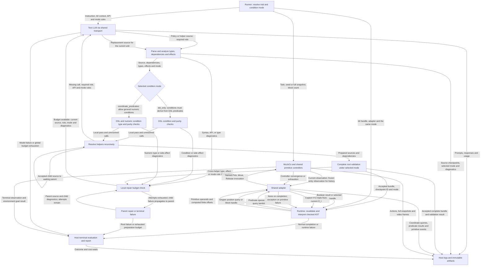

# Method 1: observations, condition modes, and program flow

This document separates the current implementation from the requested two-mode
design. The configuration contract is in
[Method1_Configuration.md](Method1_Configuration.md); the implementation plan is
[revision_1.md](revision_1.md). See [the baseline flow](BASELINE-FLOW.md) for the
current upstream Python execution path.

## Implementation status

Today, method 1 generates and repairs code, checks DSL-only conditions, and
executes an accepted bundle through its checked interpreter. It exposes
predicate truth and query-bound object handles; position getters and a selectable
condition mode are not implemented. The existing initial policy prompt matches
the baseline's for identical task/API inputs.

The flow below is the **proposed target**, not a diagram of already implemented
coordinate access. It adds shared runtime position observations and two checking
modes while preserving recursive generation and interface-only repair.

| Target mode | Runtime positions | Permitted loop/branch and selection conditions |
| --- | --- | --- |
| `dsl_only` | Readable for action-parameter computation | Existing DSL predicates, identity, logic, quantifiers, and pure compositions of them. |
| `coordinate_predicates` | Readable for action parameters and predicates | The same DSL conditions plus pure generated numeric predicates, coordinate comparisons, counter guards, and other numeric conditions. |

Both use `O_t = (p_gripper(t), p_1(t), ..., p_n(t))`, exposed through
`get_gripper_position()` and `get_block_position(handle)`. These return copied
XYZ triples in world-frame metres. Literal indices 0/1/2 select components.
Stored positions remain snapshots; callers must read again after movement.

## LLM inputs versus runtime observations

| Recipient | Information it receives in the target design |
| --- | --- |
| Policy-generation LLM request | Task instruction, symbolic `b0` context, API descriptions, selected condition mode and its rules. |
| Helper-generation LLM request | Missing call expression, required condition/body role, API description, and selected mode. |
| Repair LLM request | Current source unit, required role, API/mode rules, and static checker diagnostics. |
| Checked generated program | Existing predicate/query results and current gripper/block positions through the declared adapter API. |
| Host recorder/evaluator | Full simulator observations, snapshots, actions, coordinate reads, controller outcomes, video, and terminal task result. |

The model is not automatically sent `O_t`, a scene truth table, or execution
feedback. Each request is assembled text; helper requests do not automatically
contain the complete parent policy, and repair requests contain the current
source unit rather than every checkpoint source. The proposed change adds
mode/API instructions to all three request types, not runtime values.

A generated coordinate predicate runs locally each time it is called. Reading a
position or evaluating a predicate does not advance physics or invoke the LLM.
The standard runner still generates a fresh policy per trial and registers no
auxiliary query LMPs.

## Proposed flow with labeled data edges

The preparation steps recurse for missing helpers. A child returns checked
source to its waiting parent; only an accepted complete root bundle reaches
execution. Mode selection applies to local, complete, and runtime checks.

The repeated LLM node represents separate initial, helper, and repair requests.
Local helper checks may begin with unknown parameter types; root validation
checks actual caller types and transitive dependencies. Child local passes are
not execution authorization. Failed speculative descendants are discarded on
repair. Global budget exhaustion aborts rather than opening a new repair loop.

## Conditions and information flow

In `dsl_only`, `ready = helper(b); if ready:` must fail if any dependency of
`ready` is a coordinate comparison, even when hidden behind multiple helpers.
Coordinates may parameterize actions but cannot control branches or selections.

In `coordinate_predicates`, the same structure may pass when `helper` is a pure
Boolean computation over positions, counters, finite parameters, other local
numeric values, and permitted DSL predicates. Direct guards such as
`while attempts < 10` are also allowed. There is no requirement for a numeric
condition to depend on coordinates. Type and effect checks remain in force;
actions inside conditions are rejected, and object handles retain identity
semantics. DSL-origin tracking is specific to `dsl_only`. See the configuration
document for examples.

Both modes preserve existing predicate meanings and frozen trial-entry
`ON_star_zero` for Reverse. New coordinate predicates are not automatically
supported by symbolic verification or invariant learning.

## Execution and reporting boundaries

Both modes use the same controllers and action signatures. Move offsets remain
relative to their three reference objects; reading absolute coordinates does
not convert Move into an absolute-target API. Method 1 continues interpreting a
checked AST rather than executing arbitrary Python source.

Repairs occur before physical policy execution and receive static diagnostics.
Runtime coordinate values, primitive failures, and final task results do not feed
another model request. The host retains full logs and evaluates physical success
after normal completion; DSL postconditions remain separate diagnostics.

The current Grid/Pyramid adapter gaps and Unstack's 60-second limit are
unchanged. Interface acceptance does not establish a formal proof or physical
success. This document does not claim that the target modes have been evaluated.

## Implementation references

- [Current generator and recursion](../cap_method_1/generation.py),
  [method invocation](../cap_method_1/lmp.py), and [prompt template](../cap_method_1/prompts/policy.txt).
- [Current checker](../validation.py), [interpreter](../runtime.py), and
  [adapter](../adapter.py).
- [Configuration](../config.py), [runner](../runner.py),
  [shared contract](../contracts.py), and [model transport](../llm.py).
