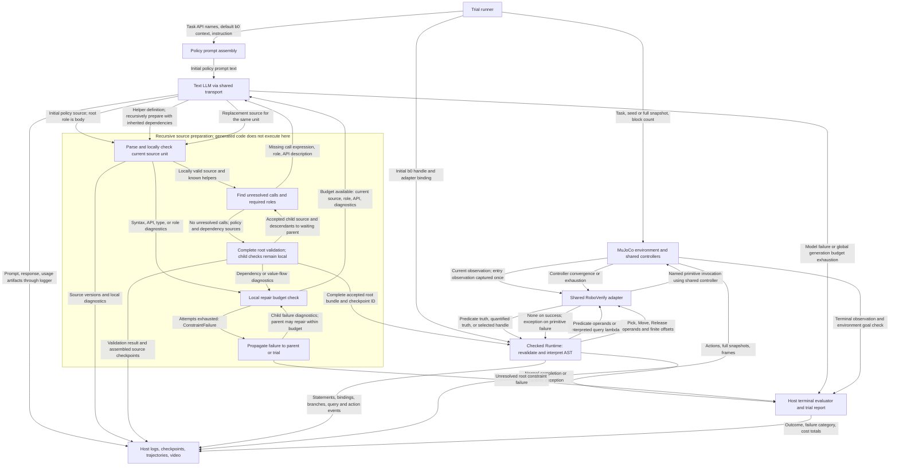

# Method 1: observations and program flow

This describes the implemented `cap_method_1` path, reviewed on 2026-10-16.
Method 1 adds deterministic DSL checking, recursive helper preparation, local
source repair, and a checked interpreter to the shared text-generation and robot
interfaces. See [the baseline](BASELINE-FLOW.md) for the upstream execution path
and [the shared DSL](DSL.md) for action and predicate semantics.

## What the LLM receives

Method 1 uses the same initial text prompt and advertised environment API as the
baseline. It supplies additional **static source diagnostics** when repairing
code, not additional observations of the robot scene.

| Model request | Text actually assembled by the implementation |
| --- | --- |
| Initial policy | Code-generation instruction, task-filtered API description, `b0 is the input block.`, and the default task instruction or caller's override. |
| Missing helper | Missing call expression, required `condition` or `body` role, helper-generation instructions, and the API description. |
| Local repair | Replacement-source instructions, required role, API description, serialized checker diagnostics, and the current source unit: either the policy or one helper. |

For Stack, the task instruction is `Stack all blocks into a single tower rooted
at the input block b0.` The same API text describes signatures, action offsets,
relational ON, default Higher tolerance, and Scattered separation. It contains
no scene-specific truth assignments.

A helper prompt does not automatically include the entire policy, its task
instruction, sibling/helper bodies, or current bindings. A repair prompt sends
the current source unit and diagnostics rather than the entire checkpoint
bundle. Serialized diagnostics contain the source unit, line, rule, and message;
checkpoint records retain additional diagnostic fields such as column. The
checker has the assembled dependencies even when the repair prompt does not.

There is no automatic block count, handle roster, XYZ state, image, full predicate
table, seed, or snapshot in a model request. Runtime settings are not generally
interpolated into the API text: for example, its Higher description gives the
default tolerance even if the configured runtime value differs. Custom
instructions/direct-call context may supply extra text explicitly.

Each request contains one assembled user text message. The transport does not
append previous model responses, runtime observations, or execution logs.
Source supplied explicitly in a repair prompt is the relevant history. The
standard runner generates a fresh policy for every trial and registers no
auxiliary query LMPs or cross-invocation method-1 session persistence.

## What the generated policy can observe

The checked interpreter starts with the `b0` object handle. It mediates all API
calls through the shared adapter rather than exposing Python environment objects.

| Policy-facing interface | Returned information |
| --- | --- |
| `ON(a,b)`, `ON_star(a,b)`, `Higher(a,b)`, `Scattered(a,b)`, `eq(a,b)` | Current-scene or identity Boolean. Object `==` / `!=` also use identity semantics. |
| `ON_star_zero(a,b)` | Frozen trial-entry relation, available only for Reverse. |
| `exists(lambda ...: condition)`, `forall(lambda ...: condition)` | Boolean over physical blocks, with one or more binders. |
| `get(lambda x: condition)` | First satisfying opaque block handle in internal physical-ID order; an error if none exists. |
| `Pick(b)`, `Move(u,v,w,[dx,dy,dz])`, `Release(b,h)` | `None` after convergence; a primitive failure terminates the rollout with an exception. |

Predicate queries obtain fresh observations without stepping physics. History
queries retain the same trial-entry snapshot throughout a Reverse policy. The
interpreter can branch and loop on returned Booleans and use selected handles
in later queries/actions. It cannot inspect raw coordinates, observation arrays,
images, handle attributes, or the adapter's ID map through the checked subset.
Finite arithmetic is available for action parameters; numerical branch tests
are rejected. Condition helpers and query lambdas must be action-free.

For example, `selected = get(lambda x: not eq(x,b0))` binds an object while the
policy runs. The interpreter receives the selected handle. The LLM receives
neither that handle value nor the truth values used to choose it. This is a
reactive generated program, without a model request on each observation or step.

## Program flow and edge data

All arrows label transferred data or outcomes. The preparation subgraph is
invoked recursively for missing helpers. A child's return feeds its waiting
parent; only a complete, accepted root bundle reaches execution.

The multiple LLM edges represent distinct policy, helper, and repair requests.
Local helper checking starts with unknown parameter types; root validation checks
actual caller types, value provenance, and dependencies. Passing a local helper
check alone does not make a bundle executable. Failed speculative descendants
are discarded before retrying a source unit. Global budget exhaustion aborts
preparation rather than opening another local repair loop.

Condition roles propagate through uses such as `ready = helper(b0); if ready:`.
A body helper can perform actions, but its guards and condition dependencies
must obey the condition rules. Runtime revalidation and explicit AST execution
preserve this boundary; generated source is not passed to Python `exec`.

All checker-driven repairs occur before physical policy execution. Repair
feedback consists of interface violations and source text. Primitive failures,
terminal-goal failures, solver counterexamples, and trajectories do not trigger a
new model request in this implementation. Ordinary helpers and predicate queries
execute without calling the LLM.

## Host-only observations and outcomes

The adapter/controller/recorder can access full observations, coordinates,
physical IDs, snapshots, controller errors, goals, rewards, and rendered frames.
These stay in host computation and artifacts rather than becoming model inputs
or extra conditions for the checked program. Logging a value is not a feedback
edge to the model.

The runner scores physical success after normal completion using the terminal
environment check. Primitive nonconvergence fails execution; Stack/Unstack DSL
postconditions are reported separately. A partially successful scene cannot turn
a failed rollout into a success. Grid/Pyramid stop with `adapter_gap` before
model calls. DSL acceptance is neither a task-correctness proof nor a physical
success result; formal verification and CEM are absent from this path.

## Implementation references

- [Shared API text and task filtering](../contracts.py).
- [Policy/helper/repair prompt construction and recursion](../cap_method_1/generation.py),
  [policy template](../cap_method_1/prompts/policy.txt),
  [helper template](../cap_method_1/prompts/helper.txt), and
  [repair template](../cap_method_1/prompts/repair.txt).
- [Method invocation](../cap_method_1/lmp.py), [static checker](../validation.py),
  and [checked interpreter](../runtime.py).
- [Shared runtime adapter](../adapter.py), [runner](../runner.py),
  [task instructions and evaluator](../tasks.py), and [model transport](../llm.py).
- [Prompt parity, helper generation, and repair tests](../test_methods.py).
