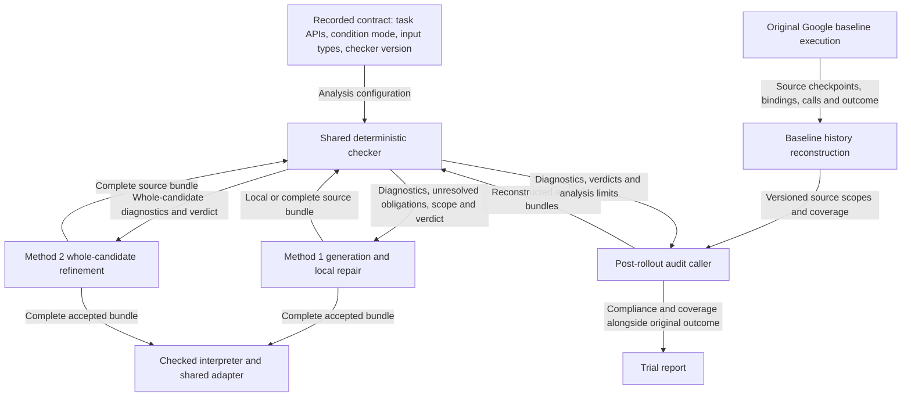

# Shared DSL checker architecture

**Status: architecture proposal.** The current reusable syntax/type/effect
engine exists in [validation.py](../validation.py) and is used by Method 1.
The unified contract-aware report interface, baseline post-rollout audit, and
Method 2 integration described here are planned, not implemented.

This document owns the shared architecture and baseline audit details for
[Revision 2 section 3](revision_2.md#3-check-baseline-dsl-compliance-after-rollout)
and [Method 2 in section 4](revision_2.md#4-method-2-whole-candidate-refinement-with-a-shared-dsl-checker).
Method-specific generation/repair plans remain in Revision 2. The shared checker
checks compliance with the declared subset and APIs, not physical success or
formal task correctness.

## 1. One core, three callers

Share one contract and deterministic analysis engine, while keeping checking
schedules, repair strategies, and execution decisions in their own method
wrappers. The baseline would use it only for the post-rollout audit in
[Revision 2 section 3](revision_2.md#3-check-baseline-dsl-compliance-after-rollout).
Sharing a library does not add a pre-execution DSL gate to Google's baseline.

| Method | When the shared checker is called | Analysis input/scope | Use of diagnostics | Execution decision |
| --- | --- | --- | --- | --- |
| Google baseline | After the rollout attempt, including failed/interrupted attempts; planned in Revision 2 section 3. | Reconstructed source/binding history, including earlier helper versions that were bound/executed; latest candidate if no executable bundle existed. | Audit/report only; no LLM feedback or rerun. | Original Google path; post-hoc results do not undo execution or overwrite its physical outcome. |
| Method 1 | During recursive generation and local repair, then complete validation before execution; implemented. | Current policy/helper plus known dependencies and unresolved obligations; finally the complete bundle. | Repair the current unit, with parent-level checking/refinement as implemented. | Only a complete accepted bundle may execute; a local pass is insufficient. |
| Method 2 | After initial whole-candidate generation and after every whole-candidate revision; planned. | Complete candidate containing policy and all helper definitions. | Revise the whole candidate using interface-only feedback. | Only a complete accepted bundle may execute. |

Share syntax restrictions, protected bindings, primitive/predicate/getter
signatures, object/position/scalar types, condition-mode rules, value-flow and
transitive effect checks, dependency obligations, and task API availability.
Keep dynamic adapter/controller checks active: static analysis does not know
whether a particular `get` has a witness or a physical Move will converge.
Numeric computation may also fail dynamically, for example on division by zero.
No model call, simulator step, repair, or execution belongs inside the checker.

`prompt_version` must not select different checker rules. Select rules using the
recorded executable contract/checker version, task API set, input bindings, and
condition mode. This preserves a fair comparison of generation/repair strategies
under the same accepted language. Changes to checker behavior require their own
version and regression evidence, separate from prompt wording changes.



The baseline audit has no edge back to baseline generation or execution.
Model calls, repairs, simulator steps, and execution decisions stay outside the
checker. Existing dynamic adapter checks remain active on all execution paths.
The diagram's Method 2 and post-rollout audit callers are planned components.

## 2. Shared contract and analysis scope

Reuse or extract the deterministic contract/type/effect checks used by Method 1
so the configured contract has one definition. The baseline audit reads saved
source/configuration; it does not invoke Method 1's generator or interpreter.

Check primitive names, arity, operand types, permitted object/position APIs,
protected API bindings, and condition purity. Analyze helper dependencies and
value flow, including assignments, arguments, and return values; inspect all
branches rather than only statements reached in the observed execution.

| Configured mode | Shared condition requirements |
| --- | --- |
| `dsl_only` | Branch, loop, and selection conditions use DSL predicates, identity, Boolean logic, quantifiers, and pure compositions of them. Coordinate reads may compute action parameters, but numeric conditions are violations even through helpers or intermediate variables. |
| `coordinate_predicates` | Conditions may additionally use pure coordinate predicates and general numeric comparisons, including counters and constants. Numbers need not originate from coordinates. Existing DSL predicates and their combinations with numeric predicates remain allowed. |

Conditions must return Boolean values and remain free of physical-action side
effects in both modes. Both retain the shared primitive interfaces: allowing
coordinate conditions does not allow passing Position3 or numbers where Move
requires ObjectHandle inputs. Apply the runtime/API contract recorded for the
trial; do not silently interpret an old artifact under a different condition
mode or a later incompatible contract.

The analysis input includes the policy, inline/generated helpers, dependency
versions, and the source checkpoints actually bound or executed. Baseline helper
binding can execute top-level statements before the nominal policy call. A
check of only the last policy.py, only the executed trace, or only the last helper
version is therefore insufficient. Reconstruct the executed bundles and assess
any earlier bound/executed versions as well. A later compliant definition must
not hide a violation in code that already ran.

If no executable bundle was reached, inspect the latest available candidate and
label the scope `candidate_only`. Unresolved dependencies in a complete candidate
are diagnostics; missing artifacts that prevent reconstruction must be reported
as an analysis limitation, never a passing result.

## 3. Checker interface and result semantics

A proposed checker boundary is:

```text
check_bundle(bundle, contract, scope="local" or "complete", role, input_types)
    -> CheckReport(status, diagnostics, unresolved, coverage, contract_identity)
```

For complete scope, `pass` requires completed analysis of the supported source
bundle with no known violations or unresolved dependencies. Local results must
be labeled `local_pass`/`pending`, never a complete-program pass. Invalid source
gets `fail`; checker failure/budget exhaustion gets `error`. The current checker
can fail at the first violation; collecting more diagnostics is optional and
must not be mistaken for changing which programs are accepted.

The baseline audit wrapper adds artifact-level outcomes such as `not_available`
or `unsupported` when source history/analysis coverage cannot be reconstructed.
A construct explicitly forbidden by the declared subset is a violation (`fail`),
not an excuse to mark the candidate compliant. Arbitrary Python outside that
subset does not gain support merely because Google's executor can run it.
A generic helper checked with unknown inputs is not proven valid for every
possible argument; preserve the distinction between local/generic checks and
checking actual call-site types. Record the analysis scope rather than claiming
formal task verification or sound analysis of unrestricted Python.

The `contract` input identifies the executable API/checker versions, task API
set, condition mode, and input bindings/types. Keep `scope` (local versus
complete) separate from `role` (body versus condition). The same complete
bundle and contract should produce the same core verdict regardless of which
method supplied them. A source/version identity and coverage record accompany
each report; a caller must not reuse a pass after changing the checked bundle.

## 4. Baseline source and binding history

The baseline reconstruction layer must also distinguish definition binding from
function invocation. During Google's recursive generation, a helper may be
bound before its child definitions exist; that transient unresolved name alone
is not proof of a violation in the eventual complete program. Check statements
that execute during binding against that moment's namespace, and check function
calls against the bindings actually available when invoked. Preserve earlier
source versions for syntax/effect assessment. If the artifacts cannot establish
which dependency version was used, report incomplete coverage instead of
inventing a complete bundle or granting a pass.

### Example: why the last helper version is insufficient

This is an illustrative binding history, not a claim that a particular saved
trial followed this exact sequence. Assume `condition_mode=dsl_only`.

| Time | Recorded event | Source or behavior | Audit implication |
| --- | --- | --- | --- |
| t1 | Bind `ready` version A | `def ready(b): return get_block_position(b)[2] > 0.1` | Its condition implementation uses a numeric comparison forbidden in this mode. |
| t2 | Invoke version A as a branch condition | `if ready(b0): ...` | The noncompliant condition was actually used; record A and its source location. |
| t3 | Rebind the name `ready` to version B | `def ready(b): return Higher(b, b)` | This later definition is compliant under the same mode. |
| t4 | Finish the attempt | A final helper dictionary contains only B. | Checking only B would miss the earlier violation. |

A later compliant definition does not erase earlier executed source. Keep both
versions and their binding/invocation events. For calls inside helpers, recover
the dependency bindings actually visible to that function, not merely the most
recent definition with the same name in a global log. Python function globals
and later namespace changes matter; a timestamp and helper name alone may be
insufficient to establish what ran. If existing artifacts do not capture enough
information, report incomplete coverage and plan additional observational logging;
do not claim reconstruction is already guaranteed by today's checkpoints.

There is a second distinction: binding a function definition normally does not
execute its body. A parent helper can temporarily refer to a not-yet-generated
child during recursive generation; that alone is not an unresolved call during
execution. In contrast, top-level statements in a helper response can run during
binding. Analyze those statements in their actual binding-time scope.

Recorded source still receives the declared static subset checks, including
unexecuted branches; execution history identifies the applicable versions and
scopes rather than restricting compliance analysis to reached statements only.
Preserve binding-time and invocation-time findings separately so the report
does not confuse a source violation with evidence that a particular operation ran.

## 5. Audit lifecycle and failure handling

Baseline policy/helper generation, binding, and execution retain the original
Google path. The audit starts after an attempt and never gates that execution,
feeds diagnostics back to the LLM, or triggers a rerun. Method 1 retains its own
pre-execution checking and repair.

Assess every scheduled outcome: normal completion, failed physical goal,
runtime exception, primitive nonconvergence, budget exhaustion, interruption,
and generation failure. Inspect available source or record why none is
available. Failed trials remain in the reporting denominator.

Prefer an artifact-based postprocessing stage owned by the parent runner or
reporting workflow. A checker called only at the bottom of a successful rollout
would miss exactly the failed trials this requirement covers. Parent-side
assessment also permits inspection after a worker deadline, crash, or interruption
when its source artifacts are available.

High-level pseudocode, not an existing repository API:

```text
for each scheduled baseline trial with a terminal or interrupted record:
    outcome = read_original_trial_outcome(trial)
    sources = reconstruct_recorded_source_bundles(trial)

    if no generated policy source is available:
        compliance = not_available(reason)
    else:
        compliance = check_recorded_bundles(
            sources,
            condition_mode = trial.config.condition_mode,
            api_contract = trial.recorded_contract,
            include_transitive_helpers = true,
            include_all_bound_or_executed_versions = true,
        )

    save_compliance_result(trial, compliance)
    report(outcome, compliance)  # No rerun or feedback to the LLM.
```

Give the audit a bounded analysis budget and record its time separately from
model generation and physical execution. It must make no model requests or
simulator steps. An audit exception or exhausted analysis budget is an explicit
analysis outcome; it must not erase the original trial outcome or be treated as
a DSL pass. Resuming the audit should reuse saved artifacts without rerunning
paid generation or physical actions.

## 6. Reporting and provenance

| Result | Meaning |
| --- | --- |
| `pass` | All required source bundles were reconstructed and checked under the recorded mode, with no contract violations. |
| `fail` | A definite violation was found, with rule IDs and source/checkpoint locations. |
| `unsupported` | Analysis cannot decide compliance for some construct or incomplete scope; this is not a pass. Syntax explicitly forbidden by the contract is a failure, not merely unsupported. |
| `not_available` | No generated policy source is available to inspect. Preserve the reason, such as a failed model request. |
| `error` | The audit itself failed or exceeded its analysis budget. |

Record analysis coverage and missing artifacts alongside the result. A definite
violation may establish `fail` even if other source could not be analyzed, but
`pass` requires complete coverage of the declared scope. Preserve all diagnostics
and distinguish an executed-bundle audit from candidate-only assessment.

Each trial report should retain the original execution/physical-success result
and add DSL compliance, configured condition mode, analyzed checkpoint IDs,
checker/contract version, diagnostics, and audit duration. Keep the existing
`# of tokens used` column: this audit uses no additional LLM tokens.

A physically successful baseline can have `dsl_compliance=fail`; a physically
failed baseline can have `dsl_compliance=pass`. Report these separately. Do not
silently overwrite the existing physical-success verdict or remove noncompliant
trials from the scheduled denominator. If a later paper also reports success
conditioned on DSL compliance, define that additional metric explicitly and
retain the original physical outcome and unknown-analysis cases.

Replace the ambiguous single validation flag in future reporting with distinct
execution-gate and post-hoc fields: baseline pre-execution DSL validation and
refinement remain disabled, while its post-hoc compliance assessment is enabled.
Old checkpoints marked `validation=not_run` remain truthful about their original
execution; attach new audit artifacts rather than rewriting immutable history.

## 7. Existing code and implementation boundaries

[validation.py](../validation.py) is already independent of Method 1's model
client, logger, and interpreter, making it the natural shared core. It currently
returns unresolved calls for partial validation or raises `ConstraintFailure`;
it is not yet the structured multi-method audit interface described here.

| Existing component | Reuse or required change |
| --- | --- |
| `parse`, `definitions`, `Checker`, `validate` in validation.py | Reuse syntax, type/value-flow, dependency, and effect analysis. Method 2 can use complete validation without a second rules implementation. Preserve current diagnostic rule IDs where semantics stay the same. |
| `validate_helper`, partial validation, and `missing_calls` | Retain Method 1's local-generation support. Unknown local parameter types and unresolved helpers are obligations, not an executable whole-program pass. Method 2 need not invoke recursive discovery to use the complete checker. |
| Task API checks in `cap_method_1/generation.py` | Move/expose the `API_UNAVAILABLE` check in the shared entry point, parameterized by the task's allowed API names. Currently `validate` itself has no `api_names` parameter, so calling it alone does not reproduce every generator-level check. |
| `Bundle`, `Diagnostic`, and version identifiers in contracts.py | Reuse source/type/diagnostic data. Add an analysis-result wrapper and contract identity if needed; preserve source unit and line/column locations, with checkpoint/binding locations attached by wrappers. |
| `Runtime.execute` in runtime.py | Reuse for Methods 1 and 2; keep its complete pre-execution validation and runtime checks. It is not a baseline audit mechanism and must not replace Google's execution path. |
| Baseline recorded sources and checkpoints | Build a separate artifact reader that reconstructs binding versions and source coverage. Do not flatten all historical helpers into one last-definition dictionary or combine mutually exclusive versions into a fake program. |
| Prompt packages and logging | Reuse configuration, request/source provenance, and immutable checkpoints. Method-specific feedback formatting may differ, but the underlying compliance rules must remain identical. |

Start by exposing task API availability through the shared checker entry point,
then migrate Method 1 without changing its accepted language. Implement the
baseline artifact/history reader as a separate layer. Method 2 then reuses
complete validation and the checked runtime, with its whole-candidate repair
loop remaining in its own generator. Retain current fail-fast diagnostics;
aggregating additional errors is an optional follow-up.

The reconstruction input must identify source units, immutable source hashes,
checkpoint IDs, bindings and dependencies, and whether code was merely generated,
bound, or invoked. Existing source/request provenance is reusable, but does not
by itself establish full namespace-history coverage. Audit artifacts must retain
this coverage assessment alongside checker/contract versions and diagnostics.

## 8. Validation requirements

- A baseline numeric branch in `dsl_only` still executes on the original path,
  then receives a post-hoc failure; the same contract-valid numeric branch passes
  in `coordinate_predicates`.
- Coordinate reads used only for action parameters pass in both modes. Mixed
  DSL/numeric predicates, counters, and nested pure helpers pass in extended mode.
- API arity/type violations and actions hidden inside condition helpers are
  detected, including violations in an unexecuted branch or earlier bound helper.
- Physically successful, goal-failed, primitive-failed, exception, timeout, and
  interrupted trials all receive audit records. Malformed/partial generated
  source and absent source are handled explicitly.
- Auditing changes neither the original action sequence nor the model-call count,
  does not invoke baseline repair, and does not overwrite existing artifacts.
- Identical complete bundles and contracts yield the same core verdict through
  all three callers; prompt versions do not alter the accepted language.
- Local checks with unknown inputs or missing dependencies cannot authorize
  execution. An unavailable task API is rejected by every complete-check caller.
- A noncompliant helper version followed by a compliant replacement retains the
  earlier finding; a transient unbound child during definition-only binding is
  distinguished from an unresolved invocation.
- Missing namespace/dependency history produces an explicit coverage limitation,
  never a pass or an invented reconstructed program.
- Checker exceptions and analysis-budget exhaustion are separate from source
  violations; retrying an audit reuses artifacts without model calls or motion.
- Accepted scripted bundles produce identical primitive actions through Methods
  1 and 2; baseline audit enablement changes neither its actions nor model calls.

## References

- [Revision 2](revision_2.md): implementation status and method-specific plans.
- [Current validation engine](../validation.py).
- [Method 1 generation and task API checks](../cap_method_1/generation.py).
- [Checked runtime](../runtime.py) and [trusted adapter](../adapter.py).
- [Source checkpoints](../checkpoints.py) and [baseline instrumentation](../cap_google_baseline/compatibility.py).
