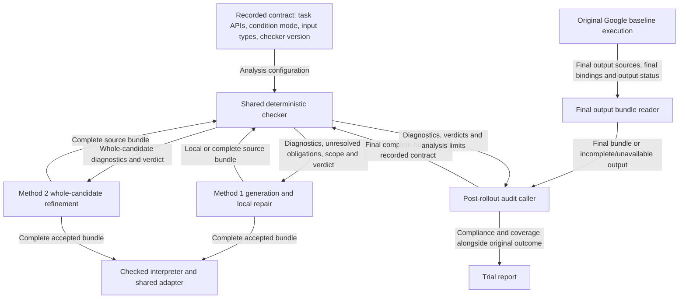

# Shared DSL checker architecture

**Status: architecture proposal.** The current reusable syntax/type/effect
engine exists in [validation.py](../validation.py) and is used by Method 1.
The unified contract-aware report interface, baseline post-rollout audit, and
Method 2 integration described here are planned, not implemented.

This document owns the shared architecture and baseline audit details for
[Revision 2 section 3](revision_2.md#3-check-baseline-dsl-compliance-after-rollout)
and [Method 2 in section 4](revision_2.md#4-method-2-whole-candidate-refinement-with-a-shared-dsl-checker).
Method-specific generation/repair plans remain in Revision 2. The shared checker
checks compliance with the declared subset and APIs, not physical success or
formal task correctness.

## 1. One core, three callers

Share one contract and deterministic analysis engine, while keeping checking
schedules, repair strategies, and execution decisions in their own method
wrappers. The baseline would use it only for the post-rollout audit in
[Revision 2 section 3](revision_2.md#3-check-baseline-dsl-compliance-after-rollout).
Sharing a library does not add a pre-execution DSL gate to Google's baseline.

| Method | When the shared checker is called | Analysis input/scope | Use of diagnostics | Execution decision |
| --- | --- | --- | --- | --- |
| Google baseline | After the rollout attempt, including failed/interrupted attempts; planned in Revision 2 section 3. | The final output program: policy source, complete helper sources, and their final binding relationships. Incomplete generation is reported separately. | Audit/report only; no LLM feedback or rerun. | Original Google path; post-hoc results do not undo execution or overwrite its physical outcome. |
| Method 1 | During recursive generation and local repair, then complete validation before execution; implemented. | Current policy/helper plus known dependencies and unresolved obligations; finally the complete bundle. | Repair the current unit, with parent-level checking/refinement as implemented. | Only a complete accepted bundle may execute; a local pass is insufficient. |
| Method 2 | After initial whole-candidate generation and after every whole-candidate revision; planned. | Complete candidate containing policy and all helper definitions. | Revise the whole candidate using interface-only feedback. | Only a complete accepted bundle may execute. |

Share syntax restrictions, protected bindings, primitive/predicate/getter
signatures, object/position/scalar types, condition-mode rules, value-flow and
transitive effect checks, dependency obligations, and task API availability.
Keep dynamic adapter/controller checks active: static analysis does not know
whether a particular `get` has a witness or a physical Move will converge.
Numeric computation may also fail dynamically, for example on division by zero.
No model call, simulator step, repair, or execution belongs inside the checker.

`prompt_version` must not select different checker rules. Select rules using the
recorded executable contract/checker version, task API set, input bindings, and
condition mode. This preserves a fair comparison of generation/repair strategies
under the same accepted language. Changes to checker behavior require their own
version and regression evidence, separate from prompt wording changes.



The baseline audit has no edge back to baseline generation or execution.
Model calls, repairs, simulator steps, and execution decisions stay outside the
checker. Existing dynamic adapter checks remain active on all execution paths.
The diagram's Method 2 and post-rollout audit callers are planned components.

## 2. Shared contract and analysis scope

Reuse or extract the deterministic contract/type/effect checks used by Method 1
so the configured contract has one definition. The baseline audit reads saved
source/configuration; it does not invoke Method 1's generator or interpreter.

Check primitive names, arity, operand types, permitted object/position APIs,
protected API bindings, and condition purity. Analyze helper dependencies and
value flow, including assignments, arguments, and return values; inspect all
branches rather than only statements reached in the observed execution.

| Configured mode | Shared condition requirements |
| --- | --- |
| `dsl_only` | Branch, loop, and selection conditions use DSL predicates, identity, Boolean logic, quantifiers, and pure compositions of them. Coordinate reads may compute action parameters, but numeric conditions are violations even through helpers or intermediate variables. |
| `coordinate_predicates` | Conditions may additionally use pure coordinate predicates and general numeric comparisons, including counters and constants. Numbers need not originate from coordinates. Existing DSL predicates and their combinations with numeric predicates remain allowed. |

Conditions must return Boolean values and remain free of physical-action side
effects in both modes. Both retain the shared primitive interfaces: allowing
coordinate conditions does not allow passing Position3 or numbers where Move
requires ObjectHandle inputs. Apply the runtime/API contract recorded for the
trial; do not silently interpret an old artifact under a different condition
mode or a later incompatible contract.

The baseline analysis input is the final output program, including the policy,
inline/generated helper sources, and the final binding relationships needed to
interpret that output. Check all code in this bundle, including unexecuted
branches and unused definitions. Previously superseded source artifacts are
outside this metric unless their definitions remain part of the final bundle.

The question is whether the framework's final output complies with the DSL,
not whether every operation during generation/execution complied. A complete
final output can be assessed even if its rollout failed. If generation stopped
before a final program was formed, report incomplete output; do not silently
substitute an earlier complete or partial candidate and call it the final output.

## 3. Checker interface and result semantics

A proposed checker boundary is:

```python
report = check_bundle(bundle, contract, scope, role, input_types)
# Report fields: status, diagnostics, unresolved, coverage, contract_identity.
```

For complete scope, `pass` requires completed analysis of the supported source
bundle with no known violations or unresolved dependencies. Local results must
be labeled `local_pass`/`pending`, never a complete-program pass. Invalid source
gets `fail`; checker failure/budget exhaustion gets `error`. The current checker
can fail at the first violation; collecting more diagnostics is optional and
must not be mistaken for changing which programs are accepted.

The baseline audit wrapper adds `incomplete` for an unfinished/missing final
bundle, `not_available` when no policy source exists, and `unsupported` when the
available final representation cannot be analyzed completely.
A construct explicitly forbidden by the declared subset is a violation (`fail`),
not an excuse to mark the candidate compliant. Arbitrary Python outside that
subset does not gain support merely because Google's executor can run it.
A generic helper checked with unknown inputs is not proven valid for every
possible argument; preserve the distinction between local/generic checks and
checking actual call-site types. Record the analysis scope rather than claiming
formal task verification or sound analysis of unrestricted Python.

The `contract` input identifies the executable API/checker versions, task API
set, condition mode, and input bindings/types. Keep `scope` (local versus
complete) separate from `role` (body versus condition). The same complete
bundle and contract should produce the same core verdict regardless of which
method supplied them. A source/version identity and coverage record accompany
each report; a caller must not reuse a pass after changing the checked bundle.

### 3.1 Current DSL checker: high-level abstraction

The code blocks below use Python-style pseudocode for readability. Named
operations represent high-level responsibilities, not callable repository APIs
or a complete implementation. Error handling and reports are schematic; AST
traversal and type-propagation details are intentionally omitted.

**Status: implemented.** The abstraction below describes
[validation.py](../validation.py), its use by the
[Method-1 generator](../cap_method_1/generation.py), and the
[checked runtime](../runtime.py). It omits AST traversal, type-environment
merging, and individual syntax rules. Names below denote conceptual operations,
not callable repository functions.

A **bundle** contains policy source and helper definitions. **Scope** determines
whether unresolved dependencies may remain during generation; **role** determines
whether the checked code is a body or a pure condition. The **condition mode**
selects DSL-only conditions or DSL plus general numeric conditions.

```python
def current_check(bundle, condition_mode, scope, role, input_types):
    # Each checking operation raises ConstraintFailure on a rule violation.
    check_mode_consistency(bundle, condition_mode)
    check_syntax_and_definitions(bundle)
    unresolved = analyze_types_conditions_and_effects(
        bundle, condition_mode, scope, role, input_types
    )
    unresolved |= check_uncalled_definitions(bundle, condition_mode)

    if scope == "complete" and unresolved:
        raise ConstraintFailure(unresolved)
    return unresolved
```

This abstracts the policy-bundle `validate` path. Local `validate_helper` reuses
the analysis for one helper with unknown parameter types and returns normally
on a local pass; it does not return a structured whole-program report.
Generic checks are not a proof that a helper accepts every possible input.
An empty unresolved list from a local check does not authorize execution.

The current caller performs some checks outside that core:

```python
def method_1_preparation(unit, task, condition_mode, input_types):
    check_task_apis(unit, task)  # Currently outside the core checker.
    bundle = recursively_generate_check_and_repair(unit, task, condition_mode)
    current_check(bundle, condition_mode, "complete", "body", input_types)
    return bundle


def method_1_execution(bundle, condition_mode, input_types):
    current_check(bundle, condition_mode, "complete", "body", input_types)
    return checked_execute(bundle)


def google_baseline(instruction):
    return original_generate_bind_execute(instruction)  # No static DSL gate.
```

The task API check is currently in the generator, not a parameter of `validate`.
Baseline adapter/runtime argument checks remain active despite the absence of
this static checker. Method 2 and the baseline post-rollout checker are not yet
implemented. The current checker already supports both condition modes and
checks dependencies beyond the lines reached by a particular rollout.

### 3.2 Planned revised checker: high-level abstraction

**Status: planned, not implemented.** `[KEEP]` retains existing checking rules;
`[MOVE]` relocates a check into the common entry point; `[NEW]` introduces a
shared interface or caller. These labels describe architectural changes, not
new permitted robot actions or a broader Python language. The surrounding
sections specify the shared architecture and result semantics.

The revised **contract** explicitly identifies the task API set, condition mode,
input types, and executable API/checker versions. Prompt wording/version does
not select different checking rules. Every report identifies the checked bundle,
contract, scope, diagnostics, unresolved obligations, and analysis coverage.

```python
def shared_check(bundle, contract, scope, role, analysis_budget):
    report = report_factory(bundle, contract, scope)  # [NEW] Source/contract identity.
    try:
        with bounded_analysis(analysis_budget):  # [NEW] Bounded analysis.
            check_mode_syntax_and_definitions(bundle, contract)  # [KEEP]
            check_task_apis(bundle, contract)  # [MOVE] Into the shared core.
            unresolved = analyze_types_conditions_and_effects(
                bundle, contract, scope, role
            )  # [KEEP]
            unresolved |= check_uncalled_definitions(bundle, contract)  # [KEEP]

            if scope == "complete" and unresolved:
                # [KEEP] Rejection rule; [NEW] Structured result.
                return report("fail", unresolved=unresolved)
            if scope == "local":
                status = "pending" if unresolved else "local_pass"
                return report(status, unresolved=unresolved)  # [NEW]
            return report("pass")  # [NEW]
    except ConstraintFailure as error:
        return report("fail", diagnostics=error.diagnostics)  # [NEW]
    except AnalysisFailure as error:  # Abstracts checker errors and timeouts.
        return report("error", reason=error)  # [NEW]
```

Only a complete `PASS` can authorize constrained execution. Local checks retain
unknown/generic types until caller-level analysis can resolve them. The existing
fail-fast behavior may remain; collecting every possible diagnostic is not a
requirement of the shared architecture. Finite-value checks during execution,
query witness availability, and controller convergence remain runtime concerns.

The methods select when to call this one core and how to use its result:

```python
def method_1(instruction, contract, budget):
    # [KEEP] Recursive/local repair; [NEW] Common report interface.
    bundle = recursively_generate_and_repair(instruction, contract, budget)
    result = shared_check(bundle, contract, "complete", "body", budget)
    return execute_only_on_complete_pass(bundle, result)


def method_2(instruction, contract, budget):  # [NEW] Whole-candidate repair.
    bundle = generate_complete_candidate(instruction, contract)
    while budget.allows_check():
        result = shared_check(bundle, contract, "complete", "body", budget)
        if result.status == "pass":
            return checked_execute(bundle)
        if result.status == "error" or not budget.allows_revision():
            return record_failure(result)
        bundle = revise_whole_candidate(bundle, result, contract, budget)
    return record_budget_exhaustion()


def baseline_after_attempt(trial):  # [NEW] Post-hoc caller only.
    output = read_final_output(trial)
    if not output.has_policy_source:
        result = report("not_available")
    elif not output.finalized or output.required_artifacts_missing:
        result = report("incomplete")
    else:
        result = shared_check(
            output.bundle, trial.contract, "complete", "body", trial.audit_budget
        )
    return report_separately(trial.original_physical_outcome, result)
```

Baseline's input is the final policy, complete helper sources, and their final
binding relationships. The reader must not execute or repair source, replace
an unfinished output with an earlier candidate, or merge superseded versions
into the final program. Superseded source outside that bundle does not affect
this verdict. Complete output is checked even when its rollout failed; missing
or unfinished output cannot pass. Historical execution auditing is optional.
Baseline receives no pre-execution gate, LLM feedback, or automatic rerun.

### 3.3 Summary of changes

| Area | Current implementation | Planned revision | Change |
| --- | --- | --- | --- |
| DSL syntax, types, condition purity, and dependency rules | Implemented in the reusable validation engine; both condition modes supported. | Reuse the same accepted language and rules across methods. | KEEP |
| Task API availability | Checked by Method 1's generator; the core `validate` entry has no task API parameter. | Include the allowed task API set in the shared contract and check it in the core. | MOVE |
| Interface and result | Mode/scope/role/input arguments; unresolved calls or exceptions, with source diagnostics. | Explicit contract and structured reports, including scope/coverage, contract/source identity, and analysis-error classification. | NEW interface; existing analysis reused |
| Method 1 | Recursive helper generation/local repair plus complete checks before execution. | Use the common report interface while preserving the generation/repair strategy. | ADAPT caller |
| Method 2 | Not implemented. | Complete-candidate checks followed by whole-candidate revision. | NEW caller |
| Baseline | No static DSL check; original Google execution and dynamic adapter checks. | Add only post-attempt checking of the final output, with incomplete/unavailable output states. | NEW caller; execution unchanged |
| Proof and runtime scope | Static compliance does not prove physical success, termination, or convergence. | Retain that boundary; do not add formal-verification or rollout feedback to repairs. | KEEP |

These are documentation abstractions of current behavior and the agreed plan;
this section does not implement the revised checker.

## 4. Baseline final output bundle

The agreed scope is **final-output DSL compliance**. Select the final program
produced by the framework, not merely the last file written and not the union
of every historical checkpoint. The output includes:

- The final policy source, including inline definitions and executable entry.
- The complete helper sources associated with that output and the final
  name/dependency bindings required to interpret them.
- Source hashes, output checkpoint/manifest identity, task/condition mode, and
  checker/API contract versions used for the assessment.

Do not merge mutually exclusive helper versions or discard code from the final
output to make it pass. A helper source containing extra top-level statements
must retain those statements for source compliance checking. Final bindings may
need to preserve a dependency still referenced by a final helper; “final” is a
coherent program representation, not a blind last-file-per-name concatenation.
This requires a final-output manifest/reader, not a full chronological execution
history or replay system. Reading/exporting it must not execute generated code.

The baseline has no DSL-guided whole-policy repair loop. Its final program is
normally the policy together with the helper definitions completed by recursive
generation. Preserve that generation/binding behavior; any added output manifest
is observational. Identify output completeness explicitly, including when a
trial fails before helper generation finishes. The latest checkpoint alone is
not proof that a final complete output exists.

### Example: final-output compliance versus execution-history compliance

Suppose `ready` version A uses a coordinate comparison in `dsl_only`, is called,
and is later replaced by version B using `Higher`. This is an illustrative
scenario, not a claim about a particular saved trial.

| Question | Assessment |
| --- | --- |
| Does the final output comply with the DSL? | Check the final policy and helper bundle. If B is the final definition, A has no remaining reference in that bundle, and all final code complies, this metric can pass. |
| Did the trial ever use noncompliant code? | An optional history audit would retain the earlier call to A and report that violation separately. |

The first question defines the required baseline metric. Historical findings
must not override it or be silently merged into `dsl_compliance`. Preserve
existing execution logs for diagnosis, but full source/binding history
reconstruction is optional and outside this implementation requirement. A final
output pass does not certify that every earlier action was compliant or that the
saved physical result came from replaying only the final program.

## 5. Audit lifecycle and failure handling

Baseline policy/helper generation, binding, and execution retain the original
Google path. The audit starts after an attempt and never gates that execution,
feeds diagnostics back to the LLM, or triggers a rerun. Method 1 retains its own
pre-execution checking and repair.

Assess every scheduled outcome: normal completion, failed physical goal,
runtime exception, primitive nonconvergence, budget exhaustion, interruption,
and generation failure. Determine whether a final complete output is available,
incomplete, or absent.
A physical failure alone does not make an already formed program incomplete.
Failed trials remain in the reporting denominator.

Prefer an artifact-based postprocessing stage owned by the parent runner or
reporting workflow. A checker called only at the bottom of a successful rollout
would miss exactly the failed trials this requirement covers. Parent-side
assessment also permits inspection after a worker deadline, crash, or interruption
when its source artifacts are available.

High-level pseudocode, not an existing repository API:

```python
for trial in scheduled_terminal_or_interrupted_trials:
    outcome = read_original_outcome(trial)
    output = read_final_output_manifest(trial)

    if not output.has_policy_source:
        result = report("not_available", reason=output.reason)
    elif not output.finalized or output.required_sources_missing:
        result = report("incomplete", reason=output.reason)
    else:
        result = shared_check(
            output.bundle, trial.contract, "complete", "body", trial.audit_budget
        )

    save_compliance(trial, result, scope="final_output")
    report_trial(outcome, result)  # No rerun or LLM feedback.
```

Give the audit a bounded analysis budget and record its time separately from
model generation and physical execution. It must make no model requests or
simulator steps. An audit exception or exhausted analysis budget is an explicit
analysis outcome; it must not erase the original trial outcome or be treated as
a DSL pass. Resuming the audit should reuse saved artifacts without rerunning
paid generation or physical actions.

## 6. Reporting and provenance

| Result | Meaning |
| --- | --- |
| `pass` | The complete final output bundle was checked under the recorded contract, with no violations or unresolved obligations. |
| `fail` | A definite violation was found in the final output, with rule IDs and source/checkpoint locations. |
| `incomplete` | Generation did not form a final complete output, or required final-output artifacts are missing; record the reason. This is not a pass. |
| `unsupported` | Analysis cannot decide compliance for some construct or incomplete scope; this is not a pass. Syntax explicitly forbidden by the contract is a failure, not merely unsupported. |
| `not_available` | No generated policy source is available to inspect. Preserve the reason, such as a failed model request. |
| `error` | The audit itself failed or exceeded its analysis budget. |

Record `compliance_scope=final_output`, output completeness, analysis coverage,
and missing artifacts. A finalized bundle containing a known violation can fail
even if other analysis is inconclusive, but pass requires complete coverage.
A partial candidate may retain optional diagnostics labeled `partial_candidate`;
those do not turn an incomplete final output into a pass or replace its status.
Unresolved calls in a candidate designated as the final output are checker
violations; unfinished helper generation is an incomplete-output outcome.

Each trial report should retain the original execution/physical-success result
and add final-output DSL compliance, output completeness, configured condition
mode, final bundle/checkpoint IDs and source hashes, checker/contract version,
diagnostics, and audit duration. Keep the existing
`# of tokens used` column: this audit uses no additional LLM tokens.

A physically successful baseline can have `dsl_compliance=fail`; a physically
failed baseline can have `dsl_compliance=pass`. Report these separately. Do not
silently overwrite the existing physical-success verdict or remove noncompliant
trials from the scheduled denominator. If a later paper also reports success
conditioned on DSL compliance, define that additional metric explicitly and
retain the original physical outcome and unknown-analysis cases.

Replace the ambiguous single validation flag in future reporting with distinct
execution-gate and post-hoc fields: baseline pre-execution DSL validation and
refinement remain disabled, while its post-hoc compliance assessment is enabled.
Old checkpoints marked `validation=not_run` remain truthful about their original
execution; attach new audit artifacts rather than rewriting immutable history.

## 7. Existing code and implementation boundaries

[validation.py](../validation.py) is already independent of Method 1's model
client, logger, and interpreter, making it the natural shared core. It currently
returns unresolved calls for partial validation or raises `ConstraintFailure`;
it is not yet the structured multi-method audit interface described here.

| Existing component | Reuse or required change |
| --- | --- |
| `parse`, `definitions`, `Checker`, `validate` in validation.py | Reuse syntax, type/value-flow, dependency, and effect analysis. Method 2 can use complete validation without a second rules implementation. Preserve current diagnostic rule IDs where semantics stay the same. |
| `validate_helper`, partial validation, and `missing_calls` | Retain Method 1's local-generation support. Unknown local parameter types and unresolved helpers are obligations, not an executable whole-program pass. Method 2 need not invoke recursive discovery to use the complete checker. |
| Task API checks in `cap_method_1/generation.py` | Move/expose the `API_UNAVAILABLE` check in the shared entry point, parameterized by the task's allowed API names. Currently `validate` itself has no `api_names` parameter, so calling it alone does not reproduce every generator-level check. |
| `Bundle`, `Diagnostic`, and version identifiers in contracts.py | Reuse source/type/diagnostic data. Add an analysis-result wrapper and contract identity if needed; preserve source unit and line/column locations, with checkpoint/binding locations attached by wrappers. |
| `Runtime.execute` in runtime.py | Reuse for Methods 1 and 2; keep its complete pre-execution validation and runtime checks. It is not a baseline audit mechanism and must not replace Google's execution path. |
| Baseline recorded sources and checkpoints | Read/export an explicit final-output bundle and its binding relationships. Record incomplete generation or missing final artifacts; do not reconstruct the complete execution history. |
| Prompt packages and logging | Reuse configuration, request/source provenance, and immutable checkpoints. Method-specific feedback formatting may differ, but the underlying compliance rules must remain identical. |

Start by exposing task API availability through the shared checker entry point,
then migrate Method 1 without changing its accepted language. Implement the
baseline final-output artifact reader as a separate layer. Method 2 then reuses
complete validation and the checked runtime, with its whole-candidate repair
loop remaining in its own generator. Retain current fail-fast diagnostics;
aggregating additional errors is an optional follow-up.

The final-output reader identifies source units, hashes, final binding/dependency
relationships, and output checkpoint/completeness. Existing source/request
provenance is reusable; add an explicit final-output manifest if current
checkpoints do not unambiguously identify it. The reader may not repair, rerun,
or alter the generated program. No namespace event-history reconstruction is
required for this metric.

## 8. Validation requirements

- A numeric branch in the final baseline output is assessed after the attempt:
  it fails in `dsl_only` and passes in `coordinate_predicates` when otherwise
  contract-valid. The audit does not change whether the original path executes it.
- Coordinate reads used only for action parameters pass in both modes. Mixed
  DSL/numeric predicates, counters, and nested pure helpers pass in extended mode.
- API arity/type violations and actions hidden inside condition helpers are
  detected, including violations in unexecuted branches or helpers retained in
  the final output.
- Physically successful, goal-failed, primitive-failed, exception, timeout, and
  interrupted trials all receive audit records. Malformed/partial generated
  source and absent source are handled explicitly.
- Auditing changes neither the original action sequence nor the model-call count,
  does not invoke baseline repair, and does not overwrite existing artifacts.
- Identical complete bundles and contracts yield the same core verdict through
  all three callers; prompt versions do not alter the accepted language.
- Local checks with unknown inputs or missing dependencies cannot authorize
  execution. An unavailable task API is rejected by every complete-check caller.
- A superseded noncompliant helper absent from the final bundle does not fail
  final-output compliance; a noncompliant definition retained in that bundle does.
- Completed final output is checked even after primitive failure or rollout
  timeout. Interrupted helper generation yields `incomplete`; absent policy
  source yields `not_available`. Neither can be reported as a pass.
- Missing required final sources/bindings never produce a fabricated bundle or
  a pass. Missing historical execution events alone do not block final checking.
- Checker exceptions and analysis-budget exhaustion are separate from source
  violations; retrying an audit reuses artifacts without model calls or motion.
- Accepted scripted bundles produce identical primitive actions through Methods
  1 and 2; baseline audit enablement changes neither its actions nor model calls.

## References

- [Revision 2](revision_2.md): implementation status and method-specific plans.
- [Current validation engine](../validation.py).
- [Method 1 generation and task API checks](../cap_method_1/generation.py).
- [Checked runtime](../runtime.py) and [trusted adapter](../adapter.py).
- [Source checkpoints](../checkpoints.py) and [baseline instrumentation](../cap_google_baseline/compatibility.py).
