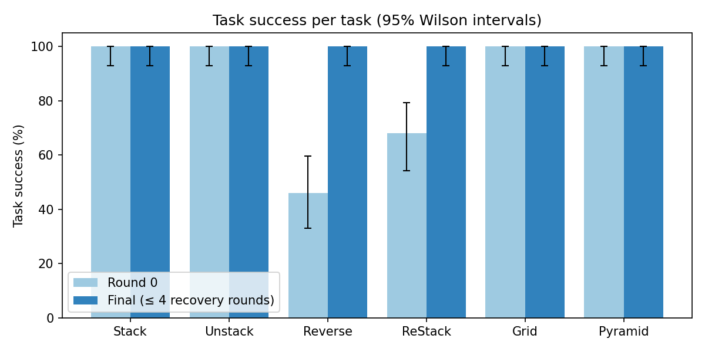
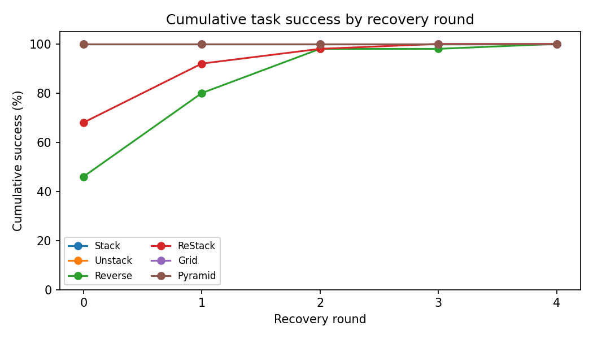
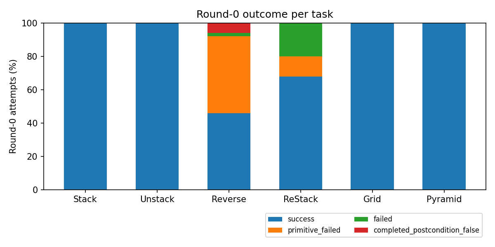
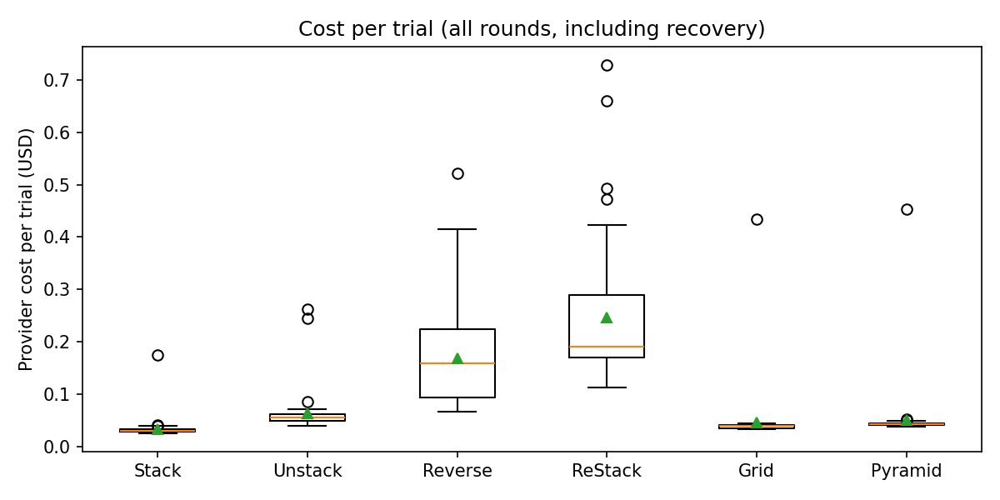
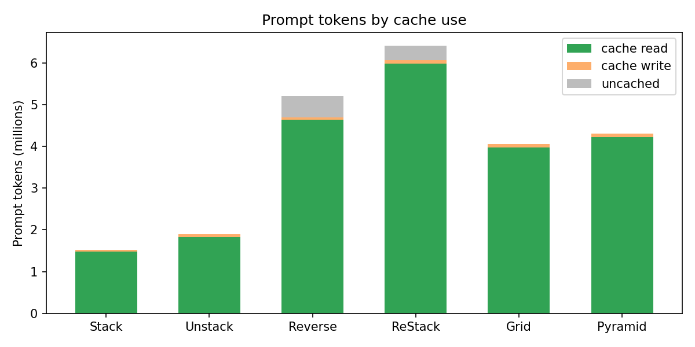

# Final CaP results: `final_v1` prompts, Claude Opus 5.5, 50 trials per task

- **Date:** 2026-10-27.
- **Runs:** `runs/cap-final-v2/20261027-final-50/` (seeds 0–49) and `runs/cap-final-v2/20261027-final-50-supplement/` (seed 50 for Unstack and Reverse, Section 6.3).
- **Configuration:** [`config_final_v2`](../configs/config_final_v2.py). It sends the [`config_final_v1`](../configs/config_final_v1.py) prompts byte for byte, with provider prompt caching ([Revision 7.5](revision_7_5_prompt_cache.md)).
- **Tables, data and figures:** `python -m synthesis.cap.reports.final_report` (Section 8).

## 1. Summary

- **Final success:** every one of the 300 valid trials succeeded under the frozen criterion `task-spec-v2+final-release-v1`, within at most four recovery rounds. That is 50/50 per task, with a 95% Wilson interval of [93%, 100%] for each task.
- **Round 0:** Stack, Unstack, Grid and Pyramid succeeded in all 50 trials on the first program. Reverse succeeded in 23/50 (46%) and ReStack in 34/50 (68%). Recovery solved every remaining trial: Reverse needed at most 4 rounds and ReStack at most 3.
- **Round-0 failures:**
  - Reverse: mostly `Move` non-convergence (23 of 27).
  - ReStack: mostly a `get` with no matching block (10 of 16).
- **Release check:** no attempt ended with status `unreleased_block`. Every attempt that ended holding a block had already stopped on an exception.
- **Cost:** the 300 scored trials cost $30.66; 95% of prompt tokens were read from the provider cache. The whole final run, including requeued trials and the one-time demonstration counts, cost $33.18. All work on this key, including the smokes, totals $42.18 of $100.
- **Infrastructure incident:** at 30 concurrent workers, OpenRouter's admission control returned HTTP 429s.
  - I stopped the run and requeued 39 affected trials with their original seeds; no model output was discarded for being unfavourable.
  - I added a longer 429 backoff and resumed at at most 14 workers. No later trial failed on a 429.

## 2. Configuration

| Setting | Value |
| --- | --- |
| Model | Claude Opus 5.5 (`anthropic/claude-opus-5.5`) on OpenRouter, reasoning effort medium, 64k output tokens; routing Anthropic, then Claude Platform on AWS; every call was served by Anthropic |
| Method | `cap_method_2`, `dsl_only`, `typed_v5`, primitive prompt `primitive-prompt-v2` (`p0101`) |
| Instructions | `task-instructions-v3`: general task specification without counts, plus the release sentence (Revision 7.4) |
| Demonstrations | On; 15 per task (seeds 1000–1014), compacted, prepended to every request |
| Recovery | On, up to 4 rounds, feedback profile `full`, RDP keyframes; success field `task_spec_success` |
| Success criterion | `task-spec-v2+final-release-v1`: shared pre/postcondition after 50 unrecorded settling steps; a rollout that ends with a block touching the gripper fails |
| Blocks | Stack, Unstack, Reverse 4; ReStack 5 (3-block source tower); Grid 2 × 3; Pyramid 3-2-1 |
| Scenes | Fresh resets with seeds 0–49, settled for 50 steps; seed 39 of Unstack and Reverse replaced by seed 50 (Section 6.3) |
| Prompt caching | `prompt_cache: "5m"`; demonstration tokens measured once per batch; first-response warm-up |

Prompt caching does not change what the model reads. The text of every request equals the `final_v1` text (Revision 7.5, Section 10).

## 3. Task success



| Task | Blocks | Trials | Excluded | Round-0 success | 95% CI (%) | Final success | 95% CI (%) | Mean recovery rounds |
| --- | ---: | ---: | ---: | ---: | --- | ---: | --- | ---: |
| Stack | 4 | 50 | 0 | 50/50 (100%) | [93, 100] | 50/50 (100%) | [93, 100] | 0.00 |
| Unstack | 4 | 50 | 1 | 50/50 (100%) | [93, 100] | 50/50 (100%) | [93, 100] | 0.00 |
| Reverse | 4 | 50 | 1 | 23/50 (46%) | [33, 60] | 50/50 (100%) | [93, 100] | 0.78 |
| ReStack | 5 | 50 | 0 | 34/50 (68%) | [54, 79] | 50/50 (100%) | [93, 100] | 0.42 |
| Grid | 6 | 50 | 0 | 50/50 (100%) | [93, 100] | 50/50 (100%) | [93, 100] | 0.00 |
| Pyramid | 6 | 50 | 0 | 50/50 (100%) | [93, 100] | 50/50 (100%) | [93, 100] | 0.00 |

"Excluded" is the seed-39 scene, which the information-boundary check rejected because it matches a demonstration. It is replaced by seed 50, so every task still has 50 valid trials.

### 3.1 Recovery



The four tasks at 100% from round 0 overlap in the figure.

| Task | ≤ round 0 | ≤ round 1 | ≤ round 2 | ≤ round 3 | ≤ round 4 |
| --- | ---: | ---: | ---: | ---: | ---: |
| Stack, Unstack, Grid, Pyramid | 50 | 50 | 50 | 50 | 50 |
| Reverse | 23 | 40 | 49 | 49 | 50 |
| ReStack | 34 | 46 | 49 | 50 | 50 |

- **Reverse:** recovery took it from 46% to 80% after one round and 98% after two. One trial needed all four rounds.
- **ReStack:** went from 68% to 92% after one round. Its slowest trial succeeded in round 3.
- **Request counts:**
  - Recovery requests: 39 for Reverse, 21 for ReStack.
  - DSL repair requests: 5 for Reverse, 9 for ReStack.
  - The four other tasks needed neither.

## 4. Failures



Round-0 outcomes (attempts that did not reach `task_spec_success`):

| Task | `primitive_failed` | `failed` | Completed, postcondition false | Total |
| --- | ---: | ---: | ---: | ---: |
| Reverse | 23 | 1 | 3 | 27 |
| ReStack | 6 | 10 | 0 | 16 |

Failed attempts over all rounds ("All attempts" includes the successful ones):

| Task | All attempts | `primitive_failed` | `failed` | Completed, postcondition false | `goal_failed` | `unreleased_block` | Ended holding a block |
| --- | ---: | ---: | ---: | ---: | ---: | ---: | ---: |
| Reverse | 89 | 23 | 2 | 13 | 1 | 0 | 25 |
| ReStack | 71 | 8 | 13 | 0 | 0 | 0 | 10 |

- **`primitive_failed`:** in every case but one, a `Move` did not converge within its primitive budget (one ReStack `Pick`). This is the dominant Reverse failure. It is the same failure mode as earlier CaP runs (Revision 5 report, Section 3.1).
- **`failed`:** in every case, `CapError: No object satisfies get condition`. A selection predicate matched no block, typically after an earlier placement differed from what the program assumed. This is the dominant ReStack failure.
- **Completed, postcondition false:** the policy returned normally, but the settled postcondition did not hold (Reverse only). The one Reverse `goal_failed` attempt is reported under its own status.
- **Release check (Revision 7.4):** no normally completed attempt ended with a block touching the gripper. The attempts that ended holding a block (25 Reverse, 10 ReStack) are exactly the `primitive_failed` and `failed` attempts, which stopped mid-carry. Their exception status is kept, as designed.

## 5. Cost and prompt caching





| Task | Calls | Prompt tokens | Read from cache | Written | Output tokens | Cost | Mean cost per trial | Mean wall time per trial |
| --- | ---: | ---: | ---: | ---: | ---: | ---: | ---: | ---: |
| Stack | 50 | 1,517,450 | 1,486,905 (98%) | 30,345 | 63,624 | $1.72 | $0.034 | 22 s |
| Unstack | 50 | 1,901,900 | 1,825,632 (96%) | 76,068 | 123,865 | $3.22 | $0.064 | 34 s |
| Reverse | 94 | 5,201,509 | 4,640,509 (89%) | 50,113 | 259,883 | $8.42 | $0.168 | 64 s |
| ReStack | 80 | 6,406,463 | 5,979,973 (93%) | 76,138 | 469,534 | $12.37 | $0.247 | 108 s |
| Grid | 50 | 4,054,250 | 3,972,969 (98%) | 81,081 | 56,600 | $2.33 | $0.047 | 22 s |
| Pyramid | 50 | 4,301,750 | 4,215,519 (98%) | 86,031 | 65,719 | $2.59 | $0.052 | 24 s |
| **Scored trials** | **374** | **23,383,322** | **22,121,507 (95%)** | **399,776** | **1,039,225** | **$30.66** | | |

- **Writes:** each batch session wrote its round-0 prompt once (Unstack twice: the main run and the supplement). Every other request read the prefix it shares with earlier requests.
- **Hit rate by request kind:**

  | Request kind | Prompt tokens read from cache | Calls without a hit |
  | --- | ---: | --- |
  | Round-0 policy | 97.6% | 7 (the first writes) |
  | Recovery | 81.6% | none |
  | DSL repair | 93.1% | none |
- **Rest of the final-run spend ($2.52):**
  - one demonstration count per batch, about $1.7;
  - calls of requeued trials, $0.51;
  - requests still in flight when the run was stopped.
- **Comparison without caching (estimated):** the round-0 calls alone of 300 trials would cost about $155 at the `final_v1` smoke rate, including the per-trial count requests (Revision 7.5, Section 7).
- **Output dominates:** with caching, output tokens are most of the remaining cost (reasoning counts as output).

## 6. Run log and deviations

### 6.1 HTTP 429 at 30 workers

- **What happened:** the run started with 5 workers per task (30 concurrent trials). OpenRouter answered part of the requests with HTTP 429: "OpenRouter could not verify available credits for this request in time. Retry shortly" (`openrouter_admission_control`).
- **Why trials failed:** the configured transport retry (one retry after 1 s) also failed for 15 trials.
  - 13 failed before any model output: 8 Grid and 5 Pyramid round-0 requests.
  - 2 Reverse trials were cut off during recovery.
  - Other 429s succeeded on the retry and left the trial intact: Grid and Pyramid each show 57 policy calls for 50 trials, which includes 7 such retries.
- **What I did:** I stopped the run with SIGINT after about 10 minutes. 178 trials had finished; 24 running trials were marked `interrupted` and 98 were still pending.

### 6.2 Requeue and resume

- **Which trials:** 39 trials whose outcome was decided by infrastructure: the 24 interrupted trials and the 15 that a 429 ended. I requeued them with their original seeds.
  - Each trial's directory was moved to `<batch>/replaced/` and is kept.
  - `<batch>/requeued.json` records the reason and the previous state.
  - Their queued video jobs were moved to `replaced/render_queue/`.
- **The selection never looked at whether a trial succeeded or failed.** Every trial that a 429 had not ended was kept as it was, and all of them succeeded (163/163).
- **Resume:**
  - `llm.py` now waits for `Retry-After`, or 20 s, before retrying a 429 (commit `0cc2818`).
  - The batches resumed with 2 workers per task (3 for Reverse and ReStack).
  - No resumed trial saw a 429.

### 6.3 Seed 39 of Unstack and Reverse

The seed-39 Unstack and Reverse scenes match demonstration d7, so `check_evaluation_seed` rejected them (`demonstration_rejected`, no model request). Unstack and Reverse share one lateral tower reset. The supplement ran seed 50 for both tasks, and both succeeded in round 0. The report excludes the seed-39 rows from the denominator.

### 6.4 Code versions

- **Main run:** created at `05c18ae`. Its dirty flag reflects documentation and the then-untracked report module, not runtime code.
- **Resumed sessions and supplement:** ran at `0cc2818`, which differs from `05c18ae` only in the 429 backoff.
- **Prompts:** all prompt-producing code is identical across sessions.
- **Videos:** rendered in deferred mode; video status is separate from trial outcomes.

## 7. Interpretation and limits

- **Ceiling:** with demonstrations and Opus 5.5, four tasks are at 100% from round 0, and final success is 100% everywhere. At n = 50 per task, 50/50 bounds the true rate only at ≥ 93% (95% Wilson). Differences between tasks show up only in round-0 success, recovery depth and cost.
- **What the model sees:** the 15 demonstrations of each task are recorded executions of RoboVerify's reference programs. They show successful strategies as gripper events and waypoints, without program source. These results measure CaP with that information, not program synthesis from the specification alone. A demonstrations-off arm with the same configuration would isolate their effect (Revision 6).
- **Scope:** one model (Opus 5.5), one reasoning effort and one block count per task. The task instructions do not state counts, but every evaluation scene uses the paper's counts.
- **Comparison:** this report contains CaP results only. A RoboVerify comparison should score RoboVerify on the same seeds with the same criterion.

## 8. Reproduction

```bash
# from roboverify/, with the simulator environment of AGENTS.md
export OPENROUTER_API_KEY=...   # never on argv; read from the key file
python -m synthesis.cap.experiments.revision6_experiment \
    --root runs/cap-final-v2/20261027-final-50 --model claude-opus-5.5 \
    --frozen final_v2 --trials 50 --seed-start 0 --workers 2
python -m synthesis.cap.reports.final_report \
    runs/cap-final-v2/20261027-final-50 runs/cap-final-v2/20261027-final-50-supplement \
    --output <dir> --plots synthesis/cap/docs/plots --prefix final_v1
```

- **Concurrency:** use at most about 2–3 workers per task on one OpenRouter key.
- **Generated outputs:** the report module writes `final_v1_data.json` and `final_v1_tables.md` to `--output`, and the five figures to `docs/plots/final_v1_*.png`.
