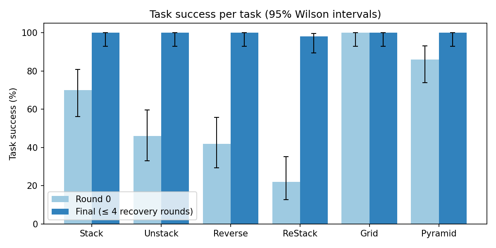
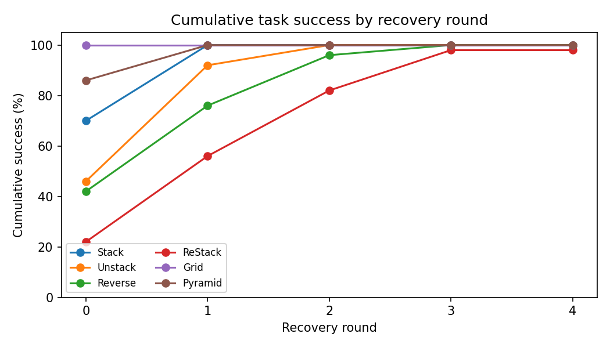
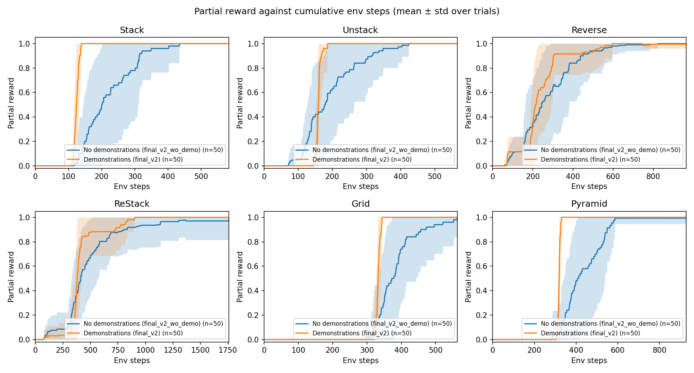
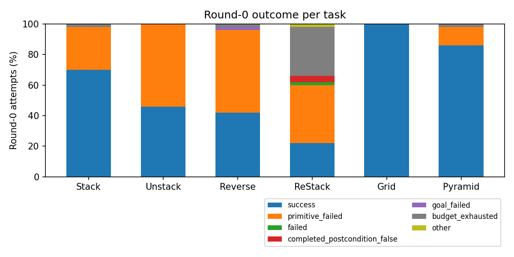
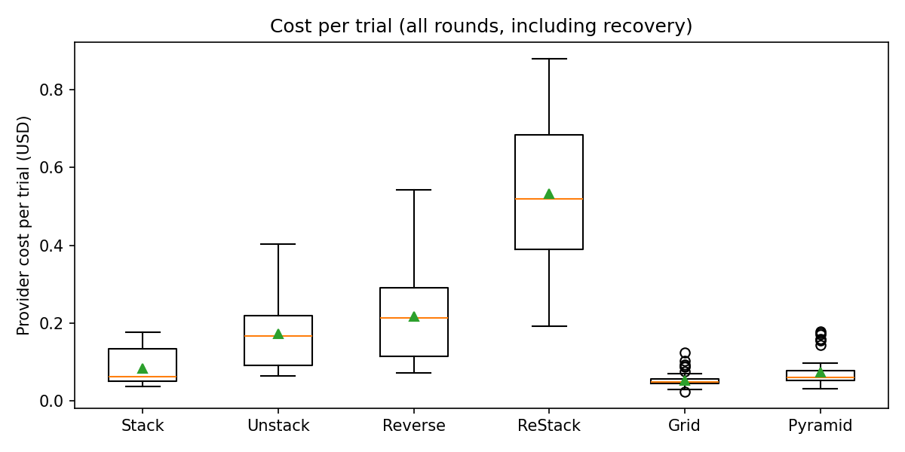
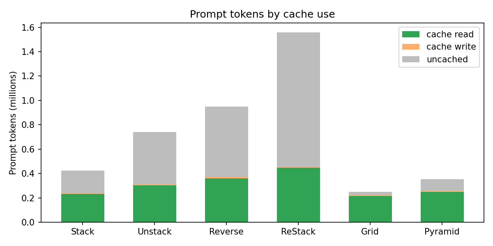

# Final CaP results without demonstrations: `final_v2_wo_demo`, Claude Opus 5.5, 50 trials per task

- **Date:** 2026-10-28.
- **Run:** `runs/cap-final-v2-wo-demo/20261028-final-50/` (seeds 0–49 for every task). Its `report.md` lists every trial and round with its env steps.
- **Configuration:** [`config_final_v2_wo_demo`](../configs/config_final_v2_wo_demo.py). This is [`config_final_v2`](../configs/config_final_v2.py) with the demonstration block off; nothing else changes.
- **Comparison arm:** the demonstrations-on run of the [final_v1 report](final_v1_report.md) (`config_final_v2`, the same seeds; seed 50 replaces seed 39 for Unstack and Reverse there).
- **Tables, data and figures:** `python -m synthesis.cap.reports.final_report` (Section 9). Partial reward follows [TASK_PARTIAL_REWARD.md](TASK_PARTIAL_REWARD.md).

## 1. Summary

- **Final success:**
  - 299/300 trials succeeded under the frozen criterion `task-spec-v2+final-release-v1`, within at most four recovery rounds.
  - Every task except ReStack is at 50/50; ReStack is at 49/50.
  - The one failure is a static-checker limit, not an execution failure (Section 4.2).
- **Round 0:** removing the demonstrations lowers first-program success on every tower task and on Pyramid:

  | | Stack | Unstack | Reverse | ReStack | Grid | Pyramid |
  | --- | ---: | ---: | ---: | ---: | ---: | ---: |
  | No demonstrations | 35/50 | 23/50 | 21/50 | 11/50 | 50/50 | 43/50 |
  | Demonstrations (final_v1) | 50/50 | 50/50 | 23/50 | 34/50 | 50/50 | 50/50 |

  Recovery makes up the difference: mean recovery rounds rise from 0–0.78 to 0–1.34 per task.
- **Env steps:** reaching the successful program takes more environment steps:
  - 1.8× as many for Stack, 1.6× for Unstack, 1.5× for ReStack;
  - 1.4× for Pyramid, 1.15× for Grid, 1.06× for Reverse.

  Section 3.2 has the tables, and Fig. 11-style curves are in Section 3.3.
- **Failures:**
  - The dominant failure is `Move` non-convergence: 90 of the 117 failed round-0 attempts across tasks.
  - ReStack also exhausts the execution/query tick budget in 16 round-0 attempts.
  - No attempt failed only on the release check.
- **Cost:**
  - The 300 scored trials cost $56.74, of which ReStack accounts for $26.64.
  - Without the demonstration block, prompts are short, so the cache saves less: 42% of prompt tokens were read from cache, against 95% with demonstrations. Output tokens dominate the cost.
  - The key's total was $57.94, including requeued trials. The smoke cost $1.01 on the earlier key.
- **Run interruptions:** the run was stopped twice by request (Section 6). The 13 trials interrupted at those stops were rerun with their original seeds. No trial was dropped or rerun because of its outcome.

## 2. Configuration

| Setting | Value |
| --- | --- |
| Model | Claude Opus 5.5 (`anthropic/claude-opus-5.5`) on OpenRouter, reasoning effort medium, 64k output tokens; routing Anthropic, then Claude Platform on AWS (475 of 476 scored calls served by Anthropic) |
| Method | `cap_method_2`, `dsl_only`, `typed_v5`, primitive prompt `primitive-prompt-v2` (`p0101`) |
| Instructions | `task-instructions-v3`, as in final_v1 |
| Demonstrations | **Off.** No demonstration block, and no measurement of one |
| Recovery | On, up to 4 rounds, feedback profile `full`, RDP keyframes; success field `task_spec_success` |
| Success criterion | `task-spec-v2+final-release-v1` |
| Budgets per trial | 10,000 execution/query ticks, 10,000 simulation steps, 200,000 effort tokens, 12 model calls, 3,600 s |
| Blocks | Stack, Unstack, Reverse 4; ReStack 5 (3-block source tower); Grid 2 × 3; Pyramid 3-2-1 |
| Scenes | Fresh resets with seeds 0–49, settled for 50 steps. With no demonstrations there is no information-boundary rejection, so seed 39 is included for every task |
| Prompt caching | `prompt_cache: "5m"`, first-response warm-up, as in final_v2; only the round-0 breakpoint exists |

The prompt text is final_v1's demonstrations-off text, byte for byte.

## 3. Task success



| Task | Blocks | Trials | Round-0 success | 95% CI (%) | Final success | 95% CI (%) | Mean recovery rounds | Mean calls | Total env steps |
| --- | ---: | ---: | ---: | --- | ---: | --- | ---: | ---: | ---: |
| Stack | 4 | 50 | 35/50 (70%) | [56, 81] | 50/50 (100%) | [93, 100] | 0.30 | 1.32 | 11,238 |
| Unstack | 4 | 50 | 23/50 (46%) | [33, 60] | 50/50 (100%) | [93, 100] | 0.62 | 1.64 | 12,863 |
| Reverse | 4 | 50 | 21/50 (42%) | [29, 56] | 50/50 (100%) | [93, 100] | 0.86 | 1.88 | 16,702 |
| ReStack | 5 | 50 | 11/50 (22%) | [13, 35] | 49/50 (98%) | [90, 100] | 1.34 | 2.42 | 37,004 |
| Grid | 6 | 50 | 50/50 (100%) | [93, 100] | 50/50 (100%) | [93, 100] | 0.00 | 1.10 | 19,172 |
| Pyramid | 6 | 50 | 43/50 (86%) | [74, 93] | 50/50 (100%) | [93, 100] | 0.14 | 1.16 | 21,980 |

"Total env steps" sums the policy's `env.step` calls over every round of every trial. The 50 settling steps before and after each rollout are not included.

### 3.1 Recovery



| Task | ≤ round 0 | ≤ round 1 | ≤ round 2 | ≤ round 3 | ≤ round 4 |
| --- | ---: | ---: | ---: | ---: | ---: |
| Stack | 35 | 50 | 50 | 50 | 50 |
| Unstack | 23 | 46 | 50 | 50 | 50 |
| Reverse | 21 | 38 | 48 | 50 | 50 |
| ReStack | 11 | 28 | 41 | 49 | 49 |
| Grid | 50 | 50 | 50 | 50 | 50 |
| Pyramid | 43 | 50 | 50 | 50 | 50 |

- **Stack and Pyramid:** one recovery round solves every round-0 failure.
- **Unstack:** needs up to two rounds.
- **Reverse:** needs up to three.
- **ReStack:** needs up to three; 8 trials succeed only in round 3.

### 3.2 Env steps until the final result

The step count is taken until the final program succeeded, or until the trial finally failed. It covers all rounds, with settling excluded.

| Task | Succeeded | Mean | Median | Min | Max | Failed | Steps |
| --- | ---: | ---: | ---: | ---: | ---: | ---: | --- |
| Stack | 50 | 225 | 201 | 118 | 583 | 0 | – |
| Unstack | 50 | 257 | 236 | 114 | 566 | 0 | – |
| Reverse | 50 | 334 | 299 | 154 | 823 | 0 | – |
| ReStack | 49 | 755 | 689 | 297 | 1,756 | 1 | 0 (no rollout; Section 4.2) |
| Grid | 50 | 383 | 375 | 295 | 563 | 0 | – |
| Pyramid | 50 | 440 | 410 | 285 | 927 | 0 | – |

Compared with the demonstrations-on run (successful trials):

| Task | Mean steps, no demonstrations | Mean steps, demonstrations | Ratio | Median, no demonstrations | Median, demonstrations |
| --- | ---: | ---: | ---: | ---: | ---: |
| Stack | 225 | 124 | 1.81 | 201 | 124 |
| Unstack | 257 | 160 | 1.61 | 236 | 159 |
| Reverse | 334 | 316 | 1.06 | 299 | 260 |
| ReStack | 755 | 496 | 1.52 | 689 | 388 |
| Grid | 383 | 332 | 1.15 | 375 | 332 |
| Pyramid | 440 | 318 | 1.38 | 410 | 318 |

Two effects add up here:
- **More failed rounds.** Each failed round adds its rollout's steps.
- **Longer successful programs.** Without demonstrations, successful programs also take more steps: they use higher clearances and extra waypoints. For example, all 50 Grid trials succeed in round 0 in both arms, yet the median Grid trial takes 375 instead of 332 steps.

### 3.3 Partial reward against env steps (Fig. 11 style)



How to read the figure:
- Each trial contributes a step function. Its value is the partial reward of its most recent rollout, at that rollout's cumulative env-step count: 0 before the first rollout, then held after the trial stops.
- The solid curve is the mean over the task's 50 trials, and the band is ± one standard deviation.
- Orange is the demonstrations-on run; blue is this run.
- Partial reward follows [`partial-reward-v1`](TASK_PARTIAL_REWARD.md), scored on the settled state of each rollout.

Mean partial reward after each round (trials that already stopped keep their last value):

| Task | Round 0 | Round 1 | Round 2 | Round 3 | Round 4 |
| --- | ---: | ---: | ---: | ---: | ---: |
| Stack | 0.72 | 1.00 | 1.00 | 1.00 | 1.00 |
| Unstack | 0.83 | 0.95 | 1.00 | 1.00 | 1.00 |
| Reverse | 0.59 | 0.85 | 0.99 | 1.00 | 1.00 |
| ReStack | 0.62 | 0.85 | 0.95 | 0.98 | 0.98 |
| Grid | 1.00 | 1.00 | 1.00 | 1.00 | 1.00 |
| Pyramid | 0.87 | 1.00 | 1.00 | 1.00 | 1.00 |

- **Unstack round 0:** partial reward (0.83) is far higher than round-0 success (46%). Many failed Unstack attempts had already placed most blocks on the table when a later `Move` failed to converge.
- **ReStack:** the mean stops at 0.98 because the failed trial never executed (reward 0).

## 4. Failures



### 4.1 Failed attempts

Round-0 attempts that did not reach `task_spec_success`:

| Task | `Move` non-convergence | `Release` non-convergence | Tick budget exhausted | Other | Total |
| --- | ---: | ---: | ---: | --- | ---: |
| Stack | 14 | 0 | 1 | | 15 |
| Unstack | 27 | 0 | 0 | | 27 |
| Reverse | 24 | 2 | 1 | 1 `goal_failed` (completed, postcondition false); 1 other primitive failure | 29 |
| ReStack | 19 | 0 | 16 | 2 completed with the postcondition false; 1 `get` without a witness; 1 `analysis_failed` | 39 |
| Grid | 0 | 0 | 0 | | 0 |
| Pyramid | 6 | 0 | 1 | | 7 |

- **`Move` non-convergence:**
  - A primitive did not reach its target within its 50-step budget. This usually happens because the target lies inside another block or the carried block collides.
  - With demonstrations, this was the main failure only for Reverse (23 of 27). Without them, it is the main failure of every task.
  - The demonstrations show the clearances and waypoint heights that the reference programs use.
- **Tick budget:**
  - Execution/query ticks count every query, guard and predicate evaluation as well as every simulation step. The budget is 10,000 per round.
  - The 30 ReStack attempts that exhausted it over all rounds had used only 296–546 simulation steps. Their programs evaluate thousands of quantified conditions, and the budget ran out mid-execution, right after a primitive, rather than in a non-progressing loop.
  - No demonstrations-on attempt hit this budget.
- **Release check:** no attempt failed only because of the final release check. Attempts that ended holding a block (127 over all rounds) had all already stopped on an exception.

### 4.2 The one failed trial: ReStack seed 3 (`analysis_failed`)

- **Status:** `analysis_failed`; stop reason `preparation_failure_no_rollout`.
- **What happened:** the model's first program had 156 lines, 9 helpers and 3 loops. The static DSL checker's type, provenance and effect analysis exceeded its work budget (`MAX_ANALYSIS_STEPS = 100000`, `validation.py`) before reaching a verdict.
- **Why the trial ended:** an unfinished analysis is neither a violation nor an approval. Under the frozen pipeline the program is not executed and is not sent to DSL repair, so the trial ended without a rollout and without recovery.
- **Offline check (diagnostic only):** the same source was checked again with a budget of 1,000,000. The analysis finished in 0.3 s after about 181,000 steps and reported no violations.
- **How it is counted:** this report keeps the trial as a failure, under the frozen configuration (final success 49/50). It is a checker-capacity outcome, so the summary separates it. Excluding it, ReStack would be 49/49.
- **Comparison:** it did not occur in the 300 demonstrations-on trials. Demonstrations-off programs tend to be longer.

## 5. Cost and prompt caching





| Task | Calls | Prompt tokens | Read from cache | Written | Output tokens | Cost | Mean cost per trial | Mean wall time per trial |
| --- | ---: | ---: | ---: | ---: | ---: | ---: | ---: | ---: |
| Stack | 66 | 423,320 | 231,651 (55%) | 7,354 | 170,505 | $4.23 | $0.085 | 44 s |
| Unstack | 82 | 738,787 | 302,965 (41%) | 7,670 | 339,334 | $8.60 | $0.172 | 81 s |
| Reverse | 94 | 948,833 | 360,360 (38%) | 12,012 | 423,332 | $10.90 | $0.218 | 98 s |
| ReStack | 121 | 1,557,868 | 446,775 (29%) | 7,770 | 1,105,053 | $26.64 | $0.533 | 243 s |
| Grid | 55 | 249,910 | 215,424 (86%) | 8,976 | 123,232 | $2.65 | $0.053 | 35 s |
| Pyramid | 58 | 353,408 | 249,040 (70%) | 9,056 | 161,749 | $3.71 | $0.074 | 45 s |
| **Scored trials** | **476** | **4,272,126** | **1,806,215 (42%)** | **52,838** | **2,323,205** | **$56.74** | | |

- **Why caching saves less here:** without demonstrations, the round-0 prompt is only about 3.7–4.5k tokens. The cacheable prefix is therefore small. Recovery requests add long feedback that is new each time, so their uncached share is large.
- **Output dominates the cost:** 2.3M output tokens at $20/M account for about $46 of the $56.74.
  - ReStack alone produced 1.1M output tokens, about 9k per call.
  - With demonstrations, the same 300 trials produced 1.0M output tokens over all tasks.
- **Rest of the key's spend:** the key's total of $57.94 also covers:
  - the calls of the 13 requeued trials ($0.83);
  - requests still in flight at the two stops.

## 6. Run log and deviations

### 6.1 First stop (requested)

- **Start:** the run started at 2 workers per task (12 concurrent trials).
- **First stop:** after 52 trials had finished (all successful), the run was stopped with SIGINT on request. 11 running trials were marked `interrupted`.
- **Restart:** it was later resumed on request.
- **Requeue:** before the resume, the 11 interrupted trials were requeued with their original seeds:
  - each directory was moved to `<batch>/replaced/`;
  - `<batch>/requeued.json` records the reason and the previous state;
  - their queued video jobs were moved to `replaced/render_queue/`.
- **Selection:** the same procedure as final_v1, Section 6.2. It never looks at whether a trial succeeded.

### 6.2 More ReStack workers

- **Why:** ReStack trials take about four minutes each, so ReStack became the tail of the run.
- **Change:** after Stack, Grid and Pyramid had finished, only the ReStack batch was stopped. Its 2 interrupted trials were requeued in the same way, and the batch was resumed alone with 6 workers.
- **Effect:** total concurrency stayed at about 10. No request returned HTTP 429 or 402 during the run.

### 6.3 Code versions

- **Session commits:**
  - the run was created at `f1c6e1f` (clean);
  - resumed sessions ran at `e8bca1e`;
  - the ReStack 6-worker session ran at `6b386f6`.
- **No runtime difference:** the commits between them change only documentation and the report module. Runtime, prompt and checker code are identical across sessions.
- **Earlier change:** `8cdf4d7`, before the run, makes demonstrations-off trials record their provider cache summary (`prefix_cache`). It does not change requests or execution.

## 7. Smoke

One trial per task (seed 0) under `runs/cap-final-v2-wo-demo/20261028-smoke/`:
- **Result:** 6/6 succeeded.
- **Rounds:** Stack, Unstack and Reverse needed one recovery round each.
- **Cost:** $1.01.
- **Finding:** the smoke found the missing `prefix_cache` summary for demonstrations-off trials, which was fixed before the run (Section 6.3).

## 8. Interpretation and limits

- **What demonstrations buy:** final success is near the ceiling in both arms, so the demonstrations' effect shows in three places:
  - first-program success, for example ReStack 22% against 68% and Unstack 46% against 100%;
  - recovery depth;
  - env steps and cost. ReStack costs $0.53 per trial against $0.25.

  The recovery loop compensates for missing demonstrations through executed feedback. Each failed rollout is an environment interaction that the demonstrations would have avoided.
- **Grid:** the only task unaffected at round 0 (50/50 in both arms). Its reference structure (nested goal loops with `HasBlock`) follows directly from the goal API.
- **Statistics:** at n = 50, the final-success results bound true rates only at ≥ 93% (or ≥ 90% for ReStack's 49/50, by Wilson 95%). Round-0 differences between arms are much larger than their intervals for Stack, Unstack, ReStack and Pyramid. For Reverse (42% against 46%) they are not distinguishable.
- **Scope:** one model, one reasoning effort and one block count per task. Generalization to other block counts is the subject of [Revision 9](revision_9_generalization_checker.md). Whether these programs verify is the subject of [Revision 8](revision_8_verification.md).

## 9. Reproduction

```bash
# from roboverify/, with the simulator environment of AGENTS.md
export OPENROUTER_API_KEY=...   # never on argv; read from the key file
python -m synthesis.cap.experiments.revision6_experiment \
    --root runs/cap-final-v2-wo-demo/20261028-final-50 --model claude-opus-5.5 \
    --frozen final_v2_wo_demo --trials 50 --seed-start 0 --workers 2
python -m synthesis.cap.reports.batch_set_report runs/cap-final-v2-wo-demo/20261028-final-50
python -m synthesis.cap.reports.final_report runs/cap-final-v2-wo-demo/20261028-final-50 \
    --output runs/cap-final-v2-wo-demo/20261028-final-50/analysis \
    --plots synthesis/cap/docs/plots --prefix final_v2_wo_demo \
    --label "No demonstrations (final_v2_wo_demo)" \
    --compare "Demonstrations (final_v2)" runs/cap-final-v2/20261027-final-50 \
    --compare "Demonstrations (final_v2)" runs/cap-final-v2/20261027-final-50-supplement
```

- **Concurrency:** use at most about 2–3 workers per task on one OpenRouter key; a single remaining batch can use more.
- **Generated outputs:** the report module writes `final_v2_wo_demo_data.json`, `final_v2_wo_demo_tables.md` and the comparison arm's progress data to `--output`, and six figures to `docs/plots/final_v2_wo_demo_*.png`.
