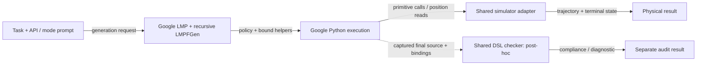
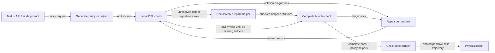
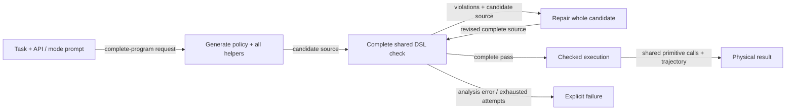

# Progress report: October 15–19, 2026

- Developed a Code-as-Policies baseline for comparison with RoboVerify, using the same robot primitives and predicates.
- Preserved Google CaP’s implementation to measure how reliably prompting alone produces DSL-compliant policies.
- Implemented two checker-guided variants to enforce the DSL contract: recursive helper checking and whole-program checking.
- Built reproducible experiments and analyzed generation and execution failures.
- Next steps: extend task coverage and give CaP access to the same demonstrations used by RoboVerify.

## 1. Research goal and motivation

- **Big goal:** evaluate how synthesis and verification affect policy quality by comparing RoboVerify with CaP under a shared primitive and predicate interface.
  - Compare the quality of generated policies on the shared benchmarks.
  - Restrict CaP to the primitives and predicates available to RoboVerify, such as Pick/Move/Release and the shared block relations.
  - Yuanlin’s implementation and black-box parameter search are potential components for a future CaP variant; they are not integrated into the current experiments.
- **Google CaP as the reference baseline:**
  - Measure what the original generation/execution workflow produces when the restriction is expressed through prompting.
  - Preserve the pinned Google `LMP -> LMPFGen -> exec_safe` behavior instead of silently adding checker-guided repair to this reference.
  - Measure physical success and final-output DSL compliance separately.
- **Explicit DSL enforcement through Methods 1 and 2:**
  - These variants enforce the same DSL contract at different stages of program generation, allowing a comparison of local and whole-program checking and repair.
  - Method 1 checks and repairs recursively generated units; Method 2 checks and repairs complete candidates.
  - Their motivation is enforcement of the implemented DSL contract. The present results do not establish that prompting usually violates the DSL.
- **Primary comparison and additional condition setting:**
  - `dsl_only` is the primary setting for comparing approaches within the shared predicate vocabulary.
  - `coordinate_predicates` expands the condition language and is reported as a separate experimental factor.
  - The final research comparison remains RoboVerify versus CaP under comparable task inputs, primitive semantics, predicates, and evaluation conditions.
  - A matched RoboVerify-versus-CaP performance evaluation remains to be completed.

## 2. Implementation and generation workflows

### 2.1 Completed changes

| Area | What changed | Purpose and scope |
| --- | --- | --- |
| Shared observations | Immutable current world-frame XYZ getters for the gripper and each block; finite values, metres, no physics step on read | Generated programs can read positions during execution; this does not automatically send live state to the LLM |
| Condition modes | Shared `dsl_only` and `coordinate_predicates` configuration, prompt rules, checkpoint metadata, and checked execution | Keep API access consistent while varying allowed conditions |
| Numeric behavior | Mode-dependent comparison checks, transitive helper/assignment analysis, action-free Boolean conditions, and exact integer comparison behavior | Permit extended numeric predicates without requiring coordinate provenance |
| Versioned prompts | Frozen `legacy_v1`; typed `typed_v2`; `typed_v3` adds Method 2 templates while preserving typed_v2 text for the existing methods | Enable reproducibility and future prompt ablations |
| API descriptions | Explicit types, argument meanings, coordinate frames/units, Move reference semantics, predicate semantics/tolerances, observation freshness, primitive returns and failure limits | Reduce interface ambiguity without changing primitives |
| Request roles | Policy prompts request a top-level invocation; helper prompts request only the requested definition | Remove the conflict between policy execution instructions and helper-only output |
| Shared checker | Explicit task/mode contract, bounded analysis, structured diagnostics, local versus complete scope, source/contract identity | Reuse one static contract across methods |
| Method 1 | Connect recursive local checking, helper generation, bounded repair, complete checking, and execution to the shared contract | Check the assembled program before physical actions |
| Method 2 | Add complete-candidate generation and bounded whole-candidate repair | Offer a second enforcement workflow using the same checker/runtime |
| Baseline audit | Capture final source and actual function bindings; check after the attempt, without feeding results back into generation | Preserve Google CaP behavior while measuring final-output compliance |
| Audit correction | Recursively capture helper references in nested query-lambda code objects; classify incomplete legacy bindings conservatively | Fix CAP-AUDIT-1 without changing physical outcomes or rerunning requests |
| Resource accounting | Raise default active wall cap from 180 to 600 seconds; separately track calls, reported tokens, execution ticks, simulation steps, depth, and exclusive phase times | Distinguish model latency, execution, recording, and resource exhaustion; retain Unstack’s 60-second cap |
| Parallel experiments | Isolated workers, immutable manifest, balanced randomized dispatch, separate queue delay, bounded concurrency, pending-job resume, and atomic summaries | Run repeatable batches without shared simulator state or replacement of failed trials |
| Reporting | Per-trial token counts, source/check/video links, configuration and prompt hashes, snapshot and recording audits | Make comparisons inspectable and avoid double-counting reasoning tokens |
| Documentation | Observation/data-flow diagrams, mode configuration, Revision 1/2 records, and shared-checker architecture/pseudocode | Document the final behavior and its limits |

- **Observation interface:** `O_t = {gripper_xyz(t), block_1_xyz(t), ..., block_n_xyz(t)}`.
  - `get_gripper_position() -> Position3` and `get_block_position(handle) -> Position3`.
  - Each returned triple is a snapshot; reading again after an action gives current positions.
  - Rewards, success labels, simulator internals, and controller feedback remain outside the policy observation interface.

| Mode | Loop, branch, and selection conditions | Coordinate use in actions |
| --- | --- | --- |
| `dsl_only` | DSL predicates, object identity, Boolean combinations, quantifiers, and pure helpers composed from these | Allowed |
| `coordinate_predicates` | All strict-mode conditions plus pure numeric predicates, coordinate comparisons, counters, constants, and mixed DSL/numeric combinations | Allowed |

- **The prompt changes with the mode.** The actual typed_v3 coordinate-mode text states:
  > Loop, branch and selection conditions may use DSL predicates, pure numeric predicates, or Boolean combinations of DSL and/or numeric predicates.
  - This permission was confirmed in saved Haiku coordinate-mode requests for all three methods.
  - Numeric provenance is unrestricted; using coordinate conditions is permitted, not required.
- **Potential reuse beyond these three workflows:**
  - The common API/DSL prompt specification and checker could support adapters for other CaP frameworks, including Yuanlin’s Logic, CaPX, and other code generators.
  - An adapter would supply the generated policy, helper sources and bindings, task API, input types, and condition mode to the shared checker.
  - A framework could use the result for post-hoc measurement or for candidate rejection/repair.
  - These integrations have not been implemented or evaluated. Different output languages, dynamic bindings, or unsupported constructs would require adaptation; this is not a claim that arbitrary generated Python can already be checked.
- **Checker boundary:** checks cover the supported syntax, primitive/API signatures, types, helper dependencies, and condition effects. Passing is not a proof of task completion, termination, controller convergence, or physical safety.

### 2.2 Baseline: original Google CaP with post-hoc measurement



```python
def baseline(task, api, mode):
    prompt = build_prompt(task, api, mode)
    try:
        policy = google_lmp.generate(prompt)
        helpers = google_lmpfgen.resolve_recursively(policy)
        outcome = google_execute(policy, helpers, shared_adapter)
    finally:
        final_output = capture_available_final_source_and_bindings()
        compliance = audit_final_output(final_output, contract(api, mode))
        save_physical_outcome_and_compliance_separately()
    # No checker-guided repair or execution gate is added to Google CaP.
```

- Capture is observational, including on failures; an unavailable/incomplete output is not silently replaced with an earlier candidate.
- The diagram abstracts helper generation/binding and Python execution; it does not replace the upstream algorithm.

### 2.3 Method 1: recursive unit generation and repair



```python
def method_1(task, contract):
    policy = generate_policy(task, contract)
    bundle = prepare_recursively(policy, role="body", contract=contract)
    require_complete_pass(bundle, contract)
    return checked_execute(bundle, contract)


def prepare_recursively(unit, role, contract):
    for attempt in allowed_local_attempts():
        report = check_local(unit, role, contract)
        if report.has_violations:
            unit = repair_current_unit(unit, report.diagnostics)
            continue
        helpers = {}
        for call in unresolved_helpers(unit):
            source = generate_helper(call.signature, call.role, contract)
            helpers.update(prepare_recursively(source, call.role, contract))
        bundle = assemble(unit, helpers)
        if is_helper(unit):
            return bundle  # Local approval; parent checks actual argument types.
        report = check_complete(bundle, contract)
        if report.passed:
            return bundle
        unit = repair_current_unit(unit, report.diagnostics)
    raise ConstraintFailure()
```

- Local approval permits composition, not physical execution; the complete root must pass.
- All recursion and repairs consume shared budgets. The pseudocode abstracts dependency/cycle handling, helper bookkeeping, and diagnostic propagation.

### 2.4 Method 2: whole-candidate generation and repair



```python
def method_2(task, contract):
    candidate = generate_complete_program(task, contract)
    for attempt in allowed_whole_candidate_attempts():
        report = check_complete(candidate, contract)
        if report.passed:
            return checked_execute(candidate, contract)
        if report.analysis_error:
            raise AnalysisFailure()
        if no_attempts_remain():
            raise ConstraintFailure(report.diagnostics)
        candidate = repair_whole_program(candidate, report.diagnostics, contract)
```

- Missing helpers are repaired as part of the entire candidate; there is no separate recursive LMPFGen stage.
- Both checked methods use interface/DSL diagnostics, not rollout feedback, for repairs.
- Five attempts per local unit in Method 1 and five whole-candidate attempts in Method 2 are different allocations; shared call/token budgets also apply.

## 3. Experiments and results

### 3.1 Evaluation protocol

- Main live experiments use one saved **three-block Stack scene**, with five fresh policy-generation trials per reported method/model/mode group.
  - A fixed scene controls the initial state; these trials do not measure generalization across layouts or tasks.
  - Success requires normal program completion and the terminal task check, not merely reaching a successful state before a later exception.
  - No demonstrations were supplied to CaP in these experiments.
- Report physical success independently from final-output DSL compliance.
  - A contract-compliant program can fail physically.
  - Missing output or unsupported audit evidence is neither a compliance pass nor a confirmed violation.
- Reported tokens sum provider input/output usage across policy, helper, and repair calls.
  - Reasoning tokens are included once, not added again to completion totals.
  - Unreturned requests can make earlier token totals incomplete; individual reports mark this.

### 3.2 Revision 1: original prompts and two methods

| Batch / model | Reasoning | Response cap | Active wall cap | Baseline DSL | Method 1 DSL | Baseline coordinate | Method 1 coordinate |
| --- | --- | --- | --- | --- | --- | --- | --- |
| A: DeepSeek v4.1 Flash | Off | 4,096 | 180 s | 0/5 | 0/5 | Not tested | Not tested |
| B: DeepSeek v4.1 Flash | On | 16,384 | 180 s | 1/5 | 2/5 | 0/5 | 2/5 |
| C: GPT-6.1-sol | On | 16,384 | 180 s | 1/5 | 5/5 | 4/5 | 5/5 |
| C baseline rerun | On | 16,384 | 600 s | 3/5 | Not rerun | Not rerun | Not rerun |

| Batch / mode | Baseline reported tokens | Method 1 reported tokens | Main failures |
| --- | ---: | ---: | --- |
| A / DSL | 14,937 | 21,882 | Baseline: 3 Move-arity errors, 1 truncated helper, 1 no-witness query. Method 1: all 5 exhausted local attempts on arity/object-reference errors before actions |
| B / DSL | 63,755 | 82,434 | Baseline: 2 object-reference errors, 1 truncation, 1 Move failure. Method 1: 2 Move failures, 1 truncation |
| C / DSL | 40,567, incomplete usage | 8,072 | Baseline: 3 wall deadlines, 1 Pick failure. Method 1: all succeeded, with 1 static repair |
| B / coordinate | 75,190 | 75,019 | Baseline: 3 object-reference errors, 1 deadline, 1 Move failure. Method 1: 2 truncations, 1 Move failure |
| C / coordinate | 33,394 | 9,422 | Baseline: 1 Pick failure. Method 1: all succeeded, with 2 static repairs |
| C / DSL, 600 s rerun | 42,272 | — | 2 Move failures; no resource/wall exhaustion |

- **Wall-clock finding:** one successful 600-second rerun took 187.46 seconds, including 185.15 seconds in model requests and 0.18 seconds in simulation.
  - Queue wait was 217.83 seconds and excluded from the active trial deadline.
  - Within this rerun’s recorded traces, 2/5 completed successfully by 180 seconds and 3/5 by 300/600 seconds. These are thresholds on the same traces, not additional experiments.
  - The earlier 1/5 and fresh 3/5 results differ in generated samples and scheduling; the entire change cannot be attributed to timeout alone.
- **Sources:** [Batch A](../../../runs/cap-stack-deepseek-revision1/20261018-172554/report.md), [B/C DSL](../../../runs/cap-stack-reasoning-comparison/20261018-180533-16k/report.md), [B/C coordinate](../../../runs/cap-stack-coordinate-comparison/20261018-184618-reasoning-16k/report.md), [600-second rerun](../../../runs/cap-stack-gpt61sol-budget/20261018-192834-dsl-600s/report.md).

### 3.3 Revision 2: three methods and both modes

- Both batches use typed_v3, 16,384 output tokens per response, three isolated workers, the same full initial snapshot, and matching paired initial policy prompts.
- Experiment limits: 600-second active wall cap, 12 model calls, 50,000 reported tokens, depth 12, 10,000 execution/query ticks, 10,000 policy simulation steps; 50-second request timeout and one transport retry available.
- DeepSeek: reasoning enabled, temperature 0. Haiku: reasoning enabled with explicit medium effort; temperature omitted because the route did not advertise support.
  - This compares model/configuration choices, not model identity alone.

| Method | Mode | DeepSeek success | Haiku success | DeepSeek tokens | Haiku tokens |
| --- | --- | ---: | ---: | ---: | ---: |
| Baseline | DSL | 0/5 | 2/5 | 80,402 | 48,577 |
| Baseline | Coordinate | 1/5 | 3/5 | 83,672 | 39,115 |
| Method 1 | DSL | 1/5 | 2/5 | 79,975 | 28,259 |
| Method 1 | Coordinate | 2/5 | 5/5 | 90,779 | 30,239 |
| Method 2 | DSL | 1/5 | 3/5 | 89,576 | 62,668 |
| Method 2 | Coordinate | 0/5 | 4/5 | 91,330 | 46,873 |
| **Total within each batch** | | **5/30** | **19/30** | **515,734** | **255,731** |

| Measurement | DeepSeek | Haiku |
| --- | --- | --- |
| Response-length failures with no returned code | 20 | 0 |
| Primitive failures | 4 Move, 1 Release | 6 Move, 2 Pick, 2 Release |
| Other physical/runtime failures | 0 | 1 no-witness `get` |
| Requests | 30 policy; no helper/repair calls | 30 policy, 7 baseline helper, 2 Method 2 repair |
| Reported reasoning tokens, already included above | 457,078 | 128,723 |
| Complete DSL audit/check passes | 10 | 29 |
| Remaining DSL statuses | 14 incomplete constrained generations; 6 unavailable baseline outputs | 1 unsupported legacy baseline binding capture |

- **Generation bottleneck:** DeepSeek’s reasoning consumed almost all completion tokens; 20 trials reached the response cap before returning code. This batch cannot establish a benefit of either repair strategy because no repair calls occurred.
- **Repair examples:** Haiku Method 2 DSL trials 2 and 4 each repaired `Expected position, got vector`, then completed Stack.
- **Execution bottleneck:** 10 of Haiku’s 11 failures were primitive nonconvergence.
  - The unchanged primitive limit is 50 simulation steps, with 2 mm position tolerances; raising the trial wall cap does not increase it.
  - Nonconvergence alone does not identify whether the cause is the generated target, geometry, grasp behavior, or controller dynamics.
- **Audit correction:** Haiku baseline coordinate trial 3 physically failed because `get` had no witness.
  - Its original unresolved-helper audit was incorrect because capture omitted a helper dependency inside a query lambda.
  - The corrected legacy verdict is `unsupported`; the recorder was fixed for future runs. Original audits, requests, and rollouts remain preserved.
- **Sources:** [DeepSeek report](../../../runs/cap-revision2-deepseek/20261018-215345/report.md), [DeepSeek analysis](../../../runs/cap-revision2-deepseek/20261018-215345/analysis.md), [Haiku report](../../../runs/cap-revision2-haiku55/20261019-021933/report.md), [Haiku analysis](../../../runs/cap-revision2-haiku55/20261019-021933/analysis.md).

### 3.4 Setup, interrupted experiments, and validation

| Experiment / validation | Observed result | Treatment |
| --- | --- | --- |
| GPT reasoning-disabled setup request | Endpoint rejected the request: reasoning mandatory | Setup diagnostic; not a completed five-trial comparison |
| GPT reasoning-on, 4k partial batch | Finished baseline trial failed its wall deadline; finished Method 1 trial succeeded | Superseded by the 16k rerun; excluded from main tables |
| DeepSeek reasoning-on, 4k partial batch | Four finished trials per method, all truncated with no code | Superseded; exclude from main tables |
| Revision 1 real-MuJoCo parity | Four method/mode combinations had identical initial states, coordinate reads, and 19 physical actions | Partial Pick/Move diagnostic; expected `goal_failed`, not Stack success |
| Resource-accounting validation | 65 CaP tests and a five-job scripted scheduler check | Infrastructure validation, not model performance |
| Typed prompt validation | 74 CaP tests; 20 saved initial GPT requests reproduced with legacy text | Prompt/version compatibility validation |
| Revision 2 preflight | Six method/mode combinations matched starts/actions; six videos matched states | Partial Pick/Move diagnostic, not Stack success |
| Revision 2 implementation | 87 CaP tests passed | Checker, methods, audit, and scheduler validation |
| After query-lambda capture correction | 88 CaP tests passed | Includes new and incomplete-legacy capture regression coverage |

- Setup/partial reports: [GPT setup](../../../runs/cap-stack-gpt61sol-revision1/20261018-180040/report.md), [GPT 4k partial](../../../runs/cap-stack-gpt61sol-revision1/20261018-180040-reasoning/report.md), [DeepSeek 4k partial](../../../runs/cap-stack-deepseek-revision1/20261018-180205-reasoning/report.md).
- Parity/preflight evidence: [Revision 1](revision_1.md#validation), [Revision 2 preflight](../../../runs/cap-revision2-preflight/20261018-214704/report.md).
- All 30 videos in each Revision 2 live batch matched trajectory state counts; saved full starts, request hashes, token totals, and exclusive timing sums were checked. Earlier deadline-interrupted videos are marked unavailable rather than silently omitted.

## 4. Interpretation and baseline hypothesis

### 4.1 What the baseline evidence actually shows

- **Hypothesis:** prompting alone may produce final programs outside the specified DSL, even when execution succeeds.
- **Finding:** no physically successful, genuinely DSL-violating final output has been confirmed in the reviewed experiments.
  - All **six successful Revision 2 baseline trials** have saved DSL `pass` results.
  - Older artifacts contain unsupported generated helpers, but some were overwritten. Superseded source is not a final-output violation unless the definition remains in the final bundle.
  - Older runs lack the complete final-binding captures introduced in Revision 2; source-only retrospective checks do not replace those missing records.
- **Checker limitation discovered during this review:** four successful GPT coordinate policy sources are rejected by the current checker’s generic helper pass with `Expected object, got mixed`.
  - Their concrete `b0: ObjectHandle` call-site analysis passes.
  - Generic unknown helper arguments combined with a loop-carried object variable become `mixed` during the additional definition analysis.
  - Record these as checker-rejected historical sources with a likely conservative-analysis limitation, not confirmed forbidden-primitive or forbidden-condition examples.
  - This review did not change the checker or historical outcomes; a focused regression and correction remain follow-up work.
- **Motivation supported by current evidence:** Methods 1 and 2 enforce the implemented contract before execution; the original baseline has no such gate. The experiment does not establish a nonzero rate of successful-but-noncompliant final outputs.
  - Scripted tests demonstrate that baseline `dsl_only` can execute a forbidden numeric condition. That is a mechanism test, not a naturally generated successful Stack counterexample.

| Successful Revision 2 baseline trial | Mode | Saved compliance | Trial directory |
| --- | --- | --- | --- |
| DeepSeek trial 5 | Coordinate | Pass | [Artifacts](../../../runs/cap-revision2-deepseek/20261018-215345/trials/cap_google_baseline-coordinate_predicates-005/) |
| Haiku trial 3 | DSL | Pass | [Artifacts](../../../runs/cap-revision2-haiku55/20261019-021933/trials/cap_google_baseline-dsl_only-003/) |
| Haiku trial 5 | DSL | Pass | [Artifacts](../../../runs/cap-revision2-haiku55/20261019-021933/trials/cap_google_baseline-dsl_only-005/) |
| Haiku trial 1 | Coordinate | Pass | [Artifacts](../../../runs/cap-revision2-haiku55/20261019-021933/trials/cap_google_baseline-coordinate_predicates-001/) |
| Haiku trial 2 | Coordinate | Pass | [Artifacts](../../../runs/cap-revision2-haiku55/20261019-021933/trials/cap_google_baseline-coordinate_predicates-002/) |
| Haiku trial 4 | Coordinate | Pass | [Artifacts](../../../runs/cap-revision2-haiku55/20261019-021933/trials/cap_google_baseline-coordinate_predicates-004/) |

| Historical source needing checker follow-up | Physical outcome | Evidence |
| --- | --- | --- |
| GPT Revision 1 coordinate baseline trial 1 | Success | [Final policy](../../../runs/cap-stack-gpt61sol-revision1/20261018-184618-coordinate-reasoning-16k/trial_001/cap_google_baseline/cap/20261018-184635-d77b413-cap_google_baseline-stack-52ebfdcb/artifacts/trial_001/checkpoints/cp_0009/policy.py) |
| GPT Revision 1 coordinate baseline trial 3 | Success | [Final policy](../../../runs/cap-stack-gpt61sol-revision1/20261018-184618-coordinate-reasoning-16k/trial_003/cap_google_baseline/cap/20261018-185119-d77b413-cap_google_baseline-stack-5cacab70/artifacts/trial_001/checkpoints/cp_0014/policy.py) |
| GPT Revision 1 coordinate baseline trial 4 | Success | [Final policy](../../../runs/cap-stack-gpt61sol-revision1/20261018-184618-coordinate-reasoning-16k/trial_004/cap_google_baseline/cap/20261018-185404-d77b413-cap_google_baseline-stack-167d09bc/artifacts/trial_001/checkpoints/cp_0007/policy.py) |
| GPT Revision 1 coordinate baseline trial 5 | Success | [Final policy](../../../runs/cap-stack-gpt61sol-revision1/20261018-184618-coordinate-reasoning-16k/trial_005/cap_google_baseline/cap/20261018-185601-d77b413-cap_google_baseline-stack-7a129597/artifacts/trial_001/checkpoints/cp_0004/policy.py) |

### 4.2 Did successful coordinate-mode policies actually use coordinate conditions?

| Haiku method | Coordinate-mode successes | Successes that executed coordinate conditions |
| --- | ---: | ---: |
| Baseline | 3 | 0 |
| Method 1 | 5 | 0 |
| Method 2 | 4 | 2 |
| **Total** | **12** | **2** |

| Trial | Synthesized condition and purpose | Execution evidence | Source |
| --- | --- | --- | --- |
| Method 2 coordinate trial 1 | `tower_top()` combines `ON_star` with a Z-coordinate comparison inside `get`/`forall` to select a highest tower member | 3 helper calls; 12 coordinate reads inside the selection predicate | [Policy](../../../runs/cap-revision2-haiku55/20261019-021933/trials/cap_method_2-coordinate_predicates-001/cap/20261019-021934-f46189a-cap_method_2-stack-9ecae6aa/artifacts/trial_001/checkpoints/cp_0002/policy.py) |
| Method 2 coordinate trial 4 | `if held_near(q)` checks each component of block-minus-gripper position lies strictly between -0.03 and +0.03 metres before placement | 2 calls, both True; placement branch taken twice | [Policy](../../../runs/cap-revision2-haiku55/20261019-021933/trials/cap_method_2-coordinate_predicates-004/cap/20261019-022311-f46189a-cap_method_2-stack-4170488d/artifacts/trial_001/checkpoints/cp_0002/policy.py) |

- No successful Haiku trial used a coordinate-driven `while` guard.
- Method 2 coordinate trial 3 used `k < 20`, a counter condition, not a coordinate predicate. Its `block_z` helper was never called.
- Position reads used only to compute Move offsets do not count as coordinate conditions.
- Consequently, the observed coordinate-mode success rates cannot be attributed directly to coordinate predicates; Method 1’s 5/5 successes did not use them.

### 4.3 Limits on claims

- Five generations on one fixed scene do not establish benchmark-wide performance or a general ranking of the methods.
- Typed prompts were implemented, but no controlled legacy-versus-typed live ablation was completed. Cross-revision differences do not isolate prompt effects.
- DeepSeek/Haiku reasoning settings and temperature handling differ; their results do not isolate a single model property.
- Static DSL compliance, task postcondition satisfaction, and formal symbolic/geometric verification are distinct measurements.
- Existing RoboVerify proof results and the current CaP experiments do not yet constitute a matched generalization comparison.

## 5. Next experiments and research directions

### 5.1 Expand to the remaining five tasks

| Task | Current CaP/specification status | Next action |
| --- | --- | --- |
| Unstack | Adapter and shared symbolic pre/postcondition exist | Collect demonstrations and matched scenes; evaluate within the existing 60-second limit |
| Reverse | Adapter and environment order-reversal evaluator exist; no shared `cfg.task_spec` entry | Agree on the evaluation specification and demonstration source, then run comparisons |
| ReStack | Adapter maps to `partial_stack`; goal is one tower rooted at b0; no shared `cfg.task_spec` entry | Validate layouts/specification and demonstrations, then run comparisons |
| Grid | Environment goals exist; CaP reports an adapter gap | Implement shared goal traversal/occupancy and physical reference interfaces before testing |
| Pyramid | Environment specifies a six-block 3+2+1 layered structure; CaP reports an adapter gap | Complete the goal/reference interface and validate the evaluator before testing |

- Keep primitives and evaluator semantics shared across approaches.
- Use multiple saved scenes and, where appropriate, block counts; pair evaluation inputs across methods.
- Preserve separate failure categories for generation, contract checking, query failure, primitive execution, and goal failure.

### 5.2 Add demonstration input, configurable on/off

- **Motivation:** RoboVerify’s demonstration-driven synthesis receives demonstrations; giving CaP the same demonstration data controls an important information-access difference.
  - Demonstration access alone does not match compute budgets, representations, or search procedures; document those separately.
- **Current repository status:**
  - [collect_demos.py](../../entry/collect_demos.py) supports only Stack.
  - Documentation records prior Stack collections, but no `demonstrations.npz` archive was found in this checkout during this review; the expected `roboverify/demos/` directory is absent.
  - Current CaP configuration and prompts do not load demonstration trajectories. A saved evaluation initial state is not a demonstration input.
- **Planned integration, pending Yuning’s generator:**
  - Agree on a stable demonstration schema and task/object bindings.
  - Add an explicit configurable demonstration-input mode, with on/off settings and a demonstration path/selection configuration. Exact flag names remain to be designed.
  - Supply the same selected demonstrations to Baseline, Method 1, and Method 2 through a shared serializer/prompt section.
  - Select a representation that preserves the relevant information, such as aligned state/action traces, and document any compression or sampling.
  - Do not expose the expert program source solely because it generated demonstrations unless that is an explicitly shared experimental input.
  - Record demonstration IDs/hashes, selection, representation version, rendered prompt hash, and token cost.
  - Keep demonstration scenes separate from held-out evaluation scenes.
- **Planned comparisons:**
  - Primary: RoboVerify versus DSL-only CaP variants with matched demonstration access and task evaluation.
  - Ablation: demonstration input on versus off within each CaP method.
  - Additional factor: DSL-only versus expanded numeric conditions, reported separately.
  - Preserve prompt versions for a later controlled prompt ablation.

### 5.3 Experimental priorities

- **Evaluation design:** define policy quality through held-out task success, DSL compliance, robustness across instances, and resource use; fix the baseline configurations and task suite before the next comparison.
- **Demonstrations:** coordinate the generator interface and dataset availability with Yuning; prioritize Stack integration first.
- **Checker reliability:** isolate the generic-helper type-merge limitation before using historical checker rejections as evidence of language violations.
- **Failure diagnosis:** inspect failed primitive targets and trajectories before changing controllers or budgets; preserve shared primitive semantics in comparisons.
- **Optional framework reuse:** evaluate an adapter for Yuanlin’s Logic or CaPX after agreeing on source/binding export. Do not mix such an integration or black-box parameter optimization into an existing result table without a separately recorded configuration.

## Appendix A. Code changes and validation milestones

| Date, Eastern | Commits | Coherent change |
| --- | --- | --- |
| Oct 16 | `30adfc4`, `25eb4e6`, `8795717`, `c255c26`, `a86131e` | Organize CaP docs; document observation/data flow and settle shared condition-mode semantics |
| Oct 16 | `8468eec`, `fd36754`, `ba8f73f`, `e424ade` | Implement position observations, both modes, checked Method 1 execution, integer precision fix, and simulator parity documentation |
| Oct 18 | `d7bcbb0`, `d77b413`, `e5636dc`, `7d7372a`, `baf40d5` | Record Revision 1 live experiments/tokens and draft typed prompts plus parallel-batch plan |
| Oct 18 | `2bf43fc`, `8bdd196` | Separate resource budgets/phase timing and document 600-second GPT rerun |
| Oct 18 | `d052ff7`, `2ad9dde`, `de94253` | Refine and implement typed/versioned prompts with request provenance |
| Oct 18 | `379ba2f`, `6fa8a63`, `bde092f`, `26fa9c9`, `8571115`, `3d7d5fe`, `9f17598`, `92c8b5f` | Design shared checker, final-output audit scope, Method 2, and high-level Python-style checker pseudocode |
| Oct 18 | `52e9d16`, `4b87ea2`, `43ae430` | Implement shared checking, final-output capture/audit, Method 2, resumable process batches, and validation docs |
| Oct 18 | `f46189a` | Record 30-trial Revision 2 DeepSeek results |
| Oct 18, late evening | `705c445`, `178bdb7` | Correct query-lambda binding capture and report the 30-trial Haiku comparison |

- Relevant implementation: [adapter](../adapter.py), [contracts](../contracts.py), [validation](../validation.py), [shared checker](../checker.py), [runtime](../runtime.py), [prompt packages](../prompts/), [baseline](../cap_google_baseline/), [Method 1](../cap_method_1/), [Method 2](../cap_method_2/), [final-output capture](../final_output.py), [audit](../audit.py), [batch runner](../batch.py), [timing](../timing.py).
- Design references: [Revision 1](revision_1.md), [Revision 2](revision_2.md), [shared-checker architecture](SHARED-DSL-CHECKER.md).
- Detailed reports retain each trial’s token usage and source/recording links; aggregate values here do not replace those artifacts.
