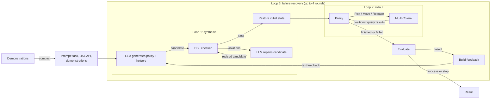

# Progress report: October 22–26, 2026

## 0. Framework overview: Method 2 with failure recovery

Setting for all later sections: Method 2 (whole-program generation) with recovery on, under the frozen configuration. The framework has three nested loops:

- **Loop 1, synthesis:** the LLM writes a program and the DSL checker corrects it.
- **Loop 2, rollout:** the program acts on the environment and reads observations back.
- **Loop 3, failure recovery:** a failed rollout becomes feedback for a new synthesis.

Main components are written as instances or functions below. Their implementation is described in the [module docs](module_docs/README.md).



```python
# Components, built once per trial from the frozen configuration
llm     = LLMClient(config.model)            # Qwen3.8 27B on vLLM
checker = DSLChecker(task, mode="dsl_only")
env     = Environment(task, scene)           # MuJoCo + DSL adapter + recorder
logger  = Logger(run_dir)                    # every call below writes to it
budget  = Budget(config)                     # per round and per trial


def cap_trial(task, scene, config):
    demos  = compact_demonstrations(config.demonstrations)   # None when off
    prompt = build_prompt(task, demos)
    feedback = None
    for round in range(1 + config.max_recovery_rounds):    # Loop 3: recovery
        program    = synthesize(prompt, feedback)           # Loop 1
        trajectory = rollout(program, scene)                # Loop 2
        if evaluate(trajectory, task):                      # task_spec_success
            return Success(round)
        feedback = build_feedback(trajectory, program)      # keeps earlier attempts
    return Failure()


def synthesize(prompt, feedback):                     # Loop 1: checker + LLM corrector
    program = llm.generate(prompt + feedback)
    for attempt in range(config.max_attempts):            # frozen: 5 checks, 4 repairs
        report = checker.check(program)
        if report.passed:
            return program
        program = llm.generate(repair_prompt(program, report.diagnostics))


def rollout(program, scene):                          # Loop 2: program <-> environment
    env.restore(scene.initial_state)                      # same start every round
    run(program, api=env)    # queries/guards read env; Pick/Move/Release step env
    return env.trajectory    # ends on return, or on a failed primitive / get / budget
```

| Component | What it does | Module doc |
| --- | --- | --- |
| `compact_demonstrations` | Turns recorded demonstrations into a short text block: gripper open/close events with block positions and predicate changes, plus simplified gripper waypoints. It is placed before every request and charged separately from the effort budget. | [Demonstration compactor](module_docs/demonstration_compactor.md) |
| `build_prompt` | Initial request: task instruction, input handles (`b0`, `tbl` or goals), the DSL API description with primitive notes and condition rules, and the demonstration block if on. | [Prompt builder](module_docs/prompt_builder.md) |
| `llm` | Sends requests to the model, logs them, charges tokens, and returns the program source. Truncated or empty responses fail the round. | [LLM client](module_docs/llm_client.md) |
| `synthesize` | Method 2: one complete program with all helpers, repaired as a whole from checker diagnostics. Recovery feedback goes only into the first request of a round, not into repair requests. | [Synthesizer: Method 2](module_docs/synthesizer_method2.md) |
| `checker` | Static check that the program stays inside the DSL: known calls, argument types, defined helpers, allowed conditions. It does not check reachability or task completion. | [DSL checker](module_docs/dsl_checker.md) |
| `env`, `rollout` | Restores the saved initial state, interprets the program, runs each primitive with RoboVerify's controller, and records the trajectory. | [Rollout](module_docs/rollout.md) |
| `evaluate` | RoboVerify's `task_spec_success`: normal completion, all primitives converged, and the shared pre/postcondition hold. | [Evaluator](module_docs/evaluator.md) |
| `build_feedback` | Deterministic text from the failed attempt: executed source, failure location, controller result, keyframes, goal clauses, and every earlier executed program. Returns a stop reason if required evidence does not fit. | [Feedback builder](module_docs/feedback_builder.md) |
| `budget`, recovery loop | Up to 4 recovery rounds, round and trial token/call/time limits. The loop also stops early when the checker never passes, required feedback evidence is missing or too large, or the trial budget runs out. | [Recovery loop and budgets](module_docs/recovery_loop.md#stop-reasons) |
| `logger` | Saves every prompt, response, candidate, check report, event, trajectory and video for each round. | [Logger and artifacts](module_docs/logger.md) |

Code entry point: [`runner.run`](../runner.py#L623), which calls [`recovery.run_recovery`](../recovery.py#L879) (Loop 3), which calls [`runner.run_once`](../runner.py#L157) for each round (Loops 1 and 2). See [Entry points and configuration](module_docs/entry_and_config.md).

## 1. Prompt ablation (Revision 4.3)

Design: [prompt ablation plan](revision_4_3_prompt_ablation_plan.md). Results: [Revision 4.3 report, §1](revision_4_3_report.md#1-prompt-factorial).

- Ran a full 2⁴ factorial over the four primitive-prompt blocks: 2,400 trials (50 per cell × 16 cells × 3 methods) on Qwen3.8 27B, Stack ([configuration](revision_4_3_report.md#11-configuration), [cell table](revision_4_3_report.md#16-cell-table-round-0-and-final-success-150-trials-per-cell)).
- Only the motion-planning-limits block matters: round-0 success rises from 32% to 72% (odds ratio 5.3), and final success from 74% to 93% ([main effects](revision_4_3_report.md#152-main-effects), [secondary outcomes](revision_4_3_report.md#153-secondary-outcomes-motion-planning-block-off--on)).
- Target offsets, convergence criteria and partial execution show no effect, and no block interacts with another.
- The factorial's own selection rule picks `p0001`; for the baseline we use `p0101` (convergence criteria also on), chosen from the numeric results (see Section 3). Rule and outcome: [selected prompt set](revision_4_3_report.md#154-selected-prompt-set).
- Dropped Qwen3.5 9B after 291 trials: it almost never succeeded in round 0, so it could not separate the cells ([§1.3](revision_4_3_report.md#13-qwen35-9b-stopped-2026-10-22)).

## 2. Feedback ablation (Revision 4.3)

Design: [feedback ablation plan](revision_4_3_ablation_experiment_plan.md) and [configurable feedback](revision_4_3_configurable_feedback_and_full_policy_history.md). Results: [Revision 4.3 report, §2](revision_4_3_report.md#2-feedback-ablation).

- Compared 8 feedback profiles on 210 paired seeds (3,150 recovery chains); each profile removes one feedback item and shares round 0 with `full` ([profile definitions](revision_4_3_report.md#21-profile-definitions-that-differ-from-a-single-item-removal)).
- `full` recovers 92.4% of failed seeds within four rounds. No removed item has a detectable effect after multiplicity correction ([profiles against `full`](revision_4_3_report.md#251-profiles-against-full-210-paired-seeds)).
- The closest case, `no_current_source` (−7.6 points, p = 0.020), does not survive correction (Holm p = 0.27).
- Added figures to the report ([§2.5](revision_4_3_report.md#25-results)).

## 3. Frozen baseline configuration for RoboVerify comparisons

Selection and frozen settings: [Revision 4.3 report, §3](revision_4_3_report.md#3-selected-cap-configuration-for-roboverify-comparisons).

- Chose Method 2 with prompt `p0101` from the numeric results of the Revision 4.3 report ([method](revision_4_3_report.md#32-method-method-2), [prompt set](revision_4_3_report.md#33-prompt-set-p0101)); all later CaP baseline runs use this choice.
- Full baseline: Qwen3.8 27B (medium reasoning), Method 2, `dsl_only`, prompt `p0101`, recovery with 4 rounds, feedback `full` ([feedback](revision_4_3_report.md#34-recovery-feedback-full), [frozen configuration](revision_4_3_report.md#35-frozen-configuration)).
- Adopted RoboVerify's `task_spec_success` as the success criterion, so CaP and RoboVerify are scored the same way ([§3.1](revision_4_3_report.md#31-success-criterion-task_spec_success), [Revision 5, §3](revision_5_add_tasks.md#3-evaluation-criterion)).
- Recorded the configuration as [`config_frozen_v1`](../configs/config_frozen_v1.py) (tower tasks) and [`config_frozen_v2`](../configs/config_frozen_v2.py) (adds Grid/Pyramid). Frozen versions are never edited ([six-task rule](revision_4_3_report.md#36-six-task-evaluation)).

## 4. Six-task support

Design: [Revision 5 task plan](revision_5_add_tasks.md).

- Merged upstream `main`, which adds Reverse, ReStack, Grid and Pyramid collection. CaP now runs ReStack on the upstream environment ([pre-merge review](pre_merge_upstream_main_20261023.md), [task support after the merge](revision_5_add_tasks.md#2-task-support-after-the-upstream-merge-2026-10-23)).
- Wrote per-task pre/postconditions and the paper's block counts into [`task_specification.md`](task_specification.md#2-preconditions-and-postconditions), and added Unstack/Reverse/ReStack instructions.
- Added a `tbl` reference for the table tasks, and aligned task setup with upstream collection ([shared changes](revision_5_add_tasks.md#41-shared-changes), [table reference](revision_5_add_tasks.md#42-table-reference-unstack-reverse-restack)).
- Designed and implemented the Grid/Pyramid goal interface from RoboVerify's DSL (`MoveRight`/`MoveDown`, `AtGoal`/`HasBlock`, goal references), with `typed_v4` prompts ([design](revision_5_add_grid_pyramid.md#3-design), [prompt and configuration version](revision_5_add_grid_pyramid.md#311-prompt-instruction-and-configuration-version), [implementation](revision_5_add_grid_pyramid.md#7-implementation-and-validation-2026-10-25)).

## 5. Six-task results (Revision 5)

Full report: [Revision 5 report](revision_5_report.md).

- Ran 20 trials per task under the frozen configuration, with fresh scenes and the paper's block counts ([configuration](revision_5_report.md#1-configuration), [per-task results](revision_5_report.md#2-results-per-task)).

  | | Stack | Unstack | Reverse | ReStack | Grid | Pyramid |
  | --- | ---: | ---: | ---: | ---: | ---: | ---: |
  | Round 0 | 14/20 | 3/20 | 1/20 | 0/20 | 12/20 | 16/20 |
  | Final (≤ 4 rounds) | 19/20 | 14/20 | 2/20 | 0/20 | 19/20 | 20/20 |

- Stack, Grid and Pyramid are nearly solved. Unstack succeeds mostly through recovery. Reverse and ReStack almost never succeed.
- Most failures are `Move` that does not converge, usually from wrong offset arithmetic: 85% of failed Moves in the three hard tower tasks end at least 1 cm from the target ([§3.1](revision_5_report.md#31-move-non-convergence-dominates-the-tower-tasks)).
- No attempt misused `tbl` or a goal handle, so the interfaces are sufficient and the configuration stays frozen ([§3.4](revision_5_report.md#34-interface-usage)).
- Grid and Pyramid failures are mostly `Release` from 15 cm without descending ([§3.3](revision_5_report.md#33-grid-and-pyramid)).
- These are CaP's numbers only. RoboVerify has not yet been run on the same scenes ([limits](revision_5_report.md#5-interpretation-and-limits)).

## 6. Demonstration input (Revision 6)

Design and implementation: [Revision 6](revision_6_add_demonstration.md).

- Implemented configurable demonstration input for all three methods, with an on/off switch ([§6.1](revision_6_add_demonstration.md#61-configuration-and-loading)).
- Demonstrations are compacted deterministically: gripper events plus motion waypoints (1 cm tolerance), with predicate deltas. No program source, snapshots or evaluation scenes are included ([information boundary](revision_6_add_demonstration.md#31-information-boundary-decided-2026-10-25), [compaction method](revision_6_add_demonstration.md#33-method-deterministic-compaction)).
- Collected 15 demonstrations per task (seeds 1000–1014, all valid) with RoboVerify's collector ([collector and sample archive](revision_6_add_demonstration.md#11-demonstration-collector-and-sample-archive-2026-10-25), [data](revision_6_add_demonstration.md#66-data-and-validation)).
- A 15-demonstration block costs 20k–72k tokens. It is charged separately (`demonstration_tokens`), so on and off arms keep the same effort budget ([token budget](revision_6_add_demonstration.md#32-token-budget), [accounting](revision_6_add_demonstration.md#64-token-accounting)).
- Added [`config_frozen_v3`](../configs/config_frozen_v3.py), which plans a 262k context window; today's 98k window fits Stack, Unstack and Reverse only ([§3.5](revision_6_add_demonstration.md#35-context-window-upgrade-config_frozen_v3)).
- Validated with 23 tests and a scripted end-to-end Stack run: all six trials (on and off) succeeded, and every request carried the same demonstration block ([validation](revision_6_add_demonstration.md#66-data-and-validation)).
- Not done: the real-model smoke trial (the 27B servers are stopped), the window upgrade, and a loader review with Yuning ([open points](revision_6_add_demonstration.md#67-deviations-and-open-points)).
