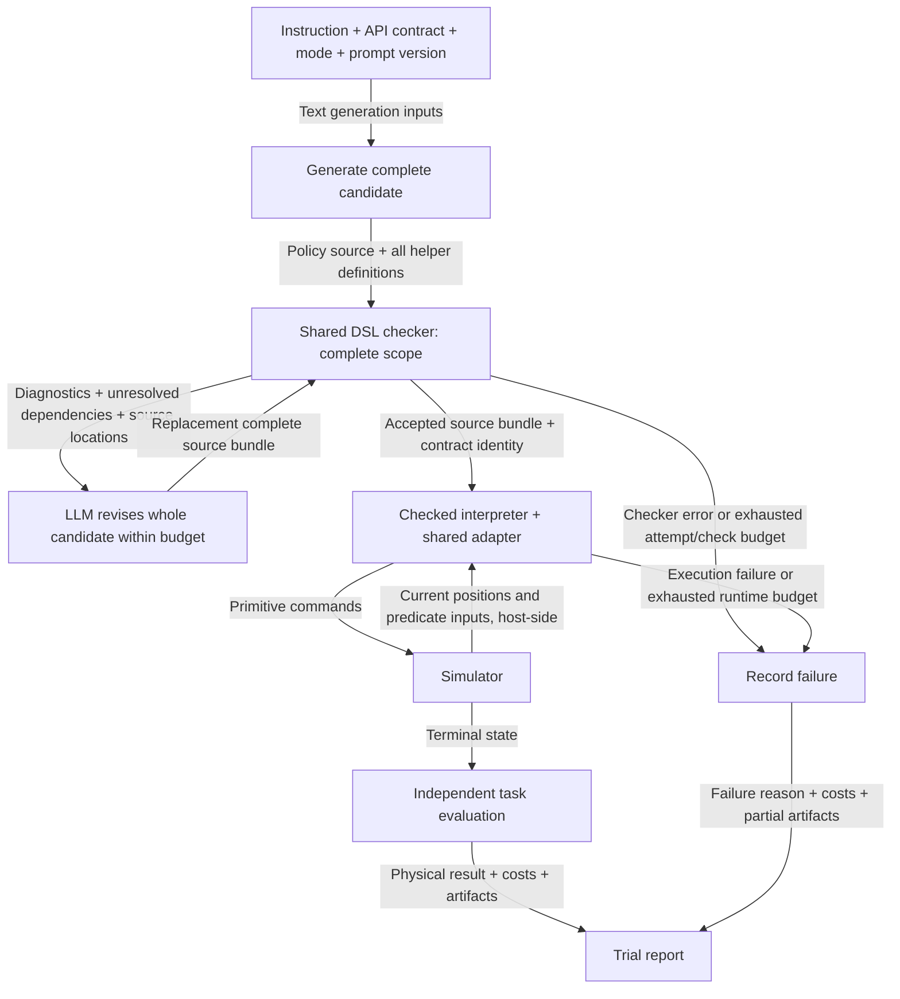

# Revision 2 discussion

Status: section 1 implemented. Other revision items retain their stated status.
The requested scope is API/prompt clarity and versioning
(item 1), parallel execution of future experiment batches (item 2), post-rollout
DSL compliance checking for the baseline (item 3), and Method 2 with a shared
checker design (item 4). The reasoning-enabled,
16k-output Stack experiments have completed using the existing prompts; their
[report](../../../runs/cap-stack-reasoning-comparison/20261018-180533-16k/report.md)
is the reference evidence for this discussion. Section 1 now provides a selectable
`typed_v2` prompt package while preserving legacy prompts, runtime interfaces,
condition semantics, and historical experimental results.
Further revision items remain for follow-up discussion.

## 1. Make API types and semantics explicit in the prompt

Implementation status (2026-10-18): section 1 is implemented as the opt-in
`typed_v2` prompt package, with `legacy_v1` retained as the default. The sections
below specify its design; optional schema unification and live prompt comparisons
remain future work. Runtime interfaces, condition languages, and controller
behavior are unchanged.

The implemented direction is to describe **each input's type and meaning**, rather
than rely on the opening sentence that all object operands are opaque handles.
The prompt should also state outputs, effects, coordinate frame/units, and the
important failure cases for each API. This is a prompt-clarity change; it does
not add new primitives or change the two condition modes.

### Motivation and API_DESCRIPTION edit summary

The completed experiments distinguish interface errors (Move arity, handle versus
coordinate types, and absent `get` witnesses), helper-generation/composition
problems, and physical controller failures. The
[coordinate-mode comparison](../../../runs/cap-stack-coordinate-comparison/20261018-184618-reasoning-16k/report.md)
and its [baseline condition execution audit](../../../runs/cap-stack-coordinate-comparison/20261018-184618-reasoning-16k/baseline_condition_execution_audit.json)
also show why coordinate access and coordinate conditions must be described
separately: the four successful coordinate-mode GPT baseline policies still used
DSL loop guards; their position reads parameterized actions. This does not
establish that numeric guards caused their improvement.

The [600-second baseline rerun](../../../runs/cap-stack-gpt61sol-budget/20261018-192834-dsl-600s/report.md)
completed 3/5 trials; the other two failed Move convergence without exhausting a
trial budget. Prompt clarity can address misunderstandings about primitive
targets and effects. It cannot establish the cause of every controller failure
or guarantee convergence. Generation latency and truncation remain separate
measurements, even if shorter helper chains reduce their incidence.

The following **`typed_v2` edit checklist** is implemented without changing the
legacy prompt or executable API semantics. Some entries clarify existing
contracts; they are not all observed failure causes.

| API_DESCRIPTION area | Current gap / experiment evidence | Implemented wording or structural edit |
| --- | --- | --- |
| Types and input bindings | The opening sentence about opaque handles has not prevented numeric/Position3 operands being passed to Move. | Define ObjectHandle, Position3, Offset3, Scalar, Bool, and None; type every parameter and return. Explain that `b0` is the supplied block handle, other handles come from queries, and type names are documentation notation, not constructors. |
| `Pick(block)` | Its signature omits its action sequence; generated action helpers have introduced unintended repeated Picks. | Describe approach at current gripper height, open, descend, close; no automatic lift or transport. State that opening can release a carried block, so a movement-only helper must not silently re-grasp. |
| `Move(x_ref, y_ref, z_ref, offset)` inputs | Six-argument calls and scalar/Position3 references were observed. | Label each reference ObjectHandle; require exactly four positional arguments and one finite three-element offset list/tuple. Give one valid call and clearly labeled wrong-arity/type examples. |
| Move target and effects | The current target equation does not explicitly identify the gripper as the controlled point or specify sampling time. | State the world-frame gripper target equation, sample all references once at invocation, and command the gripper closed. Distinguish an offset from an absolute target and the gripper position from the carried block's centre; do not assume their offset is zero. |
| `Release(reference, height_offset)` | The brief sentence omits XY preservation and leaves placement versus retreat ambiguous. | Type both inputs; open at the current location, then retreat to invocation-time `Z(reference) + height_offset`, preserving pre-opening XY. It does not lower a block onto a support before opening. |
| Primitive returns and failures | `-> None` does not explain controller failure, and trial timeout can be confused with the primitive limit. | Successful calls return None. Nonconvergence raises a runtime failure; current Move stops at at most 50 simulation steps with a 2 mm 3D position tolerance. One simulation step is one `env.step(action)`, not one wall-clock second. The 600-second trial cap does not extend this primitive limit. Convergence does not certify grasp, collision freedom, or task success. |
| Position getters | Snapshot semantics are already present; the distinction from action reference operands needs emphasis. | Preserve read-only, no-physics-step semantics, world metres, block centres, literal indices 0/1/2, and re-reading after motion. Explicitly say the returned triple cannot replace a block handle. Do not expose raw state, invented perception APIs, or a coordinate-bearing table handle. |
| `ON`, `ON_star`, `eq` | Signatures lack per-input types; informal “above/on” can be mistaken for support/contact or equal coordinates. | State two handle inputs and Bool output. Explain identity, reflexive ON_star with its XY/height tests, and irreflexive relational ON with no intermediate block. Neither geometric relation alone certifies physical support. |
| `Higher`, `Scattered`, `ON_star_zero` | Higher mentions only the default tolerance; “0.10 m XY separation” leaves the distance rule ambiguous. | Render the resolved Higher tolerance; specify Scattered's per-axis OR rule, not Euclidean distance; describe frozen entry geometry and advertise ON_star_zero only when the task exposes it. |
| `exists`, `forall`, `get` | A generated helper treated a missing `get` witness as a returned None. | Type lambda bindings and returns; quantify over physical blocks, allow repeated bindings unless explicitly excluded, and explain that `get` chooses the first satisfying handle and raises if absent. Show a mode-valid `exists` guard when existence is uncertain, not a None test after `get`. |
| Condition and action helper effects | “Helpers may compose the APIs” does not explain how to preserve a requested action's scope. | Keep conditions and query lambdas action-free. Make helper inputs, return type, and intended effects explicit; a movement-only helper should implement movement, not add Pick/Release. State these as generation guidance, without introducing new runtime effect categories. |
| Condition modes and Python subset | Coordinates are allowed for action parameters in both modes; extended mode must not be described as requiring numeric provenance. | Keep mode rules in a separate versioned block: DSL-only conditions versus DSL and/or numeric compositions, including counters/constants, in extended mode. List supported operators/syntax consistently with the checker. Formula notation is descriptive, not permission to import libraries or call unavailable builtins. |
| Output instructions | The shared text says to emit top-level invocations even when inserted into a helper prompt requesting only a definition. | Move output-shape instructions out of the common API reference: policy emits executable top-level statements; helper emits only the requested definition; repair follows the source unit's role. Apply this only to typed_v2, retaining legacy bytes. |

### 1.1 Introduce a small type glossary

| Prompt type | Meaning | Source / permitted use |
| --- | --- | --- |
| `ObjectHandle` | Identity of one physical block in the current trial. It is neither a physical ID nor a position. | The input `b0`, identity assignments, and `get(...)` / query bindings. Pass it to primitive and predicate object parameters. |
| `Position3` | Immutable snapshot `(x, y, z)` in world-frame metres. Block positions are block centres; gripper position is the controller's end-effector position. | Returned by position getters. Read components with literal indices 0/1/2. Re-query after motion for a current reading. |
| `Offset3` | Exactly three finite scalar displacements `[dx, dy, dz]`, in metres. | Construct it from constants or permitted arithmetic; use it as Move's fourth argument. It is not an absolute target position. |
| `Scalar` | A finite numeric value. | Action offsets and, in the extended condition mode, numerical predicates and counters. A scalar cannot replace an object handle. |
| `Bool` | A condition result. | DSL predicates, quantifiers, identity/Boolean operations, and mode-permitted numeric conditions. |
| `None` | No policy-visible return value. | Returned by successful primitive calls; it is not a success Boolean or an observation. |

These are explanatory type names in the prompt, not additional constructors or
APIs that generated code may call. `Offset3` names an existing three-element
list/tuple contract, not a new runtime class. The typed signatures below are
reference notation; method 1 still rejects annotations in generated function
definitions. Do not suggest importing or instantiating these types.

### 1.2 Describe every primitive parameter separately

Reference signatures:

```text
Pick(block: ObjectHandle) -> None
Move(x_ref: ObjectHandle, y_ref: ObjectHandle, z_ref: ObjectHandle,
     offset: Offset3) -> None
Release(reference: ObjectHandle, height_offset: Scalar) -> None
```

| API / input | Type | Meaning to state explicitly |
| --- | --- | --- |
| `Pick.block` | ObjectHandle | The block to grasp. The controller approaches horizontally at the current gripper height, opens, descends, and closes the gripper. Pick does not include a subsequent lift or a complete transport. |
| `Move.x_ref` | ObjectHandle | Use this block's current world X to anchor the target X. This argument is the block itself, not its X value. |
| `Move.y_ref` | ObjectHandle | Use this block's current world Y to anchor the target Y. It may differ from x_ref. |
| `Move.z_ref` | ObjectHandle | Use this block's current world Z to anchor the target Z. It may differ from the XY references. |
| `Move.offset` | Offset3 | One vector argument containing dx, dy, dz. The call has exactly four positional arguments, not six. |
| `Release.reference` | ObjectHandle | The block whose invocation-time Z anchors the gripper's retreat target. This does not specify an absolute placement position. |
| `Release.height_offset` | Scalar | Retreat-height offset from the reference block's Z, in metres. It is not an absolute world Z or an extra lowering command. |

Explain Move with an exact equation:

```text
At invocation:
  target_X = X(x_ref) + offset[0]
  target_Y = Y(y_ref) + offset[1]
  target_Z = Z(z_ref) + offset[2]
```

The host reads reference coordinates when the Move starts and drives the gripper
toward that target with the gripper closed. It does not continuously shift the
target as a reference block moves during that primitive. Reading coordinates in
policy code does not change this object-relative action contract. The target is
for the **gripper**, not directly for the carried block centre. If an action
helper reasons about a desired block-centre target, it must account for the
measured gripper-to-block offset; an assumption of zero offset is not part of
the API. Coordinate arithmetic for this purpose is allowed in both modes. Do
not promise that a measured offset stays rigid under slipping or contact.

Release opens the gripper at its current location, then retreats to
`Z(reference at invocation) + height_offset`, preserving the pre-opening XY
target. It does not perform a complete placement sequence. These meanings come
from [move_relative, pick, and release](../../api/control.py), rather than
inferring semantics from the API names.

Each primitive uses the existing shared controller and step limit. Currently,
each instruction has at most 50 simulation steps; Pick's stages share that
budget. Move's stopping test is a 3D position error of at most 0.002 m. This is
independent of the trial's wall-clock cap and total simulation-step budget.
A nonconverged primitive raises an execution failure through the adapter. A
successful return is `None`; convergence alone is not proof of grasp, collision
freedom, or task completion. This information should be stated once in a short
shared effects/returns paragraph, rather than repeated at length for every API.

### 1.3 Give predicates typed domains and precise truth conditions

All binary tower predicates take **two ObjectHandles** and return Bool. They do
not accept Position3 values. The prompt should distinguish identity, reflexive
height/above relations, direct-on relations, and frozen history.

| Predicate | Meaning worth stating in the API reference |
| --- | --- |
| `eq(a, b)` | Object identity, not equal coordinates. Object `==` / `!=` have the same identity meaning. |
| `ON_star(a, b)` | Shared geometric interpretation: `abs(X(a)-X(b)) < 0.025`, `abs(Y(a)-Y(b)) < 0.025`, and `Z(a) >= Z(b)`. Reflexive; this is not itself a physical-support guarantee. |
| `ON(a, b)` | Distinct objects with ON_star(a,b) and no distinct intermediate block c satisfying ON_star(a,c) and ON_star(c,b). Irreflexive. |
| `Higher(a, b)` | `Z(a) >= Z(b) - higher_tolerance`. Non-strict and reflexive. State the actual configured tolerance, rather than only the default 0.001 m. |
| `Scattered(a, b)` | `abs(X(a)-X(b)) >= 0.10 OR abs(Y(a)-Y(b)) >= 0.10`. The OR is important; this is not a Euclidean-distance threshold. |
| `ON_star_zero(a, b)` | ON_star evaluated on frozen trial-entry geometry. Advertise it only for tasks that expose it, currently Reverse. |

These formulas describe the host implementations. In `dsl_only`, generated
conditions must call the allowed DSL predicates or compose them; showing the
formulas is not permission to replace them with numeric comparisons. In
`coordinate_predicates`, generated numerical predicates are allowed, including
counters and comparisons unrelated to coordinates. Neither mode permits
redefining protected DSL APIs. Baseline receives these rules through prompts;
method 1 enforces them with its checker/interpreter.

The geometric facts belong to the shared contract and task configuration.
No sampled scene's coordinates or predicate table should be added to the prompt
as part of this change. If tolerance text is made dynamic, pass the resolved
value consistently to policy/helper/repair prompt assembly for both methods.

### 1.4 Type position getters and selection queries too

```text
get_gripper_position() -> Position3
get_block_position(block: ObjectHandle) -> Position3
exists(lambda objects: condition) -> Bool
forall(lambda objects: condition) -> Bool
get(lambda block: condition) -> ObjectHandle
```

Each lambda parameter binds a physical block handle. `exists` and `forall`
permit one or more parameters; `get` takes exactly one. The syntax above is
schematic: the actual arity is written in the lambda parameter list.

Explain the difference between a Boolean query and selection. `get` returns one
enabled object handle and raises when no witness exists; it does not return
False, None, or a position. The selection order is owned by the host, and the
program should not infer a physical ID from it. Query lambdas must return Bool
and be action-free. Their condition language follows the selected mode.

The position getters are read-only and do not advance physics. A stored
Position3 is a snapshot, not a live reference to the block. There is no generic
`get_observation`, raw `env`, coordinate-bearing `tbl`, or Goal handle in the
current tower API.

### 1.5 Add short interface examples, not benchmark solutions

A few type-focused examples could make the distinction concrete. For instance,
with `u`, `v`, and `w` already bound handles:

```python
Move(u, v, w, [0.01, -0.02, 0.08])
```

This illustrates separate coordinate references and one offset vector. It is
not a prescribed safe waypoint or a Stack policy. A getter example can explain
that `p = get_block_position(u)` makes `p` a Position3 while `u` remains the
ObjectHandle used by Pick, Move, Release, and DSL predicates.

Possible negative examples for an API reference:

| Invalid expression | Explanation |
| --- | --- |
| `Move(u, v, w, 0.0, 0.0, 0.08)` | Six arguments; the offsets must be one three-element vector. |
| `Move(p[0], p[1], p[2], [0.0, 0.0, 0.08])` | The first three arguments are numbers, not object handles. |
| `Move(p, p, p, [0.0, 0.0, 0.08])` | Position3 cannot replace ObjectHandle. |
| `Higher(get_block_position(u), get_block_position(v))` | DSL predicates take handles, not coordinate triples. |
| `Release(u, get_block_position(u)[2])` when intended as an absolute retreat target | The second argument is an offset; the implementation would add it to Z(u). |

The last example is type-correct but semantically wrong for that stated intent;
a type checker alone cannot detect every misunderstanding. Keep this distinction
in the discussion of expected benefits. Negative examples should be clearly
labeled; whether they improve generation more than positive examples alone is
an empirical question.

### 1.6 Suggested prompt organization and evaluation

A compact ordering to discuss is: type glossary; typed API signatures and
parameter meanings; outputs/effects; predicate semantics; short examples; then
the selected condition-mode rules. The shared contract should be reused in
policy and helper prompts for both methods, and in method-1 repair prompts.

Prefer one structured API specification from which descriptions can be rendered,
so arity/type metadata and prompt wording are less likely to diverge. This is a
possible implementation direction, not an approved requirement to redesign the
checker or baseline algorithm. Preserve Google's pinned core and the existing
method distinction.

Before adopting revised wording, check examples against the existing checker
and adapter, and verify identical shared API text across both methods. Then
compare old/new prompt versions with matched models, snapshots, modes, budgets,
and generation settings. Count arity errors, operand-type errors, no-witness
queries, accepted policies, model usage, and physical outcomes separately.
A lower interface-error rate must not be reported as guaranteed task success.

The completed 16k experiments remain the old-prompt evidence. A future
prompt experiment should have an explicit prompt version/hash and its own
report; do not mix changed prompts with those existing results.

### 1.7 Preserve prompt versions and select them through configuration

Requested requirement: retain the existing prompt when introducing the revised
one, and select the prompt version through configuration for later paper
comparisons and controlled variant experiments. Do not overwrite the old prompt
and rely on manually checking out historical commits to reproduce it.

Implemented configuration interface:

```text
RunConfig.prompt_version = "legacy_v1" | "typed_v2"
CLI: --prompt-version legacy_v1|typed_v2
Compatibility default: legacy_v1
```

| Version | Contents | Status |
| --- | --- | --- |
| `legacy_v1` | The post-Revision-1 API description, mode rules, and policy/helper/repair templates used by the completed 16k experiments. | Frozen and selectable; default. Those runs predate an explicit prompt_version field. |
| `typed_v2` | Typed inputs/returns, precise primitive/predicate/query semantics, short positive/negative interface examples, and role-specific output rules. | Implemented and covered by offline regression tests; live performance has not been evaluated. |

Freeze all model-facing components, not only `API_DESCRIPTION`: shared API text,
condition-mode rule text, policy and helper templates for both methods, and the
method-1 repair template. Preserve method-specific prompt assembly behavior,
including whitespace and the upstream baseline's source history/context rules.
For example, the existing baseline retains a final newline from a multiline
task instruction while method 1 strips it; a legacy replay must not silently
normalize this difference.

The configuration axes are independent:

```text
method          = cap_google_baseline | cap_method_1
condition_mode  = dsl_only | coordinate_predicates
prompt_version  = legacy_v1 | typed_v2
```

Changing `prompt_version` changes wording/examples, not the observation API,
allowed condition language, checker behavior, controller, or terminal evaluator.
Both prompt versions must describe the same runtime contract for a selected
condition mode. The baseline still uses prompt-only constraints and the pinned
upstream algorithm; adding version selection must not add a DSL checker or
repair loop to that method's execution path. The separately planned post-rollout
assessment in item 3 does not gate or repair execution.

Resolve a version once per trial, reject unknown versions, and propagate it to
all policy/helper/repair requests. Avoid mixing legacy policy generation with a
new helper or repair template within the same trial. The packages live in
[prompts/legacy_v1.json](../prompts/legacy_v1.json) and
[prompts/typed_v2.json](../prompts/typed_v2.json). The
[prompt package loader](../prompt_package.py) reads and freezes package bytes
per process, renders task-filtered entries, and supplies the package hash.
The legacy constants/template files remain compatibility references covered by
tests; prompt assembly selects the frozen package.

Record at least the following in configuration and generation artifacts:

- The selected `prompt_version`, `condition_mode`, method, and prompt-package
  content hash.
- The exact assembled prompt and its hash for every model request, including
  helper generation, repairs, and transport retries.
- References linking source checkpoints to their generating prompt/version and
  model-call ID; retain the separate checker/runtime provenance.

A prompt-package hash identifies the templates. An assembled-request hash also
captures the task/context, generated source, diagnostics, and configured values
inserted into a specific request. Neither hash substitutes for retaining the
actual request text. Existing run artifacts already retain prompt/request text;
versioning should build on that record rather than replace it.

Reproduction checks should compare legacy assembly byte-for-byte with archived
requests under the same task, mode, context, and source/diagnostic inputs. Include
both methods and all request types. Prompt changes should receive a new version
identifier rather than mutating the contents of `legacy_v1`.

For paper comparisons, pair versions on the same initial snapshots, models,
reasoning settings, condition modes, and generation/execution budgets. Report
interface errors, acceptance, repairs, calls/tokens, and physical outcomes per
version. Prompt length is itself a recorded cost; do not hide the extra tokens
introduced by richer descriptions. If later experiments isolate individual
prompt components, define explicit immutable variants and record their manifests
rather than editing a shared template between runs. The particular variants and
any additional Revision 2 work items remain for follow-up discussion.

### 1.8 Changes elsewhere in contracts.py and its callers

The actual file is [contracts.py](../contracts.py). Item 1 requires
more than replacing `API_DESCRIPTION`, because the file also combines prompt
selection, condition text, task exposure, and runtime types. Keep prompt
provenance separate from executable contract versions.

| Component | Implemented treatment (optional items noted) | Reason / boundary |
| --- | --- | --- |
| `API_DESCRIPTION` constant | Preserve the existing value as part of legacy_v1; add the typed_v2 description in an immutable prompt package. | Old experiment prompts must remain reproducible byte-for-byte; do not edit the legacy constant in place. |
| `CONDITION_RULES` | Freeze legacy text and provide version-selected wording if revised, with the same two modes and semantics. Explicitly allow mixed DSL/numeric conditions and unrestricted numeric origins in extended mode. | This is wording/versioning, not a new restriction on counters or a change to the checker. |
| `api_description(...)` | Accept the resolved prompt version and, for typed_v2, resolved semantic parameters such as Higher tolerance; render the matching package and mode. | The new keyword arguments are `prompt_version` and `higher_tolerance`; existing positional callers retain legacy behavior. |
| Task filtering in `api_description` / `task_api_names` | Preserve current exposure; render typed_v2 entries by API name. Keep the legacy filtering path for replay. | Legacy filtering removes lines starting with `ON_star_zero`; a multiline typed entry would otherwise leave orphaned descriptions or unavailable examples. No new task APIs are added. |
| Prompt-version identifiers and validation | Add a supported-version registry/validator, either here or in the prompt package; resolve once per trial. | Reject unknown versions and prevent policy/helper/repair requests from mixing versions. A separate module may keep contracts.py simulator-independent and small. |
| Optional structured API metadata | May add parameter/return/effect descriptions for rendering and consistency checks, using existing checker/adapter semantics as the reference. | This is optional organization; replacing the checker or adapter type system is not required for a prompt edit. Avoid adding simulator imports just to render documentation. |
| `ObjectHandle`, `Position3`, API name sets, and `validate_condition_mode` | Preserve their runtime behavior. Offset3/Scalar remain explanatory names. | Prompt clarification requires no new observation fields, constructors, primitives, or predicate implementation. |
| `OBSERVATION_API_VERSION`, `CHECKER_VERSION` | Keep unchanged for a prompt-only implementation; record prompt_version and prompt hashes separately. | A changed description does not mean the observation API or checker changed. Any later checker change is separately versioned. |
| `Bundle`, `Diagnostic`, exceptions including `PrimitiveFailure` | No semantic change required. Link prompt provenance through existing checkpoints/run artifacts; adding a Bundle provenance field is optional. | Richer controller-failure diagnostics would be a separate adapter/logging change; rewriting an exception class does not fix nonconvergence. |

The implementation also adds version selection in
[RunConfig](../config.py) and the [CLI](../../entry/run_cap.py), propagation through
[runner](../runner.py), [Method-1 prompt assembly](../cap_method_1/generation.py),
and [baseline module_config](../cap_google_baseline/compatibility.py), plus
recording the selected package/hash in configuration and checkpoint artifacts.
The resolved Higher tolerance must reach every typed_v2 request, including
helper and repair requests. Keep Google's pinned core unchanged.

### 1.9 Helper templates and validation priorities

The preserved legacy API reference ends with “Emit top-level statements that
invoke the policy”; it is also interpolated into the
[helper template](../cap_method_1/prompts/helper.txt), which asks for exactly a
function definition. The baseline similarly appends the same API text after its
helper-definition instruction. This concrete prompt conflict is removed in
typed_v2; it is not evidence that this sentence alone caused any particular
failed trial. Put execution-entry instructions in policy templates, and make
[repair output](../cap_method_1/prompts/repair.txt) depend on whether the repaired
unit is a policy or a helper.

The approved and implemented policy output instruction is:

```text
Output executable policy code. You may use top-level statements directly.
If you define a policy entry function, invoke it at the top level.
```

The approved and implemented helper output instruction is:

```text
Output only the requested function definition.
Do not include top-level calls or other executable statements outside the function.
The caller is responsible for invoking this helper.
```

Method-1 repair chooses between these instructions by source unit (`policy` or
the helper's name), independently of the action/condition role. In particular,
repairing an action helper must not turn it into an executable policy entry.
The shared typed API text contains neither entry-point instruction.

For helper generation, request the exact name/signature, a body matching the
requested action or pure-condition role, and dependencies that terminate in
available APIs. Discourage self/mutual delegation cycles and unnecessary helper
layers; prefer implementing a small requested operation directly when possible.
Do not claim this prevents Google's recursive discovery from generating unused
or duplicate helpers: that discovery behavior stays unchanged. Any future
addition of caller context must be an explicit versioned template/input change
and must not silently alter Google's core helper-resolution algorithm.

Validation and subsequent experiment requirements:

1. Check legacy prompt reconstruction byte-for-byte for both methods and all
   request roles. Check typed_v2 mode/task filtering and configured tolerances,
   including multiline entries and examples; helper prompts must not request
   top-level robot execution.
2. Check positive and negative API snippets against existing signatures and
   Method-1 validation. Include handle/Position3 distinctions, four-argument Move,
   `exists`-guarded selection, and coordinate arithmetic used solely for action
   offsets in both modes. Mathematical reference formulas must not advertise
   unavailable Python calls such as a builtin that is absent from the namespace.
3. Compare immutable prompt versions under matched modes, snapshots, models,
   resource limits, and scheduling. Report interface errors, helper names and
   dependency depth, generated versus actually executed condition helpers,
   unintended primitive sequences, truncations, calls/tokens, phase timings,
   primitive convergence, and physical outcomes separately. Use item 3's audit
   when available; until then, label manual source/trace inspection as such.

The implementation records `prompt_version` and `prompt_package_sha256` in run
configuration/results and source checkpoints, and saves `prompt_package.json`.
Each model request, including failed/retried attempts, retains its exact text,
request payload, and `prompt_metadata.json` with prompt/request hashes and role.
The request hash uses sorted-key compact ASCII JSON encoded as UTF-8; the package
hash covers the resource file bytes. Configured values such as Higher tolerance
enter assembled prompt hashes, while the package hash identifies the templates.

Each checkpoint source lists `generation_matches` linking it to model-call IDs,
request metadata, and returned-source hashes. Matching ignores outer whitespace
to accommodate upstream `.strip()`; source files retain their own exact hashes.
If multiple calls returned the same text, all matches are retained, without
claiming a unique generating call. Empty or externally supplied sources may
have no generation match. The checkpoint parent/source history is preserved.

Offline checks cover the pre-change legacy prompt fingerprints across methods,
modes, tasks and request roles; recursive helper and role-specific repair
propagation; task exposure and nondefault Higher tolerance; transport retry
hashes; and exact fixture action parity across both versions/methods/modes.
All 74 CaP tests passed. Twenty saved initial GPT Batch C requests (both methods
and both condition modes) were also reconstructed byte-for-byte under legacy_v1.
No paid model experiment is part of this implementation; whether typed_v2
improves generation or physical success remains to be measured.

### Possible follow-up ablations within item 1

- How much geometric detail should the compact prompt include versus reference
  documentation, particularly the exact ON/ON_star/Scattered formulas?
- Should the prompt include both positive and negative API examples, or start
  with only positive examples plus explicit parameter-type rules?
- Should API text be rendered from shared structured metadata, including the
  actual Higher tolerance, rather than maintained as one free-form string?

These questions concern prompt design only. Item 2 below is the separately
requested batch-execution change; other revision topics remain for discussion.

## 2. Run future experiment batches in parallel

Requested requirement: future multi-trial experiments should run independent
trials concurrently instead of executing the whole batch serially. This is a
planned harness change, not a change to policy generation algorithms. The active
coordinate-predicate comparison keeps its existing schedule: model batches run
concurrently, while trials within each model batch remain sequential.

### 2.1 Scheduling and configuration

Provide a batch-level concurrency option, for example `--max-workers N`, with a
bounded parallel default and `N=1` available for a serial reference or diagnosis.
The exact default worker count should be resolved and recorded before a batch
starts, with regard to simulator/rendering resources and provider request limits.
Do not silently change model, prompt, trial count, or per-trial budgets to fit
more workers.

Create the complete trial manifest before launching requests. A trial identity
includes model, method, condition mode, prompt version, trial index, initial-state
reference/hash, and generation settings. Use a recorded scheduling order that
balances comparison groups. Completion order must not determine trial identity,
which trials enter the report, or which failed trials are replaced.

Parallelize **independent trials**. Do not parallelize or reorder Google's
recursive helper-generation algorithm inside a baseline trial, and do not
replace method 1's existing preparation/repair flow as part of this change.

### 2.2 Process isolation and output ownership

Use separate worker processes rather than sharing live simulator instances
between threads. Each worker owns its environment, object handles, random state,
model session, signal/deadline handling, and recorder. Full initial snapshots
may be shared as immutable files, but every trial restores its own environment.
Preserve the Stack settling/replay rule; loading an archived start must not add
another settling phase.

Assign each trial a distinct output directory before dispatch. Workers must not
write the same status, stdout, timeline, checkpoint, video, or latest-link path.
A parent aggregator owns the batch summary and publishes updates atomically.
Retain the existing per-trial RunLogger/report contract and immutable generated
source checkpoints. Credentials remain process-local environment inputs; do not
put secret values in the trial manifest or artifacts.

### 2.3 Budgets, failures, and reproducibility

Implementation update: the shared runner now has a 600-second wall-clock safety
cap (Unstack remains 60 seconds), an explicit policy simulation-step budget,
first-exhausted-budget reporting, exclusive phase timings, and separate queue
waiting metadata. The requested Batch C rerun uses a two-process artifact-backed
scheduler with a recorded randomized dispatch order. A general configurable
parallel batch CLI remains planned; the existing baseline algorithm and prompts
are preserved. See [resource budgets and timing](../README.md#resource-budgets-and-timing).


Keep the existing per-trial generation/execution budgets unchanged. Start a
trial's wall-clock deadline when its worker begins trial setup, not while the job
is waiting in the batch queue. Report queue delay and active trial time
separately. Unstack still has its 60-second end-to-end trial limit. Keep the same
declared treatment of provider rate limiting and transport retries across groups;
waiting/retrying inside an active trial consumes its existing deadline.

Concurrency is not permission for unbounded retries. A worker timeout, process
crash, primitive failure, generation failure, or logging failure must produce an
explicit outcome or incomplete-trial record. Do not drop it from the scheduled
trial accounting or silently start a replacement. Resume logic must distinguish
finished, interrupted, and never-started trials to avoid duplicate paid requests.

Record requested and actual worker counts, dispatch/start/end times, schedule,
process outcomes, retry counts, and model-call usage. Every trial report must
include `# of tokens used`: cumulative provider-reported input plus output tokens
across initial/helper/repair requests, with incomplete usage marked explicitly.
Reasoning tokens already included in completion usage must not be counted twice.

Scheduling isolation does not guarantee deterministic remote-model responses.
Compare methods/versions under the same declared concurrency and resource policy,
and disclose provider contention or rate-limit failures instead of attributing
them automatically to policy quality.

### 2.4 Validation before adopting the parallel harness

Use scripted model responses and identical snapshots to compare serial and
parallel scheduling without paid requests. Check that trial identities,
restored observations, primitive action sequences, verdicts, and source/video
associations remain correct. Check that logs and checkpoints do not cross trial
boundaries. Include a deliberately failing worker and an interrupted batch to
verify accounting, independent progress, and resume behavior.

After these checks, use the parallel harness for subsequent requested batches
and record its configuration in their reports. This plan does not itself implement a general batch CLI. The timing/budget
support and the isolated-process Batch C rerun described above are implemented;
future reusable scheduling work remains separate. The five-trial 600-second Batch C baseline rerun
completed at 3/5; the [budget/timing record](../README.md#resource-budgets-and-timing)
and linked run artifacts distinguish this pilot from the general scheduler plan.


## 3. Check baseline DSL compliance after rollout

**Status: planned, not implemented.** Assess every baseline trial after its
rollout attempt using the shared DSL checker, under the recorded task contract
and `condition_mode`. Include failed/interrupted attempts and generation failures.

Keep Google's generation, helper binding, and execution path unchanged. The
audit is reporting only: no pre-execution gate, diagnostic feedback to the LLM,
checker-guided repair, or automatic rerun. Existing dynamic adapter checks remain
active. Preserve the original physical outcome and all scheduled trials.

The design is specified in [Shared DSL checker architecture](SHARED-DSL-CHECKER.md):

- [Shared rules and interface](SHARED-DSL-CHECKER.md#2-shared-contract-and-analysis-scope)
  apply the same condition/type/effect contract as the constrained methods.
- [Source and binding history](SHARED-DSL-CHECKER.md#4-baseline-source-and-binding-history)
  preserves earlier helper versions and distinguishes definition binding from
  invocation; checking only the final helper dictionary is insufficient.
- [Audit lifecycle](SHARED-DSL-CHECKER.md#5-audit-lifecycle-and-failure-handling)
  runs from saved artifacts with a separate bounded analysis budget, including
  when the trial worker fails.
- [Reporting](SHARED-DSL-CHECKER.md#6-reporting-and-provenance) records compliance,
  diagnostics, coverage, versions/checkpoints, and audit duration independently
  of physical success. Missing source or incomplete coverage cannot become a
  pass. Keep the existing `# of tokens used` column; the audit uses no LLM tokens.

Acceptance requires complete outcome accounting, correct handling of historical
bindings, and unchanged baseline model calls/actions when auditing is enabled.
Detailed cases are in the architecture document's
[validation requirements](SHARED-DSL-CHECKER.md#8-validation-requirements).

## 4. Method 2: whole-candidate refinement with a shared DSL checker

**Status: proposed, not implemented.** This section relocates and develops the
Method 2 implementation plan previously in
[CAP-INTEGRATION section 2.7](CAP-INTEGRATION.md#27-plan-2-use-llm-to-refine-until-all-code-used-dsl).
Section 2.7 now points here so the implementation plan has one maintained home.
This documentation change does not implement Method 2 or the baseline audit.

### 4.1 Generation and refinement unit

Generate a candidate containing the policy and all its helper definitions, then
use the same deterministic DSL checker as Method 1 to inspect the complete
bundle. Report violations with source locations and let the LLM revise related
conditions, variables, calls, and helper definitions together. Unlike Method 1's
local recursive repair, **the repair unit is the whole candidate**. Line
locations guide edits; checking follows cross-line and cross-function
dependencies. A checker diagnostic is not a request to edit only one line.

For the initial implementation, request a single source module containing
plain top-level helper definitions and executable policy statements. Represent
it as the existing `Bundle(source=..., helpers={})`; inline definitions are
already supported by the checker/interpreter. This avoids introducing a new
response format. A later multi-file representation may use the same Bundle
contract, but every repair must still return a coherent complete candidate.

Missing helper definitions are unresolved obligations, not automatically
forbidden API calls. Method 2 asks the next whole-candidate revision to supply
those definitions; it does not run Method 1's recursive helper-repair procedure.
An unresolved candidate cannot execute. No generated definition or top-level
statement is bound by Python execution while generating or checking candidates.

High-level pseudocode; the report interface below is proposed, not an existing
function signature:

```text
prepare_method2(instruction, contract, prompt_package, budget, max_attempts):
    candidate = generate_policy_and_helpers(instruction, contract, prompt_package)
    for attempt in range(max_attempts):
        budget.check_remaining()
        save_candidate(candidate, attempt)
        report = check_bundle(candidate, contract, scope="complete")
        save_check_report(report)
        if report.status == "pass":
            return candidate
        if report.status == "error":
            stop_with_analysis_failure(report)
        if attempt + 1 == max_attempts:
            break
        candidate = revise_complete_candidate(
            candidate, report.diagnostics, report.unresolved,
            contract, prompt_package, budget,
        )
    stop_with_constraint_failure()
```

All generation, revision, and checking consume declared shared budgets. An
analysis timeout or internal checker error is recorded explicitly, not converted
into an apparent source-code error for the LLM to repair. Each revised candidate
is checked again in full; no accepted helper from a previous attempt exempts a
changed dependency from checking. The initial candidate counts as attempt one.

### 4.2 Execution boundary, modes, and logging

Only a complete accepted candidate runs, using the same checked interpreter,
trusted adapter, physical primitives, and terminal evaluation as Method 1.
Propose `cap_method_2` as the method identifier; it is not currently a CLI choice.
Reuse the saved initial-state protocol, budgets, observations, recording, and
reporting. Runtime validation rechecks the exact bundle about to execute under
the same contract. A failed rollout is reported, with no automatic
rollout-guided policy revision in this method.

Both `dsl_only` and `coordinate_predicates` apply unchanged. Both modes allow
position getters for action parameters. Extended mode additionally permits DSL
and/or numeric conditions, including counters and constants with no numeric
origin restriction. All conditions and selection lambdas remain action-free.
A complete checker pass means compliance with the declared language/API, not
termination, controller convergence, physical safety, or task success.

Feedback to the model is limited to syntax, interface/type/effect diagnostics,
and unresolved dependencies. Do not provide rollout outcomes, simulator state,
formal-verification failures, or optimization feedback as repair signals.
The standard runner currently has no auxiliary runtime query LMPs. If that
extension is later enabled, each new runtime-generated bundle must pass the
same complete check before execution; this is not required for the initial
Method 2 implementation.

Use versioned Method-2 policy and whole-candidate-repair templates. Its repair
output must include the executable policy entry and all required definitions;
Method 1's helper-only output instruction is inappropriate here. Preserve the
already published `legacy_v1` and `typed_v2` packages from section 1: adding
Method-2 templates should use a new immutable package version/manifest, rather
than silently editing either package. Keep the shared API text matched across
methods for any future comparison; record any new template/package identities.

Record each candidate, parent checkpoint, complete diagnostics/unresolved calls,
request/version/hash, attempt index, and final execution bundle. Report calls,
`# of tokens used`, generation/checking/execution times, physical outcome, and
budget exhaustion separately. `max_attempts` has a different scope from Method
1's per-unit attempts; equal attempt counts alone are not equal generation
budgets. Match total call/token/execution limits and scheduling in comparisons,
and disclose any remaining differences. Neither refinement convergence nor
physical task success is guaranteed.



The refinement edge is taken only for a nonpassing candidate with actionable
source diagnostics and remaining budget. Simulator/evaluator results never feed
that edge in this configuration.

### 4.3 Can all three methods share one underlying checker?

Yes. Use the [shared checker architecture](SHARED-DSL-CHECKER.md) for the contract,
analysis engine, scope/result semantics, and baseline history reconstruction.
Method 1 checks locally and then completely; Method 2 checks each complete
candidate; the baseline calls the same core only through its post-rollout audit.
Generation, repair granularity, and execution decisions remain method-specific.

### 4.4 Existing reusable code and required refactoring

Reuse [validation.py](../validation.py) and [Runtime.execute](../runtime.py) for
Method 2. The architecture document's
[implementation boundaries](SHARED-DSL-CHECKER.md#7-existing-code-and-implementation-boundaries)
describe extracting task API checks from the generator, adding a structured
analysis report, and building a separate baseline history reader. No second
set of DSL acceptance rules is needed for Method 2.

### 4.5 Implementation sequence and discussion decisions

1. Extract a contract-aware checker entry point from existing validation code,
   including task API availability, without changing Method 1's accepted subset.
   Compare rule IDs/results on existing positive and negative fixtures; keep the
   current interface available while callers migrate.
2. Implement section 3's artifact-only baseline audit around that core. Confirm
   that calls, generated source, physical actions, and original success verdicts
   do not change when auditing is enabled.
3. Implement the Method-2 generator and whole-candidate repair loop, versioned
   templates, method dispatch, and reuse of the checked runtime. No execution
   of rejected candidates and no per-helper repair loop in this method.
4. Exercise missing helpers, action effects hidden in condition helpers, both
   modes, unavailable task APIs, unused definitions, dependency cycles, and
   earlier baseline helper versions. With identical complete bundles/contracts,
   all three callers must obtain the same core compliance verdict. For scripted
   accepted bundles, Methods 1 and 2 must produce identical adapter actions.
5. Run matched model experiments only as a separately requested batch. Record
   repair granularity and total resources; keep physical success and DSL
   compliance separate, including generation and audit failures.

The shared layers and their detailed validation cases are maintained in
[Shared DSL checker architecture](SHARED-DSL-CHECKER.md); this section owns
Method 2's whole-candidate generation and repair plan.

## References

- [Shared DSL checker architecture](SHARED-DSL-CHECKER.md).

- [Current API text and mode rules](../contracts.py).
- [Runtime operand validation and queries](../adapter.py).
- [Primitive controller semantics](../../api/control.py).
- [Shared predicate definitions](DSL.md#5-tower-predicates-and-their-exact-definitions).
- [Method-1 mode configuration](Method1_Configuration.md).
- [Revision 1 implementation and evidence](revision_1.md).
