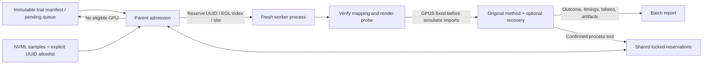

# Revision 4.1: CaP GPU scheduling

- **Status: implemented.** This document retains the implemented scheduling feature and its validation results.
- **Scope:** GPU selection, resource reservations, and parallel trial scheduling entirely within `synthesis/cap/`.
- **Workflow:** each later `4.x` revision addresses one focused problem, with its own implementation and validation before proceeding to the next. Splitting these documents changes no runtime behavior or saved experiment result.

## 1. GPU scheduling

**Status: implemented.** GPU admission is optional and applies to all three
methods, with recovery enabled or disabled. It is implemented entirely within
`synthesis/cap/`. Primitive-failure work is planned separately in
[Revision 4.2](revision_4_2_fix_primitive_noncovergence.md); other deferred work is
kept in the [unimplemented backlog](revision_4_unimplemented.md).

### 1.1 Scope and architecture

MuJoCo physics and primitive control remain on CPU; GPUs provide offscreen
rendering. The scheduler targets trial throughput across model requests,
CPU simulation, rendering, encoding, and artifact I/O. It does not change policy
prompts, generation/checking behavior, recovery feedback, task semantics, or
primitive controllers.

| File | Implemented responsibility |
| --- | --- |
| [gpu_scheduler.py](../gpu_scheduler.py) | NVML monitoring, UUID-to-EGL mapping, shared atomic reservations, process liveness, worker verification, and rendering probe |
| [batch.py](../batch.py) | Existing isolated trial queue, total worker limit, GPU admission, resume, telemetry, and `python -m synthesis.cap.batch` entry point |
| [batch_worker.py](../batch_worker.py) | Claim assignment and verify rendering before importing trial machinery; retain the assignment across recovery attempts |
| [config.py](../config.py) | Validated optional `GPUConfig`, separate from policy and recovery configuration |
| [test_gpu_scheduler.py](../test_gpu_scheduler.py) | Mocked admission/lifecycle tests and opt-in real simulator/rendering parity test |
| [AGENTS.md](../AGENTS.md) | Default parallel experiment execution within authorized resource limits |



No simulator package, primitive API, CFG module, shared experiment reporter,
existing entry script, vendored Google core, or dependency is changed.
Omitting `gpu_config` preserves the existing batch execution path.

### 1.2 Configuration and admission

Pass `gpu_config` to `create_batch(...)`, or include it in the JSON configuration
for the new batch CLI. See the [README usage example](../README.md#gpu-scheduled-parallel-experiments).

| Setting | Behavior |
| --- | --- |
| `gpu_policy` | `auto` (default): choose within the allowlist using reservations and recent monitored load; `fixed`: exactly one explicit UUID |
| `gpu_allowlist` | Required nonempty list of unique physical `GPU-...` UUIDs; never expanded automatically |
| `max_workers` | Existing batch-level field: maximum active trial processes in this batch |
| `max_workers_per_gpu` | Maximum cooperating workers per GPU, including starting workers; default 1 |
| `min_free_memory_mb` | Memory headroom after all worker reservations; required positive in auto mode |
| `worker_memory_mb` | Conservative memory allowance reserved for each worker before launch; required positive in auto mode |
| `gpu_poll_interval_seconds` | NVML sampling interval; default 2 seconds |
| `gpu_sample_window_seconds` | Recent window for mean utilization and minimum free memory; default 10 seconds; use available samples during warm-up |
| `reservation_directory` | Required shared host-local directory used by all cooperating batch schedulers |
| `admission_timeout_seconds` | Default 60 seconds without admission; drain active workers and return with unstarted trials pending, then resume explicitly |

Eligible devices need a verified EGL mapping, a successful latest NVML health
sample, a free slot, and sufficient memory. Admission subtracts the **full**
allowance of every reserved worker, even when NVML already sees some of its
allocation; this deliberately over-reserves instead of spending the same
headroom twice. Within eligible devices, prefer fewer reservations, then lower
mean utilization, then more free memory. Different cooperating policies honor
the stricter active per-GPU slot limit.

NVML is accessed through the installed driver library, without installing a
Python package. Samples include UUID, monitoring index, PCI bus ID, free/used
memory, utilization, and available compute/graphics process memory. The health
field means the memory/utilization/PCI queries succeeded; it is not a full
hardware fault diagnosis. Unavailable process counters are labeled explicitly.

In auto mode, unavailable monitoring prevents new admission. Existing workers
continue; they are not killed because monitoring or external load changed.
Fixed mode can proceed when monitoring itself is unavailable, but records this
limitation and still requires an independently verified EGL mapping and a free
reserved slot. A device reported unhealthy is not admitted. Fixed fallback
cannot enforce a memory threshold without monitoring.

Tune memory allowances and worker counts from measurements. The tested values
are diagnostic settings, not universal production defaults. Slots coordinate
participating schedulers; they do not reserve hardware against other lab users.

### 1.3 Atomic reservations and failure handling

`reservation_directory/scheduler.lock` protects a host-specific
`reservations.json`. Each reservation records the trial's absolute job path,
UUID, EGL index, slot, memory allowance, parent identity, worker identity, state,
and admission sample. Linux process identities combine PID, process start ticks,
and boot ID; stale heartbeats alone never reclaim a live worker's slot.

- Reserve before spawn, including the startup interval before visible allocation.
- The worker claims its token before importing or using the rendering stack.
- Launch failure releases the reservation and retains a failed trial record.
- Confirmed worker exit or crash releases its slot; failed trials are not retried
  under new identities.
- If a parent dies, a live recorded worker keeps its slot. A child launched before
  its PID was recorded is detected by its exact job path, or claims the token
  itself. A child whose reservation was reclaimed cannot initialize the GPU.
- Resume refuses duplicate dispatch while a prior worker is live. Once that
  worker exits, resume collects its artifacts or records interruption and runs
  only previously pending trials.
- File permissions, ambiguous mapping, or foreign-host reservation directories
  fail explicitly rather than silently assigning GPU 0.

The existing batch lock prevents two parents from dispatching the same manifest.
The shared GPU lock coordinates different batches. Request pacing and wire-call
limits remain separate controls and continue to apply inside each worker.

### 1.4 Device mapping and initialization

The installed `mujoco_py` shim enumerates the first eight EGL devices. The mapper
uses the same enumeration prefix and `EGL_EXT_device_persistent_id` to match each
binary device UUID to its physical NVML UUID. Missing, unsupported, or ambiguous
mappings fail before a policy trial. This implementation intentionally does not
infer EGL identity from CUDA visibility or the monitoring index.

The distinction matters on the tested server: monitoring GPU 6 maps to EGL 4,
and monitoring GPU 7 maps to EGL 5. These are recorded observations, not portable
hard-coded mappings.

The parent passes a private `env` dictionary to a fresh subprocess with `GPUS`
set to the verified EGL index. It does not mutate the parent's environment or
inherit a rendering context through fork. The worker verifies the mapping again
and performs a small MuJoCo offscreen rendering probe **before any model call**.
A failure produces `gpu_initialization_failed`, with zero model calls, in the
same trial's artifacts. Non-rendering test fixtures skip only the rendering probe.

The assignment remains fixed through the entire trial, including helper calls
and every recovery attempt. Each attempt retains the existing fresh execution
context and exact initial-state restore. Environment cleanup uses the existing
runner, and process exit releases the graphics resources.

### 1.5 Budgets, artifacts, and measurements

Resource admission occurs before the existing active trial budget starts.
Queue time remains separate. The batch hard deadline, model-call/token limits,
simulation/execution limits, and Unstack's 60-second limit remain unchanged.
The worker holds its slot during model requests because Baseline generation can
interleave with execution, and recovery alternates both stages.

| Artifact | Added scheduling information |
| --- | --- |
| `manifest.json` | Immutable GPU policy, allowlist, memory allowances, limits, and reservation path |
| `schedule.json`, each `job.json`, and trial summaries | UUID/EGL assignment, slot, admission sample, environment settings, and process identity |
| Each runner `config.json` → `config.batch_context.gpu_assignment` | Same assignment for all recovery attempts |
| `gpu_probe.json` | Worker identity, verified UUID/EGL mapping, effective environment, and rendered image dimensions/checksum |
| `gpu_samples.jsonl` | Timestamped device load, memory, identity, and available process measurements |
| `execution_metadata.json` | Peak active workers, pause reasons, sampled device memory/load peaks, and per-worker CPU/RSS/I/O/GPU-memory observations |
| Existing trial artifacts/reports | Queue/active time, phase timings, retries, policy outcome, source attribution, videos, and token totals |

Device memory peaks include other processes. Per-worker memory observations use
NVML process attribution when available; all peaks are sampled, not exact
instantaneous maxima. CPU/RSS/I/O observations cover the worker process, not
all encoder descendants. Existing rendering and video-finalization timings help
interpret these measurements. Scheduling itself adds no model tokens.

### 1.6 Validation

The validation uses mocked GPU state, isolated subprocesses, scripted model
responses, and real MuJoCo rendering. No paid model requests are required.

The focused tests cover simultaneous reservations, startup memory accounting,
allowlist enforcement, recent-load windows, incompatible/missing mapping,
monitoring failure and fixed fallback, launch failure, worker crash, surviving
children, PID reuse, duplicate-trial refusal, parent-environment isolation,
resource-wait pause/resume, and zero-call worker initialization failure.

The opt-in integration test runs all three methods with recovery off/on in
serial and parallel batches from one saved three-block Stack state. It checks
primitive trajectories, exact restore, fixed assignment through recovery,
source checkpoints, independently decoded video frame counts, final outcomes,
and completed-trial resume without repeated requests.

Validation completed on 2026-10-20:

- Default CaP suite: **151 passed**, with the opt-in hardware test skipped.
- Focused GPU tests: **17 passed**, including resume of completed batches when
  GPU discovery is unavailable.
- Hardware integration: **passed** separately, with 12 trials and 18 rollouts
  across three methods, recovery off/on, and one/two workers. All 18 videos
  passed independent frame-count checks. State/action arrays matched exactly
  between serial and parallel execution; delivered source matched active
  checkpoint source. All six recovery-on trials restored the initial state and
  succeeded after one repair. The six recovery-off trials retained the scripted
  no-witness failure. These are expected test outcomes, not model-quality results.
- Completed-batch resume left worker results unchanged. Shared reservations were
  empty after both batches. No remote model requests were made.

| Diagnostic | One worker | Two workers |
| --- | ---: | ---: |
| Trials / rollouts | 6 / 9 | 6 / 9 |
| Observed peak active workers | 1 | 2 |
| First dispatch to last worker exit | 49.69 s | 30.14 s |
| Sampled maximum per-worker GPU memory | 69.89 MiB | 69.89 MiB |
| Sampled maximum worker RSS | 923.54 MiB | 919.68 MiB |

These measurements are one small scripted comparison on a shared server, with
other validation work running concurrently. They validate scheduling and
accounting; they do not establish optimal concurrency or production throughput.
The test used two explicit allowed GPUs, one slot per GPU, 1,024 MiB per-worker
reservations, and 2,048 MiB headroom. Larger worker counts require separate tuning.

Artifacts: [validation directory](../../../runs/cap-gpu-scheduling-validation/20261020-section2-final/),
[serial report](../../../runs/cap-gpu-scheduling-validation/20261020-section2-final/workers-1/report.md),
[parallel report](../../../runs/cap-gpu-scheduling-validation/20261020-section2-final/workers-2/report.md),
and [audit](../../../runs/cap-gpu-scheduling-validation/20261020-section2-final/audit.json).
Earlier fixture-development diagnostics are retained separately; the final
comparison uses the self-contained top-level scripted policy for all methods.

Reproduce focused tests from `roboverify/`:

```bash
.venv/bin/python -m unittest synthesis.cap.test_gpu_scheduler.GPUTests -v
```

For hardware validation, configure the existing MuJoCo runtime first, set the
following environment variables, then run the opt-in test. Use a fresh output
directory for new rollouts; an existing completed output is checked without
repeating trials.

```bash
export CAP_GPU_TEST_UUIDS=GPU-ALLOWED-UUID-1,GPU-ALLOWED-UUID-2
export CAP_GPU_TEST_SNAPSHOT=/absolute/path/to/three-block-stack-initial_state.npz
export CAP_GPU_TEST_OUTPUT=/absolute/path/to/new-validation-directory
.venv/bin/python -m unittest synthesis.cap.test_gpu_scheduler.GPUIntegrationTests -v
```
