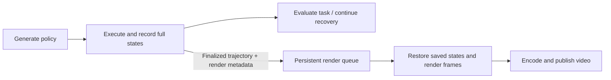

# Revision 4.2.1: deferred video rendering

**Status: implemented. New experiments default to deferred rendering, as requested.**

## 1. Motivation and scope

Separate video production from policy execution so trials can evaluate results
and continue recovery without waiting for rendering or encoding. Share the
feature across Baseline, Method 1, and Method 2.

In the [Revision 4.2 batch](revision_4_2_report.md), the 220 trials spent about
427 worker-seconds on rendering/frame submission and video finalization
(1.26% of recorded phase time; 1.94 seconds per trial). Model requests, including
provider/network waits, accounted for 92.5%. These are summed worker times, not
batch elapsed time: substantial overall acceleration is not established.
The expected benefits are independent resource scheduling, earlier availability
of results, and resumable video generation.

## 2. Configuration and workflow

Shared setting: `video_mode` in `RunConfig`, batch JSON, and the single-trial CLI.

| Mode | Behavior |
| --- | --- |
| `inline` | Render frames during rollout; explicit compatibility/debugging option. |
| `deferred` | **Default for new experiments.** Save trajectories during rollout and enqueue independent rendering jobs. |
| `off` | Save trajectories without automatically generating videos. |

Legacy explicit `save_video=true` selects inline and `false` selects off when
`video_mode` is absent. With neither setting supplied, select deferred. Reject
contradictory explicit settings. All modes retain full snapshots and
execution evidence needed for recovery. Prompts, controllers, DSL checking,
model budgets, and task-success criteria remain unchanged.



- Enqueue each finalized attempt trajectory, including partial failed rollouts.
  Background rendering may overlap later trials; it need not wait for batch completion.
- Use the existing full-state archives from [recording.py](../recording.py).
  Restore each saved snapshot and render it without policy re-execution or
  additional physics steps. Retain frame-to-state indices, 20 FPS, camera,
  resolution, environment/model identity, and relevant visualization settings.
- Run a bounded rendering worker pool using the existing GPU allowlist and
  shared reservation mechanism. Account for experiment and rendering workers
  together; each render job keeps one GPU assignment. Separate render reservations
  from trial reservations without oversubscribing CPU, GPU memory, or encoding.
- Persist job identities and `pending/running/completed/failed` status. Resume
  unfinished jobs without duplicating live workers or overwriting completed
  videos; publish a completed video atomically after validation.

## 3. Results, logging, and implementation boundaries

- Track experiment completion and video completion separately. Rendering failure
  does not change a saved policy outcome or trigger policy recovery.
- Charge deferred rendering to a separate budget. Report experiment elapsed time,
  video queue/render/encode time, and elapsed time until all requested artifacts
  finish. Keep the existing inline timing behavior for historical comparisons.
- Log source trajectory identity, attempt/rollout IDs, frame count, output path,
  GPU assignment, failures, and retry history. Permit explicit later rendering
  of compatible saved trajectories; report missing metadata instead of silently
  claiming an exact visual replay.
- Main integration points: shared configuration/CLI, recorder, batch scheduling,
  a reusable trajectory-to-video worker, and report/video-status handling.
  This revision does not change synthesis or recovery algorithms.

## 4. Tests and evaluation

1. Use deterministic scripted policies for all three methods, including a failed
   primitive and a recovery attempt. Compare `inline`, `deferred`, and `off`:
   actions and outcomes must agree, physical states must agree within documented
   numerical tolerances, and inline/deferred feedback must match after normalizing
   allocated handles. Off-mode bookkeeping differences are reported separately.
2. Validate decoded video frame counts and frame/state mappings. Compare frames
   under the same renderer/camera with a documented codec tolerance; explicitly
   test rendering callbacks and visualization state for replay fidelity.
3. Test interrupted rendering, restart/resume, duplicate job prevention, missing
   or incompatible archives, and shared GPU reservation cleanup.
4. Benchmark matched saved trajectories and scripted rollouts at fixed concurrency,
   recording time to experiment results, time to all videos, throughput, and
   CPU/GPU/memory usage. Use these measurements before
   making performance claims. The deferred default is a workflow preference,
   not a claim of faster total completion. Live model experiments are not required
   for this validation.


## 5. Implementation and validation

- [deferred_video.py](../deferred_video.py) owns immutable render jobs, snapshot
  replay, subprocess deadlines, locking, GPU reservations, restart/retry handling,
  decoded frame-count checks, and atomic video publication. Reports resolve mutable
  video status without rewriting policy results. Legacy archives without captured
  render metadata are not automatically accepted as exact replays.
- The batch worker ceiling includes trial and render processes. `render_workers`
  (default 2) and `render_timeout` (default 600 seconds) bound video work separately.
  Python `run()` only enqueues; batch execution drains automatically. The single-run
  CLI drains after execution, except Unstack, whose videos are processed separately
  to retain its execution deadline. See [usage](../README.md#deferred-video-rendering).
- Regression suite: **210 passed, two opt-in hardware tests skipped** (212 discovered).
  The deferred-video hardware test was also run explicitly and passed.
- [Focused tests](../test_deferred_video.py) cover configuration, all three methods,
  failed primitives/recovery, unchanged policy results, matching feedback, frame
  decoding, archive/metadata errors, locking, interruption, retry, render-worker
  launch failure isolation, and batch resume.
- The opt-in [physical test](../test_deferred_video_simulator.py) completed **9
  scripted trials / 18 attempts / 12 videos**, without model API calls. Every
  method recovered successfully in every video mode. Actions matched exactly;
  normalized inline/deferred feedback matched exactly; all six video pairs had
  **zero decoded pixel difference**. Combined workers stayed at or below three,
  and all GPU reservations were released.
- Inline render callbacks invoke `sim.forward()`, so full physical states are
  numerically rather than byte-for-byte identical: maximum observed observation-vector
  difference was **5.82e-11**. Tests use absolute tolerance 1e-8 for observations,
  full state and control arrays, and 1e-6 for solver warm-start accelerations.
  Deferred/off observations were identical. Allowed video comparison tolerance
  is mean pixel error <= 1 and maximum <= 8; this run observed zero for both.
  Off mode retains its existing absence of video lifecycle log events; it has
  the same execution evidence but different bookkeeping counts in feedback.

| Mode | Experiment results available | All requested artifacts complete |
| --- | ---: | ---: |
| Inline | 9.88 s | 10.12 s |
| Deferred | 8.73 s | 28.90 s |
| Off | 9.17 s | 9.41 s |

These are one small scripted batch per mode, not statistical throughput estimates.
Deferred rendering produced results earlier, but per-job process/environment
initialization increased total video completion time. No overall speedup is claimed;
persistent render workers are a possible later optimization.

[Validation data](../../../runs/cap-revision421-validation/final-20261021/validation.json)
includes parity and timing results. Per-batch execution metadata and GPU samples
retain worker memory/resource measurements.

To repeat the physical test, set `CAP_DEFERRED_GPU_UUIDS` to the authorized UUID
allowlist, `CAP_DEFERRED_SNAPSHOT` to the Stack archive, and `CAP_DEFERRED_OUTPUT`
to a fresh directory, then run (with the normal simulator environment):

```bash
.venv/bin/python -m unittest synthesis.cap.test_deferred_video_simulator -v
```
