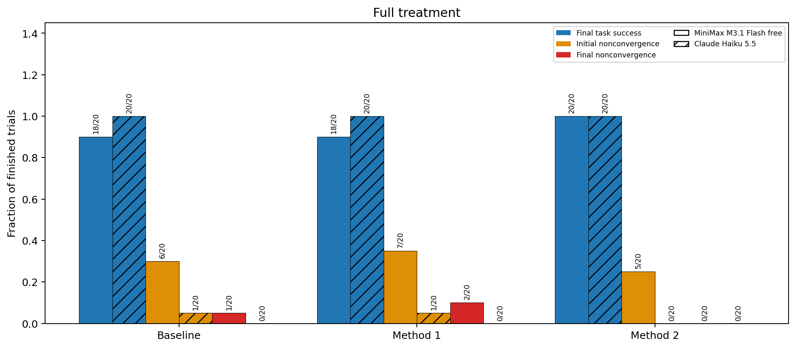
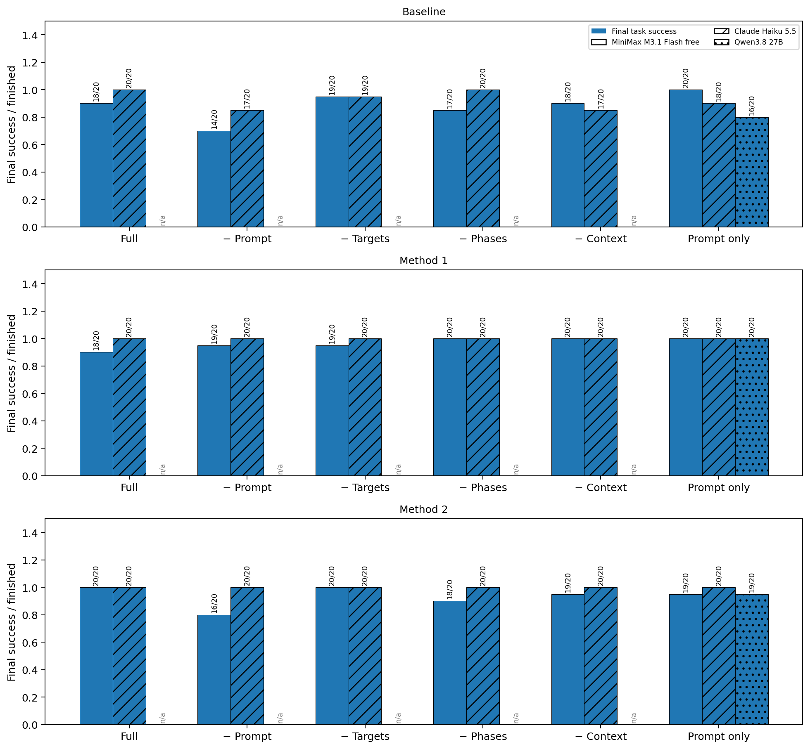
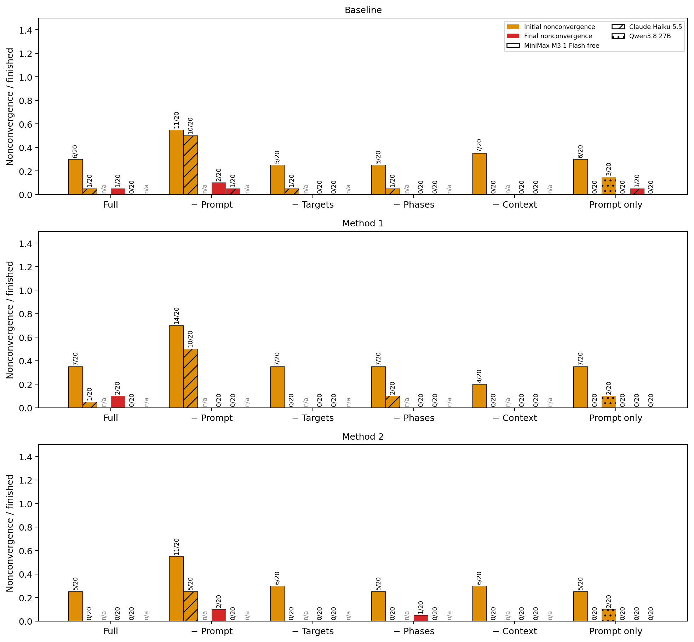

# Revision 4.2: primitive prompt and feedback experiment

**Status: complete; MiniMax M3.1 Flash free 360/360; Claude Haiku 5.5 360/360; Qwen3.8 27B 60/60 trials finished.** Pending trials are not observed failures.

Models: MiniMax M3.1 Flash free, Claude Haiku 5.5, Qwen3.8 27B; each uses medium reasoning; 16,384 output tokens; Stack with three blocks; `dsl_only`; `typed_v3` plus the selected primitive prompt supplement. All trials enable recovery, with up to four repairs/five rollouts from the same full initial state. Model identity is the only experimental difference between cohorts.

**MiniMax M3.1 Flash free:** 60 full-treatment trials cover all three methods. Baseline ablations: `no_prompt`, `no_target`, `no_phases`, `no_context`, `only_prompt` (100 trials). Method 1 ablations: `no_prompt`, `no_target`, `no_phases`, `no_context`, `only_prompt` (100 trials). Method 2 ablations: `no_prompt`, `no_target`, `no_phases`, `no_context`, `only_prompt` (100 trials).

- `20261021-174848-minimax-220` (220 planned): [Immutable manifest](../../../runs/cap-revision42/20261021-174848-minimax-220/manifest.json) · [Configuration and source hashes](../../../runs/cap-revision42/20261021-174848-minimax-220/comparison_plan.json)
- `20261021-minimax-extension-140` (140 planned): [Immutable manifest](../../../runs/cap-revision42/20261021-minimax-extension-140/manifest.json) · [Configuration and source hashes](../../../runs/cap-revision42/20261021-minimax-extension-140/comparison_plan.json)

**Claude Haiku 5.5:** 60 full-treatment trials cover all three methods. Baseline ablations: `no_prompt`, `no_target`, `no_phases`, `no_context`, `only_prompt` (100 trials). Method 1 ablations: `no_prompt`, `no_target`, `no_phases`, `no_context`, `only_prompt` (100 trials). Method 2 ablations: `no_prompt`, `no_target`, `no_phases`, `no_context`, `only_prompt` (100 trials).

- `20261021-haiku55-220` (220 planned): [Immutable manifest](../../../runs/cap-revision42/20261021-haiku55-220/manifest.json) · [Configuration and source hashes](../../../runs/cap-revision42/20261021-haiku55-220/comparison_plan.json)
- `20261021-haiku55-extension-140` (140 planned): [Immutable manifest](../../../runs/cap-revision42/20261021-haiku55-extension-140/manifest.json) · [Configuration and source hashes](../../../runs/cap-revision42/20261021-haiku55-extension-140/comparison_plan.json)

**Qwen3.8 27B:** no full-treatment groups; compare its profiles with the other models' groups. Baseline ablations: `only_prompt` (20 trials). Method 1 ablations: `only_prompt` (20 trials). Method 2 ablations: `only_prompt` (20 trials).

- `20261021-qwen38-27b-only-prompt-60` (60 planned): [Immutable manifest](../../../runs/cap-revision42/20261021-qwen38-27b-only-prompt-60/manifest.json) · [Configuration and source hashes](../../../runs/cap-revision42/20261021-qwen38-27b-only-prompt-60/comparison_plan.json)

The full groups are reused as controls; no duplicate control cohort is added. [Machine-readable analysis](../../../runs/cap-revision42/20261021-combined-minimax-haiku55/revision42_analysis.json) · [Per-trial CSV](../../../runs/cap-revision42/20261021-combined-minimax-haiku55/revision42_trials.csv)

## 1. Main comparison

| Model | Method | Finished / planned | Initial success | Final success | Initial nonconvergence | Final nonconvergence | # of tokens used |
| --- | --- | ---: | ---: | ---: | ---: | ---: | ---: |
| MiniMax M3.1 Flash free | Baseline | 20/20 | 8/20 | 18/20 | 6/20 | 1/20 | 393,895 |
| MiniMax M3.1 Flash free | Method 1 | 20/20 | 6/20 | 18/20 | 7/20 | 2/20 | 397,139 |
| MiniMax M3.1 Flash free | Method 2 | 20/20 | 10/20 | 20/20 | 5/20 | 0/20 | 353,868 |
| Claude Haiku 5.5 | Baseline | 20/20 | 18/20 | 20/20 | 1/20 | 0/20 | 298,416 |
| Claude Haiku 5.5 | Method 1 | 20/20 | 19/20 | 20/20 | 1/20 | 0/20 | 176,025 |
| Claude Haiku 5.5 | Method 2 | 20/20 | 20/20 | 20/20 | 0/20 | 0/20 | 261,273 |

Ratios use finished trials; planned counts remain visible until completion. Nonconvergence includes Pick, Move and Release, not all runtime failures. In the figures, color identifies the measure and hatching identifies the model.

## 2. Candidate-level ablations

`no_prompt` disables all four general-prompt additions. `no_target`, `no_phases`, and `no_context` each disable only their named feedback enrichment. `only_prompt` keeps the four general-prompt additions and disables all three feedback enrichments. Legacy API text and legacy feedback facts remain present.

| Model | Method | Profile | Finished / planned | Initial success | Final success | Initial nonconvergence | Final nonconvergence | Any nonconvergence | Nonconverged / executed rollouts | Tokens |
| --- | --- | --- | ---: | ---: | ---: | ---: | ---: | ---: | ---: | ---: |
| MiniMax M3.1 Flash free | Baseline | full | 20/20 | 8/20 | 18/20 | 6/20 | 1/20 | 7/20 | 10/34 | 393,895 |
| MiniMax M3.1 Flash free | Baseline | no_prompt | 20/20 | 1/20 | 14/20 | 11/20 | 2/20 | 15/20 | 19/63 | 792,942 |
| MiniMax M3.1 Flash free | Baseline | no_target | 20/20 | 11/20 | 19/20 | 5/20 | 0/20 | 6/20 | 7/35 | 427,965 |
| MiniMax M3.1 Flash free | Baseline | no_phases | 20/20 | 8/20 | 17/20 | 5/20 | 0/20 | 8/20 | 11/37 | 548,382 |
| MiniMax M3.1 Flash free | Baseline | no_context | 20/20 | 6/20 | 18/20 | 7/20 | 0/20 | 7/20 | 12/39 | 613,410 |
| MiniMax M3.1 Flash free | Baseline | only_prompt | 20/20 | 8/20 | 20/20 | 6/20 | 0/20 | 7/20 | 12/41 | 520,882 |
| Claude Haiku 5.5 | Baseline | full | 20/20 | 18/20 | 20/20 | 1/20 | 0/20 | 1/20 | 2/24 | 298,416 |
| Claude Haiku 5.5 | Baseline | no_prompt | 20/20 | 6/20 | 17/20 | 10/20 | 1/20 | 11/20 | 12/37 | 501,919 |
| Claude Haiku 5.5 | Baseline | no_target | 20/20 | 18/20 | 19/20 | 1/20 | 0/20 | 1/20 | 1/20 | 245,478 |
| Claude Haiku 5.5 | Baseline | no_phases | 20/20 | 15/20 | 20/20 | 1/20 | 0/20 | 1/20 | 1/25 | 310,097 |
| Claude Haiku 5.5 | Baseline | no_context | 20/20 | 15/20 | 17/20 | 0/20 | 0/20 | 0/20 | 0/20 | 324,167 |
| Claude Haiku 5.5 | Baseline | only_prompt | 20/20 | 18/20 | 18/20 | 0/20 | 1/20 | 1/20 | 4/28 | 454,794 |
| Qwen3.8 27B | Baseline | only_prompt | 20/20 | 12/20 | 16/20 | 3/20 | 0/20 | 4/20 | 7/31 | 454,274 |
| MiniMax M3.1 Flash free | Method 1 | full | 20/20 | 6/20 | 18/20 | 7/20 | 2/20 | 8/20 | 15/41 | 397,139 |
| MiniMax M3.1 Flash free | Method 1 | no_prompt | 20/20 | 2/20 | 19/20 | 14/20 | 0/20 | 16/20 | 24/56 | 481,067 |
| MiniMax M3.1 Flash free | Method 1 | no_target | 20/20 | 9/20 | 19/20 | 7/20 | 0/20 | 8/20 | 10/37 | 349,255 |
| MiniMax M3.1 Flash free | Method 1 | no_phases | 20/20 | 10/20 | 20/20 | 7/20 | 0/20 | 8/20 | 11/36 | 357,175 |
| MiniMax M3.1 Flash free | Method 1 | no_context | 20/20 | 12/20 | 20/20 | 4/20 | 0/20 | 5/20 | 5/32 | 267,157 |
| MiniMax M3.1 Flash free | Method 1 | only_prompt | 20/20 | 8/20 | 20/20 | 7/20 | 0/20 | 10/20 | 13/39 | 382,245 |
| Claude Haiku 5.5 | Method 1 | full | 20/20 | 19/20 | 20/20 | 1/20 | 0/20 | 1/20 | 1/21 | 176,025 |
| Claude Haiku 5.5 | Method 1 | no_prompt | 20/20 | 9/20 | 20/20 | 10/20 | 0/20 | 10/20 | 13/34 | 273,816 |
| Claude Haiku 5.5 | Method 1 | no_target | 20/20 | 19/20 | 20/20 | 0/20 | 0/20 | 0/20 | 0/21 | 176,747 |
| Claude Haiku 5.5 | Method 1 | no_phases | 20/20 | 16/20 | 20/20 | 2/20 | 0/20 | 3/20 | 3/25 | 223,682 |
| Claude Haiku 5.5 | Method 1 | no_context | 20/20 | 18/20 | 20/20 | 0/20 | 0/20 | 0/20 | 0/22 | 187,035 |
| Claude Haiku 5.5 | Method 1 | only_prompt | 20/20 | 19/20 | 20/20 | 0/20 | 0/20 | 0/20 | 0/21 | 166,591 |
| Qwen3.8 27B | Method 1 | only_prompt | 20/20 | 16/20 | 20/20 | 2/20 | 0/20 | 3/20 | 3/26 | 312,186 |
| MiniMax M3.1 Flash free | Method 2 | full | 20/20 | 10/20 | 20/20 | 5/20 | 0/20 | 8/20 | 10/35 | 353,868 |
| MiniMax M3.1 Flash free | Method 2 | no_prompt | 20/20 | 3/20 | 16/20 | 11/20 | 2/20 | 16/20 | 27/64 | 599,750 |
| MiniMax M3.1 Flash free | Method 2 | no_target | 20/20 | 9/20 | 20/20 | 6/20 | 0/20 | 9/20 | 15/41 | 428,629 |
| MiniMax M3.1 Flash free | Method 2 | no_phases | 20/20 | 13/20 | 18/20 | 5/20 | 1/20 | 5/20 | 10/35 | 366,233 |
| MiniMax M3.1 Flash free | Method 2 | no_context | 20/20 | 10/20 | 19/20 | 6/20 | 0/20 | 7/20 | 10/33 | 383,863 |
| MiniMax M3.1 Flash free | Method 2 | only_prompt | 20/20 | 10/20 | 19/20 | 5/20 | 0/20 | 6/20 | 12/42 | 401,619 |
| Claude Haiku 5.5 | Method 2 | full | 20/20 | 20/20 | 20/20 | 0/20 | 0/20 | 0/20 | 0/20 | 261,273 |
| Claude Haiku 5.5 | Method 2 | no_prompt | 20/20 | 15/20 | 20/20 | 5/20 | 0/20 | 5/20 | 6/26 | 294,617 |
| Claude Haiku 5.5 | Method 2 | no_target | 20/20 | 20/20 | 20/20 | 0/20 | 0/20 | 0/20 | 0/20 | 254,902 |
| Claude Haiku 5.5 | Method 2 | no_phases | 20/20 | 20/20 | 20/20 | 0/20 | 0/20 | 0/20 | 0/20 | 241,926 |
| Claude Haiku 5.5 | Method 2 | no_context | 20/20 | 20/20 | 20/20 | 0/20 | 0/20 | 0/20 | 0/20 | 234,474 |
| Claude Haiku 5.5 | Method 2 | only_prompt | 20/20 | 20/20 | 20/20 | 0/20 | 0/20 | 0/20 | 0/20 | 238,181 |
| Qwen3.8 27B | Method 2 | only_prompt | 20/20 | 17/20 | 19/20 | 2/20 | 0/20 | 2/20 | 5/26 | 351,193 |

### 2.1 Unsuccessful trials by terminal path

| Model | Method | Profile | Unsuccessful | Final nonconvergence | Final execution/query budget stop | Final goal failure | Final other runtime failure | Preparation stop | Feedback-size stop |
| --- | --- | --- | ---: | ---: | ---: | ---: | ---: | ---: | ---: |
| MiniMax M3.1 Flash free | Baseline | full | 2 | 1 | 0 | 0 | 0 | 1 | 1 |
| MiniMax M3.1 Flash free | Baseline | no_prompt | 6 | 2 | 0 | 2 | 1 | 1 | 1 |
| MiniMax M3.1 Flash free | Baseline | no_target | 1 | 0 | 0 | 1 | 0 | 0 | 0 |
| MiniMax M3.1 Flash free | Baseline | no_phases | 3 | 0 | 0 | 0 | 1 | 2 | 0 |
| MiniMax M3.1 Flash free | Baseline | no_context | 2 | 0 | 0 | 0 | 0 | 2 | 0 |
| MiniMax M3.1 Flash free | Baseline | only_prompt | 0 | 0 | 0 | 0 | 0 | 0 | 0 |
| MiniMax M3.1 Flash free | Method 1 | full | 2 | 2 | 0 | 0 | 0 | 0 | 0 |
| MiniMax M3.1 Flash free | Method 1 | no_prompt | 1 | 0 | 1 | 0 | 0 | 0 | 0 |
| MiniMax M3.1 Flash free | Method 1 | no_target | 1 | 0 | 1 | 0 | 0 | 0 | 0 |
| MiniMax M3.1 Flash free | Method 1 | no_phases | 0 | 0 | 0 | 0 | 0 | 0 | 0 |
| MiniMax M3.1 Flash free | Method 1 | no_context | 0 | 0 | 0 | 0 | 0 | 0 | 0 |
| MiniMax M3.1 Flash free | Method 1 | only_prompt | 0 | 0 | 0 | 0 | 0 | 0 | 0 |
| MiniMax M3.1 Flash free | Method 2 | full | 0 | 0 | 0 | 0 | 0 | 0 | 0 |
| MiniMax M3.1 Flash free | Method 2 | no_prompt | 4 | 2 | 1 | 1 | 0 | 0 | 0 |
| MiniMax M3.1 Flash free | Method 2 | no_target | 0 | 0 | 0 | 0 | 0 | 0 | 0 |
| MiniMax M3.1 Flash free | Method 2 | no_phases | 2 | 1 | 0 | 1 | 0 | 0 | 0 |
| MiniMax M3.1 Flash free | Method 2 | no_context | 1 | 0 | 0 | 0 | 0 | 1 | 0 |
| MiniMax M3.1 Flash free | Method 2 | only_prompt | 1 | 0 | 0 | 1 | 0 | 0 | 0 |
| Claude Haiku 5.5 | Baseline | full | 0 | 0 | 0 | 0 | 0 | 0 | 0 |
| Claude Haiku 5.5 | Baseline | no_prompt | 3 | 1 | 0 | 0 | 0 | 2 | 0 |
| Claude Haiku 5.5 | Baseline | no_target | 1 | 0 | 0 | 0 | 0 | 1 | 0 |
| Claude Haiku 5.5 | Baseline | no_phases | 0 | 0 | 0 | 0 | 0 | 0 | 0 |
| Claude Haiku 5.5 | Baseline | no_context | 3 | 0 | 0 | 0 | 0 | 3 | 0 |
| Claude Haiku 5.5 | Baseline | only_prompt | 2 | 1 | 0 | 0 | 1 | 0 | 0 |
| Claude Haiku 5.5 | Method 1 | full | 0 | 0 | 0 | 0 | 0 | 0 | 0 |
| Claude Haiku 5.5 | Method 1 | no_prompt | 0 | 0 | 0 | 0 | 0 | 0 | 0 |
| Claude Haiku 5.5 | Method 1 | no_target | 0 | 0 | 0 | 0 | 0 | 0 | 0 |
| Claude Haiku 5.5 | Method 1 | no_phases | 0 | 0 | 0 | 0 | 0 | 0 | 0 |
| Claude Haiku 5.5 | Method 1 | no_context | 0 | 0 | 0 | 0 | 0 | 0 | 0 |
| Claude Haiku 5.5 | Method 1 | only_prompt | 0 | 0 | 0 | 0 | 0 | 0 | 0 |
| Claude Haiku 5.5 | Method 2 | full | 0 | 0 | 0 | 0 | 0 | 0 | 0 |
| Claude Haiku 5.5 | Method 2 | no_prompt | 0 | 0 | 0 | 0 | 0 | 0 | 0 |
| Claude Haiku 5.5 | Method 2 | no_target | 0 | 0 | 0 | 0 | 0 | 0 | 0 |
| Claude Haiku 5.5 | Method 2 | no_phases | 0 | 0 | 0 | 0 | 0 | 0 | 0 |
| Claude Haiku 5.5 | Method 2 | no_context | 0 | 0 | 0 | 0 | 0 | 0 | 0 |
| Claude Haiku 5.5 | Method 2 | only_prompt | 0 | 0 | 0 | 0 | 0 | 0 | 0 |
| Qwen3.8 27B | Baseline | only_prompt | 4 | 0 | 0 | 0 | 0 | 4 | 0 |
| Qwen3.8 27B | Method 1 | only_prompt | 0 | 0 | 0 | 0 | 0 | 0 | 0 |
| Qwen3.8 27B | Method 2 | only_prompt | 1 | 0 | 0 | 0 | 0 | 1 | 0 |

The feedback-size column can overlap a final rollout failure: that stop occurs while preparing feedback for another attempt. A preparation stop has no final rollout.

## 3. Recovery transitions and failure exposure

| Model | Method | Profile | Nonconv → nonconv / eligible transitions | Same primitive | Next task success | Next other execution failure | Next preparation failure | Terminal nonconv without next attempt | Pick / Move / Release failed rollouts |
| --- | --- | --- | ---: | ---: | ---: | ---: | ---: | ---: | --- |
| MiniMax M3.1 Flash free | Baseline | full | 3/9 | 1 | 6 | 0 | 0 | 1 | 3 / 6 / 1 |
| MiniMax M3.1 Flash free | Baseline | no_prompt | 3/17 | 2 | 6 | 8 | 0 | 2 | 2 / 15 / 2 |
| MiniMax M3.1 Flash free | Baseline | no_target | 1/7 | 0 | 5 | 1 | 0 | 0 | 3 / 4 / 0 |
| MiniMax M3.1 Flash free | Baseline | no_phases | 3/11 | 3 | 6 | 1 | 1 | 0 | 1 / 9 / 1 |
| MiniMax M3.1 Flash free | Baseline | no_context | 5/12 | 1 | 5 | 2 | 0 | 0 | 4 / 5 / 3 |
| MiniMax M3.1 Flash free | Baseline | only_prompt | 5/12 | 3 | 5 | 2 | 0 | 0 | 4 / 7 / 1 |
| MiniMax M3.1 Flash free | Method 1 | full | 7/13 | 3 | 5 | 1 | 0 | 2 | 2 / 9 / 4 |
| MiniMax M3.1 Flash free | Method 1 | no_prompt | 7/24 | 5 | 12 | 5 | 0 | 0 | 4 / 19 / 1 |
| MiniMax M3.1 Flash free | Method 1 | no_target | 2/10 | 1 | 6 | 2 | 0 | 0 | 6 / 2 / 2 |
| MiniMax M3.1 Flash free | Method 1 | no_phases | 3/11 | 2 | 6 | 2 | 0 | 0 | 4 / 4 / 3 |
| MiniMax M3.1 Flash free | Method 1 | no_context | 0/5 | 0 | 3 | 2 | 0 | 0 | 1 / 3 / 1 |
| MiniMax M3.1 Flash free | Method 1 | only_prompt | 3/13 | 2 | 9 | 1 | 0 | 0 | 2 / 10 / 1 |
| MiniMax M3.1 Flash free | Method 2 | full | 2/10 | 1 | 8 | 0 | 0 | 0 | 3 / 6 / 1 |
| MiniMax M3.1 Flash free | Method 2 | no_prompt | 8/25 | 3 | 9 | 8 | 0 | 2 | 5 / 20 / 2 |
| MiniMax M3.1 Flash free | Method 2 | no_target | 6/15 | 3 | 9 | 0 | 0 | 0 | 6 / 8 / 1 |
| MiniMax M3.1 Flash free | Method 2 | no_phases | 5/9 | 4 | 3 | 1 | 0 | 1 | 4 / 4 / 2 |
| MiniMax M3.1 Flash free | Method 2 | no_context | 3/10 | 1 | 6 | 1 | 0 | 0 | 4 / 5 / 1 |
| MiniMax M3.1 Flash free | Method 2 | only_prompt | 6/12 | 1 | 3 | 3 | 0 | 0 | 2 / 7 / 3 |
| Claude Haiku 5.5 | Baseline | full | 1/2 | 1 | 0 | 1 | 0 | 0 | 0 / 2 / 0 |
| Claude Haiku 5.5 | Baseline | no_prompt | 1/11 | 0 | 7 | 1 | 2 | 1 | 2 / 8 / 2 |
| Claude Haiku 5.5 | Baseline | no_target | 0/1 | 0 | 1 | 0 | 0 | 0 | 0 / 0 / 1 |
| Claude Haiku 5.5 | Baseline | no_phases | 0/1 | 0 | 1 | 0 | 0 | 0 | 0 / 0 / 1 |
| Claude Haiku 5.5 | Baseline | no_context | 0/0 | 0 | 0 | 0 | 0 | 0 | 0 / 0 / 0 |
| Claude Haiku 5.5 | Baseline | only_prompt | 3/3 | 1 | 0 | 0 | 0 | 1 | 2 / 0 / 2 |
| Claude Haiku 5.5 | Method 1 | full | 0/1 | 0 | 1 | 0 | 0 | 0 | 1 / 0 / 0 |
| Claude Haiku 5.5 | Method 1 | no_prompt | 3/13 | 1 | 10 | 0 | 0 | 0 | 6 / 6 / 1 |
| Claude Haiku 5.5 | Method 1 | no_target | 0/0 | 0 | 0 | 0 | 0 | 0 | 0 / 0 / 0 |
| Claude Haiku 5.5 | Method 1 | no_phases | 0/3 | 0 | 3 | 0 | 0 | 0 | 1 / 1 / 1 |
| Claude Haiku 5.5 | Method 1 | no_context | 0/0 | 0 | 0 | 0 | 0 | 0 | 0 / 0 / 0 |
| Claude Haiku 5.5 | Method 1 | only_prompt | 0/0 | 0 | 0 | 0 | 0 | 0 | 0 / 0 / 0 |
| Claude Haiku 5.5 | Method 2 | full | 0/0 | 0 | 0 | 0 | 0 | 0 | 0 / 0 / 0 |
| Claude Haiku 5.5 | Method 2 | no_prompt | 1/6 | 0 | 5 | 0 | 0 | 0 | 0 / 5 / 1 |
| Claude Haiku 5.5 | Method 2 | no_target | 0/0 | 0 | 0 | 0 | 0 | 0 | 0 / 0 / 0 |
| Claude Haiku 5.5 | Method 2 | no_phases | 0/0 | 0 | 0 | 0 | 0 | 0 | 0 / 0 / 0 |
| Claude Haiku 5.5 | Method 2 | no_context | 0/0 | 0 | 0 | 0 | 0 | 0 | 0 / 0 / 0 |
| Claude Haiku 5.5 | Method 2 | only_prompt | 0/0 | 0 | 0 | 0 | 0 | 0 | 0 / 0 / 0 |
| Qwen3.8 27B | Baseline | only_prompt | 3/7 | 1 | 1 | 1 | 2 | 0 | 3 / 4 / 0 |
| Qwen3.8 27B | Method 1 | only_prompt | 0/3 | 0 | 3 | 0 | 0 | 0 | 0 / 1 / 2 |
| Qwen3.8 27B | Method 2 | only_prompt | 3/5 | 2 | 1 | 0 | 1 | 0 | 1 / 2 / 2 |

A transition is eligible only when an actual next attempt exists. Repeated failure labels do not establish the same defect, and disappearance of nonconvergence is not necessarily success. Attempts/transitions within a trial are dependent; these plots do not assign independent-sample confidence intervals to them.

## 4. Validation, resources, and comparison scope

- **MiniMax M3.1 Flash free** — artifact audit issues: **0**; verified delivered recovery payloads: 387; saved videos: 747. Reported tokens: 8,065,476; calls: 936; calls without returned usage: 0.
- **Claude Haiku 5.5** — artifact audit issues: **0**; verified delivered recovery payloads: 70; saved videos: 430. Reported tokens: 4,864,140; calls: 569; calls without returned usage: 0.
- **Qwen3.8 27B** — artifact audit issues: **0**; verified delivered recovery payloads: 28; saved videos: 88. Reported tokens: 1,117,653; calls: 89; calls without returned usage: 0.
- Independent video decoding checks: enabled. Reasoning is included in output usage once.
- Source compliance, physical task success, and logical postconditions remain distinct. Baseline retains the pinned original executor and no pre-execution DSL gate. No preparation/API repair mechanism was added.
- GPU assignments are fixed through each trial; request pacing and quota reservations are independent controls. Credential values are absent from manifests/logs; only environment-variable identities are recorded.
- All groups use independent policy generations on one fixed scene. Ablating general prompts can change the initial candidate; this is an end-to-end ablation, not a paired repair comparison from identical failed programs.
- Historical MiniMax recovery-on results were Baseline 42/50, Method 1 40/50, Method 2 40/50 final success; initial nonconvergence 24/50, 28/50, 19/50; final nonconvergence 3/50, 6/50, 7/50. These are a separate historical cohort with different execution dates/request concurrency, not a contemporaneous control.
- The scripted physical preflights and minimal credential probes are excluded from the 780 live trials. Full validation logs and preflight audits are retained with the experiment artifacts.
- Requested workers (`20261021-174848-minimax-220`): 18; observed peak active workers: 14. [GPU/resource telemetry](../../../runs/cap-revision42/20261021-174848-minimax-220/execution_metadata.json)
- Wire requests by credential environment (`20261021-174848-minimax-220`): `{"OPENROUTER_API_KEY": 361, "OPENROUTER_API_KEY_2": 44, "OPENROUTER_API_KEY_3": 44, "OPENROUTER_API_KEY_4": 44}`.
- Requested workers (`20261021-minimax-extension-140`): 18; observed peak active workers: 8. [GPU/resource telemetry](../../../runs/cap-revision42/20261021-minimax-extension-140/execution_metadata.json)
- Wire requests by credential environment (`20261021-minimax-extension-140`): `{"OPENROUTER_API_KEY": 443}`.
- Requested workers (`20261021-haiku55-220`): 18; observed peak active workers: 18. [GPU/resource telemetry](../../../runs/cap-revision42/20261021-haiku55-220/execution_metadata.json)
- Wire requests by credential environment (`20261021-haiku55-220`): `{"OPENROUTER_API_KEY": 276}`.
- Requested workers (`20261021-haiku55-extension-140`): 18; observed peak active workers: 16. [GPU/resource telemetry](../../../runs/cap-revision42/20261021-haiku55-extension-140/execution_metadata.json)
- Wire requests by credential environment (`20261021-haiku55-extension-140`): `{"OPENROUTER_API_KEY": 293}`.
- Requested workers (`20261021-qwen38-27b-only-prompt-60`): 18; observed peak active workers: 13. [GPU/resource telemetry](../../../runs/cap-revision42/20261021-qwen38-27b-only-prompt-60/execution_metadata.json)
- Wire requests by credential environment (`20261021-qwen38-27b-only-prompt-60`): `{"OPENROUTER_API_KEY": 89}`.

## 5. Interpretation of the completed results

- **Workload totals.** MiniMax finishes 334/360, Claude Haiku 5.5 351/360 and Qwen3.8 27B 55/60. These are totals across different treatments, not single-method success estimates.
- **The general-prompt effect replicates in every method/model pair and is clearest in the initial attempt.** The feedback configuration is not delivered before the first rollout. Removing the four prompt additions raises initial nonconvergence:

  | Model | Baseline | Method 1 | Method 2 |
  | --- | --- | --- | --- |
  | MiniMax | 6/20 → 11/20 | 7/20 → 14/20 | 5/20 → 11/20 |
  | Haiku | 1/20 → 10/20 | 1/20 → 10/20 | 0/20 → 5/20 |

  Initial success falls correspondingly (Section 5.3).
- **Prompt additions with legacy feedback are as effective as the full configuration in these data.**
  - `only_prompt` finishes MiniMax 20/20, 20/20 and 19/20 (Baseline, Method 1, Method 2), versus 18/20, 18/20 and 20/20 for `full`. Haiku finishes 18/20, 20/20 and 20/20, versus 20/20 in every `full` group.
  - Among initially unsuccessful MiniMax trials, `only_prompt` recovers 33/34 and `full` 32/36 (Section 5.4).
  - Both MiniMax feedback-size stops occurred with all three enrichments enabled.
  - At 20 trials per group, these differences do not establish that the enrichments help or hurt. They also do not show any benefit beyond legacy feedback.
- **Feedback components cannot be ranked from these data.** Final-success differences among feedback profiles are at most a few trials per 20.
  - Haiku leaves few executed failures for feedback to act on: Method 2 has no initially unsuccessful trial in its five prompt-on profiles (0/100), and Method 1 has nine, all recovered.
  - Most remaining Baseline losses for all three models are preparation stops, such as generated helper SyntaxErrors, which the enrichments do not address.
- **Qwen3.8 27B, `only_prompt` only, behaves like a model between MiniMax and Haiku.** It reaches initial success 12/20, 16/20 and 17/20 and final success 16/20, 20/20 and 19/20. Its 7 initial nonconvergences across methods all ended without final nonconvergence. Three of its five losses are response-length stops: recovery requests exhausted the 16,384-token output cap.
- **Identical initial prompts were verified.** Within each method, all prompt-on profiles have byte-identical first prompts, so their initial differences are sampling outcomes. The `no_prompt` first prompts match the historical typed_v3 prompts byte for byte: for MiniMax Method 1/2, and for all three Haiku methods against the Revision 4 Haiku cohort.
- **One successful final policy fails the post-hoc DSL audit.** MiniMax Baseline `no_phases` trial 11 succeeds physically, but its final output reports `TYPE: Expected position, got vector`. Its loop and selection conditions use only DSL predicates. Review confirms a genuine contract violation, not a conservative checker limitation: the policy builds a three-element list `displacement` from scalar position differences and then indexes it (`-displacement[0]`, policy line 14). The shared API footer states "Only Position3 literal indexing 0/1/2 is allowed; no general indexing or vector arithmetic", and the checker types such a list as an action-offset vector. An equivalent compliant policy would inline the scalar differences. Baseline has no pre-execution gate and `on_dsl_noncompliance` is off, so the trial remains a physical success with a failed audit. It is the first successful-but-audit-failing Baseline output in the Revision 4.2 batches.

### 5.1 MiniMax M3.1 Flash

- **Full treatment:** 56/60 tasks succeed: Baseline 18/20, Method 1 18/20, and Method 2 20/20.
- **Baseline ablations (new):** full 18/20, `no_prompt` 14/20, `no_target` 19/20, `no_phases` 17/20, `no_context` 18/20, `only_prompt` 20/20. `no_prompt` has the most initial nonconvergence (11/20) and the lowest initial success (1/20).
- **The full configuration does not uniformly dominate the feedback ablations.** Method 1 finishes 18/20 with all features, versus 19/20, 20/20, 20/20 and 20/20 for `no_target`, `no_phases`, `no_context` and `only_prompt`. Method 2 finishes 20/20 full, 20/20 `no_target`, 18/20 `no_phases`, 19/20 `no_context` and 19/20 `only_prompt`. With 20 trials per setting and independently generated initial candidates, these small differences do not establish a ranking of the feedback components.

### 5.2 Claude Haiku 5.5 and Qwen3.8 27B

- **Haiku full treatment:** 60/60 tasks succeed. Initial success is already 18/20, 19/20 and 20/20, with one initial nonconvergence each for Baseline and Method 1.
- **Haiku Baseline is the only Haiku method with residual failures.** Across its six profiles it finishes 20, 17, 19, 20, 17 and 18 of 20 (full, `no_prompt`, `no_target`, `no_phases`, `no_context`, `only_prompt`). Six of its nine losses are preparation stops on generated helper/source SyntaxErrors.
- **Token use.** Haiku uses fewer tokens than MiniMax in every group both models ran; for example, full treatment uses 298,416 / 176,025 / 261,273 versus 393,895 / 397,139 / 353,868. Qwen's `only_prompt` groups use 454,274 / 312,186 / 351,193.
- **Qwen was added as a weaker-model stress test** with the `only_prompt` profile only. It has no full-treatment control, so its groups are compared descriptively with the other models' `only_prompt` groups.
- **Model identity is the only experimental difference.** All cohorts reuse the same job definitions, including the 300-second request timeout, budgets and evidence cap. Only execution controls differ: credentials, pacing, request caps and video mode.

### 5.3 Exploratory pooled initial-prompt comparison

This table pools the prompt-on profiles within each method **only for the initial attempt**, before any feedback setting can apply. It is descriptive and does not replace the per-profile results.

| Model | Method | General prompt | Initial success | Initial nonconvergence |
| --- | --- | --- | ---: | ---: |
| MiniMax M3.1 Flash free | Baseline | On, five profiles pooled | 41/100 (41.0%) | 29/100 (29.0%) |
| MiniMax M3.1 Flash free | Baseline | Off | 1/20 (5.0%) | 11/20 (55.0%) |
| MiniMax M3.1 Flash free | Method 1 | On, five profiles pooled | 45/100 (45.0%) | 32/100 (32.0%) |
| MiniMax M3.1 Flash free | Method 1 | Off | 2/20 (10.0%) | 14/20 (70.0%) |
| MiniMax M3.1 Flash free | Method 2 | On, five profiles pooled | 52/100 (52.0%) | 27/100 (27.0%) |
| MiniMax M3.1 Flash free | Method 2 | Off | 3/20 (15.0%) | 11/20 (55.0%) |
| Claude Haiku 5.5 | Baseline | On, five profiles pooled | 84/100 (84.0%) | 3/100 (3.0%) |
| Claude Haiku 5.5 | Baseline | Off | 6/20 (30.0%) | 10/20 (50.0%) |
| Claude Haiku 5.5 | Method 1 | On, five profiles pooled | 91/100 (91.0%) | 3/100 (3.0%) |
| Claude Haiku 5.5 | Method 1 | Off | 9/20 (45.0%) | 10/20 (50.0%) |
| Claude Haiku 5.5 | Method 2 | On, five profiles pooled | 100/100 (100.0%) | 0/100 (0.0%) |
| Claude Haiku 5.5 | Method 2 | Off | 15/20 (75.0%) | 5/20 (25.0%) |
| Qwen3.8 27B | Baseline | On, `only_prompt` | 12/20 (60.0%) | 3/20 (15.0%) |
| Qwen3.8 27B | Method 1 | On, `only_prompt` | 16/20 (80.0%) | 2/20 (10.0%) |
| Qwen3.8 27B | Method 2 | On, `only_prompt` | 17/20 (85.0%) | 2/20 (10.0%) |

### 5.4 Recovery of initially unsuccessful trials

Feedback can only matter after an executed failure. The table counts trials whose initial attempt was unsuccessful and reports how many finished successfully. The denominators differ by group and are small; they are not matched failed programs.

| Model | Method | full | no_prompt | no_target | no_phases | no_context | only_prompt |
| --- | --- | ---: | ---: | ---: | ---: | ---: | ---: |
| MiniMax M3.1 Flash free | Baseline | 10/12 | 13/19 | 8/9 | 9/12 | 12/14 | 12/12 |
| MiniMax M3.1 Flash free | Method 1 | 12/14 | 17/18 | 10/11 | 10/10 | 8/8 | 12/12 |
| MiniMax M3.1 Flash free | Method 2 | 10/10 | 13/17 | 11/11 | 5/7 | 9/10 | 9/10 |
| Claude Haiku 5.5 | Baseline | 2/2 | 11/14 | 1/2 | 5/5 | 2/5 | 0/2 |
| Claude Haiku 5.5 | Method 1 | 1/1 | 11/11 | 1/1 | 4/4 | 2/2 | 1/1 |
| Claude Haiku 5.5 | Method 2 | 0/0 | 5/5 | 0/0 | 0/0 | 0/0 | 0/0 |
| Qwen3.8 27B | Baseline | — | — | — | — | — | 4/8 |
| Qwen3.8 27B | Method 1 | — | — | — | — | — | 4/4 |
| Qwen3.8 27B | Method 2 | — | — | — | — | — | 2/3 |

`—` marks a group that was not run. Several unrecovered Baseline trials are preparation stops (SyntaxErrors or response-length stops) rather than unrepaired executed failures.

### 5.5 Failures and budget effects

Section 2.1 gives every unsuccessful trial's terminal path.

**MiniMax stop paths.**

- Baseline full trial 2 stops before rollout on a helper/source SyntaxError. Its original preparation behavior is preserved.
- Method 2 no_context trial 1 stops during initial preparation because a request reservation exceeds the fixed round token allowance. Its 19/20 final result is not evidence that removing action context prevented repair of an executed failure; this trial never reached that stage.
- Baseline full trial 20 executes three unsuccessful candidates (execution/query budget failure, NameError, Pick nonconvergence), then stops with `required_feedback_exceeds_token_limit`. Offline reconstruction of the same saved attempt gives **8,300 bytes** for the combined required diagnostics plus metadata, even with zero optional action-context records and zero optional legacy supporting events, exceeding the **8,192-byte cap by 108 bytes**. The legacy selector on the same recorded events fits at 8,061 bytes. This is a feedback-packing limitation of the new combination, not evidence that the model used all four repairs unsuccessfully. No additional candidate was generated or rerun.
[Feedback-size diagnostic](../../../runs/cap-revision42/20261021-174848-minimax-220/feedback_budget_diagnostic.json) · [Affected trial](../../../runs/cap-revision42/20261021-174848-minimax-220/trials/cap_google_baseline-dsl_only-020-recovery-on-full/cap/20261021-184244-29d9ebf-cap_google_baseline-recovery-b33d7805)
- Baseline `no_prompt` trial 10 is a second `required_feedback_exceeds_token_limit` stop after a Pick nonconvergence, again with all three feedback enrichments enabled. Its size breakdown has not been reconstructed.
- In the new Baseline ablations, the 12 unsuccessful trials comprise:
  - 5 preparation stops on generated SyntaxErrors, one of them a duplicate argument `b0`;
  - 3 final goal failures;
  - 2 final runtime errors: a NameError, and a TypeError from a helper called with a missing argument;
  - 2 final nonconvergences (`no_prompt` trials 10 and 20).

  Method 2 `only_prompt` trial 1 ends in two final goal failures.
- Delivered action context also depends on the shared byte cap: of 126 feedback payloads with action-context enrichment enabled in the original MiniMax batch, 125 have context candidates, 118 include at least one selected action, 98 omit at least one candidate under the cap, and 7 omit every candidate. One payload has no eligible candidate. These omissions are explicit. Removing another enrichment can free space for more context or legacy events, so these are ablations of the bounded end-to-end system, not strictly identical payloads with only one block deleted.
[Actual feedback-feature coverage](../../../runs/cap-revision42/20261021-174848-minimax-220/feedback_feature_coverage.json)

**Root causes of the six final nonconvergences in the original 220-trial MiniMax batch.** This is a read-only retrospective review of each trial's final checkpoint, timeline events, recorded trajectory and delivered feedback. The reachable ceiling is inferred from where the gripper stalls, not from a kinematic computation.

| Trial | Final failure | Root cause | Recurring across rounds | Delivered feedback |
| --- | --- | --- | --- | --- |
| Baseline full 20 | Pick descent: target z 0.411 m, stalled at 0.419 m, residual 0.0082 m | `Release(tower, 0.05)` referenced the base block, so the retreat was effectively zero. The next Pick's horizontal approach knocked b1 off b0. The policy then picked b1 with b2 on top, released in mid-air, and Pick sampled b1's height during the impact transient | No; first occurrence in the final rollout | Not delivered: the required diagnostics exceed the 8,192-byte cap |
| Method 1 full 1 | Move: target z 0.976 m, stalled near 0.965 m, residual 0.0142 m | A 4 cm Release retreat left open fingertips low enough for the next Pick's approach to drag d373 off b0. The policy then picked d373 from under a9cf and referenced the Move target to a9cf while it was being carried, so the target rose above the reachable ceiling | Yes; round 3 failed the same way | Keyframes implied the facts, but no field named the displaced tower or the moving reference; the model changed only lift heights |
| Method 1 full 14 | Move with closed gripper toward block centre +0.03 m: stalled at 0.458 m, residual 0.0029 m | A new pre-grasp descent with closed fingers pressed into the block top. It was introduced after the model misdiagnosed the previous round's target, which referenced a falling block. The guard also cannot terminate with three blocks | Pattern yes (infeasible target each round), specific defect no | Accurate target derivation and keyframes; misdiagnosed by the model |
| Method 2 no_phases 13 | Move with two carried blocks: residual 0.0029 m near x ≈ 1.43 m, at the edge of the reachable range | From round 1 the guard `x≠b0 ∧ x≠top` never terminates. The tower was complete at step 73, but the loop continued, repeatedly lifting covered blocks with targets referenced to the block riding on top | Yes; rounds 2–4 share the structure | No phase diagnostics in this profile, and no field states that the goal was reached while the loop continued |
| Method 2 no_prompt 2 | Pick descent: target z 0.416 m, stalled at 0.419 m, residual 0.0038 m | Same chain as Baseline 20: a zero-height Release, then a tower knocked over by the next approach, then repeated lifts of a covered block with a Move referenced to the carried block itself. Pick finally sampled an impact transient | Yes; the Release line was never changed, and round 2 had the same Pick failure | Previous round ended on a budget stop, so no primitive diagnostics were delivered |
| Method 2 no_prompt 5 | Move: target z 0.999 m, stalled at 0.97 m, residual 0.0376 m | Offset frame error: the policy added the reference Z itself, so Move counted it twice (target 2·Z + 0.05). The first iteration converged at 0.899 m by chance; the second exceeded the reachable ceiling | Infeasible targets each round, with different specific defects | Target derivation showed the arithmetic, but the model repeated the error. The ablated `explain_target_offsets` block addresses exactly this rule |

- Every case is a policy-logic defect at its root; no case shows a controller fault under a sound policy.
- Two physical mechanisms turn those defects into nonconvergence. First, Pick samples its descent target once, during an impact transient (the immediate cause in two cases, and seen in earlier rounds of four trials). Second, targets exceed the reachable ceiling, about 0.965 m near x ≈ 1.30 m and lower at larger x.
- The recurring chains are (a) an insufficient Release retreat followed by the next Pick's horizontal approach knocking over the tower (three trials), and (b) re-picking a covered block while referencing the target to a block that moves with the gripper (four trials).
- Feedback rarely states such events (a displaced tower, a moving reference, or a goal already reached) as explicit facts. The model usually responded by adjusting heights rather than fixing the cause.

**Claude Haiku 5.5 failures.**

- **Six preparation stops** (Baseline `no_prompt` trials 16 and 18, `no_target` trial 10, `no_context` trials 3, 10 and 13) end on SyntaxErrors in generated helper/source text, such as unterminated string literals. Four occur at initial preparation and two after one executed rollout. Baseline's original preparation behavior has no repair path, and feedback enrichments do not apply before execution.
- **Baseline `only_prompt` trials 5 and 16** fail for a reason other than motion: Baseline's separately generated helpers shadow the policy's own definitions. In trial 5, the executed helper `is_top(t, base) = ON(t, base)` matches no block in the initial scene, so `get` fails at step 0 in all five rounds. In trial 16, the executed `is_free` checks only `ON(·, b0)`, so every iteration picks up the base itself; the final Release retreat targets z = 0.926 m and stalls with a 0.0031 m residual. In both trials, the legacy feedback's binding table showed the policy's correct definition, not the helper that actually executed. The model therefore kept editing code that never ran. This is the helper-namespace failure previously recorded for Haiku Baseline trial 5 in Revision 4 and kept in the deferred backlog.
- **Baseline `no_prompt` trial 19** uses a no-lift transport in every round: Pick, then `Move(b0, b0, b0, [0, 0, 0.06])`, then Release. The carried block is dragged into the base, which is pushed from (1.302, 0.901) to (1.531, 1.121) m over the final rollout. The carried block never satisfies `ON_star(x, b0)`, and each new Move chases the displaced base until it stalls 0.032 m from its target. Round 4 received feedback about round 3's Boolean-query error, so it included no primitive diagnostics and nothing about the displaced base.

**Qwen3.8 27B failures.**

- Three trials stop when a recovery request returns an incomplete response at the 16,384-token output cap (`ModelError: Incomplete/empty model response: length`). Each follows earlier primitive failures: Baseline trials 9 and 10 and Method 2 trial 6. This is a model/output-budget limit, recorded as a preparation stop with no further rollout.
- Two Baseline trials (2 and 13) stop on generated helper/source SyntaxErrors at initial preparation.
- No Qwen trial ends in final nonconvergence. All seven initial nonconvergences either recovered or later ended in one of the response-length stops above.

- A follow-up should improve packing of overlapping facts/metadata without increasing budgets silently, and use matched failed programs/states for direct repair comparisons. The MiniMax cases additionally suggest explicit feedback facts for displaced supports, references that move with the gripper, and goals already satisfied inside a continuing loop. These observations motivate further work; no post-run implementation change or selective rerun was made.

### 5.6 Historical comparison and scope

| Method | Earlier MiniMax final success | Current full final success | Earlier initial nonconvergence | Current full initial nonconvergence | Earlier final nonconvergence | Current full final nonconvergence |
| --- | ---: | ---: | ---: | ---: | ---: | ---: |
| Baseline | 42/50 (84%) | 18/20 (90%) | 24/50 (48%) | 6/20 (30%) | 3/50 (6%) | 1/20 (5%) |
| Method 1 | 40/50 (80%) | 18/20 (90%) | 28/50 (56%) | 7/20 (35%) | 6/50 (12%) | 2/20 (10%) |
| Method 2 | 40/50 (80%) | 20/20 (100%) | 19/50 (38%) | 5/20 (25%) | 7/50 (14%) | 0/20 (0%) |

| Method | Earlier Haiku recovery-on: first attempt | Current Haiku `no_prompt`: initial | Current Haiku full: initial | Earlier Haiku final | Current Haiku `no_prompt` final | Current Haiku full final |
| --- | ---: | ---: | ---: | ---: | ---: | ---: |
| Baseline | 8/20 | 6/20 | 18/20 | 19/20 | 17/20 | 20/20 |
| Method 1 | 10/20 | 9/20 | 19/20 | 20/20 | 20/20 | 20/20 |
| Method 2 | 17/20 | 15/20 | 20/20 | 20/20 | 20/20 | 20/20 |

The [earlier recovery report](revision_4_recovery_report.md) supplies both historical cohorts. These are fresh generations on the same fixed Stack scene, with different dates, request concurrency and credential routing; the earlier Haiku cohort also used a 50-second request timeout and the Revision 4 feedback. The current Haiku `no_prompt` initial prompts are byte-identical to that cohort's, and its initial success is similar. The cohorts are not paired trials or contemporaneous controls. Twenty trials on one scene do not establish robustness across layouts/tasks or that each new component helps independently.

## 6. Completed validation and reproducibility

### 6.1 Original MiniMax M3.1 Flash batch

- Implementation commit: `29d9ebf`. All **62 frozen Python/JSON source files** matched their recorded hashes at batch completion. Runtime changes were not made during the batch.
- After completion, the four prompt blocks and heading were relocated to [prompts/primitive_v1.json](../prompts/primitive_v1.json). All 16 supplement renderings/provenance records and 96 complete API renderings remain identical; 13 focused prompt tests pass. This resource-only refactor is subsequent to the recorded experiment source snapshot.
- Tests: **189 passed, one opt-in hardware test skipped** (190 discovered, including the controller suite); focused feature/report/request-control tests: **24 passed**. Final scripted preflight: **11/11 recover successfully**, with 22 rollouts and zero artifact-audit issues.
- Live data: **220/220 trials**, exactly **20 in each of 11 settings**; **446 prepared attempts**, **444 actual rollouts**, **446 exact initial-state matches**, **446 independently checked videos**, and **226 matching delivered recovery payloads**. Two initial preparation failures remain in the trial denominator.
- All **207 successful final policies pass the recorded DSL audit**. There are no observed caught/masked primitive failures that escape the nonconvergence classification. Source validity and physical task success remain separate metrics.
- Usage: **493 model calls / 493 wire requests**, **4,378,031 reported tokens**, **zero missing-usage calls**, and **provider-reported cost $0.00**. The four minimal compatibility probes used a separate 913 tokens at reported cost zero and are excluded.
- Credential request counts: original key environment **361**; the three additional credential environments **44 each**. Values remain outside repository artifacts. Daily caps and pacing were respected; no trial was replaced.
- Resource observations: peak **14 active workers** under an 18-worker ceiling; first dispatch to last worker exit **58.10 minutes**; sampled maximum worker RSS **1023.63 MiB**, sampled attributed GPU memory **142.52 MiB**. Quota reservations and request latency constrain throughput even when GPU memory is available.
[Final experiment audit](../../../runs/cap-revision42/20261021-174848-minimax-220/final_experiment_audit.json) · [Per-trial/video audit](../../../runs/cap-revision42/20261021-174848-minimax-220/revision42_audit.json) · [Final preflight audit](../../../runs/cap-revision42-validation/20261021-final-preflight/revision42_audit.json) · [Validation logs](../../../runs/cap-revision42-validation/20261021-final-preflight/validation)

### 6.2 Claude Haiku 5.5 batches

- Two batches accumulate into one 360-trial cohort with no duplicate trial identity: the original 220-job design (`20261021-haiku55-220`) and a 140-job extension (`20261021-haiku55-extension-140`). The extension adds Baseline `no_prompt`/`no_target`/`no_phases`/`no_context` and `only_prompt` for all three methods. Each batch has its own immutable manifest and request ledger; the full groups remain the only controls.
- Job definitions were generated from the same prior configuration as the MiniMax batch and replay the same snapshot. For the 220 shared jobs, the manifests differ from MiniMax only in the model identifier and execution controls: video mode, credential set, pacing and request cap. The launcher was parameterized for this run (commits `3f0c0f9` and `8411dbb`, whose files match the recorded launcher hashes). All runtime source hashes still match the current files; only launcher, report and report-test files changed afterwards.
- Model: `anthropic/claude-haiku-5.5` through OpenRouter, reasoning `{"enabled": true, "effort": "medium"}`. A minimal live probe confirmed the model identifier and reasoning parameter before dispatch and is excluded from usage.
- Scripted preflight with the Haiku configuration and deferred video: **11/11 recover successfully**, 22/22 deferred videos rendered, and zero artifact-audit issues. Tests after the report changes: **201 passed, two skipped** (CaP suites plus the controller suite).
- Live data: **360/360 trials**, **20 in each of 18 settings**; **430 prepared attempts**, **424 actual rollouts**, **430/430 exact initial-state matches**, **430 independently decoded videos** (deferred rendering, frame counts checked) and **70 matching delivered recovery payloads**. Six preparation stops remain in the trial denominator.
- All **351 successful final policies pass the recorded DSL audit**.
- Usage: **569 model calls / 569 wire requests** (276 + 293), **4,864,140 reported tokens**, **zero missing-usage calls**, provider-reported cost **$1.44**. One credential environment was used; its value is stored outside the repository and artifacts.
- Resources: an 18-worker ceiling per batch, with up to 18 combined trial/render workers on the two allowlisted GPUs under the shared reservation ledger. The two batches overlapped. Dispatch to the last trial took **12.9 minutes** for the 220-job batch and **11.3 minutes** for the extension, and all videos completed by **15.7 / 11.3 minutes**.
- Trial run directories started after commit `3f0c0f9` carry that hash in their names. Runtime code is unchanged across both batches.
[Accumulated audit](../../../runs/cap-revision42/20261021-combined-minimax-haiku55/revision42_audit.json) · [220-job plan](../../../runs/cap-revision42/20261021-haiku55-220/comparison_plan.json) · [Extension plan](../../../runs/cap-revision42/20261021-haiku55-extension-140/comparison_plan.json) · [Haiku preflight](../../../runs/cap-revision42-validation/20261021-haiku55-preflight/revision42_audit.json)

### 6.3 MiniMax extension and Qwen3.8 27B batches

- **MiniMax extension (`20261021-minimax-extension-140`):** the same seven groups as the Haiku extension. It reuses the original MiniMax model configuration unchanged and the job definitions of the Haiku extension, except for the model. There was one credential with 6-second pacing; free-tier admission reserved the remaining call allowance of active trials, which limited concurrency to 4–8 workers. Results:
  - **Live data:** 140/140 trials; 301 prepared attempts, 296 rollouts, 301/301 exact initial-state matches, 301 decoded videos and 161 matching delivered recovery payloads.
  - **DSL audit:** 126 of 127 successful final policies pass (Section 5).
  - **Usage:** 443 calls, 3,687,445 reported tokens, zero missing usage and $0.00 reported cost. All requests stayed within the credential's remaining daily free quota.
  - **Wall time:** 102.5 minutes.
- **Qwen3.8 27B (`20261021-qwen38-27b-only-prompt-60`):** `qwen/qwen3.8-27b` through OpenRouter with reasoning `{"enabled": true, "effort": "medium"}`. A minimal live probe was made before dispatch and is excluded. The jobs equal the Haiku `only_prompt` jobs except for the model identifier. Results:
  - **Live data:** 60/60 trials; 88 prepared attempts, 83 rollouts, 88/88 exact initial-state matches, 88 decoded videos and 28 matching delivered recovery payloads.
  - **DSL audit:** all 55 successful final policies pass.
  - **Usage:** 89 calls, 1,117,653 reported tokens, zero missing usage and $1.87 reported cost.
  - **Wall time:** 11.2 minutes.
- Both batches were created from commit `f3ebe71`. Their recorded runtime source hashes match the current files; only the report generator changed afterwards.
- The accumulated audit covers **780/780 trials** across five batches with zero artifact-audit issues and independent video decoding.

The numerical tables and figures are generated by `synthesis.cap.revision42_report` from all five batch directories. This interpretation is retained separately as [final_interpretation.md](../../../runs/cap-revision42/20261021-combined-minimax-haiku55/final_interpretation.md) so it can be restored after the numerical tables are regenerated. The MiniMax-only interpretation remains in its [batch directory](../../../runs/cap-revision42/20261021-174848-minimax-220/final_interpretation.md).

## 7. Per-trial results

| Model | Method | Profile | Trial | Initial status | Final status | Success | # of tokens used | Calls | Artifacts |
| --- | --- | --- | ---: | --- | --- | --- | ---: | ---: | --- |
| MiniMax M3.1 Flash free | Baseline | full | 1 | primitive_failed | completed | True | 14973 | 2 | [Run](../../../runs/cap-revision42/20261021-174848-minimax-220/trials/cap_google_baseline-dsl_only-001-recovery-on-full/cap/20261021-174853-29d9ebf-cap_google_baseline-recovery-e2f7152e) |
| MiniMax M3.1 Flash free | Baseline | full | 2 | failed | failed | False | 7707 | 1 | [Run](../../../runs/cap-revision42/20261021-174848-minimax-220/trials/cap_google_baseline-dsl_only-002-recovery-on-full/cap/20261021-175107-29d9ebf-cap_google_baseline-recovery-574d3ab6) |
| MiniMax M3.1 Flash free | Baseline | full | 3 | completed | completed | True | 10626 | 2 | [Run](../../../runs/cap-revision42/20261021-174848-minimax-220/trials/cap_google_baseline-dsl_only-003-recovery-on-full/cap/20261021-175159-29d9ebf-cap_google_baseline-recovery-55570028) |
| MiniMax M3.1 Flash free | Baseline | full | 4 | completed | completed | True | 7282 | 1 | [Run](../../../runs/cap-revision42/20261021-174848-minimax-220/trials/cap_google_baseline-dsl_only-004-recovery-on-full/cap/20261021-175424-29d9ebf-cap_google_baseline-recovery-6229987a) |
| MiniMax M3.1 Flash free | Baseline | full | 5 | completed | completed | True | 6469 | 1 | [Run](../../../runs/cap-revision42/20261021-174848-minimax-220/trials/cap_google_baseline-dsl_only-005-recovery-on-full/cap/20261021-175646-29d9ebf-cap_google_baseline-recovery-a197caad) |
| MiniMax M3.1 Flash free | Baseline | full | 6 | completed | completed | True | 9146 | 2 | [Run](../../../runs/cap-revision42/20261021-174848-minimax-220/trials/cap_google_baseline-dsl_only-006-recovery-on-full/cap/20261021-175905-29d9ebf-cap_google_baseline-recovery-3c224538) |
| MiniMax M3.1 Flash free | Baseline | full | 7 | goal_failed | completed | True | 38905 | 5 | [Run](../../../runs/cap-revision42/20261021-174848-minimax-220/trials/cap_google_baseline-dsl_only-007-recovery-on-full/cap/20261021-175940-29d9ebf-cap_google_baseline-recovery-89356a75) |
| MiniMax M3.1 Flash free | Baseline | full | 8 | primitive_failed | completed | True | 24080 | 4 | [Run](../../../runs/cap-revision42/20261021-174848-minimax-220/trials/cap_google_baseline-dsl_only-008-recovery-on-full/cap/20261021-180231-29d9ebf-cap_google_baseline-recovery-a71bb449) |
| MiniMax M3.1 Flash free | Baseline | full | 9 | primitive_failed | completed | True | 24145 | 3 | [Run](../../../runs/cap-revision42/20261021-174848-minimax-220/trials/cap_google_baseline-dsl_only-009-recovery-on-full/cap/20261021-180606-29d9ebf-cap_google_baseline-recovery-2a15c66b) |
| MiniMax M3.1 Flash free | Baseline | full | 10 | primitive_failed | completed | True | 19520 | 2 | [Run](../../../runs/cap-revision42/20261021-174848-minimax-220/trials/cap_google_baseline-dsl_only-010-recovery-on-full/cap/20261021-180723-29d9ebf-cap_google_baseline-recovery-5f997bc1) |
| MiniMax M3.1 Flash free | Baseline | full | 11 | primitive_failed | completed | True | 28683 | 3 | [Run](../../../runs/cap-revision42/20261021-174848-minimax-220/trials/cap_google_baseline-dsl_only-011-recovery-on-full/cap/20261021-180952-29d9ebf-cap_google_baseline-recovery-1bc6732a) |
| MiniMax M3.1 Flash free | Baseline | full | 12 | goal_failed | completed | True | 17255 | 2 | [Run](../../../runs/cap-revision42/20261021-174848-minimax-220/trials/cap_google_baseline-dsl_only-012-recovery-on-full/cap/20261021-181332-29d9ebf-cap_google_baseline-recovery-e027c859) |
| MiniMax M3.1 Flash free | Baseline | full | 13 | completed | completed | True | 10374 | 2 | [Run](../../../runs/cap-revision42/20261021-174848-minimax-220/trials/cap_google_baseline-dsl_only-013-recovery-on-full/cap/20261021-181608-29d9ebf-cap_google_baseline-recovery-18273342) |
| MiniMax M3.1 Flash free | Baseline | full | 14 | completed | completed | True | 6552 | 1 | [Run](../../../runs/cap-revision42/20261021-174848-minimax-220/trials/cap_google_baseline-dsl_only-014-recovery-on-full/cap/20261021-182114-29d9ebf-cap_google_baseline-recovery-e5b91f93) |
| MiniMax M3.1 Flash free | Baseline | full | 15 | completed | completed | True | 16573 | 2 | [Run](../../../runs/cap-revision42/20261021-174848-minimax-220/trials/cap_google_baseline-dsl_only-015-recovery-on-full/cap/20261021-182522-29d9ebf-cap_google_baseline-recovery-55579b3e) |
| MiniMax M3.1 Flash free | Baseline | full | 16 | primitive_failed | completed | True | 44326 | 4 | [Run](../../../runs/cap-revision42/20261021-174848-minimax-220/trials/cap_google_baseline-dsl_only-016-recovery-on-full/cap/20261021-182651-29d9ebf-cap_google_baseline-recovery-64676157) |
| MiniMax M3.1 Flash free | Baseline | full | 17 | completed | completed | True | 17832 | 2 | [Run](../../../runs/cap-revision42/20261021-174848-minimax-220/trials/cap_google_baseline-dsl_only-017-recovery-on-full/cap/20261021-183134-29d9ebf-cap_google_baseline-recovery-cf5e9069) |
| MiniMax M3.1 Flash free | Baseline | full | 18 | budget_exhausted | completed | True | 40501 | 5 | [Run](../../../runs/cap-revision42/20261021-174848-minimax-220/trials/cap_google_baseline-dsl_only-018-recovery-on-full/cap/20261021-183237-29d9ebf-cap_google_baseline-recovery-5f41f3d6) |
| MiniMax M3.1 Flash free | Baseline | full | 19 | failed | completed | True | 16780 | 2 | [Run](../../../runs/cap-revision42/20261021-174848-minimax-220/trials/cap_google_baseline-dsl_only-019-recovery-on-full/cap/20261021-183824-29d9ebf-cap_google_baseline-recovery-4a15d562) |
| MiniMax M3.1 Flash free | Baseline | full | 20 | budget_exhausted | primitive_failed | False | 32166 | 4 | [Run](../../../runs/cap-revision42/20261021-174848-minimax-220/trials/cap_google_baseline-dsl_only-020-recovery-on-full/cap/20261021-184244-29d9ebf-cap_google_baseline-recovery-b33d7805) |
| MiniMax M3.1 Flash free | Baseline | no_prompt | 1 | primitive_failed | completed | True | 30698 | 4 | [Run](../../../runs/cap-revision42/20261021-minimax-extension-140/trials/cap_google_baseline-dsl_only-001-recovery-on-no_prompt/cap/20261021-210513-f3ebe71-cap_google_baseline-recovery-d8a5d9fb) |
| MiniMax M3.1 Flash free | Baseline | no_prompt | 2 | completed | completed | True | 11539 | 2 | [Run](../../../runs/cap-revision42/20261021-minimax-extension-140/trials/cap_google_baseline-dsl_only-002-recovery-on-no_prompt/cap/20261021-210755-f3ebe71-cap_google_baseline-recovery-9f96eb37) |
| MiniMax M3.1 Flash free | Baseline | no_prompt | 3 | budget_exhausted | goal_failed | False | 79580 | 10 | [Run](../../../runs/cap-revision42/20261021-minimax-extension-140/trials/cap_google_baseline-dsl_only-003-recovery-on-no_prompt/cap/20261021-211234-f3ebe71-cap_google_baseline-recovery-42c59d8b) |
| MiniMax M3.1 Flash free | Baseline | no_prompt | 4 | primitive_failed | failed | False | 43271 | 5 | [Run](../../../runs/cap-revision42/20261021-minimax-extension-140/trials/cap_google_baseline-dsl_only-004-recovery-on-no_prompt/cap/20261021-211447-f3ebe71-cap_google_baseline-recovery-b709f93b) |
| MiniMax M3.1 Flash free | Baseline | no_prompt | 5 | primitive_failed | completed | True | 38950 | 6 | [Run](../../../runs/cap-revision42/20261021-minimax-extension-140/trials/cap_google_baseline-dsl_only-005-recovery-on-no_prompt/cap/20261021-212028-f3ebe71-cap_google_baseline-recovery-e48ede64) |
| MiniMax M3.1 Flash free | Baseline | no_prompt | 6 | failed | goal_failed | False | 44740 | 5 | [Run](../../../runs/cap-revision42/20261021-minimax-extension-140/trials/cap_google_baseline-dsl_only-006-recovery-on-no_prompt/cap/20261021-212158-f3ebe71-cap_google_baseline-recovery-c39ab12a) |
| MiniMax M3.1 Flash free | Baseline | no_prompt | 7 | budget_exhausted | completed | True | 61521 | 8 | [Run](../../../runs/cap-revision42/20261021-minimax-extension-140/trials/cap_google_baseline-dsl_only-007-recovery-on-no_prompt/cap/20261021-212659-f3ebe71-cap_google_baseline-recovery-21bc247d) |
| MiniMax M3.1 Flash free | Baseline | no_prompt | 8 | primitive_failed | completed | True | 21223 | 3 | [Run](../../../runs/cap-revision42/20261021-minimax-extension-140/trials/cap_google_baseline-dsl_only-008-recovery-on-no_prompt/cap/20261021-212929-f3ebe71-cap_google_baseline-recovery-eead7d1e) |
| MiniMax M3.1 Flash free | Baseline | no_prompt | 9 | budget_exhausted | completed | True | 40510 | 5 | [Run](../../../runs/cap-revision42/20261021-minimax-extension-140/trials/cap_google_baseline-dsl_only-009-recovery-on-no_prompt/cap/20261021-213134-f3ebe71-cap_google_baseline-recovery-ee22136a) |
| MiniMax M3.1 Flash free | Baseline | no_prompt | 10 | primitive_failed | primitive_failed | False | 45718 | 6 | [Run](../../../runs/cap-revision42/20261021-minimax-extension-140/trials/cap_google_baseline-dsl_only-010-recovery-on-no_prompt/cap/20261021-213815-f3ebe71-cap_google_baseline-recovery-dd1b8392) |
| MiniMax M3.1 Flash free | Baseline | no_prompt | 11 | goal_failed | completed | True | 26503 | 4 | [Run](../../../runs/cap-revision42/20261021-minimax-extension-140/trials/cap_google_baseline-dsl_only-011-recovery-on-no_prompt/cap/20261021-214315-f3ebe71-cap_google_baseline-recovery-74e85391) |
| MiniMax M3.1 Flash free | Baseline | no_prompt | 12 | failed | failed | False | 4279 | 1 | [Run](../../../runs/cap-revision42/20261021-minimax-extension-140/trials/cap_google_baseline-dsl_only-012-recovery-on-no_prompt/cap/20261021-214430-f3ebe71-cap_google_baseline-recovery-3a88264d) |
| MiniMax M3.1 Flash free | Baseline | no_prompt | 13 | primitive_failed | completed | True | 17359 | 2 | [Run](../../../runs/cap-revision42/20261021-minimax-extension-140/trials/cap_google_baseline-dsl_only-013-recovery-on-no_prompt/cap/20261021-214825-f3ebe71-cap_google_baseline-recovery-84ca7a68) |
| MiniMax M3.1 Flash free | Baseline | no_prompt | 14 | primitive_failed | completed | True | 37058 | 4 | [Run](../../../runs/cap-revision42/20261021-minimax-extension-140/trials/cap_google_baseline-dsl_only-014-recovery-on-no_prompt/cap/20261021-215027-f3ebe71-cap_google_baseline-recovery-2acc7470) |
| MiniMax M3.1 Flash free | Baseline | no_prompt | 15 | primitive_failed | completed | True | 16937 | 2 | [Run](../../../runs/cap-revision42/20261021-minimax-extension-140/trials/cap_google_baseline-dsl_only-015-recovery-on-no_prompt/cap/20261021-215537-f3ebe71-cap_google_baseline-recovery-e425df10) |
| MiniMax M3.1 Flash free | Baseline | no_prompt | 16 | primitive_failed | completed | True | 61039 | 8 | [Run](../../../runs/cap-revision42/20261021-minimax-extension-140/trials/cap_google_baseline-dsl_only-016-recovery-on-no_prompt/cap/20261021-220008-f3ebe71-cap_google_baseline-recovery-97266b75) |
| MiniMax M3.1 Flash free | Baseline | no_prompt | 17 | goal_failed | completed | True | 58831 | 6 | [Run](../../../runs/cap-revision42/20261021-minimax-extension-140/trials/cap_google_baseline-dsl_only-017-recovery-on-no_prompt/cap/20261021-220403-f3ebe71-cap_google_baseline-recovery-1ea6a1cd) |
| MiniMax M3.1 Flash free | Baseline | no_prompt | 18 | primitive_failed | completed | True | 14585 | 2 | [Run](../../../runs/cap-revision42/20261021-minimax-extension-140/trials/cap_google_baseline-dsl_only-018-recovery-on-no_prompt/cap/20261021-221507-f3ebe71-cap_google_baseline-recovery-572527c2) |
| MiniMax M3.1 Flash free | Baseline | no_prompt | 19 | primitive_failed | completed | True | 25013 | 4 | [Run](../../../runs/cap-revision42/20261021-minimax-extension-140/trials/cap_google_baseline-dsl_only-019-recovery-on-no_prompt/cap/20261021-222306-f3ebe71-cap_google_baseline-recovery-05b13187) |
| MiniMax M3.1 Flash free | Baseline | no_prompt | 20 | failed | primitive_failed | False | 113588 | 16 | [Run](../../../runs/cap-revision42/20261021-minimax-extension-140/trials/cap_google_baseline-dsl_only-020-recovery-on-no_prompt/cap/20261021-223127-f3ebe71-cap_google_baseline-recovery-c72c167e) |
| MiniMax M3.1 Flash free | Baseline | no_target | 1 | completed | completed | True | 10787 | 2 | [Run](../../../runs/cap-revision42/20261021-minimax-extension-140/trials/cap_google_baseline-dsl_only-001-recovery-on-no_target/cap/20261021-210513-f3ebe71-cap_google_baseline-recovery-4f12834a) |
| MiniMax M3.1 Flash free | Baseline | no_target | 2 | completed | completed | True | 13669 | 2 | [Run](../../../runs/cap-revision42/20261021-minimax-extension-140/trials/cap_google_baseline-dsl_only-002-recovery-on-no_target/cap/20261021-210935-f3ebe71-cap_google_baseline-recovery-eeb6612f) |
| MiniMax M3.1 Flash free | Baseline | no_target | 3 | completed | completed | True | 11644 | 2 | [Run](../../../runs/cap-revision42/20261021-minimax-extension-140/trials/cap_google_baseline-dsl_only-003-recovery-on-no_target/cap/20261021-211108-f3ebe71-cap_google_baseline-recovery-05fff2ca) |
| MiniMax M3.1 Flash free | Baseline | no_target | 4 | failed | completed | True | 52395 | 5 | [Run](../../../runs/cap-revision42/20261021-minimax-extension-140/trials/cap_google_baseline-dsl_only-004-recovery-on-no_target/cap/20261021-211553-f3ebe71-cap_google_baseline-recovery-77f4ac3e) |
| MiniMax M3.1 Flash free | Baseline | no_target | 5 | primitive_failed | completed | True | 17296 | 2 | [Run](../../../runs/cap-revision42/20261021-minimax-extension-140/trials/cap_google_baseline-dsl_only-005-recovery-on-no_target/cap/20261021-211952-f3ebe71-cap_google_baseline-recovery-b68b4a71) |
| MiniMax M3.1 Flash free | Baseline | no_target | 6 | budget_exhausted | goal_failed | False | 118295 | 13 | [Run](../../../runs/cap-revision42/20261021-minimax-extension-140/trials/cap_google_baseline-dsl_only-006-recovery-on-no_target/cap/20261021-212307-f3ebe71-cap_google_baseline-recovery-fcace38c) |
| MiniMax M3.1 Flash free | Baseline | no_target | 7 | primitive_failed | completed | True | 32299 | 3 | [Run](../../../runs/cap-revision42/20261021-minimax-extension-140/trials/cap_google_baseline-dsl_only-007-recovery-on-no_target/cap/20261021-212446-f3ebe71-cap_google_baseline-recovery-b9fe087d) |
| MiniMax M3.1 Flash free | Baseline | no_target | 8 | completed | completed | True | 11199 | 2 | [Run](../../../runs/cap-revision42/20261021-minimax-extension-140/trials/cap_google_baseline-dsl_only-008-recovery-on-no_target/cap/20261021-212755-f3ebe71-cap_google_baseline-recovery-378b9673) |
| MiniMax M3.1 Flash free | Baseline | no_target | 9 | primitive_failed | completed | True | 18749 | 2 | [Run](../../../runs/cap-revision42/20261021-minimax-extension-140/trials/cap_google_baseline-dsl_only-009-recovery-on-no_target/cap/20261021-213104-f3ebe71-cap_google_baseline-recovery-0370409c) |
| MiniMax M3.1 Flash free | Baseline | no_target | 10 | completed | completed | True | 6210 | 1 | [Run](../../../runs/cap-revision42/20261021-minimax-extension-140/trials/cap_google_baseline-dsl_only-010-recovery-on-no_target/cap/20261021-213805-f3ebe71-cap_google_baseline-recovery-b0ba67cb) |
| MiniMax M3.1 Flash free | Baseline | no_target | 11 | primitive_failed | completed | True | 29784 | 4 | [Run](../../../runs/cap-revision42/20261021-minimax-extension-140/trials/cap_google_baseline-dsl_only-011-recovery-on-no_target/cap/20261021-214405-f3ebe71-cap_google_baseline-recovery-0862ae59) |
| MiniMax M3.1 Flash free | Baseline | no_target | 12 | completed | completed | True | 10626 | 2 | [Run](../../../runs/cap-revision42/20261021-minimax-extension-140/trials/cap_google_baseline-dsl_only-012-recovery-on-no_target/cap/20261021-214615-f3ebe71-cap_google_baseline-recovery-3e95e42b) |
| MiniMax M3.1 Flash free | Baseline | no_target | 13 | completed | completed | True | 10432 | 2 | [Run](../../../runs/cap-revision42/20261021-minimax-extension-140/trials/cap_google_baseline-dsl_only-013-recovery-on-no_target/cap/20261021-214758-f3ebe71-cap_google_baseline-recovery-2ccf9f21) |
| MiniMax M3.1 Flash free | Baseline | no_target | 14 | budget_exhausted | completed | True | 21096 | 3 | [Run](../../../runs/cap-revision42/20261021-minimax-extension-140/trials/cap_google_baseline-dsl_only-014-recovery-on-no_target/cap/20261021-215222-f3ebe71-cap_google_baseline-recovery-80fd871b) |
| MiniMax M3.1 Flash free | Baseline | no_target | 15 | completed | completed | True | 8201 | 1 | [Run](../../../runs/cap-revision42/20261021-minimax-extension-140/trials/cap_google_baseline-dsl_only-015-recovery-on-no_target/cap/20261021-215509-f3ebe71-cap_google_baseline-recovery-f8b1a72e) |
| MiniMax M3.1 Flash free | Baseline | no_target | 16 | goal_failed | completed | True | 17472 | 2 | [Run](../../../runs/cap-revision42/20261021-minimax-extension-140/trials/cap_google_baseline-dsl_only-016-recovery-on-no_target/cap/20261021-215839-f3ebe71-cap_google_baseline-recovery-4d15e2e9) |
| MiniMax M3.1 Flash free | Baseline | no_target | 17 | completed | completed | True | 6107 | 1 | [Run](../../../runs/cap-revision42/20261021-minimax-extension-140/trials/cap_google_baseline-dsl_only-017-recovery-on-no_target/cap/20261021-221412-f3ebe71-cap_google_baseline-recovery-03263583) |
| MiniMax M3.1 Flash free | Baseline | no_target | 18 | completed | completed | True | 8164 | 1 | [Run](../../../runs/cap-revision42/20261021-minimax-extension-140/trials/cap_google_baseline-dsl_only-018-recovery-on-no_target/cap/20261021-222144-f3ebe71-cap_google_baseline-recovery-853bad7c) |
| MiniMax M3.1 Flash free | Baseline | no_target | 19 | completed | completed | True | 7139 | 1 | [Run](../../../runs/cap-revision42/20261021-minimax-extension-140/trials/cap_google_baseline-dsl_only-019-recovery-on-no_target/cap/20261021-222342-f3ebe71-cap_google_baseline-recovery-8d1baaf0) |
| MiniMax M3.1 Flash free | Baseline | no_target | 20 | primitive_failed | completed | True | 16401 | 2 | [Run](../../../runs/cap-revision42/20261021-minimax-extension-140/trials/cap_google_baseline-dsl_only-020-recovery-on-no_target/cap/20261021-224541-f3ebe71-cap_google_baseline-recovery-23c94df0) |
| MiniMax M3.1 Flash free | Baseline | no_phases | 1 | primitive_failed | failed | False | 141279 | 16 | [Run](../../../runs/cap-revision42/20261021-minimax-extension-140/trials/cap_google_baseline-dsl_only-001-recovery-on-no_phases/cap/20261021-210513-f3ebe71-cap_google_baseline-recovery-3835263c) |
| MiniMax M3.1 Flash free | Baseline | no_phases | 2 | failed | completed | True | 30290 | 3 | [Run](../../../runs/cap-revision42/20261021-minimax-extension-140/trials/cap_google_baseline-dsl_only-002-recovery-on-no_phases/cap/20261021-210649-f3ebe71-cap_google_baseline-recovery-a0ec792a) |
| MiniMax M3.1 Flash free | Baseline | no_phases | 3 | primitive_failed | completed | True | 36760 | 4 | [Run](../../../runs/cap-revision42/20261021-minimax-extension-140/trials/cap_google_baseline-dsl_only-003-recovery-on-no_phases/cap/20261021-210955-f3ebe71-cap_google_baseline-recovery-8fb09438) |
| MiniMax M3.1 Flash free | Baseline | no_phases | 4 | completed | completed | True | 22459 | 3 | [Run](../../../runs/cap-revision42/20261021-minimax-extension-140/trials/cap_google_baseline-dsl_only-004-recovery-on-no_phases/cap/20261021-211237-f3ebe71-cap_google_baseline-recovery-7a737aba) |
| MiniMax M3.1 Flash free | Baseline | no_phases | 5 | primitive_failed | failed | False | 34253 | 4 | [Run](../../../runs/cap-revision42/20261021-minimax-extension-140/trials/cap_google_baseline-dsl_only-005-recovery-on-no_phases/cap/20261021-212054-f3ebe71-cap_google_baseline-recovery-5e22508a) |
| MiniMax M3.1 Flash free | Baseline | no_phases | 6 | primitive_failed | completed | True | 16839 | 2 | [Run](../../../runs/cap-revision42/20261021-minimax-extension-140/trials/cap_google_baseline-dsl_only-006-recovery-on-no_phases/cap/20261021-212359-f3ebe71-cap_google_baseline-recovery-d5084a5c) |
| MiniMax M3.1 Flash free | Baseline | no_phases | 7 | completed | completed | True | 7142 | 1 | [Run](../../../runs/cap-revision42/20261021-minimax-extension-140/trials/cap_google_baseline-dsl_only-007-recovery-on-no_phases/cap/20261021-212552-f3ebe71-cap_google_baseline-recovery-2cc7cd87) |
| MiniMax M3.1 Flash free | Baseline | no_phases | 8 | failed | completed | True | 25812 | 3 | [Run](../../../runs/cap-revision42/20261021-minimax-extension-140/trials/cap_google_baseline-dsl_only-008-recovery-on-no_phases/cap/20261021-212735-f3ebe71-cap_google_baseline-recovery-a973ae4a) |
| MiniMax M3.1 Flash free | Baseline | no_phases | 9 | primitive_failed | completed | True | 33602 | 4 | [Run](../../../runs/cap-revision42/20261021-minimax-extension-140/trials/cap_google_baseline-dsl_only-009-recovery-on-no_phases/cap/20261021-213337-f3ebe71-cap_google_baseline-recovery-f1554362) |
| MiniMax M3.1 Flash free | Baseline | no_phases | 10 | failed | completed | True | 21178 | 3 | [Run](../../../runs/cap-revision42/20261021-minimax-extension-140/trials/cap_google_baseline-dsl_only-010-recovery-on-no_phases/cap/20261021-213559-f3ebe71-cap_google_baseline-recovery-eccef8dc) |
| MiniMax M3.1 Flash free | Baseline | no_phases | 11 | completed | completed | True | 11652 | 2 | [Run](../../../runs/cap-revision42/20261021-minimax-extension-140/trials/cap_google_baseline-dsl_only-011-recovery-on-no_phases/cap/20261021-214120-f3ebe71-cap_google_baseline-recovery-108fd9d5) |
| MiniMax M3.1 Flash free | Baseline | no_phases | 12 | completed | completed | True | 8229 | 1 | [Run](../../../runs/cap-revision42/20261021-minimax-extension-140/trials/cap_google_baseline-dsl_only-012-recovery-on-no_phases/cap/20261021-214628-f3ebe71-cap_google_baseline-recovery-8eb4e417) |
| MiniMax M3.1 Flash free | Baseline | no_phases | 13 | completed | completed | True | 15192 | 2 | [Run](../../../runs/cap-revision42/20261021-minimax-extension-140/trials/cap_google_baseline-dsl_only-013-recovery-on-no_phases/cap/20261021-214900-f3ebe71-cap_google_baseline-recovery-f9314f91) |
| MiniMax M3.1 Flash free | Baseline | no_phases | 14 | completed | completed | True | 7323 | 1 | [Run](../../../runs/cap-revision42/20261021-minimax-extension-140/trials/cap_google_baseline-dsl_only-014-recovery-on-no_phases/cap/20261021-215121-f3ebe71-cap_google_baseline-recovery-24a910ee) |
| MiniMax M3.1 Flash free | Baseline | no_phases | 15 | completed | completed | True | 7110 | 1 | [Run](../../../runs/cap-revision42/20261021-minimax-extension-140/trials/cap_google_baseline-dsl_only-015-recovery-on-no_phases/cap/20261021-215540-f3ebe71-cap_google_baseline-recovery-c4dd7269) |
| MiniMax M3.1 Flash free | Baseline | no_phases | 16 | budget_exhausted | completed | True | 61791 | 7 | [Run](../../../runs/cap-revision42/20261021-minimax-extension-140/trials/cap_google_baseline-dsl_only-016-recovery-on-no_phases/cap/20261021-220054-f3ebe71-cap_google_baseline-recovery-4b7c6ad6) |
| MiniMax M3.1 Flash free | Baseline | no_phases | 17 | failed | completed | True | 15756 | 2 | [Run](../../../runs/cap-revision42/20261021-minimax-extension-140/trials/cap_google_baseline-dsl_only-017-recovery-on-no_phases/cap/20261021-220829-f3ebe71-cap_google_baseline-recovery-62277f8c) |
| MiniMax M3.1 Flash free | Baseline | no_phases | 18 | completed | completed | True | 5978 | 1 | [Run](../../../runs/cap-revision42/20261021-minimax-extension-140/trials/cap_google_baseline-dsl_only-018-recovery-on-no_phases/cap/20261021-222100-f3ebe71-cap_google_baseline-recovery-e4fb7fa6) |
| MiniMax M3.1 Flash free | Baseline | no_phases | 19 | failed | failed | False | 17022 | 2 | [Run](../../../runs/cap-revision42/20261021-minimax-extension-140/trials/cap_google_baseline-dsl_only-019-recovery-on-no_phases/cap/20261021-222237-f3ebe71-cap_google_baseline-recovery-1a91d2bf) |
| MiniMax M3.1 Flash free | Baseline | no_phases | 20 | goal_failed | completed | True | 28715 | 3 | [Run](../../../runs/cap-revision42/20261021-minimax-extension-140/trials/cap_google_baseline-dsl_only-020-recovery-on-no_phases/cap/20261021-222908-f3ebe71-cap_google_baseline-recovery-9dac66d0) |
| MiniMax M3.1 Flash free | Baseline | no_context | 1 | failed | failed | False | 12088 | 2 | [Run](../../../runs/cap-revision42/20261021-minimax-extension-140/trials/cap_google_baseline-dsl_only-001-recovery-on-no_context/cap/20261021-210513-f3ebe71-cap_google_baseline-recovery-a3050b71) |
| MiniMax M3.1 Flash free | Baseline | no_context | 2 | failed | completed | True | 19500 | 2 | [Run](../../../runs/cap-revision42/20261021-minimax-extension-140/trials/cap_google_baseline-dsl_only-002-recovery-on-no_context/cap/20261021-210513-f3ebe71-cap_google_baseline-recovery-90c292be) |
| MiniMax M3.1 Flash free | Baseline | no_context | 3 | completed | completed | True | 9652 | 2 | [Run](../../../runs/cap-revision42/20261021-minimax-extension-140/trials/cap_google_baseline-dsl_only-003-recovery-on-no_context/cap/20261021-210947-f3ebe71-cap_google_baseline-recovery-28ede465) |
| MiniMax M3.1 Flash free | Baseline | no_context | 4 | primitive_failed | completed | True | 28196 | 4 | [Run](../../../runs/cap-revision42/20261021-minimax-extension-140/trials/cap_google_baseline-dsl_only-004-recovery-on-no_context/cap/20261021-211520-f3ebe71-cap_google_baseline-recovery-543c0ce5) |
| MiniMax M3.1 Flash free | Baseline | no_context | 5 | completed | completed | True | 7597 | 1 | [Run](../../../runs/cap-revision42/20261021-minimax-extension-140/trials/cap_google_baseline-dsl_only-005-recovery-on-no_context/cap/20261021-211938-f3ebe71-cap_google_baseline-recovery-b584765f) |
| MiniMax M3.1 Flash free | Baseline | no_context | 6 | completed | completed | True | 10133 | 2 | [Run](../../../runs/cap-revision42/20261021-minimax-extension-140/trials/cap_google_baseline-dsl_only-006-recovery-on-no_context/cap/20261021-212222-f3ebe71-cap_google_baseline-recovery-e640b6da) |
| MiniMax M3.1 Flash free | Baseline | no_context | 7 | completed | completed | True | 6364 | 1 | [Run](../../../runs/cap-revision42/20261021-minimax-extension-140/trials/cap_google_baseline-dsl_only-007-recovery-on-no_context/cap/20261021-212636-f3ebe71-cap_google_baseline-recovery-58f20390) |
| MiniMax M3.1 Flash free | Baseline | no_context | 8 | primitive_failed | completed | True | 17552 | 2 | [Run](../../../runs/cap-revision42/20261021-minimax-extension-140/trials/cap_google_baseline-dsl_only-008-recovery-on-no_context/cap/20261021-212926-f3ebe71-cap_google_baseline-recovery-d2ca34b8) |
| MiniMax M3.1 Flash free | Baseline | no_context | 9 | failed | completed | True | 16675 | 2 | [Run](../../../runs/cap-revision42/20261021-minimax-extension-140/trials/cap_google_baseline-dsl_only-009-recovery-on-no_context/cap/20261021-213141-f3ebe71-cap_google_baseline-recovery-089bc87c) |
| MiniMax M3.1 Flash free | Baseline | no_context | 10 | primitive_failed | completed | True | 53728 | 6 | [Run](../../../runs/cap-revision42/20261021-minimax-extension-140/trials/cap_google_baseline-dsl_only-010-recovery-on-no_context/cap/20261021-213742-f3ebe71-cap_google_baseline-recovery-4e5b5784) |
| MiniMax M3.1 Flash free | Baseline | no_context | 11 | completed | completed | True | 7048 | 1 | [Run](../../../runs/cap-revision42/20261021-minimax-extension-140/trials/cap_google_baseline-dsl_only-011-recovery-on-no_context/cap/20261021-214311-f3ebe71-cap_google_baseline-recovery-6feb2fbd) |
| MiniMax M3.1 Flash free | Baseline | no_context | 12 | failed | failed | False | 17443 | 2 | [Run](../../../runs/cap-revision42/20261021-minimax-extension-140/trials/cap_google_baseline-dsl_only-012-recovery-on-no_context/cap/20261021-214421-f3ebe71-cap_google_baseline-recovery-56c79337) |
| MiniMax M3.1 Flash free | Baseline | no_context | 13 | completed | completed | True | 6575 | 1 | [Run](../../../runs/cap-revision42/20261021-minimax-extension-140/trials/cap_google_baseline-dsl_only-013-recovery-on-no_context/cap/20261021-214725-f3ebe71-cap_google_baseline-recovery-6d0a52ff) |
| MiniMax M3.1 Flash free | Baseline | no_context | 14 | budget_exhausted | completed | True | 24725 | 3 | [Run](../../../runs/cap-revision42/20261021-minimax-extension-140/trials/cap_google_baseline-dsl_only-014-recovery-on-no_context/cap/20261021-215219-f3ebe71-cap_google_baseline-recovery-748a527b) |
| MiniMax M3.1 Flash free | Baseline | no_context | 15 | primitive_failed | completed | True | 178597 | 21 | [Run](../../../runs/cap-revision42/20261021-minimax-extension-140/trials/cap_google_baseline-dsl_only-015-recovery-on-no_context/cap/20261021-215403-f3ebe71-cap_google_baseline-recovery-7c392530) |
| MiniMax M3.1 Flash free | Baseline | no_context | 16 | failed | completed | True | 19252 | 2 | [Run](../../../runs/cap-revision42/20261021-minimax-extension-140/trials/cap_google_baseline-dsl_only-016-recovery-on-no_context/cap/20261021-220130-f3ebe71-cap_google_baseline-recovery-8b19bfa4) |
| MiniMax M3.1 Flash free | Baseline | no_context | 17 | primitive_failed | completed | True | 66975 | 7 | [Run](../../../runs/cap-revision42/20261021-minimax-extension-140/trials/cap_google_baseline-dsl_only-017-recovery-on-no_context/cap/20261021-221133-f3ebe71-cap_google_baseline-recovery-4f68614a) |
| MiniMax M3.1 Flash free | Baseline | no_context | 18 | primitive_failed | completed | True | 58678 | 6 | [Run](../../../runs/cap-revision42/20261021-minimax-extension-140/trials/cap_google_baseline-dsl_only-018-recovery-on-no_context/cap/20261021-221521-f3ebe71-cap_google_baseline-recovery-f284d2c7) |
| MiniMax M3.1 Flash free | Baseline | no_context | 19 | primitive_failed | completed | True | 18094 | 2 | [Run](../../../runs/cap-revision42/20261021-minimax-extension-140/trials/cap_google_baseline-dsl_only-019-recovery-on-no_context/cap/20261021-222456-f3ebe71-cap_google_baseline-recovery-4a2efd53) |
| MiniMax M3.1 Flash free | Baseline | no_context | 20 | failed | completed | True | 34538 | 4 | [Run](../../../runs/cap-revision42/20261021-minimax-extension-140/trials/cap_google_baseline-dsl_only-020-recovery-on-no_context/cap/20261021-223154-f3ebe71-cap_google_baseline-recovery-370c7b63) |
| MiniMax M3.1 Flash free | Baseline | only_prompt | 1 | primitive_failed | completed | True | 19225 | 2 | [Run](../../../runs/cap-revision42/20261021-minimax-extension-140/trials/cap_google_baseline-dsl_only-001-recovery-on-only_prompt/cap/20261021-210513-f3ebe71-cap_google_baseline-recovery-e05b2357) |
| MiniMax M3.1 Flash free | Baseline | only_prompt | 2 | failed | completed | True | 28249 | 3 | [Run](../../../runs/cap-revision42/20261021-minimax-extension-140/trials/cap_google_baseline-dsl_only-002-recovery-on-only_prompt/cap/20261021-210653-f3ebe71-cap_google_baseline-recovery-1489f2ec) |
| MiniMax M3.1 Flash free | Baseline | only_prompt | 3 | budget_exhausted | completed | True | 24146 | 4 | [Run](../../../runs/cap-revision42/20261021-minimax-extension-140/trials/cap_google_baseline-dsl_only-003-recovery-on-only_prompt/cap/20261021-211038-f3ebe71-cap_google_baseline-recovery-55331cbd) |
| MiniMax M3.1 Flash free | Baseline | only_prompt | 4 | primitive_failed | completed | True | 36321 | 4 | [Run](../../../runs/cap-revision42/20261021-minimax-extension-140/trials/cap_google_baseline-dsl_only-004-recovery-on-only_prompt/cap/20261021-211709-f3ebe71-cap_google_baseline-recovery-3dae1dd8) |
| MiniMax M3.1 Flash free | Baseline | only_prompt | 5 | completed | completed | True | 6690 | 1 | [Run](../../../runs/cap-revision42/20261021-minimax-extension-140/trials/cap_google_baseline-dsl_only-005-recovery-on-only_prompt/cap/20261021-212128-f3ebe71-cap_google_baseline-recovery-a76c788f) |
| MiniMax M3.1 Flash free | Baseline | only_prompt | 6 | completed | completed | True | 6802 | 1 | [Run](../../../runs/cap-revision42/20261021-minimax-extension-140/trials/cap_google_baseline-dsl_only-006-recovery-on-only_prompt/cap/20261021-212257-f3ebe71-cap_google_baseline-recovery-71310ab7) |
| MiniMax M3.1 Flash free | Baseline | only_prompt | 7 | completed | completed | True | 14544 | 2 | [Run](../../../runs/cap-revision42/20261021-minimax-extension-140/trials/cap_google_baseline-dsl_only-007-recovery-on-only_prompt/cap/20261021-212421-f3ebe71-cap_google_baseline-recovery-6f618ada) |
| MiniMax M3.1 Flash free | Baseline | only_prompt | 8 | primitive_failed | completed | True | 36404 | 3 | [Run](../../../runs/cap-revision42/20261021-minimax-extension-140/trials/cap_google_baseline-dsl_only-008-recovery-on-only_prompt/cap/20261021-212745-f3ebe71-cap_google_baseline-recovery-8c5fa855) |
| MiniMax M3.1 Flash free | Baseline | only_prompt | 9 | primitive_failed | completed | True | 28531 | 4 | [Run](../../../runs/cap-revision42/20261021-minimax-extension-140/trials/cap_google_baseline-dsl_only-009-recovery-on-only_prompt/cap/20261021-213457-f3ebe71-cap_google_baseline-recovery-3e3d6feb) |
| MiniMax M3.1 Flash free | Baseline | only_prompt | 10 | primitive_failed | completed | True | 36927 | 4 | [Run](../../../runs/cap-revision42/20261021-minimax-extension-140/trials/cap_google_baseline-dsl_only-010-recovery-on-only_prompt/cap/20261021-213658-f3ebe71-cap_google_baseline-recovery-0d8f7315) |
| MiniMax M3.1 Flash free | Baseline | only_prompt | 11 | budget_exhausted | completed | True | 31860 | 4 | [Run](../../../runs/cap-revision42/20261021-minimax-extension-140/trials/cap_google_baseline-dsl_only-011-recovery-on-only_prompt/cap/20261021-214031-f3ebe71-cap_google_baseline-recovery-511bf45b) |
| MiniMax M3.1 Flash free | Baseline | only_prompt | 12 | completed | completed | True | 7082 | 1 | [Run](../../../runs/cap-revision42/20261021-minimax-extension-140/trials/cap_google_baseline-dsl_only-012-recovery-on-only_prompt/cap/20261021-214514-f3ebe71-cap_google_baseline-recovery-c5c8199c) |
| MiniMax M3.1 Flash free | Baseline | only_prompt | 13 | goal_failed | completed | True | 15883 | 2 | [Run](../../../runs/cap-revision42/20261021-minimax-extension-140/trials/cap_google_baseline-dsl_only-013-recovery-on-only_prompt/cap/20261021-214739-f3ebe71-cap_google_baseline-recovery-108bd358) |
| MiniMax M3.1 Flash free | Baseline | only_prompt | 14 | completed | completed | True | 7665 | 1 | [Run](../../../runs/cap-revision42/20261021-minimax-extension-140/trials/cap_google_baseline-dsl_only-014-recovery-on-only_prompt/cap/20261021-215107-f3ebe71-cap_google_baseline-recovery-7a12e5b3) |
| MiniMax M3.1 Flash free | Baseline | only_prompt | 15 | completed | completed | True | 10803 | 2 | [Run](../../../runs/cap-revision42/20261021-minimax-extension-140/trials/cap_google_baseline-dsl_only-015-recovery-on-only_prompt/cap/20261021-215405-f3ebe71-cap_google_baseline-recovery-b3a0e8af) |
| MiniMax M3.1 Flash free | Baseline | only_prompt | 16 | completed | completed | True | 11333 | 2 | [Run](../../../runs/cap-revision42/20261021-minimax-extension-140/trials/cap_google_baseline-dsl_only-016-recovery-on-only_prompt/cap/20261021-215649-f3ebe71-cap_google_baseline-recovery-c3f165aa) |
| MiniMax M3.1 Flash free | Baseline | only_prompt | 17 | failed | completed | True | 38397 | 4 | [Run](../../../runs/cap-revision42/20261021-minimax-extension-140/trials/cap_google_baseline-dsl_only-017-recovery-on-only_prompt/cap/20261021-221003-f3ebe71-cap_google_baseline-recovery-67dc93b2) |
| MiniMax M3.1 Flash free | Baseline | only_prompt | 18 | budget_exhausted | completed | True | 34859 | 4 | [Run](../../../runs/cap-revision42/20261021-minimax-extension-140/trials/cap_google_baseline-dsl_only-018-recovery-on-only_prompt/cap/20261021-221842-f3ebe71-cap_google_baseline-recovery-88228171) |
| MiniMax M3.1 Flash free | Baseline | only_prompt | 19 | completed | completed | True | 6655 | 1 | [Run](../../../runs/cap-revision42/20261021-minimax-extension-140/trials/cap_google_baseline-dsl_only-019-recovery-on-only_prompt/cap/20261021-222608-f3ebe71-cap_google_baseline-recovery-f6561143) |
| MiniMax M3.1 Flash free | Baseline | only_prompt | 20 | primitive_failed | completed | True | 118506 | 13 | [Run](../../../runs/cap-revision42/20261021-minimax-extension-140/trials/cap_google_baseline-dsl_only-020-recovery-on-only_prompt/cap/20261021-223549-f3ebe71-cap_google_baseline-recovery-f02d4e6a) |
| MiniMax M3.1 Flash free | Method 1 | full | 1 | budget_exhausted | primitive_failed | False | 67712 | 6 | [Run](../../../runs/cap-revision42/20261021-174848-minimax-220/trials/cap_method_1-dsl_only-001-recovery-on-full/cap/20261021-174851-29d9ebf-cap_method_1-recovery-e5eade75) |
| MiniMax M3.1 Flash free | Method 1 | full | 2 | primitive_failed | completed | True | 15730 | 2 | [Run](../../../runs/cap-revision42/20261021-174848-minimax-220/trials/cap_method_1-dsl_only-002-recovery-on-full/cap/20261021-175006-29d9ebf-cap_method_1-recovery-ffa13d52) |
| MiniMax M3.1 Flash free | Method 1 | full | 3 | budget_exhausted | completed | True | 20360 | 2 | [Run](../../../runs/cap-revision42/20261021-174848-minimax-220/trials/cap_method_1-dsl_only-003-recovery-on-full/cap/20261021-175145-29d9ebf-cap_method_1-recovery-2e00dbde) |
| MiniMax M3.1 Flash free | Method 1 | full | 4 | goal_failed | completed | True | 17074 | 2 | [Run](../../../runs/cap-revision42/20261021-174848-minimax-220/trials/cap_method_1-dsl_only-004-recovery-on-full/cap/20261021-175338-29d9ebf-cap_method_1-recovery-f7eae9b4) |
| MiniMax M3.1 Flash free | Method 1 | full | 5 | completed | completed | True | 8019 | 1 | [Run](../../../runs/cap-revision42/20261021-174848-minimax-220/trials/cap_method_1-dsl_only-005-recovery-on-full/cap/20261021-175604-29d9ebf-cap_method_1-recovery-081664b7) |
| MiniMax M3.1 Flash free | Method 1 | full | 6 | completed | completed | True | 7664 | 1 | [Run](../../../runs/cap-revision42/20261021-174848-minimax-220/trials/cap_method_1-dsl_only-006-recovery-on-full/cap/20261021-175804-29d9ebf-cap_method_1-recovery-3dda6f13) |
| MiniMax M3.1 Flash free | Method 1 | full | 7 | completed | completed | True | 9327 | 1 | [Run](../../../runs/cap-revision42/20261021-174848-minimax-220/trials/cap_method_1-dsl_only-007-recovery-on-full/cap/20261021-180219-29d9ebf-cap_method_1-recovery-060395d5) |
| MiniMax M3.1 Flash free | Method 1 | full | 8 | primitive_failed | completed | True | 16818 | 2 | [Run](../../../runs/cap-revision42/20261021-174848-minimax-220/trials/cap_method_1-dsl_only-008-recovery-on-full/cap/20261021-180351-29d9ebf-cap_method_1-recovery-e6c6c3d1) |
| MiniMax M3.1 Flash free | Method 1 | full | 9 | completed | completed | True | 8200 | 1 | [Run](../../../runs/cap-revision42/20261021-174848-minimax-220/trials/cap_method_1-dsl_only-009-recovery-on-full/cap/20261021-180556-29d9ebf-cap_method_1-recovery-1ebc2be0) |
| MiniMax M3.1 Flash free | Method 1 | full | 10 | budget_exhausted | completed | True | 16250 | 2 | [Run](../../../runs/cap-revision42/20261021-174848-minimax-220/trials/cap_method_1-dsl_only-010-recovery-on-full/cap/20261021-180926-29d9ebf-cap_method_1-recovery-b2c6c35c) |
| MiniMax M3.1 Flash free | Method 1 | full | 11 | completed | completed | True | 6783 | 1 | [Run](../../../runs/cap-revision42/20261021-174848-minimax-220/trials/cap_method_1-dsl_only-011-recovery-on-full/cap/20261021-180957-29d9ebf-cap_method_1-recovery-f56dc733) |
| MiniMax M3.1 Flash free | Method 1 | full | 12 | completed | completed | True | 7098 | 1 | [Run](../../../runs/cap-revision42/20261021-174848-minimax-220/trials/cap_method_1-dsl_only-012-recovery-on-full/cap/20261021-181428-29d9ebf-cap_method_1-recovery-5242ff2f) |
| MiniMax M3.1 Flash free | Method 1 | full | 13 | primitive_failed | completed | True | 31436 | 3 | [Run](../../../runs/cap-revision42/20261021-174848-minimax-220/trials/cap_method_1-dsl_only-013-recovery-on-full/cap/20261021-181753-29d9ebf-cap_method_1-recovery-e739b2de) |
| MiniMax M3.1 Flash free | Method 1 | full | 14 | primitive_failed | primitive_failed | False | 60541 | 5 | [Run](../../../runs/cap-revision42/20261021-174848-minimax-220/trials/cap_method_1-dsl_only-014-recovery-on-full/cap/20261021-182009-29d9ebf-cap_method_1-recovery-f43a8f50) |
| MiniMax M3.1 Flash free | Method 1 | full | 15 | budget_exhausted | completed | True | 16628 | 2 | [Run](../../../runs/cap-revision42/20261021-174848-minimax-220/trials/cap_method_1-dsl_only-015-recovery-on-full/cap/20261021-182322-29d9ebf-cap_method_1-recovery-ed06f57b) |
| MiniMax M3.1 Flash free | Method 1 | full | 16 | budget_exhausted | completed | True | 18395 | 2 | [Run](../../../runs/cap-revision42/20261021-174848-minimax-220/trials/cap_method_1-dsl_only-016-recovery-on-full/cap/20261021-182703-29d9ebf-cap_method_1-recovery-86b4c39a) |
| MiniMax M3.1 Flash free | Method 1 | full | 17 | budget_exhausted | completed | True | 15992 | 2 | [Run](../../../runs/cap-revision42/20261021-174848-minimax-220/trials/cap_method_1-dsl_only-017-recovery-on-full/cap/20261021-183056-29d9ebf-cap_method_1-recovery-2715eee9) |
| MiniMax M3.1 Flash free | Method 1 | full | 18 | primitive_failed | completed | True | 16627 | 2 | [Run](../../../runs/cap-revision42/20261021-174848-minimax-220/trials/cap_method_1-dsl_only-018-recovery-on-full/cap/20261021-183756-29d9ebf-cap_method_1-recovery-a989945a) |
| MiniMax M3.1 Flash free | Method 1 | full | 19 | primitive_failed | completed | True | 17133 | 2 | [Run](../../../runs/cap-revision42/20261021-174848-minimax-220/trials/cap_method_1-dsl_only-019-recovery-on-full/cap/20261021-183838-29d9ebf-cap_method_1-recovery-1f6afd4a) |
| MiniMax M3.1 Flash free | Method 1 | full | 20 | primitive_failed | completed | True | 19352 | 2 | [Run](../../../runs/cap-revision42/20261021-174848-minimax-220/trials/cap_method_1-dsl_only-020-recovery-on-full/cap/20261021-184411-29d9ebf-cap_method_1-recovery-4be0ca77) |
| MiniMax M3.1 Flash free | Method 1 | no_prompt | 1 | budget_exhausted | budget_exhausted | False | 41401 | 5 | [Run](../../../runs/cap-revision42/20261021-174848-minimax-220/trials/cap_method_1-dsl_only-001-recovery-on-no_prompt/cap/20261021-174851-29d9ebf-cap_method_1-recovery-78449cd3) |
| MiniMax M3.1 Flash free | Method 1 | no_prompt | 2 | primitive_failed | completed | True | 16833 | 2 | [Run](../../../runs/cap-revision42/20261021-174848-minimax-220/trials/cap_method_1-dsl_only-002-recovery-on-no_prompt/cap/20261021-174853-29d9ebf-cap_method_1-recovery-dc30848e) |
| MiniMax M3.1 Flash free | Method 1 | no_prompt | 3 | primitive_failed | completed | True | 22780 | 3 | [Run](../../../runs/cap-revision42/20261021-174848-minimax-220/trials/cap_method_1-dsl_only-003-recovery-on-no_prompt/cap/20261021-175223-29d9ebf-cap_method_1-recovery-d79f7ee9) |
| MiniMax M3.1 Flash free | Method 1 | no_prompt | 4 | completed | completed | True | 10548 | 2 | [Run](../../../runs/cap-revision42/20261021-174848-minimax-220/trials/cap_method_1-dsl_only-004-recovery-on-no_prompt/cap/20261021-175459-29d9ebf-cap_method_1-recovery-cca90ae0) |
| MiniMax M3.1 Flash free | Method 1 | no_prompt | 5 | primitive_failed | completed | True | 20554 | 2 | [Run](../../../runs/cap-revision42/20261021-174848-minimax-220/trials/cap_method_1-dsl_only-005-recovery-on-no_prompt/cap/20261021-175634-29d9ebf-cap_method_1-recovery-1fbd24b0) |
| MiniMax M3.1 Flash free | Method 1 | no_prompt | 6 | budget_exhausted | completed | True | 33135 | 4 | [Run](../../../runs/cap-revision42/20261021-174848-minimax-220/trials/cap_method_1-dsl_only-006-recovery-on-no_prompt/cap/20261021-175921-29d9ebf-cap_method_1-recovery-53184678) |
| MiniMax M3.1 Flash free | Method 1 | no_prompt | 7 | primitive_failed | completed | True | 21118 | 3 | [Run](../../../runs/cap-revision42/20261021-174848-minimax-220/trials/cap_method_1-dsl_only-007-recovery-on-no_prompt/cap/20261021-180222-29d9ebf-cap_method_1-recovery-166b4a25) |
| MiniMax M3.1 Flash free | Method 1 | no_prompt | 8 | primitive_failed | completed | True | 15420 | 2 | [Run](../../../runs/cap-revision42/20261021-174848-minimax-220/trials/cap_method_1-dsl_only-008-recovery-on-no_prompt/cap/20261021-180439-29d9ebf-cap_method_1-recovery-ffd60660) |
| MiniMax M3.1 Flash free | Method 1 | no_prompt | 9 | primitive_failed | completed | True | 14515 | 2 | [Run](../../../runs/cap-revision42/20261021-174848-minimax-220/trials/cap_method_1-dsl_only-009-recovery-on-no_prompt/cap/20261021-180655-29d9ebf-cap_method_1-recovery-cc1516f0) |
| MiniMax M3.1 Flash free | Method 1 | no_prompt | 10 | primitive_failed | completed | True | 24133 | 3 | [Run](../../../runs/cap-revision42/20261021-174848-minimax-220/trials/cap_method_1-dsl_only-010-recovery-on-no_prompt/cap/20261021-180857-29d9ebf-cap_method_1-recovery-c84af19d) |
| MiniMax M3.1 Flash free | Method 1 | no_prompt | 11 | primitive_failed | completed | True | 40812 | 4 | [Run](../../../runs/cap-revision42/20261021-174848-minimax-220/trials/cap_method_1-dsl_only-011-recovery-on-no_prompt/cap/20261021-181158-29d9ebf-cap_method_1-recovery-3c06eb22) |
| MiniMax M3.1 Flash free | Method 1 | no_prompt | 12 | goal_failed | completed | True | 27170 | 3 | [Run](../../../runs/cap-revision42/20261021-174848-minimax-220/trials/cap_method_1-dsl_only-012-recovery-on-no_prompt/cap/20261021-181432-29d9ebf-cap_method_1-recovery-f2ae9815) |
| MiniMax M3.1 Flash free | Method 1 | no_prompt | 13 | primitive_failed | completed | True | 13204 | 2 | [Run](../../../runs/cap-revision42/20261021-174848-minimax-220/trials/cap_method_1-dsl_only-013-recovery-on-no_prompt/cap/20261021-181734-29d9ebf-cap_method_1-recovery-77ff34ce) |
| MiniMax M3.1 Flash free | Method 1 | no_prompt | 14 | primitive_failed | completed | True | 31687 | 4 | [Run](../../../runs/cap-revision42/20261021-174848-minimax-220/trials/cap_method_1-dsl_only-014-recovery-on-no_prompt/cap/20261021-181810-29d9ebf-cap_method_1-recovery-7bbc58b9) |
| MiniMax M3.1 Flash free | Method 1 | no_prompt | 15 | completed | completed | True | 5350 | 1 | [Run](../../../runs/cap-revision42/20261021-174848-minimax-220/trials/cap_method_1-dsl_only-015-recovery-on-no_prompt/cap/20261021-182152-29d9ebf-cap_method_1-recovery-2665ab24) |
| MiniMax M3.1 Flash free | Method 1 | no_prompt | 16 | primitive_failed | completed | True | 15354 | 2 | [Run](../../../runs/cap-revision42/20261021-174848-minimax-220/trials/cap_method_1-dsl_only-016-recovery-on-no_prompt/cap/20261021-182751-29d9ebf-cap_method_1-recovery-5b46dc1d) |
| MiniMax M3.1 Flash free | Method 1 | no_prompt | 17 | primitive_failed | completed | True | 50918 | 6 | [Run](../../../runs/cap-revision42/20261021-174848-minimax-220/trials/cap_method_1-dsl_only-017-recovery-on-no_prompt/cap/20261021-182925-29d9ebf-cap_method_1-recovery-aefbc7c4) |
| MiniMax M3.1 Flash free | Method 1 | no_prompt | 18 | primitive_failed | completed | True | 24024 | 3 | [Run](../../../runs/cap-revision42/20261021-174848-minimax-220/trials/cap_method_1-dsl_only-018-recovery-on-no_prompt/cap/20261021-183413-29d9ebf-cap_method_1-recovery-051ac791) |
| MiniMax M3.1 Flash free | Method 1 | no_prompt | 19 | primitive_failed | completed | True | 33206 | 4 | [Run](../../../runs/cap-revision42/20261021-174848-minimax-220/trials/cap_method_1-dsl_only-019-recovery-on-no_prompt/cap/20261021-184124-29d9ebf-cap_method_1-recovery-198aab78) |
| MiniMax M3.1 Flash free | Method 1 | no_prompt | 20 | goal_failed | completed | True | 18905 | 2 | [Run](../../../runs/cap-revision42/20261021-174848-minimax-220/trials/cap_method_1-dsl_only-020-recovery-on-no_prompt/cap/20261021-184406-29d9ebf-cap_method_1-recovery-0b5aebe8) |
| MiniMax M3.1 Flash free | Method 1 | no_target | 1 | primitive_failed | completed | True | 16333 | 2 | [Run](../../../runs/cap-revision42/20261021-174848-minimax-220/trials/cap_method_1-dsl_only-001-recovery-on-no_target/cap/20261021-174853-29d9ebf-cap_method_1-recovery-522e0afe) |
| MiniMax M3.1 Flash free | Method 1 | no_target | 2 | primitive_failed | completed | True | 18033 | 2 | [Run](../../../runs/cap-revision42/20261021-174848-minimax-220/trials/cap_method_1-dsl_only-002-recovery-on-no_target/cap/20261021-175004-29d9ebf-cap_method_1-recovery-baeb4e50) |
| MiniMax M3.1 Flash free | Method 1 | no_target | 3 | budget_exhausted | completed | True | 25837 | 3 | [Run](../../../runs/cap-revision42/20261021-174848-minimax-220/trials/cap_method_1-dsl_only-003-recovery-on-no_target/cap/20261021-175131-29d9ebf-cap_method_1-recovery-d5b2f55a) |
| MiniMax M3.1 Flash free | Method 1 | no_target | 4 | completed | completed | True | 8081 | 1 | [Run](../../../runs/cap-revision42/20261021-174848-minimax-220/trials/cap_method_1-dsl_only-004-recovery-on-no_target/cap/20261021-175529-29d9ebf-cap_method_1-recovery-b603e12c) |
| MiniMax M3.1 Flash free | Method 1 | no_target | 5 | primitive_failed | completed | True | 22997 | 2 | [Run](../../../runs/cap-revision42/20261021-174848-minimax-220/trials/cap_method_1-dsl_only-005-recovery-on-no_target/cap/20261021-175734-29d9ebf-cap_method_1-recovery-6a44d7d6) |
| MiniMax M3.1 Flash free | Method 1 | no_target | 6 | completed | completed | True | 7676 | 1 | [Run](../../../runs/cap-revision42/20261021-174848-minimax-220/trials/cap_method_1-dsl_only-006-recovery-on-no_target/cap/20261021-175927-29d9ebf-cap_method_1-recovery-02fe4288) |
| MiniMax M3.1 Flash free | Method 1 | no_target | 7 | primitive_failed | completed | True | 19226 | 2 | [Run](../../../runs/cap-revision42/20261021-174848-minimax-220/trials/cap_method_1-dsl_only-007-recovery-on-no_target/cap/20261021-180027-29d9ebf-cap_method_1-recovery-be8c919f) |
| MiniMax M3.1 Flash free | Method 1 | no_target | 8 | primitive_failed | completed | True | 22794 | 2 | [Run](../../../runs/cap-revision42/20261021-174848-minimax-220/trials/cap_method_1-dsl_only-008-recovery-on-no_target/cap/20261021-180312-29d9ebf-cap_method_1-recovery-9bff15e1) |
| MiniMax M3.1 Flash free | Method 1 | no_target | 9 | budget_exhausted | completed | True | 16387 | 2 | [Run](../../../runs/cap-revision42/20261021-174848-minimax-220/trials/cap_method_1-dsl_only-009-recovery-on-no_target/cap/20261021-180650-29d9ebf-cap_method_1-recovery-140aba58) |
| MiniMax M3.1 Flash free | Method 1 | no_target | 10 | completed | completed | True | 7820 | 1 | [Run](../../../runs/cap-revision42/20261021-174848-minimax-220/trials/cap_method_1-dsl_only-010-recovery-on-no_target/cap/20261021-180850-29d9ebf-cap_method_1-recovery-19d1621f) |
| MiniMax M3.1 Flash free | Method 1 | no_target | 11 | completed | completed | True | 7850 | 1 | [Run](../../../runs/cap-revision42/20261021-174848-minimax-220/trials/cap_method_1-dsl_only-011-recovery-on-no_target/cap/20261021-181158-29d9ebf-cap_method_1-recovery-00953a11) |
| MiniMax M3.1 Flash free | Method 1 | no_target | 12 | completed | completed | True | 7970 | 1 | [Run](../../../runs/cap-revision42/20261021-174848-minimax-220/trials/cap_method_1-dsl_only-012-recovery-on-no_target/cap/20261021-181444-29d9ebf-cap_method_1-recovery-66203c0f) |
| MiniMax M3.1 Flash free | Method 1 | no_target | 13 | primitive_failed | completed | True | 19007 | 2 | [Run](../../../runs/cap-revision42/20261021-174848-minimax-220/trials/cap_method_1-dsl_only-013-recovery-on-no_target/cap/20261021-181722-29d9ebf-cap_method_1-recovery-ef461fe7) |
| MiniMax M3.1 Flash free | Method 1 | no_target | 14 | budget_exhausted | completed | True | 32244 | 4 | [Run](../../../runs/cap-revision42/20261021-174848-minimax-220/trials/cap_method_1-dsl_only-014-recovery-on-no_target/cap/20261021-181935-29d9ebf-cap_method_1-recovery-99173550) |
| MiniMax M3.1 Flash free | Method 1 | no_target | 15 | budget_exhausted | budget_exhausted | False | 51108 | 6 | [Run](../../../runs/cap-revision42/20261021-174848-minimax-220/trials/cap_method_1-dsl_only-015-recovery-on-no_target/cap/20261021-182158-29d9ebf-cap_method_1-recovery-014da07f) |
| MiniMax M3.1 Flash free | Method 1 | no_target | 16 | completed | completed | True | 7343 | 1 | [Run](../../../runs/cap-revision42/20261021-174848-minimax-220/trials/cap_method_1-dsl_only-016-recovery-on-no_target/cap/20261021-182608-29d9ebf-cap_method_1-recovery-99697494) |
| MiniMax M3.1 Flash free | Method 1 | no_target | 17 | completed | completed | True | 10974 | 1 | [Run](../../../runs/cap-revision42/20261021-174848-minimax-220/trials/cap_method_1-dsl_only-017-recovery-on-no_target/cap/20261021-183047-29d9ebf-cap_method_1-recovery-ecfda474) |
| MiniMax M3.1 Flash free | Method 1 | no_target | 18 | completed | completed | True | 6232 | 1 | [Run](../../../runs/cap-revision42/20261021-174848-minimax-220/trials/cap_method_1-dsl_only-018-recovery-on-no_target/cap/20261021-183529-29d9ebf-cap_method_1-recovery-1150fb5f) |
| MiniMax M3.1 Flash free | Method 1 | no_target | 19 | completed | completed | True | 6301 | 1 | [Run](../../../runs/cap-revision42/20261021-174848-minimax-220/trials/cap_method_1-dsl_only-019-recovery-on-no_target/cap/20261021-184030-29d9ebf-cap_method_1-recovery-7b185811) |
| MiniMax M3.1 Flash free | Method 1 | no_target | 20 | primitive_failed | completed | True | 35042 | 3 | [Run](../../../runs/cap-revision42/20261021-174848-minimax-220/trials/cap_method_1-dsl_only-020-recovery-on-no_target/cap/20261021-184152-29d9ebf-cap_method_1-recovery-0f32c915) |
| MiniMax M3.1 Flash free | Method 1 | no_phases | 1 | completed | completed | True | 7296 | 1 | [Run](../../../runs/cap-revision42/20261021-174848-minimax-220/trials/cap_method_1-dsl_only-001-recovery-on-no_phases/cap/20261021-174850-29d9ebf-cap_method_1-recovery-347cd606) |
| MiniMax M3.1 Flash free | Method 1 | no_phases | 2 | completed | completed | True | 7756 | 1 | [Run](../../../runs/cap-revision42/20261021-174848-minimax-220/trials/cap_method_1-dsl_only-002-recovery-on-no_phases/cap/20261021-175008-29d9ebf-cap_method_1-recovery-df536c5d) |
| MiniMax M3.1 Flash free | Method 1 | no_phases | 3 | completed | completed | True | 7183 | 1 | [Run](../../../runs/cap-revision42/20261021-174848-minimax-220/trials/cap_method_1-dsl_only-003-recovery-on-no_phases/cap/20261021-175214-29d9ebf-cap_method_1-recovery-b0a99d4f) |
| MiniMax M3.1 Flash free | Method 1 | no_phases | 4 | primitive_failed | completed | True | 25518 | 3 | [Run](../../../runs/cap-revision42/20261021-174848-minimax-220/trials/cap_method_1-dsl_only-004-recovery-on-no_phases/cap/20261021-175333-29d9ebf-cap_method_1-recovery-99757255) |
| MiniMax M3.1 Flash free | Method 1 | no_phases | 5 | completed | completed | True | 8518 | 1 | [Run](../../../runs/cap-revision42/20261021-174848-minimax-220/trials/cap_method_1-dsl_only-005-recovery-on-no_phases/cap/20261021-175617-29d9ebf-cap_method_1-recovery-7234d236) |
| MiniMax M3.1 Flash free | Method 1 | no_phases | 6 | primitive_failed | completed | True | 15177 | 2 | [Run](../../../runs/cap-revision42/20261021-174848-minimax-220/trials/cap_method_1-dsl_only-006-recovery-on-no_phases/cap/20261021-175747-29d9ebf-cap_method_1-recovery-9a20187c) |
| MiniMax M3.1 Flash free | Method 1 | no_phases | 7 | goal_failed | completed | True | 18597 | 2 | [Run](../../../runs/cap-revision42/20261021-174848-minimax-220/trials/cap_method_1-dsl_only-007-recovery-on-no_phases/cap/20261021-180007-29d9ebf-cap_method_1-recovery-7c20f7a3) |
| MiniMax M3.1 Flash free | Method 1 | no_phases | 8 | completed | completed | True | 13425 | 2 | [Run](../../../runs/cap-revision42/20261021-174848-minimax-220/trials/cap_method_1-dsl_only-008-recovery-on-no_phases/cap/20261021-180236-29d9ebf-cap_method_1-recovery-876e7ce7) |
| MiniMax M3.1 Flash free | Method 1 | no_phases | 9 | primitive_failed | completed | True | 19957 | 3 | [Run](../../../runs/cap-revision42/20261021-174848-minimax-220/trials/cap_method_1-dsl_only-009-recovery-on-no_phases/cap/20261021-180545-29d9ebf-cap_method_1-recovery-fa42e028) |
| MiniMax M3.1 Flash free | Method 1 | no_phases | 10 | budget_exhausted | completed | True | 27217 | 3 | [Run](../../../runs/cap-revision42/20261021-174848-minimax-220/trials/cap_method_1-dsl_only-010-recovery-on-no_phases/cap/20261021-180807-29d9ebf-cap_method_1-recovery-bd5ade1d) |
| MiniMax M3.1 Flash free | Method 1 | no_phases | 11 | primitive_failed | completed | True | 18985 | 2 | [Run](../../../runs/cap-revision42/20261021-174848-minimax-220/trials/cap_method_1-dsl_only-011-recovery-on-no_phases/cap/20261021-181005-29d9ebf-cap_method_1-recovery-030101bb) |
| MiniMax M3.1 Flash free | Method 1 | no_phases | 12 | budget_exhausted | completed | True | 16610 | 2 | [Run](../../../runs/cap-revision42/20261021-174848-minimax-220/trials/cap_method_1-dsl_only-012-recovery-on-no_phases/cap/20261021-181342-29d9ebf-cap_method_1-recovery-aecc5780) |
| MiniMax M3.1 Flash free | Method 1 | no_phases | 13 | completed | completed | True | 8673 | 1 | [Run](../../../runs/cap-revision42/20261021-174848-minimax-220/trials/cap_method_1-dsl_only-013-recovery-on-no_phases/cap/20261021-181622-29d9ebf-cap_method_1-recovery-e576f91c) |
| MiniMax M3.1 Flash free | Method 1 | no_phases | 14 | completed | completed | True | 16922 | 2 | [Run](../../../runs/cap-revision42/20261021-174848-minimax-220/trials/cap_method_1-dsl_only-014-recovery-on-no_phases/cap/20261021-181839-29d9ebf-cap_method_1-recovery-96691d23) |
| MiniMax M3.1 Flash free | Method 1 | no_phases | 15 | completed | completed | True | 9401 | 1 | [Run](../../../runs/cap-revision42/20261021-174848-minimax-220/trials/cap_method_1-dsl_only-015-recovery-on-no_phases/cap/20261021-182529-29d9ebf-cap_method_1-recovery-6998214b) |
| MiniMax M3.1 Flash free | Method 1 | no_phases | 16 | completed | completed | True | 6901 | 1 | [Run](../../../runs/cap-revision42/20261021-174848-minimax-220/trials/cap_method_1-dsl_only-016-recovery-on-no_phases/cap/20261021-182709-29d9ebf-cap_method_1-recovery-82e369c3) |
| MiniMax M3.1 Flash free | Method 1 | no_phases | 17 | primitive_failed | completed | True | 59679 | 6 | [Run](../../../runs/cap-revision42/20261021-174848-minimax-220/trials/cap_method_1-dsl_only-017-recovery-on-no_phases/cap/20261021-183156-29d9ebf-cap_method_1-recovery-90694268) |
| MiniMax M3.1 Flash free | Method 1 | no_phases | 18 | primitive_failed | completed | True | 39301 | 4 | [Run](../../../runs/cap-revision42/20261021-174848-minimax-220/trials/cap_method_1-dsl_only-018-recovery-on-no_phases/cap/20261021-183731-29d9ebf-cap_method_1-recovery-aaa0a165) |
| MiniMax M3.1 Flash free | Method 1 | no_phases | 19 | primitive_failed | completed | True | 23085 | 2 | [Run](../../../runs/cap-revision42/20261021-174848-minimax-220/trials/cap_method_1-dsl_only-019-recovery-on-no_phases/cap/20261021-183937-29d9ebf-cap_method_1-recovery-869284cd) |
| MiniMax M3.1 Flash free | Method 1 | no_phases | 20 | completed | completed | True | 6974 | 1 | [Run](../../../runs/cap-revision42/20261021-174848-minimax-220/trials/cap_method_1-dsl_only-020-recovery-on-no_phases/cap/20261021-184206-29d9ebf-cap_method_1-recovery-c518e55a) |
| MiniMax M3.1 Flash free | Method 1 | no_context | 1 | completed | completed | True | 7004 | 1 | [Run](../../../runs/cap-revision42/20261021-174848-minimax-220/trials/cap_method_1-dsl_only-001-recovery-on-no_context/cap/20261021-174853-29d9ebf-cap_method_1-recovery-112aa46e) |
| MiniMax M3.1 Flash free | Method 1 | no_context | 2 | completed | completed | True | 7706 | 1 | [Run](../../../runs/cap-revision42/20261021-174848-minimax-220/trials/cap_method_1-dsl_only-002-recovery-on-no_context/cap/20261021-175114-29d9ebf-cap_method_1-recovery-fc28f313) |
| MiniMax M3.1 Flash free | Method 1 | no_context | 3 | goal_failed | completed | True | 15968 | 2 | [Run](../../../runs/cap-revision42/20261021-174848-minimax-220/trials/cap_method_1-dsl_only-003-recovery-on-no_context/cap/20261021-175158-29d9ebf-cap_method_1-recovery-b0be19c4) |
| MiniMax M3.1 Flash free | Method 1 | no_context | 4 | completed | completed | True | 6830 | 1 | [Run](../../../runs/cap-revision42/20261021-174848-minimax-220/trials/cap_method_1-dsl_only-004-recovery-on-no_context/cap/20261021-175416-29d9ebf-cap_method_1-recovery-61128f6c) |
| MiniMax M3.1 Flash free | Method 1 | no_context | 5 | primitive_failed | completed | True | 20787 | 2 | [Run](../../../runs/cap-revision42/20261021-174848-minimax-220/trials/cap_method_1-dsl_only-005-recovery-on-no_context/cap/20261021-175642-29d9ebf-cap_method_1-recovery-c389001b) |
| MiniMax M3.1 Flash free | Method 1 | no_context | 6 | goal_failed | completed | True | 15192 | 2 | [Run](../../../runs/cap-revision42/20261021-174848-minimax-220/trials/cap_method_1-dsl_only-006-recovery-on-no_context/cap/20261021-175739-29d9ebf-cap_method_1-recovery-b4e8482c) |
| MiniMax M3.1 Flash free | Method 1 | no_context | 7 | completed | completed | True | 5957 | 1 | [Run](../../../runs/cap-revision42/20261021-174848-minimax-220/trials/cap_method_1-dsl_only-007-recovery-on-no_context/cap/20261021-180020-29d9ebf-cap_method_1-recovery-a920a985) |
| MiniMax M3.1 Flash free | Method 1 | no_context | 8 | completed | completed | True | 15063 | 2 | [Run](../../../runs/cap-revision42/20261021-174848-minimax-220/trials/cap_method_1-dsl_only-008-recovery-on-no_context/cap/20261021-180339-29d9ebf-cap_method_1-recovery-bae54f32) |
| MiniMax M3.1 Flash free | Method 1 | no_context | 9 | completed | completed | True | 7253 | 1 | [Run](../../../runs/cap-revision42/20261021-174848-minimax-220/trials/cap_method_1-dsl_only-009-recovery-on-no_context/cap/20261021-180452-29d9ebf-cap_method_1-recovery-dc3c96f3) |
| MiniMax M3.1 Flash free | Method 1 | no_context | 10 | completed | completed | True | 7722 | 1 | [Run](../../../runs/cap-revision42/20261021-174848-minimax-220/trials/cap_method_1-dsl_only-010-recovery-on-no_context/cap/20261021-180828-29d9ebf-cap_method_1-recovery-4ad51bfa) |
| MiniMax M3.1 Flash free | Method 1 | no_context | 11 | completed | completed | True | 8512 | 1 | [Run](../../../runs/cap-revision42/20261021-174848-minimax-220/trials/cap_method_1-dsl_only-011-recovery-on-no_context/cap/20261021-181053-29d9ebf-cap_method_1-recovery-04386634) |
| MiniMax M3.1 Flash free | Method 1 | no_context | 12 | budget_exhausted | completed | True | 16815 | 2 | [Run](../../../runs/cap-revision42/20261021-174848-minimax-220/trials/cap_method_1-dsl_only-012-recovery-on-no_context/cap/20261021-181527-29d9ebf-cap_method_1-recovery-5ec5b0b3) |
| MiniMax M3.1 Flash free | Method 1 | no_context | 13 | completed | completed | True | 5861 | 1 | [Run](../../../runs/cap-revision42/20261021-174848-minimax-220/trials/cap_method_1-dsl_only-013-recovery-on-no_context/cap/20261021-181628-29d9ebf-cap_method_1-recovery-ca478b65) |
| MiniMax M3.1 Flash free | Method 1 | no_context | 14 | completed | completed | True | 5911 | 1 | [Run](../../../runs/cap-revision42/20261021-174848-minimax-220/trials/cap_method_1-dsl_only-014-recovery-on-no_context/cap/20261021-181902-29d9ebf-cap_method_1-recovery-c68766cd) |
| MiniMax M3.1 Flash free | Method 1 | no_context | 15 | primitive_failed | completed | True | 23500 | 3 | [Run](../../../runs/cap-revision42/20261021-174848-minimax-220/trials/cap_method_1-dsl_only-015-recovery-on-no_context/cap/20261021-182333-29d9ebf-cap_method_1-recovery-470a46a1) |
| MiniMax M3.1 Flash free | Method 1 | no_context | 16 | completed | completed | True | 6765 | 1 | [Run](../../../runs/cap-revision42/20261021-174848-minimax-220/trials/cap_method_1-dsl_only-016-recovery-on-no_context/cap/20261021-182606-29d9ebf-cap_method_1-recovery-c90223fd) |
| MiniMax M3.1 Flash free | Method 1 | no_context | 17 | budget_exhausted | completed | True | 37056 | 4 | [Run](../../../runs/cap-revision42/20261021-174848-minimax-220/trials/cap_method_1-dsl_only-017-recovery-on-no_context/cap/20261021-182940-29d9ebf-cap_method_1-recovery-c0c39587) |
| MiniMax M3.1 Flash free | Method 1 | no_context | 18 | primitive_failed | completed | True | 28732 | 3 | [Run](../../../runs/cap-revision42/20261021-174848-minimax-220/trials/cap_method_1-dsl_only-018-recovery-on-no_context/cap/20261021-183246-29d9ebf-cap_method_1-recovery-ce0e8abd) |
| MiniMax M3.1 Flash free | Method 1 | no_context | 19 | completed | completed | True | 6810 | 1 | [Run](../../../runs/cap-revision42/20261021-174848-minimax-220/trials/cap_method_1-dsl_only-019-recovery-on-no_context/cap/20261021-184033-29d9ebf-cap_method_1-recovery-ba5f5817) |
| MiniMax M3.1 Flash free | Method 1 | no_context | 20 | primitive_failed | completed | True | 17713 | 2 | [Run](../../../runs/cap-revision42/20261021-174848-minimax-220/trials/cap_method_1-dsl_only-020-recovery-on-no_context/cap/20261021-184337-29d9ebf-cap_method_1-recovery-178bc075) |
| MiniMax M3.1 Flash free | Method 1 | only_prompt | 1 | completed | completed | True | 7777 | 1 | [Run](../../../runs/cap-revision42/20261021-minimax-extension-140/trials/cap_method_1-dsl_only-001-recovery-on-only_prompt/cap/20261021-210513-f3ebe71-cap_method_1-recovery-65058121) |
| MiniMax M3.1 Flash free | Method 1 | only_prompt | 2 | goal_failed | completed | True | 38072 | 4 | [Run](../../../runs/cap-revision42/20261021-minimax-extension-140/trials/cap_method_1-dsl_only-002-recovery-on-only_prompt/cap/20261021-210820-f3ebe71-cap_method_1-recovery-bba60c19) |
| MiniMax M3.1 Flash free | Method 1 | only_prompt | 3 | primitive_failed | completed | True | 34876 | 4 | [Run](../../../runs/cap-revision42/20261021-minimax-extension-140/trials/cap_method_1-dsl_only-003-recovery-on-only_prompt/cap/20261021-211131-f3ebe71-cap_method_1-recovery-81a2094e) |
| MiniMax M3.1 Flash free | Method 1 | only_prompt | 4 | primitive_failed | completed | True | 27973 | 3 | [Run](../../../runs/cap-revision42/20261021-minimax-extension-140/trials/cap_method_1-dsl_only-004-recovery-on-only_prompt/cap/20261021-211338-f3ebe71-cap_method_1-recovery-5ac4af26) |
| MiniMax M3.1 Flash free | Method 1 | only_prompt | 5 | primitive_failed | completed | True | 17784 | 2 | [Run](../../../runs/cap-revision42/20261021-minimax-extension-140/trials/cap_method_1-dsl_only-005-recovery-on-only_prompt/cap/20261021-211944-f3ebe71-cap_method_1-recovery-6d2ae9a0) |
| MiniMax M3.1 Flash free | Method 1 | only_prompt | 6 | completed | completed | True | 9527 | 1 | [Run](../../../runs/cap-revision42/20261021-minimax-extension-140/trials/cap_method_1-dsl_only-006-recovery-on-only_prompt/cap/20261021-212133-f3ebe71-cap_method_1-recovery-1c769c46) |
| MiniMax M3.1 Flash free | Method 1 | only_prompt | 7 | budget_exhausted | completed | True | 27634 | 3 | [Run](../../../runs/cap-revision42/20261021-minimax-extension-140/trials/cap_method_1-dsl_only-007-recovery-on-only_prompt/cap/20261021-212440-f3ebe71-cap_method_1-recovery-aa544cc1) |
| MiniMax M3.1 Flash free | Method 1 | only_prompt | 8 | completed | completed | True | 6400 | 1 | [Run](../../../runs/cap-revision42/20261021-minimax-extension-140/trials/cap_method_1-dsl_only-008-recovery-on-only_prompt/cap/20261021-212838-f3ebe71-cap_method_1-recovery-cbafaa71) |
| MiniMax M3.1 Flash free | Method 1 | only_prompt | 9 | primitive_failed | completed | True | 32085 | 4 | [Run](../../../runs/cap-revision42/20261021-minimax-extension-140/trials/cap_method_1-dsl_only-009-recovery-on-only_prompt/cap/20261021-213205-f3ebe71-cap_method_1-recovery-26d2e57a) |
| MiniMax M3.1 Flash free | Method 1 | only_prompt | 10 | primitive_failed | completed | True | 25802 | 2 | [Run](../../../runs/cap-revision42/20261021-minimax-extension-140/trials/cap_method_1-dsl_only-010-recovery-on-only_prompt/cap/20261021-213851-f3ebe71-cap_method_1-recovery-17a1563b) |
| MiniMax M3.1 Flash free | Method 1 | only_prompt | 11 | primitive_failed | completed | True | 24240 | 3 | [Run](../../../runs/cap-revision42/20261021-minimax-extension-140/trials/cap_method_1-dsl_only-011-recovery-on-only_prompt/cap/20261021-214212-f3ebe71-cap_method_1-recovery-5e66f864) |
| MiniMax M3.1 Flash free | Method 1 | only_prompt | 12 | completed | completed | True | 7369 | 1 | [Run](../../../runs/cap-revision42/20261021-minimax-extension-140/trials/cap_method_1-dsl_only-012-recovery-on-only_prompt/cap/20261021-214634-f3ebe71-cap_method_1-recovery-6f899f46) |
| MiniMax M3.1 Flash free | Method 1 | only_prompt | 13 | budget_exhausted | completed | True | 17327 | 2 | [Run](../../../runs/cap-revision42/20261021-minimax-extension-140/trials/cap_method_1-dsl_only-013-recovery-on-only_prompt/cap/20261021-214903-f3ebe71-cap_method_1-recovery-3b94da74) |
| MiniMax M3.1 Flash free | Method 1 | only_prompt | 14 | completed | completed | True | 6479 | 1 | [Run](../../../runs/cap-revision42/20261021-minimax-extension-140/trials/cap_method_1-dsl_only-014-recovery-on-only_prompt/cap/20261021-215134-f3ebe71-cap_method_1-recovery-ea4c8df4) |
| MiniMax M3.1 Flash free | Method 1 | only_prompt | 15 | completed | completed | True | 15143 | 2 | [Run](../../../runs/cap-revision42/20261021-minimax-extension-140/trials/cap_method_1-dsl_only-015-recovery-on-only_prompt/cap/20261021-215632-f3ebe71-cap_method_1-recovery-8f49c85c) |
| MiniMax M3.1 Flash free | Method 1 | only_prompt | 16 | budget_exhausted | completed | True | 15530 | 2 | [Run](../../../runs/cap-revision42/20261021-minimax-extension-140/trials/cap_method_1-dsl_only-016-recovery-on-only_prompt/cap/20261021-215811-f3ebe71-cap_method_1-recovery-ed6062b2) |
| MiniMax M3.1 Flash free | Method 1 | only_prompt | 17 | completed | completed | True | 12183 | 2 | [Run](../../../runs/cap-revision42/20261021-minimax-extension-140/trials/cap_method_1-dsl_only-017-recovery-on-only_prompt/cap/20261021-221359-f3ebe71-cap_method_1-recovery-c6b35b31) |
| MiniMax M3.1 Flash free | Method 1 | only_prompt | 18 | goal_failed | completed | True | 27545 | 3 | [Run](../../../runs/cap-revision42/20261021-minimax-extension-140/trials/cap_method_1-dsl_only-018-recovery-on-only_prompt/cap/20261021-221642-f3ebe71-cap_method_1-recovery-30d1b087) |
| MiniMax M3.1 Flash free | Method 1 | only_prompt | 19 | primitive_failed | completed | True | 16633 | 2 | [Run](../../../runs/cap-revision42/20261021-minimax-extension-140/trials/cap_method_1-dsl_only-019-recovery-on-only_prompt/cap/20261021-222651-f3ebe71-cap_method_1-recovery-9e2a6c94) |
| MiniMax M3.1 Flash free | Method 1 | only_prompt | 20 | completed | completed | True | 11866 | 1 | [Run](../../../runs/cap-revision42/20261021-minimax-extension-140/trials/cap_method_1-dsl_only-020-recovery-on-only_prompt/cap/20261021-222944-f3ebe71-cap_method_1-recovery-bc6fff0f) |
| MiniMax M3.1 Flash free | Method 2 | full | 1 | completed | completed | True | 7022 | 1 | [Run](../../../runs/cap-revision42/20261021-174848-minimax-220/trials/cap_method_2-dsl_only-001-recovery-on-full/cap/20261021-174852-29d9ebf-cap_method_2-recovery-89bd400f) |
| MiniMax M3.1 Flash free | Method 2 | full | 2 | primitive_failed | completed | True | 18075 | 2 | [Run](../../../runs/cap-revision42/20261021-174848-minimax-220/trials/cap_method_2-dsl_only-002-recovery-on-full/cap/20261021-174853-29d9ebf-cap_method_2-recovery-8915e59b) |
| MiniMax M3.1 Flash free | Method 2 | full | 3 | completed | completed | True | 16415 | 2 | [Run](../../../runs/cap-revision42/20261021-174848-minimax-220/trials/cap_method_2-dsl_only-003-recovery-on-full/cap/20261021-175205-29d9ebf-cap_method_2-recovery-1f0f32fa) |
| MiniMax M3.1 Flash free | Method 2 | full | 4 | completed | completed | True | 6728 | 1 | [Run](../../../runs/cap-revision42/20261021-174848-minimax-220/trials/cap_method_2-dsl_only-004-recovery-on-full/cap/20261021-175513-29d9ebf-cap_method_2-recovery-2e080d1c) |
| MiniMax M3.1 Flash free | Method 2 | full | 5 | primitive_failed | completed | True | 31542 | 3 | [Run](../../../runs/cap-revision42/20261021-174848-minimax-220/trials/cap_method_2-dsl_only-005-recovery-on-full/cap/20261021-175540-29d9ebf-cap_method_2-recovery-9c71bf26) |
| MiniMax M3.1 Flash free | Method 2 | full | 6 | goal_failed | completed | True | 33248 | 3 | [Run](../../../runs/cap-revision42/20261021-174848-minimax-220/trials/cap_method_2-dsl_only-006-recovery-on-full/cap/20261021-175737-29d9ebf-cap_method_2-recovery-8ccf776d) |
| MiniMax M3.1 Flash free | Method 2 | full | 7 | goal_failed | completed | True | 16752 | 2 | [Run](../../../runs/cap-revision42/20261021-174848-minimax-220/trials/cap_method_2-dsl_only-007-recovery-on-full/cap/20261021-180027-29d9ebf-cap_method_2-recovery-74010a60) |
| MiniMax M3.1 Flash free | Method 2 | full | 8 | completed | completed | True | 7338 | 1 | [Run](../../../runs/cap-revision42/20261021-174848-minimax-220/trials/cap_method_2-dsl_only-008-recovery-on-full/cap/20261021-180345-29d9ebf-cap_method_2-recovery-2b515ca9) |
| MiniMax M3.1 Flash free | Method 2 | full | 9 | budget_exhausted | completed | True | 25708 | 3 | [Run](../../../runs/cap-revision42/20261021-174848-minimax-220/trials/cap_method_2-dsl_only-009-recovery-on-full/cap/20261021-180505-29d9ebf-cap_method_2-recovery-a494323c) |
| MiniMax M3.1 Flash free | Method 2 | full | 10 | budget_exhausted | completed | True | 16897 | 2 | [Run](../../../runs/cap-revision42/20261021-174848-minimax-220/trials/cap_method_2-dsl_only-010-recovery-on-full/cap/20261021-180741-29d9ebf-cap_method_2-recovery-86c2d7d2) |
| MiniMax M3.1 Flash free | Method 2 | full | 11 | completed | completed | True | 12239 | 2 | [Run](../../../runs/cap-revision42/20261021-174848-minimax-220/trials/cap_method_2-dsl_only-011-recovery-on-full/cap/20261021-181242-29d9ebf-cap_method_2-recovery-78049b56) |
| MiniMax M3.1 Flash free | Method 2 | full | 12 | completed | completed | True | 8697 | 1 | [Run](../../../runs/cap-revision42/20261021-174848-minimax-220/trials/cap_method_2-dsl_only-012-recovery-on-full/cap/20261021-181319-29d9ebf-cap_method_2-recovery-ad283150) |
| MiniMax M3.1 Flash free | Method 2 | full | 13 | completed | completed | True | 7092 | 1 | [Run](../../../runs/cap-revision42/20261021-174848-minimax-220/trials/cap_method_2-dsl_only-013-recovery-on-full/cap/20261021-181807-29d9ebf-cap_method_2-recovery-cc5cdb0e) |
| MiniMax M3.1 Flash free | Method 2 | full | 14 | primitive_failed | completed | True | 27347 | 2 | [Run](../../../runs/cap-revision42/20261021-174848-minimax-220/trials/cap_method_2-dsl_only-014-recovery-on-full/cap/20261021-181915-29d9ebf-cap_method_2-recovery-8b53e141) |
| MiniMax M3.1 Flash free | Method 2 | full | 15 | completed | completed | True | 7913 | 1 | [Run](../../../runs/cap-revision42/20261021-174848-minimax-220/trials/cap_method_2-dsl_only-015-recovery-on-full/cap/20261021-182535-29d9ebf-cap_method_2-recovery-b8beb6f3) |
| MiniMax M3.1 Flash free | Method 2 | full | 16 | primitive_failed | completed | True | 20839 | 2 | [Run](../../../runs/cap-revision42/20261021-174848-minimax-220/trials/cap_method_2-dsl_only-016-recovery-on-full/cap/20261021-182744-29d9ebf-cap_method_2-recovery-d1e68a82) |
| MiniMax M3.1 Flash free | Method 2 | full | 17 | goal_failed | completed | True | 53065 | 5 | [Run](../../../runs/cap-revision42/20261021-174848-minimax-220/trials/cap_method_2-dsl_only-017-recovery-on-full/cap/20261021-183015-29d9ebf-cap_method_2-recovery-a70c17cc) |
| MiniMax M3.1 Flash free | Method 2 | full | 18 | completed | completed | True | 8670 | 1 | [Run](../../../runs/cap-revision42/20261021-174848-minimax-220/trials/cap_method_2-dsl_only-018-recovery-on-full/cap/20261021-183616-29d9ebf-cap_method_2-recovery-8221cd3a) |
| MiniMax M3.1 Flash free | Method 2 | full | 19 | primitive_failed | completed | True | 19951 | 2 | [Run](../../../runs/cap-revision42/20261021-174848-minimax-220/trials/cap_method_2-dsl_only-019-recovery-on-full/cap/20261021-183948-29d9ebf-cap_method_2-recovery-eab89ba0) |
| MiniMax M3.1 Flash free | Method 2 | full | 20 | completed | completed | True | 8330 | 1 | [Run](../../../runs/cap-revision42/20261021-174848-minimax-220/trials/cap_method_2-dsl_only-020-recovery-on-full/cap/20261021-184259-29d9ebf-cap_method_2-recovery-341619a2) |
| MiniMax M3.1 Flash free | Method 2 | no_prompt | 1 | primitive_failed | completed | True | 24535 | 3 | [Run](../../../runs/cap-revision42/20261021-174848-minimax-220/trials/cap_method_2-dsl_only-001-recovery-on-no_prompt/cap/20261021-174852-29d9ebf-cap_method_2-recovery-335b01ff) |
| MiniMax M3.1 Flash free | Method 2 | no_prompt | 2 | goal_failed | primitive_failed | False | 51281 | 6 | [Run](../../../runs/cap-revision42/20261021-174848-minimax-220/trials/cap_method_2-dsl_only-002-recovery-on-no_prompt/cap/20261021-174852-29d9ebf-cap_method_2-recovery-8c52beb5) |
| MiniMax M3.1 Flash free | Method 2 | no_prompt | 3 | budget_exhausted | completed | True | 43372 | 5 | [Run](../../../runs/cap-revision42/20261021-174848-minimax-220/trials/cap_method_2-dsl_only-003-recovery-on-no_prompt/cap/20261021-175209-29d9ebf-cap_method_2-recovery-0d8d8a8f) |
| MiniMax M3.1 Flash free | Method 2 | no_prompt | 4 | primitive_failed | completed | True | 19229 | 2 | [Run](../../../runs/cap-revision42/20261021-174848-minimax-220/trials/cap_method_2-dsl_only-004-recovery-on-no_prompt/cap/20261021-175519-29d9ebf-cap_method_2-recovery-6402e72b) |
| MiniMax M3.1 Flash free | Method 2 | no_prompt | 5 | primitive_failed | primitive_failed | False | 49527 | 5 | [Run](../../../runs/cap-revision42/20261021-174848-minimax-220/trials/cap_method_2-dsl_only-005-recovery-on-no_prompt/cap/20261021-175707-29d9ebf-cap_method_2-recovery-bd0cd9a6) |
| MiniMax M3.1 Flash free | Method 2 | no_prompt | 6 | primitive_failed | budget_exhausted | False | 44138 | 5 | [Run](../../../runs/cap-revision42/20261021-174848-minimax-220/trials/cap_method_2-dsl_only-006-recovery-on-no_prompt/cap/20261021-175933-29d9ebf-cap_method_2-recovery-558bf303) |
| MiniMax M3.1 Flash free | Method 2 | no_prompt | 7 | primitive_failed | completed | True | 16264 | 2 | [Run](../../../runs/cap-revision42/20261021-174848-minimax-220/trials/cap_method_2-dsl_only-007-recovery-on-no_prompt/cap/20261021-180053-29d9ebf-cap_method_2-recovery-c6301f14) |
| MiniMax M3.1 Flash free | Method 2 | no_prompt | 8 | primitive_failed | completed | True | 16937 | 2 | [Run](../../../runs/cap-revision42/20261021-174848-minimax-220/trials/cap_method_2-dsl_only-008-recovery-on-no_prompt/cap/20261021-180424-29d9ebf-cap_method_2-recovery-4b55ec0a) |
| MiniMax M3.1 Flash free | Method 2 | no_prompt | 9 | primitive_failed | completed | True | 48576 | 5 | [Run](../../../runs/cap-revision42/20261021-174848-minimax-220/trials/cap_method_2-dsl_only-009-recovery-on-no_prompt/cap/20261021-180721-29d9ebf-cap_method_2-recovery-956b6166) |
| MiniMax M3.1 Flash free | Method 2 | no_prompt | 10 | failed | completed | True | 23113 | 3 | [Run](../../../runs/cap-revision42/20261021-174848-minimax-220/trials/cap_method_2-dsl_only-010-recovery-on-no_prompt/cap/20261021-180927-29d9ebf-cap_method_2-recovery-6d17936a) |
| MiniMax M3.1 Flash free | Method 2 | no_prompt | 11 | budget_exhausted | completed | True | 38225 | 5 | [Run](../../../runs/cap-revision42/20261021-174848-minimax-220/trials/cap_method_2-dsl_only-011-recovery-on-no_prompt/cap/20261021-181219-29d9ebf-cap_method_2-recovery-31ee3e14) |
| MiniMax M3.1 Flash free | Method 2 | no_prompt | 12 | budget_exhausted | completed | True | 31186 | 4 | [Run](../../../runs/cap-revision42/20261021-174848-minimax-220/trials/cap_method_2-dsl_only-012-recovery-on-no_prompt/cap/20261021-181343-29d9ebf-cap_method_2-recovery-e82b18c2) |
| MiniMax M3.1 Flash free | Method 2 | no_prompt | 13 | completed | completed | True | 12793 | 1 | [Run](../../../runs/cap-revision42/20261021-174848-minimax-220/trials/cap_method_2-dsl_only-013-recovery-on-no_prompt/cap/20261021-181726-29d9ebf-cap_method_2-recovery-4b53de2a) |
| MiniMax M3.1 Flash free | Method 2 | no_prompt | 14 | primitive_failed | completed | True | 44993 | 4 | [Run](../../../runs/cap-revision42/20261021-174848-minimax-220/trials/cap_method_2-dsl_only-014-recovery-on-no_prompt/cap/20261021-182005-29d9ebf-cap_method_2-recovery-0e4b3148) |
| MiniMax M3.1 Flash free | Method 2 | no_prompt | 15 | primitive_failed | completed | True | 16848 | 2 | [Run](../../../runs/cap-revision42/20261021-174848-minimax-220/trials/cap_method_2-dsl_only-015-recovery-on-no_prompt/cap/20261021-182406-29d9ebf-cap_method_2-recovery-8267b68e) |
| MiniMax M3.1 Flash free | Method 2 | no_prompt | 16 | primitive_failed | completed | True | 28670 | 3 | [Run](../../../runs/cap-revision42/20261021-174848-minimax-220/trials/cap_method_2-dsl_only-016-recovery-on-no_prompt/cap/20261021-182702-29d9ebf-cap_method_2-recovery-de991047) |
| MiniMax M3.1 Flash free | Method 2 | no_prompt | 17 | completed | completed | True | 15875 | 2 | [Run](../../../runs/cap-revision42/20261021-174848-minimax-220/trials/cap_method_2-dsl_only-017-recovery-on-no_prompt/cap/20261021-182905-29d9ebf-cap_method_2-recovery-99f3c60c) |
| MiniMax M3.1 Flash free | Method 2 | no_prompt | 18 | budget_exhausted | goal_failed | False | 52412 | 5 | [Run](../../../runs/cap-revision42/20261021-174848-minimax-220/trials/cap_method_2-dsl_only-018-recovery-on-no_prompt/cap/20261021-183311-29d9ebf-cap_method_2-recovery-8a841724) |
| MiniMax M3.1 Flash free | Method 2 | no_prompt | 19 | primitive_failed | completed | True | 16182 | 2 | [Run](../../../runs/cap-revision42/20261021-174848-minimax-220/trials/cap_method_2-dsl_only-019-recovery-on-no_prompt/cap/20261021-184035-29d9ebf-cap_method_2-recovery-e8fff1ac) |
| MiniMax M3.1 Flash free | Method 2 | no_prompt | 20 | completed | completed | True | 5594 | 1 | [Run](../../../runs/cap-revision42/20261021-174848-minimax-220/trials/cap_method_2-dsl_only-020-recovery-on-no_prompt/cap/20261021-184234-29d9ebf-cap_method_2-recovery-53bb63ea) |
| MiniMax M3.1 Flash free | Method 2 | no_target | 1 | completed | completed | True | 7165 | 1 | [Run](../../../runs/cap-revision42/20261021-174848-minimax-220/trials/cap_method_2-dsl_only-001-recovery-on-no_target/cap/20261021-174852-29d9ebf-cap_method_2-recovery-6eb8a3aa) |
| MiniMax M3.1 Flash free | Method 2 | no_target | 2 | completed | completed | True | 6502 | 1 | [Run](../../../runs/cap-revision42/20261021-174848-minimax-220/trials/cap_method_2-dsl_only-002-recovery-on-no_target/cap/20261021-175112-29d9ebf-cap_method_2-recovery-70540730) |
| MiniMax M3.1 Flash free | Method 2 | no_target | 3 | primitive_failed | completed | True | 19631 | 2 | [Run](../../../runs/cap-revision42/20261021-174848-minimax-220/trials/cap_method_2-dsl_only-003-recovery-on-no_target/cap/20261021-175225-29d9ebf-cap_method_2-recovery-ad6efd80) |
| MiniMax M3.1 Flash free | Method 2 | no_target | 4 | primitive_failed | completed | True | 62689 | 6 | [Run](../../../runs/cap-revision42/20261021-174848-minimax-220/trials/cap_method_2-dsl_only-004-recovery-on-no_target/cap/20261021-175447-29d9ebf-cap_method_2-recovery-c78bd94e) |
| MiniMax M3.1 Flash free | Method 2 | no_target | 5 | primitive_failed | completed | True | 17917 | 2 | [Run](../../../runs/cap-revision42/20261021-174848-minimax-220/trials/cap_method_2-dsl_only-005-recovery-on-no_target/cap/20261021-175550-29d9ebf-cap_method_2-recovery-5fb4b40f) |
| MiniMax M3.1 Flash free | Method 2 | no_target | 6 | completed | completed | True | 8536 | 1 | [Run](../../../runs/cap-revision42/20261021-174848-minimax-220/trials/cap_method_2-dsl_only-006-recovery-on-no_target/cap/20261021-175814-29d9ebf-cap_method_2-recovery-17359a24) |
| MiniMax M3.1 Flash free | Method 2 | no_target | 7 | completed | completed | True | 14742 | 2 | [Run](../../../runs/cap-revision42/20261021-174848-minimax-220/trials/cap_method_2-dsl_only-007-recovery-on-no_target/cap/20261021-180101-29d9ebf-cap_method_2-recovery-c1c1e51d) |
| MiniMax M3.1 Flash free | Method 2 | no_target | 8 | goal_failed | completed | True | 39339 | 4 | [Run](../../../runs/cap-revision42/20261021-174848-minimax-220/trials/cap_method_2-dsl_only-008-recovery-on-no_target/cap/20261021-180300-29d9ebf-cap_method_2-recovery-6d9aa095) |
| MiniMax M3.1 Flash free | Method 2 | no_target | 9 | completed | completed | True | 7451 | 1 | [Run](../../../runs/cap-revision42/20261021-174848-minimax-220/trials/cap_method_2-dsl_only-009-recovery-on-no_target/cap/20261021-180612-29d9ebf-cap_method_2-recovery-8d7978c9) |
| MiniMax M3.1 Flash free | Method 2 | no_target | 10 | completed | completed | True | 8172 | 1 | [Run](../../../runs/cap-revision42/20261021-174848-minimax-220/trials/cap_method_2-dsl_only-010-recovery-on-no_target/cap/20261021-180738-29d9ebf-cap_method_2-recovery-fde5b065) |
| MiniMax M3.1 Flash free | Method 2 | no_target | 11 | primitive_failed | completed | True | 46540 | 5 | [Run](../../../runs/cap-revision42/20261021-174848-minimax-220/trials/cap_method_2-dsl_only-011-recovery-on-no_target/cap/20261021-181025-29d9ebf-cap_method_2-recovery-ab28834b) |
| MiniMax M3.1 Flash free | Method 2 | no_target | 12 | primitive_failed | completed | True | 18845 | 2 | [Run](../../../runs/cap-revision42/20261021-174848-minimax-220/trials/cap_method_2-dsl_only-012-recovery-on-no_target/cap/20261021-181524-29d9ebf-cap_method_2-recovery-a5e03cb0) |
| MiniMax M3.1 Flash free | Method 2 | no_target | 13 | goal_failed | completed | True | 21972 | 2 | [Run](../../../runs/cap-revision42/20261021-174848-minimax-220/trials/cap_method_2-dsl_only-013-recovery-on-no_target/cap/20261021-181754-29d9ebf-cap_method_2-recovery-4becc715) |
| MiniMax M3.1 Flash free | Method 2 | no_target | 14 | completed | completed | True | 10329 | 1 | [Run](../../../runs/cap-revision42/20261021-174848-minimax-220/trials/cap_method_2-dsl_only-014-recovery-on-no_target/cap/20261021-181949-29d9ebf-cap_method_2-recovery-39ca7080) |
| MiniMax M3.1 Flash free | Method 2 | no_target | 15 | budget_exhausted | completed | True | 45450 | 4 | [Run](../../../runs/cap-revision42/20261021-174848-minimax-220/trials/cap_method_2-dsl_only-015-recovery-on-no_target/cap/20261021-182243-29d9ebf-cap_method_2-recovery-1f2e793e) |
| MiniMax M3.1 Flash free | Method 2 | no_target | 16 | primitive_failed | completed | True | 18005 | 2 | [Run](../../../runs/cap-revision42/20261021-174848-minimax-220/trials/cap_method_2-dsl_only-016-recovery-on-no_target/cap/20261021-182636-29d9ebf-cap_method_2-recovery-d84a6460) |
| MiniMax M3.1 Flash free | Method 2 | no_target | 17 | completed | completed | True | 6302 | 1 | [Run](../../../runs/cap-revision42/20261021-174848-minimax-220/trials/cap_method_2-dsl_only-017-recovery-on-no_target/cap/20261021-183033-29d9ebf-cap_method_2-recovery-6dc3c2ad) |
| MiniMax M3.1 Flash free | Method 2 | no_target | 18 | budget_exhausted | completed | True | 42601 | 4 | [Run](../../../runs/cap-revision42/20261021-174848-minimax-220/trials/cap_method_2-dsl_only-018-recovery-on-no_target/cap/20261021-183349-29d9ebf-cap_method_2-recovery-1d70cd2e) |
| MiniMax M3.1 Flash free | Method 2 | no_target | 19 | completed | completed | True | 6938 | 1 | [Run](../../../runs/cap-revision42/20261021-174848-minimax-220/trials/cap_method_2-dsl_only-019-recovery-on-no_target/cap/20261021-183945-29d9ebf-cap_method_2-recovery-d2e0c6ad) |
| MiniMax M3.1 Flash free | Method 2 | no_target | 20 | goal_failed | completed | True | 19503 | 2 | [Run](../../../runs/cap-revision42/20261021-174848-minimax-220/trials/cap_method_2-dsl_only-020-recovery-on-no_target/cap/20261021-184156-29d9ebf-cap_method_2-recovery-4529c9d3) |
| MiniMax M3.1 Flash free | Method 2 | no_phases | 1 | completed | completed | True | 9066 | 1 | [Run](../../../runs/cap-revision42/20261021-174848-minimax-220/trials/cap_method_2-dsl_only-001-recovery-on-no_phases/cap/20261021-174851-29d9ebf-cap_method_2-recovery-cf734aaf) |
| MiniMax M3.1 Flash free | Method 2 | no_phases | 2 | primitive_failed | completed | True | 20095 | 2 | [Run](../../../runs/cap-revision42/20261021-174848-minimax-220/trials/cap_method_2-dsl_only-002-recovery-on-no_phases/cap/20261021-175016-29d9ebf-cap_method_2-recovery-7defff6c) |
| MiniMax M3.1 Flash free | Method 2 | no_phases | 3 | completed | completed | True | 7192 | 1 | [Run](../../../runs/cap-revision42/20261021-174848-minimax-220/trials/cap_method_2-dsl_only-003-recovery-on-no_phases/cap/20261021-175241-29d9ebf-cap_method_2-recovery-f63ffa46) |
| MiniMax M3.1 Flash free | Method 2 | no_phases | 4 | failed | completed | True | 18777 | 2 | [Run](../../../runs/cap-revision42/20261021-174848-minimax-220/trials/cap_method_2-dsl_only-004-recovery-on-no_phases/cap/20261021-175446-29d9ebf-cap_method_2-recovery-76c4aa4a) |
| MiniMax M3.1 Flash free | Method 2 | no_phases | 5 | primitive_failed | completed | True | 23516 | 2 | [Run](../../../runs/cap-revision42/20261021-174848-minimax-220/trials/cap_method_2-dsl_only-005-recovery-on-no_phases/cap/20261021-175625-29d9ebf-cap_method_2-recovery-58c26956) |
| MiniMax M3.1 Flash free | Method 2 | no_phases | 6 | completed | completed | True | 6615 | 1 | [Run](../../../runs/cap-revision42/20261021-174848-minimax-220/trials/cap_method_2-dsl_only-006-recovery-on-no_phases/cap/20261021-175933-29d9ebf-cap_method_2-recovery-26f83264) |
| MiniMax M3.1 Flash free | Method 2 | no_phases | 7 | primitive_failed | completed | True | 35671 | 4 | [Run](../../../runs/cap-revision42/20261021-174848-minimax-220/trials/cap_method_2-dsl_only-007-recovery-on-no_phases/cap/20261021-180018-29d9ebf-cap_method_2-recovery-29eb189d) |
| MiniMax M3.1 Flash free | Method 2 | no_phases | 8 | budget_exhausted | goal_failed | False | 47427 | 5 | [Run](../../../runs/cap-revision42/20261021-174848-minimax-220/trials/cap_method_2-dsl_only-008-recovery-on-no_phases/cap/20261021-180302-29d9ebf-cap_method_2-recovery-91ee260f) |
| MiniMax M3.1 Flash free | Method 2 | no_phases | 9 | completed | completed | True | 7969 | 1 | [Run](../../../runs/cap-revision42/20261021-174848-minimax-220/trials/cap_method_2-dsl_only-009-recovery-on-no_phases/cap/20261021-180658-29d9ebf-cap_method_2-recovery-8aed2e9e) |
| MiniMax M3.1 Flash free | Method 2 | no_phases | 10 | completed | completed | True | 16840 | 2 | [Run](../../../runs/cap-revision42/20261021-174848-minimax-220/trials/cap_method_2-dsl_only-010-recovery-on-no_phases/cap/20261021-180805-29d9ebf-cap_method_2-recovery-1781c13e) |
| MiniMax M3.1 Flash free | Method 2 | no_phases | 11 | completed | completed | True | 14208 | 2 | [Run](../../../runs/cap-revision42/20261021-174848-minimax-220/trials/cap_method_2-dsl_only-011-recovery-on-no_phases/cap/20261021-181007-29d9ebf-cap_method_2-recovery-e0e43d10) |
| MiniMax M3.1 Flash free | Method 2 | no_phases | 12 | completed | completed | True | 7948 | 1 | [Run](../../../runs/cap-revision42/20261021-174848-minimax-220/trials/cap_method_2-dsl_only-012-recovery-on-no_phases/cap/20261021-181329-29d9ebf-cap_method_2-recovery-a6402e7a) |
| MiniMax M3.1 Flash free | Method 2 | no_phases | 13 | primitive_failed | primitive_failed | False | 61456 | 5 | [Run](../../../runs/cap-revision42/20261021-174848-minimax-220/trials/cap_method_2-dsl_only-013-recovery-on-no_phases/cap/20261021-181727-29d9ebf-cap_method_2-recovery-e623ed33) |
| MiniMax M3.1 Flash free | Method 2 | no_phases | 14 | completed | completed | True | 7022 | 1 | [Run](../../../runs/cap-revision42/20261021-174848-minimax-220/trials/cap_method_2-dsl_only-014-recovery-on-no_phases/cap/20261021-182131-29d9ebf-cap_method_2-recovery-b4181924) |
| MiniMax M3.1 Flash free | Method 2 | no_phases | 15 | completed | completed | True | 6610 | 1 | [Run](../../../runs/cap-revision42/20261021-174848-minimax-220/trials/cap_method_2-dsl_only-015-recovery-on-no_phases/cap/20261021-182234-29d9ebf-cap_method_2-recovery-f01b6f54) |
| MiniMax M3.1 Flash free | Method 2 | no_phases | 16 | primitive_failed | completed | True | 35141 | 3 | [Run](../../../runs/cap-revision42/20261021-174848-minimax-220/trials/cap_method_2-dsl_only-016-recovery-on-no_phases/cap/20261021-182810-29d9ebf-cap_method_2-recovery-3138b363) |
| MiniMax M3.1 Flash free | Method 2 | no_phases | 17 | completed | completed | True | 6968 | 1 | [Run](../../../runs/cap-revision42/20261021-174848-minimax-220/trials/cap_method_2-dsl_only-017-recovery-on-no_phases/cap/20261021-183005-29d9ebf-cap_method_2-recovery-b818368f) |
| MiniMax M3.1 Flash free | Method 2 | no_phases | 18 | completed | completed | True | 17683 | 2 | [Run](../../../runs/cap-revision42/20261021-174848-minimax-220/trials/cap_method_2-dsl_only-018-recovery-on-no_phases/cap/20261021-183616-29d9ebf-cap_method_2-recovery-21cd3599) |
| MiniMax M3.1 Flash free | Method 2 | no_phases | 19 | completed | completed | True | 7589 | 1 | [Run](../../../runs/cap-revision42/20261021-174848-minimax-220/trials/cap_method_2-dsl_only-019-recovery-on-no_phases/cap/20261021-184052-29d9ebf-cap_method_2-recovery-057d11f0) |
| MiniMax M3.1 Flash free | Method 2 | no_phases | 20 | completed | completed | True | 8440 | 1 | [Run](../../../runs/cap-revision42/20261021-174848-minimax-220/trials/cap_method_2-dsl_only-020-recovery-on-no_phases/cap/20261021-184133-29d9ebf-cap_method_2-recovery-d80dbf59) |
| MiniMax M3.1 Flash free | Method 2 | no_context | 1 | budget_exhausted | budget_exhausted | False | 21436 | 2 | [Run](../../../runs/cap-revision42/20261021-174848-minimax-220/trials/cap_method_2-dsl_only-001-recovery-on-no_context/cap/20261021-174851-29d9ebf-cap_method_2-recovery-e29be6d5) |
| MiniMax M3.1 Flash free | Method 2 | no_context | 2 | primitive_failed | completed | True | 19515 | 2 | [Run](../../../runs/cap-revision42/20261021-174848-minimax-220/trials/cap_method_2-dsl_only-002-recovery-on-no_context/cap/20261021-174953-29d9ebf-cap_method_2-recovery-4e20ffcb) |
| MiniMax M3.1 Flash free | Method 2 | no_context | 3 | budget_exhausted | completed | True | 21138 | 2 | [Run](../../../runs/cap-revision42/20261021-174848-minimax-220/trials/cap_method_2-dsl_only-003-recovery-on-no_context/cap/20261021-175315-29d9ebf-cap_method_2-recovery-1707d721) |
| MiniMax M3.1 Flash free | Method 2 | no_context | 4 | primitive_failed | completed | True | 35994 | 3 | [Run](../../../runs/cap-revision42/20261021-174848-minimax-220/trials/cap_method_2-dsl_only-004-recovery-on-no_context/cap/20261021-175318-29d9ebf-cap_method_2-recovery-520eb672) |
| MiniMax M3.1 Flash free | Method 2 | no_context | 5 | completed | completed | True | 6610 | 1 | [Run](../../../runs/cap-revision42/20261021-174848-minimax-220/trials/cap_method_2-dsl_only-005-recovery-on-no_context/cap/20261021-175716-29d9ebf-cap_method_2-recovery-db41d3f8) |
| MiniMax M3.1 Flash free | Method 2 | no_context | 6 | completed | completed | True | 7880 | 1 | [Run](../../../runs/cap-revision42/20261021-174848-minimax-220/trials/cap_method_2-dsl_only-006-recovery-on-no_context/cap/20261021-175906-29d9ebf-cap_method_2-recovery-9ab13799) |
| MiniMax M3.1 Flash free | Method 2 | no_context | 7 | primitive_failed | completed | True | 25227 | 3 | [Run](../../../runs/cap-revision42/20261021-174848-minimax-220/trials/cap_method_2-dsl_only-007-recovery-on-no_context/cap/20261021-180038-29d9ebf-cap_method_2-recovery-cf14ee38) |
| MiniMax M3.1 Flash free | Method 2 | no_context | 8 | completed | completed | True | 19240 | 2 | [Run](../../../runs/cap-revision42/20261021-174848-minimax-220/trials/cap_method_2-dsl_only-008-recovery-on-no_context/cap/20261021-180259-29d9ebf-cap_method_2-recovery-66735dbf) |
| MiniMax M3.1 Flash free | Method 2 | no_context | 9 | completed | completed | True | 14073 | 2 | [Run](../../../runs/cap-revision42/20261021-174848-minimax-220/trials/cap_method_2-dsl_only-009-recovery-on-no_context/cap/20261021-180520-29d9ebf-cap_method_2-recovery-85bfd412) |
| MiniMax M3.1 Flash free | Method 2 | no_context | 10 | primitive_failed | completed | True | 43942 | 4 | [Run](../../../runs/cap-revision42/20261021-174848-minimax-220/trials/cap_method_2-dsl_only-010-recovery-on-no_context/cap/20261021-180748-29d9ebf-cap_method_2-recovery-1bc59c75) |
| MiniMax M3.1 Flash free | Method 2 | no_context | 11 | completed | completed | True | 8741 | 1 | [Run](../../../runs/cap-revision42/20261021-174848-minimax-220/trials/cap_method_2-dsl_only-011-recovery-on-no_context/cap/20261021-181213-29d9ebf-cap_method_2-recovery-c8dc87bf) |
| MiniMax M3.1 Flash free | Method 2 | no_context | 12 | goal_failed | completed | True | 47776 | 5 | [Run](../../../runs/cap-revision42/20261021-174848-minimax-220/trials/cap_method_2-dsl_only-012-recovery-on-no_context/cap/20261021-181247-29d9ebf-cap_method_2-recovery-1b868b0f) |
| MiniMax M3.1 Flash free | Method 2 | no_context | 13 | completed | completed | True | 5965 | 1 | [Run](../../../runs/cap-revision42/20261021-174848-minimax-220/trials/cap_method_2-dsl_only-013-recovery-on-no_context/cap/20261021-181757-29d9ebf-cap_method_2-recovery-542c3ad6) |
| MiniMax M3.1 Flash free | Method 2 | no_context | 14 | completed | completed | True | 7528 | 1 | [Run](../../../runs/cap-revision42/20261021-174848-minimax-220/trials/cap_method_2-dsl_only-014-recovery-on-no_context/cap/20261021-181854-29d9ebf-cap_method_2-recovery-7dc95bb7) |
| MiniMax M3.1 Flash free | Method 2 | no_context | 15 | budget_exhausted | completed | True | 22493 | 2 | [Run](../../../runs/cap-revision42/20261021-174848-minimax-220/trials/cap_method_2-dsl_only-015-recovery-on-no_context/cap/20261021-182217-29d9ebf-cap_method_2-recovery-f11f0f9d) |
| MiniMax M3.1 Flash free | Method 2 | no_context | 16 | primitive_failed | completed | True | 23081 | 2 | [Run](../../../runs/cap-revision42/20261021-174848-minimax-220/trials/cap_method_2-dsl_only-016-recovery-on-no_context/cap/20261021-182833-29d9ebf-cap_method_2-recovery-f6cc77c4) |
| MiniMax M3.1 Flash free | Method 2 | no_context | 17 | completed | completed | True | 7366 | 1 | [Run](../../../runs/cap-revision42/20261021-174848-minimax-220/trials/cap_method_2-dsl_only-017-recovery-on-no_context/cap/20261021-182918-29d9ebf-cap_method_2-recovery-33fda9de) |
| MiniMax M3.1 Flash free | Method 2 | no_context | 18 | primitive_failed | completed | True | 32023 | 3 | [Run](../../../runs/cap-revision42/20261021-174848-minimax-220/trials/cap_method_2-dsl_only-018-recovery-on-no_context/cap/20261021-183646-29d9ebf-cap_method_2-recovery-69b57cae) |
| MiniMax M3.1 Flash free | Method 2 | no_context | 19 | completed | completed | True | 6886 | 1 | [Run](../../../runs/cap-revision42/20261021-174848-minimax-220/trials/cap_method_2-dsl_only-019-recovery-on-no_context/cap/20261021-184046-29d9ebf-cap_method_2-recovery-7b7da39a) |
| MiniMax M3.1 Flash free | Method 2 | no_context | 20 | completed | completed | True | 6949 | 1 | [Run](../../../runs/cap-revision42/20261021-174848-minimax-220/trials/cap_method_2-dsl_only-020-recovery-on-no_context/cap/20261021-184309-29d9ebf-cap_method_2-recovery-fb40bdf1) |
| MiniMax M3.1 Flash free | Method 2 | only_prompt | 1 | primitive_failed | goal_failed | False | 49463 | 5 | [Run](../../../runs/cap-revision42/20261021-minimax-extension-140/trials/cap_method_2-dsl_only-001-recovery-on-only_prompt/cap/20261021-210513-f3ebe71-cap_method_2-recovery-3bb12081) |
| MiniMax M3.1 Flash free | Method 2 | only_prompt | 2 | primitive_failed | completed | True | 50127 | 5 | [Run](../../../runs/cap-revision42/20261021-minimax-extension-140/trials/cap_method_2-dsl_only-002-recovery-on-only_prompt/cap/20261021-210638-f3ebe71-cap_method_2-recovery-54eb787a) |
| MiniMax M3.1 Flash free | Method 2 | only_prompt | 3 | budget_exhausted | completed | True | 18000 | 2 | [Run](../../../runs/cap-revision42/20261021-minimax-extension-140/trials/cap_method_2-dsl_only-003-recovery-on-only_prompt/cap/20261021-211231-f3ebe71-cap_method_2-recovery-45bf8364) |
| MiniMax M3.1 Flash free | Method 2 | only_prompt | 4 | primitive_failed | completed | True | 27635 | 3 | [Run](../../../runs/cap-revision42/20261021-minimax-extension-140/trials/cap_method_2-dsl_only-004-recovery-on-only_prompt/cap/20261021-211543-f3ebe71-cap_method_2-recovery-bed166a6) |
| MiniMax M3.1 Flash free | Method 2 | only_prompt | 5 | completed | completed | True | 18172 | 2 | [Run](../../../runs/cap-revision42/20261021-minimax-extension-140/trials/cap_method_2-dsl_only-005-recovery-on-only_prompt/cap/20261021-211841-f3ebe71-cap_method_2-recovery-1ef06097) |
| MiniMax M3.1 Flash free | Method 2 | only_prompt | 6 | completed | completed | True | 8776 | 1 | [Run](../../../runs/cap-revision42/20261021-minimax-extension-140/trials/cap_method_2-dsl_only-006-recovery-on-only_prompt/cap/20261021-212330-f3ebe71-cap_method_2-recovery-805b1769) |
| MiniMax M3.1 Flash free | Method 2 | only_prompt | 7 | completed | completed | True | 7225 | 1 | [Run](../../../runs/cap-revision42/20261021-minimax-extension-140/trials/cap_method_2-dsl_only-007-recovery-on-only_prompt/cap/20261021-212625-f3ebe71-cap_method_2-recovery-2d5d2819) |
| MiniMax M3.1 Flash free | Method 2 | only_prompt | 8 | completed | completed | True | 7764 | 1 | [Run](../../../runs/cap-revision42/20261021-minimax-extension-140/trials/cap_method_2-dsl_only-008-recovery-on-only_prompt/cap/20261021-213028-f3ebe71-cap_method_2-recovery-4ca0219a) |
| MiniMax M3.1 Flash free | Method 2 | only_prompt | 9 | completed | completed | True | 7157 | 1 | [Run](../../../runs/cap-revision42/20261021-minimax-extension-140/trials/cap_method_2-dsl_only-009-recovery-on-only_prompt/cap/20261021-213326-f3ebe71-cap_method_2-recovery-feb86cbc) |
| MiniMax M3.1 Flash free | Method 2 | only_prompt | 10 | failed | completed | True | 18456 | 2 | [Run](../../../runs/cap-revision42/20261021-minimax-extension-140/trials/cap_method_2-dsl_only-010-recovery-on-only_prompt/cap/20261021-213812-f3ebe71-cap_method_2-recovery-d852e018) |
| MiniMax M3.1 Flash free | Method 2 | only_prompt | 11 | completed | completed | True | 8569 | 1 | [Run](../../../runs/cap-revision42/20261021-minimax-extension-140/trials/cap_method_2-dsl_only-011-recovery-on-only_prompt/cap/20261021-214415-f3ebe71-cap_method_2-recovery-47f78f40) |
| MiniMax M3.1 Flash free | Method 2 | only_prompt | 12 | completed | completed | True | 7858 | 1 | [Run](../../../runs/cap-revision42/20261021-minimax-extension-140/trials/cap_method_2-dsl_only-012-recovery-on-only_prompt/cap/20261021-214532-f3ebe71-cap_method_2-recovery-26fd8135) |
| MiniMax M3.1 Flash free | Method 2 | only_prompt | 13 | completed | completed | True | 7962 | 1 | [Run](../../../runs/cap-revision42/20261021-minimax-extension-140/trials/cap_method_2-dsl_only-013-recovery-on-only_prompt/cap/20261021-214742-f3ebe71-cap_method_2-recovery-eed7ec2f) |
| MiniMax M3.1 Flash free | Method 2 | only_prompt | 14 | budget_exhausted | completed | True | 18479 | 2 | [Run](../../../runs/cap-revision42/20261021-minimax-extension-140/trials/cap_method_2-dsl_only-014-recovery-on-only_prompt/cap/20261021-214911-f3ebe71-cap_method_2-recovery-9a01361a) |
| MiniMax M3.1 Flash free | Method 2 | only_prompt | 15 | completed | completed | True | 8171 | 1 | [Run](../../../runs/cap-revision42/20261021-minimax-extension-140/trials/cap_method_2-dsl_only-015-recovery-on-only_prompt/cap/20261021-215238-f3ebe71-cap_method_2-recovery-75f63fa1) |
| MiniMax M3.1 Flash free | Method 2 | only_prompt | 16 | budget_exhausted | completed | True | 36335 | 4 | [Run](../../../runs/cap-revision42/20261021-minimax-extension-140/trials/cap_method_2-dsl_only-016-recovery-on-only_prompt/cap/20261021-215742-f3ebe71-cap_method_2-recovery-ff2bb095) |
| MiniMax M3.1 Flash free | Method 2 | only_prompt | 17 | primitive_failed | completed | True | 23500 | 2 | [Run](../../../runs/cap-revision42/20261021-minimax-extension-140/trials/cap_method_2-dsl_only-017-recovery-on-only_prompt/cap/20261021-220810-f3ebe71-cap_method_2-recovery-f5c4df8a) |
| MiniMax M3.1 Flash free | Method 2 | only_prompt | 18 | completed | completed | True | 7170 | 1 | [Run](../../../runs/cap-revision42/20261021-minimax-extension-140/trials/cap_method_2-dsl_only-018-recovery-on-only_prompt/cap/20261021-221956-f3ebe71-cap_method_2-recovery-95d3bfcb) |
| MiniMax M3.1 Flash free | Method 2 | only_prompt | 19 | primitive_failed | completed | True | 40710 | 4 | [Run](../../../runs/cap-revision42/20261021-minimax-extension-140/trials/cap_method_2-dsl_only-019-recovery-on-only_prompt/cap/20261021-222441-f3ebe71-cap_method_2-recovery-8425d08a) |
| MiniMax M3.1 Flash free | Method 2 | only_prompt | 20 | budget_exhausted | completed | True | 30090 | 3 | [Run](../../../runs/cap-revision42/20261021-minimax-extension-140/trials/cap_method_2-dsl_only-020-recovery-on-only_prompt/cap/20261021-222707-f3ebe71-cap_method_2-recovery-76d5bf55) |
| Claude Haiku 5.5 | Baseline | full | 1 | failed | completed | True | 19929 | 2 | [Run](../../../runs/cap-revision42/20261021-haiku55-220/trials/cap_google_baseline-dsl_only-001-recovery-on-full/cap/20261021-201321-7b34aa7-cap_google_baseline-recovery-bfbd6790) |
| Claude Haiku 5.5 | Baseline | full | 2 | completed | completed | True | 7606 | 1 | [Run](../../../runs/cap-revision42/20261021-haiku55-220/trials/cap_google_baseline-dsl_only-002-recovery-on-full/cap/20261021-201407-3f0c0f9-cap_google_baseline-recovery-237dd6ec) |
| Claude Haiku 5.5 | Baseline | full | 3 | completed | completed | True | 7438 | 1 | [Run](../../../runs/cap-revision42/20261021-haiku55-220/trials/cap_google_baseline-dsl_only-003-recovery-on-full/cap/20261021-201417-3f0c0f9-cap_google_baseline-recovery-89e42bfa) |
| Claude Haiku 5.5 | Baseline | full | 4 | completed | completed | True | 6876 | 1 | [Run](../../../runs/cap-revision42/20261021-haiku55-220/trials/cap_google_baseline-dsl_only-004-recovery-on-full/cap/20261021-201447-3f0c0f9-cap_google_baseline-recovery-4eb0de06) |
| Claude Haiku 5.5 | Baseline | full | 5 | completed | completed | True | 7948 | 1 | [Run](../../../runs/cap-revision42/20261021-haiku55-220/trials/cap_google_baseline-dsl_only-005-recovery-on-full/cap/20261021-201524-3f0c0f9-cap_google_baseline-recovery-38ebf618) |
| Claude Haiku 5.5 | Baseline | full | 6 | completed | completed | True | 7623 | 1 | [Run](../../../runs/cap-revision42/20261021-haiku55-220/trials/cap_google_baseline-dsl_only-006-recovery-on-full/cap/20261021-201541-3f0c0f9-cap_google_baseline-recovery-d72ae1e5) |
| Claude Haiku 5.5 | Baseline | full | 7 | completed | completed | True | 8648 | 1 | [Run](../../../runs/cap-revision42/20261021-haiku55-220/trials/cap_google_baseline-dsl_only-007-recovery-on-full/cap/20261021-201556-3f0c0f9-cap_google_baseline-recovery-b8f9c945) |
| Claude Haiku 5.5 | Baseline | full | 8 | completed | completed | True | 7670 | 1 | [Run](../../../runs/cap-revision42/20261021-haiku55-220/trials/cap_google_baseline-dsl_only-008-recovery-on-full/cap/20261021-201625-3f0c0f9-cap_google_baseline-recovery-9272030c) |
| Claude Haiku 5.5 | Baseline | full | 9 | completed | completed | True | 9010 | 1 | [Run](../../../runs/cap-revision42/20261021-haiku55-220/trials/cap_google_baseline-dsl_only-009-recovery-on-full/cap/20261021-201710-3f0c0f9-cap_google_baseline-recovery-5a4ccd38) |
| Claude Haiku 5.5 | Baseline | full | 10 | completed | completed | True | 14220 | 2 | [Run](../../../runs/cap-revision42/20261021-haiku55-220/trials/cap_google_baseline-dsl_only-010-recovery-on-full/cap/20261021-201731-3f0c0f9-cap_google_baseline-recovery-29c30df2) |
| Claude Haiku 5.5 | Baseline | full | 11 | completed | completed | True | 15149 | 2 | [Run](../../../runs/cap-revision42/20261021-haiku55-220/trials/cap_google_baseline-dsl_only-011-recovery-on-full/cap/20261021-201755-3f0c0f9-cap_google_baseline-recovery-4c899f99) |
| Claude Haiku 5.5 | Baseline | full | 12 | completed | completed | True | 8239 | 1 | [Run](../../../runs/cap-revision42/20261021-haiku55-220/trials/cap_google_baseline-dsl_only-012-recovery-on-full/cap/20261021-201831-3f0c0f9-cap_google_baseline-recovery-336a60e0) |
| Claude Haiku 5.5 | Baseline | full | 13 | completed | completed | True | 7270 | 1 | [Run](../../../runs/cap-revision42/20261021-haiku55-220/trials/cap_google_baseline-dsl_only-013-recovery-on-full/cap/20261021-201854-3f0c0f9-cap_google_baseline-recovery-f3fbbc30) |
| Claude Haiku 5.5 | Baseline | full | 14 | completed | completed | True | 7705 | 1 | [Run](../../../runs/cap-revision42/20261021-haiku55-220/trials/cap_google_baseline-dsl_only-014-recovery-on-full/cap/20261021-201940-3f0c0f9-cap_google_baseline-recovery-11e58854) |
| Claude Haiku 5.5 | Baseline | full | 15 | completed | completed | True | 15483 | 2 | [Run](../../../runs/cap-revision42/20261021-haiku55-220/trials/cap_google_baseline-dsl_only-015-recovery-on-full/cap/20261021-202008-3f0c0f9-cap_google_baseline-recovery-2a5792bf) |
| Claude Haiku 5.5 | Baseline | full | 16 | completed | completed | True | 7247 | 1 | [Run](../../../runs/cap-revision42/20261021-haiku55-220/trials/cap_google_baseline-dsl_only-016-recovery-on-full/cap/20261021-202019-3f0c0f9-cap_google_baseline-recovery-49658c3e) |
| Claude Haiku 5.5 | Baseline | full | 17 | completed | completed | True | 13893 | 2 | [Run](../../../runs/cap-revision42/20261021-haiku55-220/trials/cap_google_baseline-dsl_only-017-recovery-on-full/cap/20261021-202109-3f0c0f9-cap_google_baseline-recovery-407600bd) |
| Claude Haiku 5.5 | Baseline | full | 18 | completed | completed | True | 8156 | 1 | [Run](../../../runs/cap-revision42/20261021-haiku55-220/trials/cap_google_baseline-dsl_only-018-recovery-on-full/cap/20261021-202111-3f0c0f9-cap_google_baseline-recovery-66a2946f) |
| Claude Haiku 5.5 | Baseline | full | 19 | primitive_failed | completed | True | 109494 | 14 | [Run](../../../runs/cap-revision42/20261021-haiku55-220/trials/cap_google_baseline-dsl_only-019-recovery-on-full/cap/20261021-202145-3f0c0f9-cap_google_baseline-recovery-9c533f09) |
| Claude Haiku 5.5 | Baseline | full | 20 | completed | completed | True | 8812 | 1 | [Run](../../../runs/cap-revision42/20261021-haiku55-220/trials/cap_google_baseline-dsl_only-020-recovery-on-full/cap/20261021-202226-3f0c0f9-cap_google_baseline-recovery-f8dcb151) |
| Claude Haiku 5.5 | Baseline | no_prompt | 1 | primitive_failed | completed | True | 18427 | 2 | [Run](../../../runs/cap-revision42/20261021-haiku55-extension-140/trials/cap_google_baseline-dsl_only-001-recovery-on-no_prompt/cap/20261021-202736-3f0c0f9-cap_google_baseline-recovery-f67a33d6) |
| Claude Haiku 5.5 | Baseline | no_prompt | 2 | primitive_failed | completed | True | 23702 | 3 | [Run](../../../runs/cap-revision42/20261021-haiku55-extension-140/trials/cap_google_baseline-dsl_only-002-recovery-on-no_prompt/cap/20261021-202736-3f0c0f9-cap_google_baseline-recovery-058d2a3f) |
| Claude Haiku 5.5 | Baseline | no_prompt | 3 | completed | completed | True | 6090 | 1 | [Run](../../../runs/cap-revision42/20261021-haiku55-extension-140/trials/cap_google_baseline-dsl_only-003-recovery-on-no_prompt/cap/20261021-202814-3f0c0f9-cap_google_baseline-recovery-d1c8d3bc) |
| Claude Haiku 5.5 | Baseline | no_prompt | 4 | primitive_failed | completed | True | 24292 | 4 | [Run](../../../runs/cap-revision42/20261021-haiku55-extension-140/trials/cap_google_baseline-dsl_only-004-recovery-on-no_prompt/cap/20261021-202829-3f0c0f9-cap_google_baseline-recovery-65966642) |
| Claude Haiku 5.5 | Baseline | no_prompt | 5 | completed | completed | True | 6383 | 1 | [Run](../../../runs/cap-revision42/20261021-haiku55-extension-140/trials/cap_google_baseline-dsl_only-005-recovery-on-no_prompt/cap/20261021-202850-3f0c0f9-cap_google_baseline-recovery-e0c5c9b9) |
| Claude Haiku 5.5 | Baseline | no_prompt | 6 | goal_failed | completed | True | 15772 | 2 | [Run](../../../runs/cap-revision42/20261021-haiku55-extension-140/trials/cap_google_baseline-dsl_only-006-recovery-on-no_prompt/cap/20261021-202857-3f0c0f9-cap_google_baseline-recovery-9e548b00) |
| Claude Haiku 5.5 | Baseline | no_prompt | 7 | primitive_failed | completed | True | 50187 | 7 | [Run](../../../runs/cap-revision42/20261021-haiku55-extension-140/trials/cap_google_baseline-dsl_only-007-recovery-on-no_prompt/cap/20261021-202934-3f0c0f9-cap_google_baseline-recovery-eb6bd70b) |
| Claude Haiku 5.5 | Baseline | no_prompt | 8 | budget_exhausted | completed | True | 29465 | 4 | [Run](../../../runs/cap-revision42/20261021-haiku55-extension-140/trials/cap_google_baseline-dsl_only-008-recovery-on-no_prompt/cap/20261021-202942-3f0c0f9-cap_google_baseline-recovery-51f29894) |
| Claude Haiku 5.5 | Baseline | no_prompt | 9 | primitive_failed | completed | True | 37467 | 6 | [Run](../../../runs/cap-revision42/20261021-haiku55-extension-140/trials/cap_google_baseline-dsl_only-009-recovery-on-no_prompt/cap/20261021-202959-3f0c0f9-cap_google_baseline-recovery-3aa9064b) |
| Claude Haiku 5.5 | Baseline | no_prompt | 10 | primitive_failed | completed | True | 18899 | 2 | [Run](../../../runs/cap-revision42/20261021-haiku55-extension-140/trials/cap_google_baseline-dsl_only-010-recovery-on-no_prompt/cap/20261021-203033-3f0c0f9-cap_google_baseline-recovery-4cc3a225) |
| Claude Haiku 5.5 | Baseline | no_prompt | 11 | completed | completed | True | 9004 | 2 | [Run](../../../runs/cap-revision42/20261021-haiku55-extension-140/trials/cap_google_baseline-dsl_only-011-recovery-on-no_prompt/cap/20261021-203102-3f0c0f9-cap_google_baseline-recovery-deb50456) |
| Claude Haiku 5.5 | Baseline | no_prompt | 12 | completed | completed | True | 6042 | 1 | [Run](../../../runs/cap-revision42/20261021-haiku55-extension-140/trials/cap_google_baseline-dsl_only-012-recovery-on-no_prompt/cap/20261021-203115-3f0c0f9-cap_google_baseline-recovery-5311fb90) |
| Claude Haiku 5.5 | Baseline | no_prompt | 13 | completed | completed | True | 6402 | 1 | [Run](../../../runs/cap-revision42/20261021-haiku55-extension-140/trials/cap_google_baseline-dsl_only-013-recovery-on-no_prompt/cap/20261021-203145-3f0c0f9-cap_google_baseline-recovery-77fb588e) |
| Claude Haiku 5.5 | Baseline | no_prompt | 14 | completed | completed | True | 6036 | 1 | [Run](../../../runs/cap-revision42/20261021-haiku55-extension-140/trials/cap_google_baseline-dsl_only-014-recovery-on-no_prompt/cap/20261021-203155-3f0c0f9-cap_google_baseline-recovery-824e4717) |
| Claude Haiku 5.5 | Baseline | no_prompt | 15 | primitive_failed | completed | True | 25990 | 4 | [Run](../../../runs/cap-revision42/20261021-haiku55-extension-140/trials/cap_google_baseline-dsl_only-015-recovery-on-no_prompt/cap/20261021-203239-3f0c0f9-cap_google_baseline-recovery-5794a53d) |
| Claude Haiku 5.5 | Baseline | no_prompt | 16 | primitive_failed | failed | False | 28137 | 4 | [Run](../../../runs/cap-revision42/20261021-haiku55-extension-140/trials/cap_google_baseline-dsl_only-016-recovery-on-no_prompt/cap/20261021-203253-3f0c0f9-cap_google_baseline-recovery-6f593dc1) |
| Claude Haiku 5.5 | Baseline | no_prompt | 17 | budget_exhausted | completed | True | 30478 | 4 | [Run](../../../runs/cap-revision42/20261021-haiku55-extension-140/trials/cap_google_baseline-dsl_only-017-recovery-on-no_prompt/cap/20261021-203301-3f0c0f9-cap_google_baseline-recovery-e8ca0273) |
| Claude Haiku 5.5 | Baseline | no_prompt | 18 | primitive_failed | failed | False | 32990 | 6 | [Run](../../../runs/cap-revision42/20261021-haiku55-extension-140/trials/cap_google_baseline-dsl_only-018-recovery-on-no_prompt/cap/20261021-203345-3f0c0f9-cap_google_baseline-recovery-795ee1d4) |
| Claude Haiku 5.5 | Baseline | no_prompt | 19 | budget_exhausted | primitive_failed | False | 110097 | 17 | [Run](../../../runs/cap-revision42/20261021-haiku55-extension-140/trials/cap_google_baseline-dsl_only-019-recovery-on-no_prompt/cap/20261021-203419-3f0c0f9-cap_google_baseline-recovery-f63fa91e) |
| Claude Haiku 5.5 | Baseline | no_prompt | 20 | primitive_failed | completed | True | 16059 | 2 | [Run](../../../runs/cap-revision42/20261021-haiku55-extension-140/trials/cap_google_baseline-dsl_only-020-recovery-on-no_prompt/cap/20261021-203502-3f0c0f9-cap_google_baseline-recovery-97255fb4) |
| Claude Haiku 5.5 | Baseline | no_target | 1 | completed | completed | True | 7222 | 1 | [Run](../../../runs/cap-revision42/20261021-haiku55-extension-140/trials/cap_google_baseline-dsl_only-001-recovery-on-no_target/cap/20261021-202735-3f0c0f9-cap_google_baseline-recovery-b7c033bc) |
| Claude Haiku 5.5 | Baseline | no_target | 2 | completed | completed | True | 20277 | 3 | [Run](../../../runs/cap-revision42/20261021-haiku55-extension-140/trials/cap_google_baseline-dsl_only-002-recovery-on-no_target/cap/20261021-202736-3f0c0f9-cap_google_baseline-recovery-cf3c5ca6) |
| Claude Haiku 5.5 | Baseline | no_target | 3 | completed | completed | True | 13602 | 2 | [Run](../../../runs/cap-revision42/20261021-haiku55-extension-140/trials/cap_google_baseline-dsl_only-003-recovery-on-no_target/cap/20261021-202806-3f0c0f9-cap_google_baseline-recovery-08d62ee5) |
| Claude Haiku 5.5 | Baseline | no_target | 4 | completed | completed | True | 7449 | 1 | [Run](../../../runs/cap-revision42/20261021-haiku55-extension-140/trials/cap_google_baseline-dsl_only-004-recovery-on-no_target/cap/20261021-202839-3f0c0f9-cap_google_baseline-recovery-3cbd01c3) |
| Claude Haiku 5.5 | Baseline | no_target | 5 | completed | completed | True | 8873 | 1 | [Run](../../../runs/cap-revision42/20261021-haiku55-extension-140/trials/cap_google_baseline-dsl_only-005-recovery-on-no_target/cap/20261021-202844-3f0c0f9-cap_google_baseline-recovery-bd0058f8) |
| Claude Haiku 5.5 | Baseline | no_target | 6 | completed | completed | True | 7665 | 1 | [Run](../../../runs/cap-revision42/20261021-haiku55-extension-140/trials/cap_google_baseline-dsl_only-006-recovery-on-no_target/cap/20261021-202912-3f0c0f9-cap_google_baseline-recovery-da0e451c) |
| Claude Haiku 5.5 | Baseline | no_target | 7 | completed | completed | True | 13724 | 2 | [Run](../../../runs/cap-revision42/20261021-haiku55-extension-140/trials/cap_google_baseline-dsl_only-007-recovery-on-no_target/cap/20261021-202920-3f0c0f9-cap_google_baseline-recovery-22e04f8d) |
| Claude Haiku 5.5 | Baseline | no_target | 8 | completed | completed | True | 15155 | 2 | [Run](../../../runs/cap-revision42/20261021-haiku55-extension-140/trials/cap_google_baseline-dsl_only-008-recovery-on-no_target/cap/20261021-202937-3f0c0f9-cap_google_baseline-recovery-6fff6fbf) |
| Claude Haiku 5.5 | Baseline | no_target | 9 | completed | completed | True | 7583 | 1 | [Run](../../../runs/cap-revision42/20261021-haiku55-extension-140/trials/cap_google_baseline-dsl_only-009-recovery-on-no_target/cap/20261021-202953-3f0c0f9-cap_google_baseline-recovery-989b2ac1) |
| Claude Haiku 5.5 | Baseline | no_target | 10 | failed | failed | False | 23616 | 4 | [Run](../../../runs/cap-revision42/20261021-haiku55-extension-140/trials/cap_google_baseline-dsl_only-010-recovery-on-no_target/cap/20261021-203030-3f0c0f9-cap_google_baseline-recovery-eafcf193) |
| Claude Haiku 5.5 | Baseline | no_target | 11 | completed | completed | True | 8211 | 1 | [Run](../../../runs/cap-revision42/20261021-haiku55-extension-140/trials/cap_google_baseline-dsl_only-011-recovery-on-no_target/cap/20261021-203102-3f0c0f9-cap_google_baseline-recovery-aa3315eb) |
| Claude Haiku 5.5 | Baseline | no_target | 12 | completed | completed | True | 7381 | 1 | [Run](../../../runs/cap-revision42/20261021-haiku55-extension-140/trials/cap_google_baseline-dsl_only-012-recovery-on-no_target/cap/20261021-203122-3f0c0f9-cap_google_baseline-recovery-16e17953) |
| Claude Haiku 5.5 | Baseline | no_target | 13 | primitive_failed | completed | True | 24761 | 3 | [Run](../../../runs/cap-revision42/20261021-haiku55-extension-140/trials/cap_google_baseline-dsl_only-013-recovery-on-no_target/cap/20261021-203140-3f0c0f9-cap_google_baseline-recovery-a7067bda) |
| Claude Haiku 5.5 | Baseline | no_target | 14 | completed | completed | True | 7534 | 1 | [Run](../../../runs/cap-revision42/20261021-haiku55-extension-140/trials/cap_google_baseline-dsl_only-014-recovery-on-no_target/cap/20261021-203221-3f0c0f9-cap_google_baseline-recovery-71ff37b9) |
| Claude Haiku 5.5 | Baseline | no_target | 15 | completed | completed | True | 14623 | 2 | [Run](../../../runs/cap-revision42/20261021-haiku55-extension-140/trials/cap_google_baseline-dsl_only-015-recovery-on-no_target/cap/20261021-203234-3f0c0f9-cap_google_baseline-recovery-61149f88) |
| Claude Haiku 5.5 | Baseline | no_target | 16 | completed | completed | True | 8083 | 1 | [Run](../../../runs/cap-revision42/20261021-haiku55-extension-140/trials/cap_google_baseline-dsl_only-016-recovery-on-no_target/cap/20261021-203249-3f0c0f9-cap_google_baseline-recovery-7a3b7566) |
| Claude Haiku 5.5 | Baseline | no_target | 17 | completed | completed | True | 17279 | 3 | [Run](../../../runs/cap-revision42/20261021-haiku55-extension-140/trials/cap_google_baseline-dsl_only-017-recovery-on-no_target/cap/20261021-203323-3f0c0f9-cap_google_baseline-recovery-cb9bc3ab) |
| Claude Haiku 5.5 | Baseline | no_target | 18 | completed | completed | True | 7603 | 1 | [Run](../../../runs/cap-revision42/20261021-haiku55-extension-140/trials/cap_google_baseline-dsl_only-018-recovery-on-no_target/cap/20261021-203416-3f0c0f9-cap_google_baseline-recovery-af06841d) |
| Claude Haiku 5.5 | Baseline | no_target | 19 | completed | completed | True | 16127 | 3 | [Run](../../../runs/cap-revision42/20261021-haiku55-extension-140/trials/cap_google_baseline-dsl_only-019-recovery-on-no_target/cap/20261021-203421-3f0c0f9-cap_google_baseline-recovery-65cfc2b1) |
| Claude Haiku 5.5 | Baseline | no_target | 20 | completed | completed | True | 8710 | 1 | [Run](../../../runs/cap-revision42/20261021-haiku55-extension-140/trials/cap_google_baseline-dsl_only-020-recovery-on-no_target/cap/20261021-203510-3f0c0f9-cap_google_baseline-recovery-3259cbd9) |
| Claude Haiku 5.5 | Baseline | no_phases | 1 | failed | completed | True | 46348 | 6 | [Run](../../../runs/cap-revision42/20261021-haiku55-extension-140/trials/cap_google_baseline-dsl_only-001-recovery-on-no_phases/cap/20261021-202735-3f0c0f9-cap_google_baseline-recovery-94e40bdd) |
| Claude Haiku 5.5 | Baseline | no_phases | 2 | completed | completed | True | 8044 | 1 | [Run](../../../runs/cap-revision42/20261021-haiku55-extension-140/trials/cap_google_baseline-dsl_only-002-recovery-on-no_phases/cap/20261021-202736-3f0c0f9-cap_google_baseline-recovery-beee15f5) |
| Claude Haiku 5.5 | Baseline | no_phases | 3 | completed | completed | True | 8312 | 1 | [Run](../../../runs/cap-revision42/20261021-haiku55-extension-140/trials/cap_google_baseline-dsl_only-003-recovery-on-no_phases/cap/20261021-202736-3f0c0f9-cap_google_baseline-recovery-d0b5b02c) |
| Claude Haiku 5.5 | Baseline | no_phases | 4 | completed | completed | True | 8268 | 1 | [Run](../../../runs/cap-revision42/20261021-haiku55-extension-140/trials/cap_google_baseline-dsl_only-004-recovery-on-no_phases/cap/20261021-202822-3f0c0f9-cap_google_baseline-recovery-ed01b180) |
| Claude Haiku 5.5 | Baseline | no_phases | 5 | completed | completed | True | 6827 | 1 | [Run](../../../runs/cap-revision42/20261021-haiku55-extension-140/trials/cap_google_baseline-dsl_only-005-recovery-on-no_phases/cap/20261021-202851-3f0c0f9-cap_google_baseline-recovery-0ba6f29b) |
| Claude Haiku 5.5 | Baseline | no_phases | 6 | completed | completed | True | 7036 | 1 | [Run](../../../runs/cap-revision42/20261021-haiku55-extension-140/trials/cap_google_baseline-dsl_only-006-recovery-on-no_phases/cap/20261021-202917-3f0c0f9-cap_google_baseline-recovery-05c68827) |
| Claude Haiku 5.5 | Baseline | no_phases | 7 | completed | completed | True | 7920 | 1 | [Run](../../../runs/cap-revision42/20261021-haiku55-extension-140/trials/cap_google_baseline-dsl_only-007-recovery-on-no_phases/cap/20261021-202922-3f0c0f9-cap_google_baseline-recovery-7f44bad0) |
| Claude Haiku 5.5 | Baseline | no_phases | 8 | goal_failed | completed | True | 20793 | 2 | [Run](../../../runs/cap-revision42/20261021-haiku55-extension-140/trials/cap_google_baseline-dsl_only-008-recovery-on-no_phases/cap/20261021-202935-3f0c0f9-cap_google_baseline-recovery-e4d24131) |
| Claude Haiku 5.5 | Baseline | no_phases | 9 | completed | completed | True | 8071 | 1 | [Run](../../../runs/cap-revision42/20261021-haiku55-extension-140/trials/cap_google_baseline-dsl_only-009-recovery-on-no_phases/cap/20261021-203006-3f0c0f9-cap_google_baseline-recovery-8669bbc2) |
| Claude Haiku 5.5 | Baseline | no_phases | 10 | completed | completed | True | 14236 | 2 | [Run](../../../runs/cap-revision42/20261021-haiku55-extension-140/trials/cap_google_baseline-dsl_only-010-recovery-on-no_phases/cap/20261021-203014-3f0c0f9-cap_google_baseline-recovery-5218f1dd) |
| Claude Haiku 5.5 | Baseline | no_phases | 11 | completed | completed | True | 7935 | 1 | [Run](../../../runs/cap-revision42/20261021-haiku55-extension-140/trials/cap_google_baseline-dsl_only-011-recovery-on-no_phases/cap/20261021-203046-3f0c0f9-cap_google_baseline-recovery-5f6bfc59) |
| Claude Haiku 5.5 | Baseline | no_phases | 12 | completed | completed | True | 18586 | 3 | [Run](../../../runs/cap-revision42/20261021-haiku55-extension-140/trials/cap_google_baseline-dsl_only-012-recovery-on-no_phases/cap/20261021-203131-3f0c0f9-cap_google_baseline-recovery-023cdba0) |
| Claude Haiku 5.5 | Baseline | no_phases | 13 | completed | completed | True | 8360 | 1 | [Run](../../../runs/cap-revision42/20261021-haiku55-extension-140/trials/cap_google_baseline-dsl_only-013-recovery-on-no_phases/cap/20261021-203147-3f0c0f9-cap_google_baseline-recovery-1678ca84) |
| Claude Haiku 5.5 | Baseline | no_phases | 14 | completed | completed | True | 7915 | 1 | [Run](../../../runs/cap-revision42/20261021-haiku55-extension-140/trials/cap_google_baseline-dsl_only-014-recovery-on-no_phases/cap/20261021-203204-3f0c0f9-cap_google_baseline-recovery-0e4ac7d5) |
| Claude Haiku 5.5 | Baseline | no_phases | 15 | goal_failed | completed | True | 49882 | 7 | [Run](../../../runs/cap-revision42/20261021-haiku55-extension-140/trials/cap_google_baseline-dsl_only-015-recovery-on-no_phases/cap/20261021-203239-3f0c0f9-cap_google_baseline-recovery-8372c48e) |
| Claude Haiku 5.5 | Baseline | no_phases | 16 | completed | completed | True | 7531 | 1 | [Run](../../../runs/cap-revision42/20261021-haiku55-extension-140/trials/cap_google_baseline-dsl_only-016-recovery-on-no_phases/cap/20261021-203256-3f0c0f9-cap_google_baseline-recovery-7aaf4b6a) |
| Claude Haiku 5.5 | Baseline | no_phases | 17 | primitive_failed | completed | True | 37050 | 4 | [Run](../../../runs/cap-revision42/20261021-haiku55-extension-140/trials/cap_google_baseline-dsl_only-017-recovery-on-no_phases/cap/20261021-203314-3f0c0f9-cap_google_baseline-recovery-e4cb9f34) |
| Claude Haiku 5.5 | Baseline | no_phases | 18 | completed | completed | True | 6874 | 1 | [Run](../../../runs/cap-revision42/20261021-haiku55-extension-140/trials/cap_google_baseline-dsl_only-018-recovery-on-no_phases/cap/20261021-203359-3f0c0f9-cap_google_baseline-recovery-0fa29cf6) |
| Claude Haiku 5.5 | Baseline | no_phases | 19 | goal_failed | completed | True | 21581 | 2 | [Run](../../../runs/cap-revision42/20261021-haiku55-extension-140/trials/cap_google_baseline-dsl_only-019-recovery-on-no_phases/cap/20261021-203417-3f0c0f9-cap_google_baseline-recovery-2e59bac2) |
| Claude Haiku 5.5 | Baseline | no_phases | 20 | completed | completed | True | 8528 | 1 | [Run](../../../runs/cap-revision42/20261021-haiku55-extension-140/trials/cap_google_baseline-dsl_only-020-recovery-on-no_phases/cap/20261021-203446-3f0c0f9-cap_google_baseline-recovery-f249559e) |
| Claude Haiku 5.5 | Baseline | no_context | 1 | completed | completed | True | 9042 | 1 | [Run](../../../runs/cap-revision42/20261021-haiku55-extension-140/trials/cap_google_baseline-dsl_only-001-recovery-on-no_context/cap/20261021-202735-3f0c0f9-cap_google_baseline-recovery-f6de82df) |
| Claude Haiku 5.5 | Baseline | no_context | 2 | completed | completed | True | 7178 | 1 | [Run](../../../runs/cap-revision42/20261021-haiku55-extension-140/trials/cap_google_baseline-dsl_only-002-recovery-on-no_context/cap/20261021-202736-3f0c0f9-cap_google_baseline-recovery-a90b829b) |
| Claude Haiku 5.5 | Baseline | no_context | 3 | failed | failed | False | 7875 | 1 | [Run](../../../runs/cap-revision42/20261021-haiku55-extension-140/trials/cap_google_baseline-dsl_only-003-recovery-on-no_context/cap/20261021-202736-3f0c0f9-cap_google_baseline-recovery-968d8d57) |
| Claude Haiku 5.5 | Baseline | no_context | 4 | completed | completed | True | 14639 | 2 | [Run](../../../runs/cap-revision42/20261021-haiku55-extension-140/trials/cap_google_baseline-dsl_only-004-recovery-on-no_context/cap/20261021-202831-3f0c0f9-cap_google_baseline-recovery-86ce3013) |
| Claude Haiku 5.5 | Baseline | no_context | 5 | completed | completed | True | 13693 | 2 | [Run](../../../runs/cap-revision42/20261021-haiku55-extension-140/trials/cap_google_baseline-dsl_only-005-recovery-on-no_context/cap/20261021-202841-3f0c0f9-cap_google_baseline-recovery-40158f52) |
| Claude Haiku 5.5 | Baseline | no_context | 6 | completed | completed | True | 15890 | 2 | [Run](../../../runs/cap-revision42/20261021-haiku55-extension-140/trials/cap_google_baseline-dsl_only-006-recovery-on-no_context/cap/20261021-202859-3f0c0f9-cap_google_baseline-recovery-6238e014) |
| Claude Haiku 5.5 | Baseline | no_context | 7 | completed | completed | True | 8143 | 1 | [Run](../../../runs/cap-revision42/20261021-haiku55-extension-140/trials/cap_google_baseline-dsl_only-007-recovery-on-no_context/cap/20261021-202930-3f0c0f9-cap_google_baseline-recovery-e772a7ac) |
| Claude Haiku 5.5 | Baseline | no_context | 8 | completed | completed | True | 8369 | 1 | [Run](../../../runs/cap-revision42/20261021-haiku55-extension-140/trials/cap_google_baseline-dsl_only-008-recovery-on-no_context/cap/20261021-202941-3f0c0f9-cap_google_baseline-recovery-d498d5d6) |
| Claude Haiku 5.5 | Baseline | no_context | 9 | budget_exhausted | completed | True | 57379 | 7 | [Run](../../../runs/cap-revision42/20261021-haiku55-extension-140/trials/cap_google_baseline-dsl_only-009-recovery-on-no_context/cap/20261021-203003-3f0c0f9-cap_google_baseline-recovery-bbe8fe44) |
| Claude Haiku 5.5 | Baseline | no_context | 10 | failed | failed | False | 11823 | 2 | [Run](../../../runs/cap-revision42/20261021-haiku55-extension-140/trials/cap_google_baseline-dsl_only-010-recovery-on-no_context/cap/20261021-203020-3f0c0f9-cap_google_baseline-recovery-951c8e7a) |
| Claude Haiku 5.5 | Baseline | no_context | 11 | completed | completed | True | 8323 | 1 | [Run](../../../runs/cap-revision42/20261021-haiku55-extension-140/trials/cap_google_baseline-dsl_only-011-recovery-on-no_context/cap/20261021-203054-3f0c0f9-cap_google_baseline-recovery-0237e17a) |
| Claude Haiku 5.5 | Baseline | no_context | 12 | completed | completed | True | 14399 | 2 | [Run](../../../runs/cap-revision42/20261021-haiku55-extension-140/trials/cap_google_baseline-dsl_only-012-recovery-on-no_context/cap/20261021-203112-3f0c0f9-cap_google_baseline-recovery-d00b6679) |
| Claude Haiku 5.5 | Baseline | no_context | 13 | budget_exhausted | failed | False | 52131 | 6 | [Run](../../../runs/cap-revision42/20261021-haiku55-extension-140/trials/cap_google_baseline-dsl_only-013-recovery-on-no_context/cap/20261021-203133-3f0c0f9-cap_google_baseline-recovery-e36557db) |
| Claude Haiku 5.5 | Baseline | no_context | 14 | completed | completed | True | 8141 | 1 | [Run](../../../runs/cap-revision42/20261021-haiku55-extension-140/trials/cap_google_baseline-dsl_only-014-recovery-on-no_context/cap/20261021-203218-3f0c0f9-cap_google_baseline-recovery-053351e1) |
| Claude Haiku 5.5 | Baseline | no_context | 15 | completed | completed | True | 7177 | 1 | [Run](../../../runs/cap-revision42/20261021-haiku55-extension-140/trials/cap_google_baseline-dsl_only-015-recovery-on-no_context/cap/20261021-203227-3f0c0f9-cap_google_baseline-recovery-8de9507b) |
| Claude Haiku 5.5 | Baseline | no_context | 16 | budget_exhausted | completed | True | 44325 | 5 | [Run](../../../runs/cap-revision42/20261021-haiku55-extension-140/trials/cap_google_baseline-dsl_only-016-recovery-on-no_context/cap/20261021-203259-3f0c0f9-cap_google_baseline-recovery-087e2c9e) |
| Claude Haiku 5.5 | Baseline | no_context | 17 | completed | completed | True | 8771 | 1 | [Run](../../../runs/cap-revision42/20261021-haiku55-extension-140/trials/cap_google_baseline-dsl_only-017-recovery-on-no_context/cap/20261021-203321-3f0c0f9-cap_google_baseline-recovery-30e90ee1) |
| Claude Haiku 5.5 | Baseline | no_context | 18 | completed | completed | True | 7244 | 1 | [Run](../../../runs/cap-revision42/20261021-haiku55-extension-140/trials/cap_google_baseline-dsl_only-018-recovery-on-no_context/cap/20261021-203347-3f0c0f9-cap_google_baseline-recovery-73dfbbc9) |
| Claude Haiku 5.5 | Baseline | no_context | 19 | completed | completed | True | 12445 | 2 | [Run](../../../runs/cap-revision42/20261021-haiku55-extension-140/trials/cap_google_baseline-dsl_only-019-recovery-on-no_context/cap/20261021-203424-3f0c0f9-cap_google_baseline-recovery-ea67489d) |
| Claude Haiku 5.5 | Baseline | no_context | 20 | completed | completed | True | 7180 | 1 | [Run](../../../runs/cap-revision42/20261021-haiku55-extension-140/trials/cap_google_baseline-dsl_only-020-recovery-on-no_context/cap/20261021-203506-3f0c0f9-cap_google_baseline-recovery-cb844b28) |
| Claude Haiku 5.5 | Baseline | only_prompt | 1 | completed | completed | True | 6767 | 1 | [Run](../../../runs/cap-revision42/20261021-haiku55-extension-140/trials/cap_google_baseline-dsl_only-001-recovery-on-only_prompt/cap/20261021-202735-3f0c0f9-cap_google_baseline-recovery-727e509e) |
| Claude Haiku 5.5 | Baseline | only_prompt | 2 | completed | completed | True | 16141 | 2 | [Run](../../../runs/cap-revision42/20261021-haiku55-extension-140/trials/cap_google_baseline-dsl_only-002-recovery-on-only_prompt/cap/20261021-202736-3f0c0f9-cap_google_baseline-recovery-15f9d2ed) |
| Claude Haiku 5.5 | Baseline | only_prompt | 3 | completed | completed | True | 17361 | 3 | [Run](../../../runs/cap-revision42/20261021-haiku55-extension-140/trials/cap_google_baseline-dsl_only-003-recovery-on-only_prompt/cap/20261021-202805-3f0c0f9-cap_google_baseline-recovery-0921c114) |
| Claude Haiku 5.5 | Baseline | only_prompt | 4 | completed | completed | True | 7157 | 1 | [Run](../../../runs/cap-revision42/20261021-haiku55-extension-140/trials/cap_google_baseline-dsl_only-004-recovery-on-only_prompt/cap/20261021-202840-3f0c0f9-cap_google_baseline-recovery-fcb9b489) |
| Claude Haiku 5.5 | Baseline | only_prompt | 5 | failed | failed | False | 120370 | 15 | [Run](../../../runs/cap-revision42/20261021-haiku55-extension-140/trials/cap_google_baseline-dsl_only-005-recovery-on-only_prompt/cap/20261021-202852-3f0c0f9-cap_google_baseline-recovery-9c607b09) |
| Claude Haiku 5.5 | Baseline | only_prompt | 6 | completed | completed | True | 8031 | 1 | [Run](../../../runs/cap-revision42/20261021-haiku55-extension-140/trials/cap_google_baseline-dsl_only-006-recovery-on-only_prompt/cap/20261021-202905-3f0c0f9-cap_google_baseline-recovery-adaa5e5c) |
| Claude Haiku 5.5 | Baseline | only_prompt | 7 | completed | completed | True | 15655 | 2 | [Run](../../../runs/cap-revision42/20261021-haiku55-extension-140/trials/cap_google_baseline-dsl_only-007-recovery-on-only_prompt/cap/20261021-202917-3f0c0f9-cap_google_baseline-recovery-8d68fdeb) |
| Claude Haiku 5.5 | Baseline | only_prompt | 8 | completed | completed | True | 12789 | 2 | [Run](../../../runs/cap-revision42/20261021-haiku55-extension-140/trials/cap_google_baseline-dsl_only-008-recovery-on-only_prompt/cap/20261021-202937-3f0c0f9-cap_google_baseline-recovery-06dc2b48) |
| Claude Haiku 5.5 | Baseline | only_prompt | 9 | completed | completed | True | 12627 | 2 | [Run](../../../runs/cap-revision42/20261021-haiku55-extension-140/trials/cap_google_baseline-dsl_only-009-recovery-on-only_prompt/cap/20261021-203012-3f0c0f9-cap_google_baseline-recovery-ca62ad7b) |
| Claude Haiku 5.5 | Baseline | only_prompt | 10 | completed | completed | True | 7555 | 1 | [Run](../../../runs/cap-revision42/20261021-haiku55-extension-140/trials/cap_google_baseline-dsl_only-010-recovery-on-only_prompt/cap/20261021-203015-3f0c0f9-cap_google_baseline-recovery-48eeeb07) |
| Claude Haiku 5.5 | Baseline | only_prompt | 11 | completed | completed | True | 7536 | 1 | [Run](../../../runs/cap-revision42/20261021-haiku55-extension-140/trials/cap_google_baseline-dsl_only-011-recovery-on-only_prompt/cap/20261021-203038-3f0c0f9-cap_google_baseline-recovery-5b5ec2fc) |
| Claude Haiku 5.5 | Baseline | only_prompt | 12 | completed | completed | True | 12355 | 2 | [Run](../../../runs/cap-revision42/20261021-haiku55-extension-140/trials/cap_google_baseline-dsl_only-012-recovery-on-only_prompt/cap/20261021-203116-3f0c0f9-cap_google_baseline-recovery-e96b8bd1) |
| Claude Haiku 5.5 | Baseline | only_prompt | 13 | completed | completed | True | 9948 | 1 | [Run](../../../runs/cap-revision42/20261021-haiku55-extension-140/trials/cap_google_baseline-dsl_only-013-recovery-on-only_prompt/cap/20261021-203136-3f0c0f9-cap_google_baseline-recovery-5a0ed1d9) |
| Claude Haiku 5.5 | Baseline | only_prompt | 14 | completed | completed | True | 20586 | 3 | [Run](../../../runs/cap-revision42/20261021-haiku55-extension-140/trials/cap_google_baseline-dsl_only-014-recovery-on-only_prompt/cap/20261021-203157-3f0c0f9-cap_google_baseline-recovery-4d44afeb) |
| Claude Haiku 5.5 | Baseline | only_prompt | 15 | completed | completed | True | 14755 | 2 | [Run](../../../runs/cap-revision42/20261021-haiku55-extension-140/trials/cap_google_baseline-dsl_only-015-recovery-on-only_prompt/cap/20261021-203229-3f0c0f9-cap_google_baseline-recovery-c7def33f) |
| Claude Haiku 5.5 | Baseline | only_prompt | 16 | goal_failed | primitive_failed | False | 116288 | 17 | [Run](../../../runs/cap-revision42/20261021-haiku55-extension-140/trials/cap_google_baseline-dsl_only-016-recovery-on-only_prompt/cap/20261021-203244-3f0c0f9-cap_google_baseline-recovery-9d13c558) |
| Claude Haiku 5.5 | Baseline | only_prompt | 17 | completed | completed | True | 13320 | 2 | [Run](../../../runs/cap-revision42/20261021-haiku55-extension-140/trials/cap_google_baseline-dsl_only-017-recovery-on-only_prompt/cap/20261021-203317-3f0c0f9-cap_google_baseline-recovery-21fe40b9) |
| Claude Haiku 5.5 | Baseline | only_prompt | 18 | completed | completed | True | 7351 | 1 | [Run](../../../runs/cap-revision42/20261021-haiku55-extension-140/trials/cap_google_baseline-dsl_only-018-recovery-on-only_prompt/cap/20261021-203355-3f0c0f9-cap_google_baseline-recovery-91aa5b8f) |
| Claude Haiku 5.5 | Baseline | only_prompt | 19 | completed | completed | True | 19688 | 3 | [Run](../../../runs/cap-revision42/20261021-haiku55-extension-140/trials/cap_google_baseline-dsl_only-019-recovery-on-only_prompt/cap/20261021-203430-3f0c0f9-cap_google_baseline-recovery-e651a911) |
| Claude Haiku 5.5 | Baseline | only_prompt | 20 | completed | completed | True | 8514 | 1 | [Run](../../../runs/cap-revision42/20261021-haiku55-extension-140/trials/cap_google_baseline-dsl_only-020-recovery-on-only_prompt/cap/20261021-203509-3f0c0f9-cap_google_baseline-recovery-aca89db2) |
| Claude Haiku 5.5 | Method 1 | full | 1 | completed | completed | True | 8139 | 1 | [Run](../../../runs/cap-revision42/20261021-haiku55-220/trials/cap_method_1-dsl_only-001-recovery-on-full/cap/20261021-201321-7b34aa7-cap_method_1-recovery-5b7a7a75) |
| Claude Haiku 5.5 | Method 1 | full | 2 | completed | completed | True | 7561 | 1 | [Run](../../../runs/cap-revision42/20261021-haiku55-220/trials/cap_method_1-dsl_only-002-recovery-on-full/cap/20261021-201321-7b34aa7-cap_method_1-recovery-5076e666) |
| Claude Haiku 5.5 | Method 1 | full | 3 | completed | completed | True | 7137 | 1 | [Run](../../../runs/cap-revision42/20261021-haiku55-220/trials/cap_method_1-dsl_only-003-recovery-on-full/cap/20261021-201414-3f0c0f9-cap_method_1-recovery-ec9b24b0) |
| Claude Haiku 5.5 | Method 1 | full | 4 | completed | completed | True | 7725 | 1 | [Run](../../../runs/cap-revision42/20261021-haiku55-220/trials/cap_method_1-dsl_only-004-recovery-on-full/cap/20261021-201446-3f0c0f9-cap_method_1-recovery-fef84e33) |
| Claude Haiku 5.5 | Method 1 | full | 5 | completed | completed | True | 7319 | 1 | [Run](../../../runs/cap-revision42/20261021-haiku55-220/trials/cap_method_1-dsl_only-005-recovery-on-full/cap/20261021-201511-3f0c0f9-cap_method_1-recovery-38e2560d) |
| Claude Haiku 5.5 | Method 1 | full | 6 | completed | completed | True | 7093 | 1 | [Run](../../../runs/cap-revision42/20261021-haiku55-220/trials/cap_method_1-dsl_only-006-recovery-on-full/cap/20261021-201539-3f0c0f9-cap_method_1-recovery-a04298b1) |
| Claude Haiku 5.5 | Method 1 | full | 7 | completed | completed | True | 7436 | 1 | [Run](../../../runs/cap-revision42/20261021-haiku55-220/trials/cap_method_1-dsl_only-007-recovery-on-full/cap/20261021-201618-3f0c0f9-cap_method_1-recovery-06d79936) |
| Claude Haiku 5.5 | Method 1 | full | 8 | completed | completed | True | 14624 | 2 | [Run](../../../runs/cap-revision42/20261021-haiku55-220/trials/cap_method_1-dsl_only-008-recovery-on-full/cap/20261021-201645-3f0c0f9-cap_method_1-recovery-8792750c) |
| Claude Haiku 5.5 | Method 1 | full | 9 | completed | completed | True | 7785 | 1 | [Run](../../../runs/cap-revision42/20261021-haiku55-220/trials/cap_method_1-dsl_only-009-recovery-on-full/cap/20261021-201708-3f0c0f9-cap_method_1-recovery-d95f6154) |
| Claude Haiku 5.5 | Method 1 | full | 10 | completed | completed | True | 7646 | 1 | [Run](../../../runs/cap-revision42/20261021-haiku55-220/trials/cap_method_1-dsl_only-010-recovery-on-full/cap/20261021-201749-3f0c0f9-cap_method_1-recovery-6bf43848) |
| Claude Haiku 5.5 | Method 1 | full | 11 | completed | completed | True | 7451 | 1 | [Run](../../../runs/cap-revision42/20261021-haiku55-220/trials/cap_method_1-dsl_only-011-recovery-on-full/cap/20261021-201805-3f0c0f9-cap_method_1-recovery-3380978e) |
| Claude Haiku 5.5 | Method 1 | full | 12 | completed | completed | True | 8987 | 1 | [Run](../../../runs/cap-revision42/20261021-haiku55-220/trials/cap_method_1-dsl_only-012-recovery-on-full/cap/20261021-201839-3f0c0f9-cap_method_1-recovery-9b6f6f2a) |
| Claude Haiku 5.5 | Method 1 | full | 13 | completed | completed | True | 7787 | 1 | [Run](../../../runs/cap-revision42/20261021-haiku55-220/trials/cap_method_1-dsl_only-013-recovery-on-full/cap/20261021-201912-3f0c0f9-cap_method_1-recovery-fe36813a) |
| Claude Haiku 5.5 | Method 1 | full | 14 | completed | completed | True | 7505 | 1 | [Run](../../../runs/cap-revision42/20261021-haiku55-220/trials/cap_method_1-dsl_only-014-recovery-on-full/cap/20261021-201937-3f0c0f9-cap_method_1-recovery-9cf3f40d) |
| Claude Haiku 5.5 | Method 1 | full | 15 | completed | completed | True | 9328 | 1 | [Run](../../../runs/cap-revision42/20261021-haiku55-220/trials/cap_method_1-dsl_only-015-recovery-on-full/cap/20261021-202003-3f0c0f9-cap_method_1-recovery-dcf99081) |
| Claude Haiku 5.5 | Method 1 | full | 16 | completed | completed | True | 8067 | 1 | [Run](../../../runs/cap-revision42/20261021-haiku55-220/trials/cap_method_1-dsl_only-016-recovery-on-full/cap/20261021-202031-3f0c0f9-cap_method_1-recovery-19b40b4f) |
| Claude Haiku 5.5 | Method 1 | full | 17 | completed | completed | True | 7061 | 1 | [Run](../../../runs/cap-revision42/20261021-haiku55-220/trials/cap_method_1-dsl_only-017-recovery-on-full/cap/20261021-202108-3f0c0f9-cap_method_1-recovery-c6073a9c) |
| Claude Haiku 5.5 | Method 1 | full | 18 | completed | completed | True | 9341 | 1 | [Run](../../../runs/cap-revision42/20261021-haiku55-220/trials/cap_method_1-dsl_only-018-recovery-on-full/cap/20261021-202143-3f0c0f9-cap_method_1-recovery-62c5725b) |
| Claude Haiku 5.5 | Method 1 | full | 19 | completed | completed | True | 7652 | 1 | [Run](../../../runs/cap-revision42/20261021-haiku55-220/trials/cap_method_1-dsl_only-019-recovery-on-full/cap/20261021-202148-3f0c0f9-cap_method_1-recovery-ee8267a3) |
| Claude Haiku 5.5 | Method 1 | full | 20 | primitive_failed | completed | True | 20381 | 2 | [Run](../../../runs/cap-revision42/20261021-haiku55-220/trials/cap_method_1-dsl_only-020-recovery-on-full/cap/20261021-202250-3f0c0f9-cap_method_1-recovery-6827e837) |
| Claude Haiku 5.5 | Method 1 | no_prompt | 1 | primitive_failed | completed | True | 17092 | 2 | [Run](../../../runs/cap-revision42/20261021-haiku55-220/trials/cap_method_1-dsl_only-001-recovery-on-no_prompt/cap/20261021-201320-7b34aa7-cap_method_1-recovery-f64efa0e) |
| Claude Haiku 5.5 | Method 1 | no_prompt | 2 | primitive_failed | completed | True | 16047 | 2 | [Run](../../../runs/cap-revision42/20261021-haiku55-220/trials/cap_method_1-dsl_only-002-recovery-on-no_prompt/cap/20261021-201321-7b34aa7-cap_method_1-recovery-d8ba9512) |
| Claude Haiku 5.5 | Method 1 | no_prompt | 3 | completed | completed | True | 5442 | 1 | [Run](../../../runs/cap-revision42/20261021-haiku55-220/trials/cap_method_1-dsl_only-003-recovery-on-no_prompt/cap/20261021-201420-3f0c0f9-cap_method_1-recovery-e465ac02) |
| Claude Haiku 5.5 | Method 1 | no_prompt | 4 | primitive_failed | completed | True | 16842 | 2 | [Run](../../../runs/cap-revision42/20261021-haiku55-220/trials/cap_method_1-dsl_only-004-recovery-on-no_prompt/cap/20261021-201454-3f0c0f9-cap_method_1-recovery-1c12ff93) |
| Claude Haiku 5.5 | Method 1 | no_prompt | 5 | primitive_failed | completed | True | 18510 | 2 | [Run](../../../runs/cap-revision42/20261021-haiku55-220/trials/cap_method_1-dsl_only-005-recovery-on-no_prompt/cap/20261021-201518-3f0c0f9-cap_method_1-recovery-8f86eb7a) |
| Claude Haiku 5.5 | Method 1 | no_prompt | 6 | primitive_failed | completed | True | 27375 | 3 | [Run](../../../runs/cap-revision42/20261021-haiku55-220/trials/cap_method_1-dsl_only-006-recovery-on-no_prompt/cap/20261021-201548-3f0c0f9-cap_method_1-recovery-0131cb1e) |
| Claude Haiku 5.5 | Method 1 | no_prompt | 7 | primitive_failed | completed | True | 28543 | 3 | [Run](../../../runs/cap-revision42/20261021-haiku55-220/trials/cap_method_1-dsl_only-007-recovery-on-no_prompt/cap/20261021-201620-3f0c0f9-cap_method_1-recovery-6d1fae17) |
| Claude Haiku 5.5 | Method 1 | no_prompt | 8 | completed | completed | True | 6689 | 1 | [Run](../../../runs/cap-revision42/20261021-haiku55-220/trials/cap_method_1-dsl_only-008-recovery-on-no_prompt/cap/20261021-201655-3f0c0f9-cap_method_1-recovery-fbf839a8) |
| Claude Haiku 5.5 | Method 1 | no_prompt | 9 | completed | completed | True | 6413 | 1 | [Run](../../../runs/cap-revision42/20261021-haiku55-220/trials/cap_method_1-dsl_only-009-recovery-on-no_prompt/cap/20261021-201723-3f0c0f9-cap_method_1-recovery-d6f70d8b) |
| Claude Haiku 5.5 | Method 1 | no_prompt | 10 | completed | completed | True | 6444 | 1 | [Run](../../../runs/cap-revision42/20261021-haiku55-220/trials/cap_method_1-dsl_only-010-recovery-on-no_prompt/cap/20261021-201744-3f0c0f9-cap_method_1-recovery-6805261e) |
| Claude Haiku 5.5 | Method 1 | no_prompt | 11 | primitive_failed | completed | True | 15456 | 2 | [Run](../../../runs/cap-revision42/20261021-haiku55-220/trials/cap_method_1-dsl_only-011-recovery-on-no_prompt/cap/20261021-201815-3f0c0f9-cap_method_1-recovery-bda52727) |
| Claude Haiku 5.5 | Method 1 | no_prompt | 12 | primitive_failed | completed | True | 17923 | 2 | [Run](../../../runs/cap-revision42/20261021-haiku55-220/trials/cap_method_1-dsl_only-012-recovery-on-no_prompt/cap/20261021-201843-3f0c0f9-cap_method_1-recovery-81ed3f3a) |
| Claude Haiku 5.5 | Method 1 | no_prompt | 13 | completed | completed | True | 6997 | 1 | [Run](../../../runs/cap-revision42/20261021-haiku55-220/trials/cap_method_1-dsl_only-013-recovery-on-no_prompt/cap/20261021-201907-3f0c0f9-cap_method_1-recovery-23591a24) |
| Claude Haiku 5.5 | Method 1 | no_prompt | 14 | completed | completed | True | 6336 | 1 | [Run](../../../runs/cap-revision42/20261021-haiku55-220/trials/cap_method_1-dsl_only-014-recovery-on-no_prompt/cap/20261021-201918-3f0c0f9-cap_method_1-recovery-d9f2bf37) |
| Claude Haiku 5.5 | Method 1 | no_prompt | 15 | completed | completed | True | 6625 | 1 | [Run](../../../runs/cap-revision42/20261021-haiku55-220/trials/cap_method_1-dsl_only-015-recovery-on-no_prompt/cap/20261021-201943-3f0c0f9-cap_method_1-recovery-522ba7f2) |
| Claude Haiku 5.5 | Method 1 | no_prompt | 16 | budget_exhausted | completed | True | 16367 | 2 | [Run](../../../runs/cap-revision42/20261021-haiku55-220/trials/cap_method_1-dsl_only-016-recovery-on-no_prompt/cap/20261021-202041-3f0c0f9-cap_method_1-recovery-8f942c8a) |
| Claude Haiku 5.5 | Method 1 | no_prompt | 17 | completed | completed | True | 5050 | 1 | [Run](../../../runs/cap-revision42/20261021-haiku55-220/trials/cap_method_1-dsl_only-017-recovery-on-no_prompt/cap/20261021-202048-3f0c0f9-cap_method_1-recovery-906d6d81) |
| Claude Haiku 5.5 | Method 1 | no_prompt | 18 | primitive_failed | completed | True | 16875 | 2 | [Run](../../../runs/cap-revision42/20261021-haiku55-220/trials/cap_method_1-dsl_only-018-recovery-on-no_prompt/cap/20261021-202128-3f0c0f9-cap_method_1-recovery-1cedef90) |
| Claude Haiku 5.5 | Method 1 | no_prompt | 19 | completed | completed | True | 5993 | 1 | [Run](../../../runs/cap-revision42/20261021-haiku55-220/trials/cap_method_1-dsl_only-019-recovery-on-no_prompt/cap/20261021-202217-3f0c0f9-cap_method_1-recovery-ed6ca743) |
| Claude Haiku 5.5 | Method 1 | no_prompt | 20 | primitive_failed | completed | True | 26797 | 3 | [Run](../../../runs/cap-revision42/20261021-haiku55-220/trials/cap_method_1-dsl_only-020-recovery-on-no_prompt/cap/20261021-202248-3f0c0f9-cap_method_1-recovery-4aed2aaa) |
| Claude Haiku 5.5 | Method 1 | no_target | 1 | completed | completed | True | 7823 | 1 | [Run](../../../runs/cap-revision42/20261021-haiku55-220/trials/cap_method_1-dsl_only-001-recovery-on-no_target/cap/20261021-201320-7b34aa7-cap_method_1-recovery-9523f5f2) |
| Claude Haiku 5.5 | Method 1 | no_target | 2 | completed | completed | True | 8507 | 1 | [Run](../../../runs/cap-revision42/20261021-haiku55-220/trials/cap_method_1-dsl_only-002-recovery-on-no_target/cap/20261021-201321-7b34aa7-cap_method_1-recovery-3d5d83dd) |
| Claude Haiku 5.5 | Method 1 | no_target | 3 | completed | completed | True | 8982 | 1 | [Run](../../../runs/cap-revision42/20261021-haiku55-220/trials/cap_method_1-dsl_only-003-recovery-on-no_target/cap/20261021-201414-3f0c0f9-cap_method_1-recovery-c33758f0) |
| Claude Haiku 5.5 | Method 1 | no_target | 4 | completed | completed | True | 6909 | 1 | [Run](../../../runs/cap-revision42/20261021-haiku55-220/trials/cap_method_1-dsl_only-004-recovery-on-no_target/cap/20261021-201500-3f0c0f9-cap_method_1-recovery-fba11d52) |
| Claude Haiku 5.5 | Method 1 | no_target | 5 | completed | completed | True | 8944 | 1 | [Run](../../../runs/cap-revision42/20261021-haiku55-220/trials/cap_method_1-dsl_only-005-recovery-on-no_target/cap/20261021-201534-3f0c0f9-cap_method_1-recovery-c4be2c61) |
| Claude Haiku 5.5 | Method 1 | no_target | 6 | completed | completed | True | 6955 | 1 | [Run](../../../runs/cap-revision42/20261021-haiku55-220/trials/cap_method_1-dsl_only-006-recovery-on-no_target/cap/20261021-201549-3f0c0f9-cap_method_1-recovery-208326ef) |
| Claude Haiku 5.5 | Method 1 | no_target | 7 | completed | completed | True | 7526 | 1 | [Run](../../../runs/cap-revision42/20261021-haiku55-220/trials/cap_method_1-dsl_only-007-recovery-on-no_target/cap/20261021-201613-3f0c0f9-cap_method_1-recovery-94e3922d) |
| Claude Haiku 5.5 | Method 1 | no_target | 8 | goal_failed | completed | True | 19243 | 2 | [Run](../../../runs/cap-revision42/20261021-haiku55-220/trials/cap_method_1-dsl_only-008-recovery-on-no_target/cap/20261021-201641-3f0c0f9-cap_method_1-recovery-e921c230) |
| Claude Haiku 5.5 | Method 1 | no_target | 9 | completed | completed | True | 9032 | 1 | [Run](../../../runs/cap-revision42/20261021-haiku55-220/trials/cap_method_1-dsl_only-009-recovery-on-no_target/cap/20261021-201717-3f0c0f9-cap_method_1-recovery-866c428d) |
| Claude Haiku 5.5 | Method 1 | no_target | 10 | completed | completed | True | 8432 | 1 | [Run](../../../runs/cap-revision42/20261021-haiku55-220/trials/cap_method_1-dsl_only-010-recovery-on-no_target/cap/20261021-201744-3f0c0f9-cap_method_1-recovery-dbc7b308) |
| Claude Haiku 5.5 | Method 1 | no_target | 11 | completed | completed | True | 13423 | 2 | [Run](../../../runs/cap-revision42/20261021-haiku55-220/trials/cap_method_1-dsl_only-011-recovery-on-no_target/cap/20261021-201814-3f0c0f9-cap_method_1-recovery-fa147197) |
| Claude Haiku 5.5 | Method 1 | no_target | 12 | completed | completed | True | 8814 | 1 | [Run](../../../runs/cap-revision42/20261021-haiku55-220/trials/cap_method_1-dsl_only-012-recovery-on-no_target/cap/20261021-201844-3f0c0f9-cap_method_1-recovery-651e22f3) |
| Claude Haiku 5.5 | Method 1 | no_target | 13 | completed | completed | True | 8473 | 1 | [Run](../../../runs/cap-revision42/20261021-haiku55-220/trials/cap_method_1-dsl_only-013-recovery-on-no_target/cap/20261021-201905-3f0c0f9-cap_method_1-recovery-7e2eb9ef) |
| Claude Haiku 5.5 | Method 1 | no_target | 14 | completed | completed | True | 7796 | 1 | [Run](../../../runs/cap-revision42/20261021-haiku55-220/trials/cap_method_1-dsl_only-014-recovery-on-no_target/cap/20261021-201929-3f0c0f9-cap_method_1-recovery-152d583a) |
| Claude Haiku 5.5 | Method 1 | no_target | 15 | completed | completed | True | 8207 | 1 | [Run](../../../runs/cap-revision42/20261021-haiku55-220/trials/cap_method_1-dsl_only-015-recovery-on-no_target/cap/20261021-201944-3f0c0f9-cap_method_1-recovery-4ad0bfc4) |
| Claude Haiku 5.5 | Method 1 | no_target | 16 | completed | completed | True | 7608 | 1 | [Run](../../../runs/cap-revision42/20261021-haiku55-220/trials/cap_method_1-dsl_only-016-recovery-on-no_target/cap/20261021-202013-3f0c0f9-cap_method_1-recovery-2aac0837) |
| Claude Haiku 5.5 | Method 1 | no_target | 17 | completed | completed | True | 8134 | 1 | [Run](../../../runs/cap-revision42/20261021-haiku55-220/trials/cap_method_1-dsl_only-017-recovery-on-no_target/cap/20261021-202106-3f0c0f9-cap_method_1-recovery-c83fed8c) |
| Claude Haiku 5.5 | Method 1 | no_target | 18 | completed | completed | True | 8090 | 1 | [Run](../../../runs/cap-revision42/20261021-haiku55-220/trials/cap_method_1-dsl_only-018-recovery-on-no_target/cap/20261021-202131-3f0c0f9-cap_method_1-recovery-2e37b95e) |
| Claude Haiku 5.5 | Method 1 | no_target | 19 | completed | completed | True | 6527 | 1 | [Run](../../../runs/cap-revision42/20261021-haiku55-220/trials/cap_method_1-dsl_only-019-recovery-on-no_target/cap/20261021-202206-3f0c0f9-cap_method_1-recovery-f1ea793f) |
| Claude Haiku 5.5 | Method 1 | no_target | 20 | completed | completed | True | 7322 | 1 | [Run](../../../runs/cap-revision42/20261021-haiku55-220/trials/cap_method_1-dsl_only-020-recovery-on-no_target/cap/20261021-202217-3f0c0f9-cap_method_1-recovery-bb7f8e53) |
| Claude Haiku 5.5 | Method 1 | no_phases | 1 | primitive_failed | completed | True | 18575 | 2 | [Run](../../../runs/cap-revision42/20261021-haiku55-220/trials/cap_method_1-dsl_only-001-recovery-on-no_phases/cap/20261021-201320-7b34aa7-cap_method_1-recovery-3a3ae68a) |
| Claude Haiku 5.5 | Method 1 | no_phases | 2 | goal_failed | completed | True | 34929 | 3 | [Run](../../../runs/cap-revision42/20261021-haiku55-220/trials/cap_method_1-dsl_only-002-recovery-on-no_phases/cap/20261021-201321-7b34aa7-cap_method_1-recovery-3e221d0e) |
| Claude Haiku 5.5 | Method 1 | no_phases | 3 | completed | completed | True | 8235 | 1 | [Run](../../../runs/cap-revision42/20261021-haiku55-220/trials/cap_method_1-dsl_only-003-recovery-on-no_phases/cap/20261021-201419-3f0c0f9-cap_method_1-recovery-ca9f389f) |
| Claude Haiku 5.5 | Method 1 | no_phases | 4 | completed | completed | True | 8050 | 1 | [Run](../../../runs/cap-revision42/20261021-haiku55-220/trials/cap_method_1-dsl_only-004-recovery-on-no_phases/cap/20261021-201443-3f0c0f9-cap_method_1-recovery-b8d931fb) |
| Claude Haiku 5.5 | Method 1 | no_phases | 5 | completed | completed | True | 6667 | 1 | [Run](../../../runs/cap-revision42/20261021-haiku55-220/trials/cap_method_1-dsl_only-005-recovery-on-no_phases/cap/20261021-201513-3f0c0f9-cap_method_1-recovery-cd49bf2d) |
| Claude Haiku 5.5 | Method 1 | no_phases | 6 | completed | completed | True | 8726 | 1 | [Run](../../../runs/cap-revision42/20261021-haiku55-220/trials/cap_method_1-dsl_only-006-recovery-on-no_phases/cap/20261021-201538-3f0c0f9-cap_method_1-recovery-280865d9) |
| Claude Haiku 5.5 | Method 1 | no_phases | 7 | completed | completed | True | 8330 | 1 | [Run](../../../runs/cap-revision42/20261021-haiku55-220/trials/cap_method_1-dsl_only-007-recovery-on-no_phases/cap/20261021-201605-3f0c0f9-cap_method_1-recovery-f56855c8) |
| Claude Haiku 5.5 | Method 1 | no_phases | 8 | completed | completed | True | 7553 | 1 | [Run](../../../runs/cap-revision42/20261021-haiku55-220/trials/cap_method_1-dsl_only-008-recovery-on-no_phases/cap/20261021-201626-3f0c0f9-cap_method_1-recovery-b0bb197a) |
| Claude Haiku 5.5 | Method 1 | no_phases | 9 | goal_failed | completed | True | 21543 | 2 | [Run](../../../runs/cap-revision42/20261021-haiku55-220/trials/cap_method_1-dsl_only-009-recovery-on-no_phases/cap/20261021-201706-3f0c0f9-cap_method_1-recovery-95083669) |
| Claude Haiku 5.5 | Method 1 | no_phases | 10 | completed | completed | True | 7702 | 1 | [Run](../../../runs/cap-revision42/20261021-haiku55-220/trials/cap_method_1-dsl_only-010-recovery-on-no_phases/cap/20261021-201739-3f0c0f9-cap_method_1-recovery-c4685a49) |
| Claude Haiku 5.5 | Method 1 | no_phases | 11 | completed | completed | True | 7833 | 1 | [Run](../../../runs/cap-revision42/20261021-haiku55-220/trials/cap_method_1-dsl_only-011-recovery-on-no_phases/cap/20261021-201806-3f0c0f9-cap_method_1-recovery-8227f8d0) |
| Claude Haiku 5.5 | Method 1 | no_phases | 12 | completed | completed | True | 8151 | 1 | [Run](../../../runs/cap-revision42/20261021-haiku55-220/trials/cap_method_1-dsl_only-012-recovery-on-no_phases/cap/20261021-201833-3f0c0f9-cap_method_1-recovery-71e38894) |
| Claude Haiku 5.5 | Method 1 | no_phases | 13 | completed | completed | True | 8427 | 1 | [Run](../../../runs/cap-revision42/20261021-haiku55-220/trials/cap_method_1-dsl_only-013-recovery-on-no_phases/cap/20261021-201857-3f0c0f9-cap_method_1-recovery-93e216bc) |
| Claude Haiku 5.5 | Method 1 | no_phases | 14 | primitive_failed | completed | True | 20473 | 2 | [Run](../../../runs/cap-revision42/20261021-haiku55-220/trials/cap_method_1-dsl_only-014-recovery-on-no_phases/cap/20261021-201921-3f0c0f9-cap_method_1-recovery-2d30119c) |
| Claude Haiku 5.5 | Method 1 | no_phases | 15 | completed | completed | True | 7313 | 1 | [Run](../../../runs/cap-revision42/20261021-haiku55-220/trials/cap_method_1-dsl_only-015-recovery-on-no_phases/cap/20261021-202009-3f0c0f9-cap_method_1-recovery-86f2ad70) |
| Claude Haiku 5.5 | Method 1 | no_phases | 16 | completed | completed | True | 8553 | 1 | [Run](../../../runs/cap-revision42/20261021-haiku55-220/trials/cap_method_1-dsl_only-016-recovery-on-no_phases/cap/20261021-202032-3f0c0f9-cap_method_1-recovery-6506d376) |
| Claude Haiku 5.5 | Method 1 | no_phases | 17 | completed | completed | True | 8073 | 1 | [Run](../../../runs/cap-revision42/20261021-haiku55-220/trials/cap_method_1-dsl_only-017-recovery-on-no_phases/cap/20261021-202111-3f0c0f9-cap_method_1-recovery-97226686) |
| Claude Haiku 5.5 | Method 1 | no_phases | 18 | completed | completed | True | 8442 | 1 | [Run](../../../runs/cap-revision42/20261021-haiku55-220/trials/cap_method_1-dsl_only-018-recovery-on-no_phases/cap/20261021-202141-3f0c0f9-cap_method_1-recovery-e537a8f4) |
| Claude Haiku 5.5 | Method 1 | no_phases | 19 | completed | completed | True | 7245 | 1 | [Run](../../../runs/cap-revision42/20261021-haiku55-220/trials/cap_method_1-dsl_only-019-recovery-on-no_phases/cap/20261021-202153-3f0c0f9-cap_method_1-recovery-9265bb8a) |
| Claude Haiku 5.5 | Method 1 | no_phases | 20 | completed | completed | True | 8862 | 1 | [Run](../../../runs/cap-revision42/20261021-haiku55-220/trials/cap_method_1-dsl_only-020-recovery-on-no_phases/cap/20261021-202219-3f0c0f9-cap_method_1-recovery-383b091a) |
| Claude Haiku 5.5 | Method 1 | no_context | 1 | completed | completed | True | 8036 | 1 | [Run](../../../runs/cap-revision42/20261021-haiku55-220/trials/cap_method_1-dsl_only-001-recovery-on-no_context/cap/20261021-201321-7b34aa7-cap_method_1-recovery-cac79a8f) |
| Claude Haiku 5.5 | Method 1 | no_context | 2 | completed | completed | True | 7155 | 1 | [Run](../../../runs/cap-revision42/20261021-haiku55-220/trials/cap_method_1-dsl_only-002-recovery-on-no_context/cap/20261021-201414-3f0c0f9-cap_method_1-recovery-e90a1ff0) |
| Claude Haiku 5.5 | Method 1 | no_context | 3 | completed | completed | True | 8356 | 1 | [Run](../../../runs/cap-revision42/20261021-haiku55-220/trials/cap_method_1-dsl_only-003-recovery-on-no_context/cap/20261021-201414-3f0c0f9-cap_method_1-recovery-2e4db350) |
| Claude Haiku 5.5 | Method 1 | no_context | 4 | completed | completed | True | 7501 | 1 | [Run](../../../runs/cap-revision42/20261021-haiku55-220/trials/cap_method_1-dsl_only-004-recovery-on-no_context/cap/20261021-201447-3f0c0f9-cap_method_1-recovery-9704d2bf) |
| Claude Haiku 5.5 | Method 1 | no_context | 5 | completed | completed | True | 8102 | 1 | [Run](../../../runs/cap-revision42/20261021-haiku55-220/trials/cap_method_1-dsl_only-005-recovery-on-no_context/cap/20261021-201518-3f0c0f9-cap_method_1-recovery-c8c59cbb) |
| Claude Haiku 5.5 | Method 1 | no_context | 6 | completed | completed | True | 7952 | 1 | [Run](../../../runs/cap-revision42/20261021-haiku55-220/trials/cap_method_1-dsl_only-006-recovery-on-no_context/cap/20261021-201537-3f0c0f9-cap_method_1-recovery-befbb310) |
| Claude Haiku 5.5 | Method 1 | no_context | 7 | completed | completed | True | 9049 | 1 | [Run](../../../runs/cap-revision42/20261021-haiku55-220/trials/cap_method_1-dsl_only-007-recovery-on-no_context/cap/20261021-201608-3f0c0f9-cap_method_1-recovery-ac7657bf) |
| Claude Haiku 5.5 | Method 1 | no_context | 8 | completed | completed | True | 8408 | 1 | [Run](../../../runs/cap-revision42/20261021-haiku55-220/trials/cap_method_1-dsl_only-008-recovery-on-no_context/cap/20261021-201641-3f0c0f9-cap_method_1-recovery-5db75209) |
| Claude Haiku 5.5 | Method 1 | no_context | 9 | completed | completed | True | 8066 | 1 | [Run](../../../runs/cap-revision42/20261021-haiku55-220/trials/cap_method_1-dsl_only-009-recovery-on-no_context/cap/20261021-201700-3f0c0f9-cap_method_1-recovery-3927bf38) |
| Claude Haiku 5.5 | Method 1 | no_context | 10 | completed | completed | True | 6911 | 1 | [Run](../../../runs/cap-revision42/20261021-haiku55-220/trials/cap_method_1-dsl_only-010-recovery-on-no_context/cap/20261021-201743-3f0c0f9-cap_method_1-recovery-a3e285f8) |
| Claude Haiku 5.5 | Method 1 | no_context | 11 | completed | completed | True | 8472 | 1 | [Run](../../../runs/cap-revision42/20261021-haiku55-220/trials/cap_method_1-dsl_only-011-recovery-on-no_context/cap/20261021-201813-3f0c0f9-cap_method_1-recovery-b51cf9a3) |
| Claude Haiku 5.5 | Method 1 | no_context | 12 | completed | completed | True | 7185 | 1 | [Run](../../../runs/cap-revision42/20261021-haiku55-220/trials/cap_method_1-dsl_only-012-recovery-on-no_context/cap/20261021-201853-3f0c0f9-cap_method_1-recovery-68f3a7ba) |
| Claude Haiku 5.5 | Method 1 | no_context | 13 | completed | completed | True | 7174 | 1 | [Run](../../../runs/cap-revision42/20261021-haiku55-220/trials/cap_method_1-dsl_only-013-recovery-on-no_context/cap/20261021-201902-3f0c0f9-cap_method_1-recovery-220d585a) |
| Claude Haiku 5.5 | Method 1 | no_context | 14 | completed | completed | True | 6484 | 1 | [Run](../../../runs/cap-revision42/20261021-haiku55-220/trials/cap_method_1-dsl_only-014-recovery-on-no_context/cap/20261021-201927-3f0c0f9-cap_method_1-recovery-82c29e36) |
| Claude Haiku 5.5 | Method 1 | no_context | 15 | goal_failed | completed | True | 21291 | 2 | [Run](../../../runs/cap-revision42/20261021-haiku55-220/trials/cap_method_1-dsl_only-015-recovery-on-no_context/cap/20261021-202005-3f0c0f9-cap_method_1-recovery-191247e4) |
| Claude Haiku 5.5 | Method 1 | no_context | 16 | completed | completed | True | 8566 | 1 | [Run](../../../runs/cap-revision42/20261021-haiku55-220/trials/cap_method_1-dsl_only-016-recovery-on-no_context/cap/20261021-202012-3f0c0f9-cap_method_1-recovery-8c451756) |
| Claude Haiku 5.5 | Method 1 | no_context | 17 | completed | completed | True | 7067 | 1 | [Run](../../../runs/cap-revision42/20261021-haiku55-220/trials/cap_method_1-dsl_only-017-recovery-on-no_context/cap/20261021-202048-3f0c0f9-cap_method_1-recovery-f8ab45fd) |
| Claude Haiku 5.5 | Method 1 | no_context | 18 | completed | completed | True | 13798 | 2 | [Run](../../../runs/cap-revision42/20261021-haiku55-220/trials/cap_method_1-dsl_only-018-recovery-on-no_context/cap/20261021-202113-3f0c0f9-cap_method_1-recovery-b40ed3db) |
| Claude Haiku 5.5 | Method 1 | no_context | 19 | goal_failed | completed | True | 19909 | 2 | [Run](../../../runs/cap-revision42/20261021-haiku55-220/trials/cap_method_1-dsl_only-019-recovery-on-no_context/cap/20261021-202206-3f0c0f9-cap_method_1-recovery-3cba52bc) |
| Claude Haiku 5.5 | Method 1 | no_context | 20 | completed | completed | True | 7553 | 1 | [Run](../../../runs/cap-revision42/20261021-haiku55-220/trials/cap_method_1-dsl_only-020-recovery-on-no_context/cap/20261021-202244-3f0c0f9-cap_method_1-recovery-a2981147) |
| Claude Haiku 5.5 | Method 1 | only_prompt | 1 | completed | completed | True | 7355 | 1 | [Run](../../../runs/cap-revision42/20261021-haiku55-extension-140/trials/cap_method_1-dsl_only-001-recovery-on-only_prompt/cap/20261021-202736-3f0c0f9-cap_method_1-recovery-0f68a42a) |
| Claude Haiku 5.5 | Method 1 | only_prompt | 2 | completed | completed | True | 7826 | 1 | [Run](../../../runs/cap-revision42/20261021-haiku55-extension-140/trials/cap_method_1-dsl_only-002-recovery-on-only_prompt/cap/20261021-202736-3f0c0f9-cap_method_1-recovery-5ee9ac09) |
| Claude Haiku 5.5 | Method 1 | only_prompt | 3 | completed | completed | True | 7425 | 1 | [Run](../../../runs/cap-revision42/20261021-haiku55-extension-140/trials/cap_method_1-dsl_only-003-recovery-on-only_prompt/cap/20261021-202811-3f0c0f9-cap_method_1-recovery-e381b98b) |
| Claude Haiku 5.5 | Method 1 | only_prompt | 4 | completed | completed | True | 7249 | 1 | [Run](../../../runs/cap-revision42/20261021-haiku55-extension-140/trials/cap_method_1-dsl_only-004-recovery-on-only_prompt/cap/20261021-202824-3f0c0f9-cap_method_1-recovery-b6f17255) |
| Claude Haiku 5.5 | Method 1 | only_prompt | 5 | completed | completed | True | 8532 | 1 | [Run](../../../runs/cap-revision42/20261021-haiku55-extension-140/trials/cap_method_1-dsl_only-005-recovery-on-only_prompt/cap/20261021-202844-3f0c0f9-cap_method_1-recovery-0394064a) |
| Claude Haiku 5.5 | Method 1 | only_prompt | 6 | completed | completed | True | 7111 | 1 | [Run](../../../runs/cap-revision42/20261021-haiku55-extension-140/trials/cap_method_1-dsl_only-006-recovery-on-only_prompt/cap/20261021-202855-3f0c0f9-cap_method_1-recovery-ee00fd18) |
| Claude Haiku 5.5 | Method 1 | only_prompt | 7 | completed | completed | True | 7492 | 1 | [Run](../../../runs/cap-revision42/20261021-haiku55-extension-140/trials/cap_method_1-dsl_only-007-recovery-on-only_prompt/cap/20261021-202918-3f0c0f9-cap_method_1-recovery-b2023bc6) |
| Claude Haiku 5.5 | Method 1 | only_prompt | 8 | completed | completed | True | 7197 | 1 | [Run](../../../runs/cap-revision42/20261021-haiku55-extension-140/trials/cap_method_1-dsl_only-008-recovery-on-only_prompt/cap/20261021-202940-3f0c0f9-cap_method_1-recovery-fe55c63d) |
| Claude Haiku 5.5 | Method 1 | only_prompt | 9 | completed | completed | True | 8095 | 1 | [Run](../../../runs/cap-revision42/20261021-haiku55-extension-140/trials/cap_method_1-dsl_only-009-recovery-on-only_prompt/cap/20261021-203004-3f0c0f9-cap_method_1-recovery-68624827) |
| Claude Haiku 5.5 | Method 1 | only_prompt | 10 | completed | completed | True | 7414 | 1 | [Run](../../../runs/cap-revision42/20261021-haiku55-extension-140/trials/cap_method_1-dsl_only-010-recovery-on-only_prompt/cap/20261021-203037-3f0c0f9-cap_method_1-recovery-1ae19e0d) |
| Claude Haiku 5.5 | Method 1 | only_prompt | 11 | completed | completed | True | 7475 | 1 | [Run](../../../runs/cap-revision42/20261021-haiku55-extension-140/trials/cap_method_1-dsl_only-011-recovery-on-only_prompt/cap/20261021-203050-3f0c0f9-cap_method_1-recovery-92042923) |
| Claude Haiku 5.5 | Method 1 | only_prompt | 12 | completed | completed | True | 8075 | 1 | [Run](../../../runs/cap-revision42/20261021-haiku55-extension-140/trials/cap_method_1-dsl_only-012-recovery-on-only_prompt/cap/20261021-203133-3f0c0f9-cap_method_1-recovery-03d92c76) |
| Claude Haiku 5.5 | Method 1 | only_prompt | 13 | completed | completed | True | 8189 | 1 | [Run](../../../runs/cap-revision42/20261021-haiku55-extension-140/trials/cap_method_1-dsl_only-013-recovery-on-only_prompt/cap/20261021-203148-3f0c0f9-cap_method_1-recovery-5376bfff) |
| Claude Haiku 5.5 | Method 1 | only_prompt | 14 | completed | completed | True | 8961 | 1 | [Run](../../../runs/cap-revision42/20261021-haiku55-extension-140/trials/cap_method_1-dsl_only-014-recovery-on-only_prompt/cap/20261021-203211-3f0c0f9-cap_method_1-recovery-3d0f764f) |
| Claude Haiku 5.5 | Method 1 | only_prompt | 15 | completed | completed | True | 7680 | 1 | [Run](../../../runs/cap-revision42/20261021-haiku55-extension-140/trials/cap_method_1-dsl_only-015-recovery-on-only_prompt/cap/20261021-203244-3f0c0f9-cap_method_1-recovery-f301fd9c) |
| Claude Haiku 5.5 | Method 1 | only_prompt | 16 | completed | completed | True | 7569 | 1 | [Run](../../../runs/cap-revision42/20261021-haiku55-extension-140/trials/cap_method_1-dsl_only-016-recovery-on-only_prompt/cap/20261021-203249-3f0c0f9-cap_method_1-recovery-0882d8b6) |
| Claude Haiku 5.5 | Method 1 | only_prompt | 17 | completed | completed | True | 6928 | 1 | [Run](../../../runs/cap-revision42/20261021-haiku55-extension-140/trials/cap_method_1-dsl_only-017-recovery-on-only_prompt/cap/20261021-203322-3f0c0f9-cap_method_1-recovery-047aff99) |
| Claude Haiku 5.5 | Method 1 | only_prompt | 18 | completed | completed | True | 8313 | 1 | [Run](../../../runs/cap-revision42/20261021-haiku55-extension-140/trials/cap_method_1-dsl_only-018-recovery-on-only_prompt/cap/20261021-203349-3f0c0f9-cap_method_1-recovery-df7d682d) |
| Claude Haiku 5.5 | Method 1 | only_prompt | 19 | completed | completed | True | 7629 | 1 | [Run](../../../runs/cap-revision42/20261021-haiku55-extension-140/trials/cap_method_1-dsl_only-019-recovery-on-only_prompt/cap/20261021-203441-3f0c0f9-cap_method_1-recovery-39894e99) |
| Claude Haiku 5.5 | Method 1 | only_prompt | 20 | goal_failed | completed | True | 20076 | 2 | [Run](../../../runs/cap-revision42/20261021-haiku55-extension-140/trials/cap_method_1-dsl_only-020-recovery-on-only_prompt/cap/20261021-203449-3f0c0f9-cap_method_1-recovery-ff7eac97) |
| Claude Haiku 5.5 | Method 2 | full | 1 | completed | completed | True | 17080 | 1 | [Run](../../../runs/cap-revision42/20261021-haiku55-220/trials/cap_method_2-dsl_only-001-recovery-on-full/cap/20261021-201320-7b34aa7-cap_method_2-recovery-57c43294) |
| Claude Haiku 5.5 | Method 2 | full | 2 | completed | completed | True | 11547 | 1 | [Run](../../../runs/cap-revision42/20261021-haiku55-220/trials/cap_method_2-dsl_only-002-recovery-on-full/cap/20261021-201321-7b34aa7-cap_method_2-recovery-477b4018) |
| Claude Haiku 5.5 | Method 2 | full | 3 | completed | completed | True | 9256 | 1 | [Run](../../../runs/cap-revision42/20261021-haiku55-220/trials/cap_method_2-dsl_only-003-recovery-on-full/cap/20261021-201417-3f0c0f9-cap_method_2-recovery-8d06c602) |
| Claude Haiku 5.5 | Method 2 | full | 4 | completed | completed | True | 11348 | 1 | [Run](../../../runs/cap-revision42/20261021-haiku55-220/trials/cap_method_2-dsl_only-004-recovery-on-full/cap/20261021-201456-3f0c0f9-cap_method_2-recovery-dc44d382) |
| Claude Haiku 5.5 | Method 2 | full | 5 | completed | completed | True | 11640 | 1 | [Run](../../../runs/cap-revision42/20261021-haiku55-220/trials/cap_method_2-dsl_only-005-recovery-on-full/cap/20261021-201501-3f0c0f9-cap_method_2-recovery-ff349b2d) |
| Claude Haiku 5.5 | Method 2 | full | 6 | completed | completed | True | 11412 | 1 | [Run](../../../runs/cap-revision42/20261021-haiku55-220/trials/cap_method_2-dsl_only-006-recovery-on-full/cap/20261021-201536-3f0c0f9-cap_method_2-recovery-55501e08) |
| Claude Haiku 5.5 | Method 2 | full | 7 | completed | completed | True | 14175 | 1 | [Run](../../../runs/cap-revision42/20261021-haiku55-220/trials/cap_method_2-dsl_only-007-recovery-on-full/cap/20261021-201610-3f0c0f9-cap_method_2-recovery-c3568b61) |
| Claude Haiku 5.5 | Method 2 | full | 8 | completed | completed | True | 17949 | 2 | [Run](../../../runs/cap-revision42/20261021-haiku55-220/trials/cap_method_2-dsl_only-008-recovery-on-full/cap/20261021-201644-3f0c0f9-cap_method_2-recovery-df7d3c77) |
| Claude Haiku 5.5 | Method 2 | full | 9 | completed | completed | True | 13867 | 1 | [Run](../../../runs/cap-revision42/20261021-haiku55-220/trials/cap_method_2-dsl_only-009-recovery-on-full/cap/20261021-201702-3f0c0f9-cap_method_2-recovery-e99e5f13) |
| Claude Haiku 5.5 | Method 2 | full | 10 | completed | completed | True | 13161 | 1 | [Run](../../../runs/cap-revision42/20261021-haiku55-220/trials/cap_method_2-dsl_only-010-recovery-on-full/cap/20261021-201733-3f0c0f9-cap_method_2-recovery-68aff3d4) |
| Claude Haiku 5.5 | Method 2 | full | 11 | completed | completed | True | 10263 | 1 | [Run](../../../runs/cap-revision42/20261021-haiku55-220/trials/cap_method_2-dsl_only-011-recovery-on-full/cap/20261021-201820-3f0c0f9-cap_method_2-recovery-405530d5) |
| Claude Haiku 5.5 | Method 2 | full | 12 | completed | completed | True | 12449 | 1 | [Run](../../../runs/cap-revision42/20261021-haiku55-220/trials/cap_method_2-dsl_only-012-recovery-on-full/cap/20261021-201828-3f0c0f9-cap_method_2-recovery-2d7382af) |
| Claude Haiku 5.5 | Method 2 | full | 13 | completed | completed | True | 9655 | 1 | [Run](../../../runs/cap-revision42/20261021-haiku55-220/trials/cap_method_2-dsl_only-013-recovery-on-full/cap/20261021-201917-3f0c0f9-cap_method_2-recovery-a113682b) |
| Claude Haiku 5.5 | Method 2 | full | 14 | completed | completed | True | 10792 | 1 | [Run](../../../runs/cap-revision42/20261021-haiku55-220/trials/cap_method_2-dsl_only-014-recovery-on-full/cap/20261021-201928-3f0c0f9-cap_method_2-recovery-440b7d98) |
| Claude Haiku 5.5 | Method 2 | full | 15 | completed | completed | True | 12617 | 1 | [Run](../../../runs/cap-revision42/20261021-haiku55-220/trials/cap_method_2-dsl_only-015-recovery-on-full/cap/20261021-202010-3f0c0f9-cap_method_2-recovery-8e6309d0) |
| Claude Haiku 5.5 | Method 2 | full | 16 | completed | completed | True | 13171 | 1 | [Run](../../../runs/cap-revision42/20261021-haiku55-220/trials/cap_method_2-dsl_only-016-recovery-on-full/cap/20261021-202038-3f0c0f9-cap_method_2-recovery-34726c6b) |
| Claude Haiku 5.5 | Method 2 | full | 17 | completed | completed | True | 13722 | 1 | [Run](../../../runs/cap-revision42/20261021-haiku55-220/trials/cap_method_2-dsl_only-017-recovery-on-full/cap/20261021-202102-3f0c0f9-cap_method_2-recovery-9355c1b9) |
| Claude Haiku 5.5 | Method 2 | full | 18 | completed | completed | True | 12918 | 1 | [Run](../../../runs/cap-revision42/20261021-haiku55-220/trials/cap_method_2-dsl_only-018-recovery-on-full/cap/20261021-202135-3f0c0f9-cap_method_2-recovery-7938f41c) |
| Claude Haiku 5.5 | Method 2 | full | 19 | completed | completed | True | 20491 | 2 | [Run](../../../runs/cap-revision42/20261021-haiku55-220/trials/cap_method_2-dsl_only-019-recovery-on-full/cap/20261021-202159-3f0c0f9-cap_method_2-recovery-c6976045) |
| Claude Haiku 5.5 | Method 2 | full | 20 | completed | completed | True | 13760 | 1 | [Run](../../../runs/cap-revision42/20261021-haiku55-220/trials/cap_method_2-dsl_only-020-recovery-on-full/cap/20261021-202229-3f0c0f9-cap_method_2-recovery-c1366e03) |
| Claude Haiku 5.5 | Method 2 | no_prompt | 1 | completed | completed | True | 7559 | 1 | [Run](../../../runs/cap-revision42/20261021-haiku55-220/trials/cap_method_2-dsl_only-001-recovery-on-no_prompt/cap/20261021-201321-7b34aa7-cap_method_2-recovery-1119c189) |
| Claude Haiku 5.5 | Method 2 | no_prompt | 2 | completed | completed | True | 8752 | 1 | [Run](../../../runs/cap-revision42/20261021-haiku55-220/trials/cap_method_2-dsl_only-002-recovery-on-no_prompt/cap/20261021-201321-7b34aa7-cap_method_2-recovery-b0ffebe6) |
| Claude Haiku 5.5 | Method 2 | no_prompt | 3 | completed | completed | True | 8914 | 1 | [Run](../../../runs/cap-revision42/20261021-haiku55-220/trials/cap_method_2-dsl_only-003-recovery-on-no_prompt/cap/20261021-201419-3f0c0f9-cap_method_2-recovery-2a49d776) |
| Claude Haiku 5.5 | Method 2 | no_prompt | 4 | completed | completed | True | 11968 | 1 | [Run](../../../runs/cap-revision42/20261021-haiku55-220/trials/cap_method_2-dsl_only-004-recovery-on-no_prompt/cap/20261021-201458-3f0c0f9-cap_method_2-recovery-23e08b0f) |
| Claude Haiku 5.5 | Method 2 | no_prompt | 5 | primitive_failed | completed | True | 20182 | 2 | [Run](../../../runs/cap-revision42/20261021-haiku55-220/trials/cap_method_2-dsl_only-005-recovery-on-no_prompt/cap/20261021-201524-3f0c0f9-cap_method_2-recovery-1321aa5c) |
| Claude Haiku 5.5 | Method 2 | no_prompt | 6 | completed | completed | True | 8307 | 1 | [Run](../../../runs/cap-revision42/20261021-haiku55-220/trials/cap_method_2-dsl_only-006-recovery-on-no_prompt/cap/20261021-201553-3f0c0f9-cap_method_2-recovery-59cf960e) |
| Claude Haiku 5.5 | Method 2 | no_prompt | 7 | primitive_failed | completed | True | 26935 | 2 | [Run](../../../runs/cap-revision42/20261021-haiku55-220/trials/cap_method_2-dsl_only-007-recovery-on-no_prompt/cap/20261021-201617-3f0c0f9-cap_method_2-recovery-249260d3) |
| Claude Haiku 5.5 | Method 2 | no_prompt | 8 | completed | completed | True | 9292 | 1 | [Run](../../../runs/cap-revision42/20261021-haiku55-220/trials/cap_method_2-dsl_only-008-recovery-on-no_prompt/cap/20261021-201655-3f0c0f9-cap_method_2-recovery-71b026ca) |
| Claude Haiku 5.5 | Method 2 | no_prompt | 9 | completed | completed | True | 10107 | 1 | [Run](../../../runs/cap-revision42/20261021-haiku55-220/trials/cap_method_2-dsl_only-009-recovery-on-no_prompt/cap/20261021-201731-3f0c0f9-cap_method_2-recovery-f05fa021) |
| Claude Haiku 5.5 | Method 2 | no_prompt | 10 | completed | completed | True | 9468 | 1 | [Run](../../../runs/cap-revision42/20261021-haiku55-220/trials/cap_method_2-dsl_only-010-recovery-on-no_prompt/cap/20261021-201751-3f0c0f9-cap_method_2-recovery-e694e2cf) |
| Claude Haiku 5.5 | Method 2 | no_prompt | 11 | completed | completed | True | 18895 | 2 | [Run](../../../runs/cap-revision42/20261021-haiku55-220/trials/cap_method_2-dsl_only-011-recovery-on-no_prompt/cap/20261021-201816-3f0c0f9-cap_method_2-recovery-a55b2a63) |
| Claude Haiku 5.5 | Method 2 | no_prompt | 12 | completed | completed | True | 8920 | 1 | [Run](../../../runs/cap-revision42/20261021-haiku55-220/trials/cap_method_2-dsl_only-012-recovery-on-no_prompt/cap/20261021-201833-3f0c0f9-cap_method_2-recovery-241a73bf) |
| Claude Haiku 5.5 | Method 2 | no_prompt | 13 | completed | completed | True | 8973 | 1 | [Run](../../../runs/cap-revision42/20261021-haiku55-220/trials/cap_method_2-dsl_only-013-recovery-on-no_prompt/cap/20261021-201906-3f0c0f9-cap_method_2-recovery-4a9ea6ec) |
| Claude Haiku 5.5 | Method 2 | no_prompt | 14 | primitive_failed | completed | True | 21928 | 2 | [Run](../../../runs/cap-revision42/20261021-haiku55-220/trials/cap_method_2-dsl_only-014-recovery-on-no_prompt/cap/20261021-201935-3f0c0f9-cap_method_2-recovery-e311b290) |
| Claude Haiku 5.5 | Method 2 | no_prompt | 15 | completed | completed | True | 8712 | 1 | [Run](../../../runs/cap-revision42/20261021-haiku55-220/trials/cap_method_2-dsl_only-015-recovery-on-no_prompt/cap/20261021-202007-3f0c0f9-cap_method_2-recovery-df80ff1c) |
| Claude Haiku 5.5 | Method 2 | no_prompt | 16 | completed | completed | True | 10157 | 1 | [Run](../../../runs/cap-revision42/20261021-haiku55-220/trials/cap_method_2-dsl_only-016-recovery-on-no_prompt/cap/20261021-202022-3f0c0f9-cap_method_2-recovery-200bf3b4) |
| Claude Haiku 5.5 | Method 2 | no_prompt | 17 | primitive_failed | completed | True | 24539 | 2 | [Run](../../../runs/cap-revision42/20261021-haiku55-220/trials/cap_method_2-dsl_only-017-recovery-on-no_prompt/cap/20261021-202045-3f0c0f9-cap_method_2-recovery-81bccef0) |
| Claude Haiku 5.5 | Method 2 | no_prompt | 18 | completed | completed | True | 10519 | 1 | [Run](../../../runs/cap-revision42/20261021-haiku55-220/trials/cap_method_2-dsl_only-018-recovery-on-no_prompt/cap/20261021-202126-3f0c0f9-cap_method_2-recovery-2c1831ec) |
| Claude Haiku 5.5 | Method 2 | no_prompt | 19 | primitive_failed | completed | True | 47936 | 3 | [Run](../../../runs/cap-revision42/20261021-haiku55-220/trials/cap_method_2-dsl_only-019-recovery-on-no_prompt/cap/20261021-202211-3f0c0f9-cap_method_2-recovery-a29489f5) |
| Claude Haiku 5.5 | Method 2 | no_prompt | 20 | completed | completed | True | 12554 | 1 | [Run](../../../runs/cap-revision42/20261021-haiku55-220/trials/cap_method_2-dsl_only-020-recovery-on-no_prompt/cap/20261021-202220-3f0c0f9-cap_method_2-recovery-c657c927) |
| Claude Haiku 5.5 | Method 2 | no_target | 1 | completed | completed | True | 7963 | 1 | [Run](../../../runs/cap-revision42/20261021-haiku55-220/trials/cap_method_2-dsl_only-001-recovery-on-no_target/cap/20261021-201321-7b34aa7-cap_method_2-recovery-c70d0e67) |
| Claude Haiku 5.5 | Method 2 | no_target | 2 | completed | completed | True | 12535 | 1 | [Run](../../../runs/cap-revision42/20261021-haiku55-220/trials/cap_method_2-dsl_only-002-recovery-on-no_target/cap/20261021-201411-3f0c0f9-cap_method_2-recovery-fd105705) |
| Claude Haiku 5.5 | Method 2 | no_target | 3 | completed | completed | True | 11301 | 1 | [Run](../../../runs/cap-revision42/20261021-haiku55-220/trials/cap_method_2-dsl_only-003-recovery-on-no_target/cap/20261021-201422-3f0c0f9-cap_method_2-recovery-e62d3df1) |
| Claude Haiku 5.5 | Method 2 | no_target | 4 | completed | completed | True | 11469 | 1 | [Run](../../../runs/cap-revision42/20261021-haiku55-220/trials/cap_method_2-dsl_only-004-recovery-on-no_target/cap/20261021-201451-3f0c0f9-cap_method_2-recovery-0196c928) |
| Claude Haiku 5.5 | Method 2 | no_target | 5 | completed | completed | True | 12183 | 1 | [Run](../../../runs/cap-revision42/20261021-haiku55-220/trials/cap_method_2-dsl_only-005-recovery-on-no_target/cap/20261021-201509-3f0c0f9-cap_method_2-recovery-becc1795) |
| Claude Haiku 5.5 | Method 2 | no_target | 6 | completed | completed | True | 11622 | 1 | [Run](../../../runs/cap-revision42/20261021-haiku55-220/trials/cap_method_2-dsl_only-006-recovery-on-no_target/cap/20261021-201540-3f0c0f9-cap_method_2-recovery-2f69f2b2) |
| Claude Haiku 5.5 | Method 2 | no_target | 7 | completed | completed | True | 11552 | 1 | [Run](../../../runs/cap-revision42/20261021-haiku55-220/trials/cap_method_2-dsl_only-007-recovery-on-no_target/cap/20261021-201617-3f0c0f9-cap_method_2-recovery-1cf91a5e) |
| Claude Haiku 5.5 | Method 2 | no_target | 8 | completed | completed | True | 10430 | 1 | [Run](../../../runs/cap-revision42/20261021-haiku55-220/trials/cap_method_2-dsl_only-008-recovery-on-no_target/cap/20261021-201629-3f0c0f9-cap_method_2-recovery-964946c5) |
| Claude Haiku 5.5 | Method 2 | no_target | 9 | completed | completed | True | 8534 | 1 | [Run](../../../runs/cap-revision42/20261021-haiku55-220/trials/cap_method_2-dsl_only-009-recovery-on-no_target/cap/20261021-201712-3f0c0f9-cap_method_2-recovery-6e2a8c68) |
| Claude Haiku 5.5 | Method 2 | no_target | 10 | completed | completed | True | 17233 | 2 | [Run](../../../runs/cap-revision42/20261021-haiku55-220/trials/cap_method_2-dsl_only-010-recovery-on-no_target/cap/20261021-201733-3f0c0f9-cap_method_2-recovery-dcc14ad1) |
| Claude Haiku 5.5 | Method 2 | no_target | 11 | completed | completed | True | 10710 | 1 | [Run](../../../runs/cap-revision42/20261021-haiku55-220/trials/cap_method_2-dsl_only-011-recovery-on-no_target/cap/20261021-201810-3f0c0f9-cap_method_2-recovery-bfc5e537) |
| Claude Haiku 5.5 | Method 2 | no_target | 12 | completed | completed | True | 13014 | 1 | [Run](../../../runs/cap-revision42/20261021-haiku55-220/trials/cap_method_2-dsl_only-012-recovery-on-no_target/cap/20261021-201852-3f0c0f9-cap_method_2-recovery-1140109e) |
| Claude Haiku 5.5 | Method 2 | no_target | 13 | completed | completed | True | 14430 | 1 | [Run](../../../runs/cap-revision42/20261021-haiku55-220/trials/cap_method_2-dsl_only-013-recovery-on-no_target/cap/20261021-201913-3f0c0f9-cap_method_2-recovery-26f8f30a) |
| Claude Haiku 5.5 | Method 2 | no_target | 14 | completed | completed | True | 12784 | 1 | [Run](../../../runs/cap-revision42/20261021-haiku55-220/trials/cap_method_2-dsl_only-014-recovery-on-no_target/cap/20261021-201932-3f0c0f9-cap_method_2-recovery-966c9f2b) |
| Claude Haiku 5.5 | Method 2 | no_target | 15 | completed | completed | True | 22290 | 2 | [Run](../../../runs/cap-revision42/20261021-haiku55-220/trials/cap_method_2-dsl_only-015-recovery-on-no_target/cap/20261021-202003-3f0c0f9-cap_method_2-recovery-04417a8a) |
| Claude Haiku 5.5 | Method 2 | no_target | 16 | completed | completed | True | 12495 | 1 | [Run](../../../runs/cap-revision42/20261021-haiku55-220/trials/cap_method_2-dsl_only-016-recovery-on-no_target/cap/20261021-202016-3f0c0f9-cap_method_2-recovery-f5e60ad1) |
| Claude Haiku 5.5 | Method 2 | no_target | 17 | completed | completed | True | 17701 | 2 | [Run](../../../runs/cap-revision42/20261021-haiku55-220/trials/cap_method_2-dsl_only-017-recovery-on-no_target/cap/20261021-202104-3f0c0f9-cap_method_2-recovery-023f854b) |
| Claude Haiku 5.5 | Method 2 | no_target | 18 | completed | completed | True | 10888 | 1 | [Run](../../../runs/cap-revision42/20261021-haiku55-220/trials/cap_method_2-dsl_only-018-recovery-on-no_target/cap/20261021-202126-3f0c0f9-cap_method_2-recovery-69fa026f) |
| Claude Haiku 5.5 | Method 2 | no_target | 19 | completed | completed | True | 13068 | 1 | [Run](../../../runs/cap-revision42/20261021-haiku55-220/trials/cap_method_2-dsl_only-019-recovery-on-no_target/cap/20261021-202154-3f0c0f9-cap_method_2-recovery-6be4cb97) |
| Claude Haiku 5.5 | Method 2 | no_target | 20 | completed | completed | True | 12700 | 1 | [Run](../../../runs/cap-revision42/20261021-haiku55-220/trials/cap_method_2-dsl_only-020-recovery-on-no_target/cap/20261021-202217-3f0c0f9-cap_method_2-recovery-7c7c9cac) |
| Claude Haiku 5.5 | Method 2 | no_phases | 1 | completed | completed | True | 11149 | 1 | [Run](../../../runs/cap-revision42/20261021-haiku55-220/trials/cap_method_2-dsl_only-001-recovery-on-no_phases/cap/20261021-201320-7b34aa7-cap_method_2-recovery-ecf63c07) |
| Claude Haiku 5.5 | Method 2 | no_phases | 2 | completed | completed | True | 13165 | 1 | [Run](../../../runs/cap-revision42/20261021-haiku55-220/trials/cap_method_2-dsl_only-002-recovery-on-no_phases/cap/20261021-201406-3f0c0f9-cap_method_2-recovery-b9460bab) |
| Claude Haiku 5.5 | Method 2 | no_phases | 3 | completed | completed | True | 11830 | 1 | [Run](../../../runs/cap-revision42/20261021-haiku55-220/trials/cap_method_2-dsl_only-003-recovery-on-no_phases/cap/20261021-201433-3f0c0f9-cap_method_2-recovery-6a0f0ab8) |
| Claude Haiku 5.5 | Method 2 | no_phases | 4 | completed | completed | True | 11994 | 1 | [Run](../../../runs/cap-revision42/20261021-haiku55-220/trials/cap_method_2-dsl_only-004-recovery-on-no_phases/cap/20261021-201449-3f0c0f9-cap_method_2-recovery-57c1deda) |
| Claude Haiku 5.5 | Method 2 | no_phases | 5 | completed | completed | True | 10774 | 1 | [Run](../../../runs/cap-revision42/20261021-haiku55-220/trials/cap_method_2-dsl_only-005-recovery-on-no_phases/cap/20261021-201513-3f0c0f9-cap_method_2-recovery-25ff8b24) |
| Claude Haiku 5.5 | Method 2 | no_phases | 6 | completed | completed | True | 12228 | 1 | [Run](../../../runs/cap-revision42/20261021-haiku55-220/trials/cap_method_2-dsl_only-006-recovery-on-no_phases/cap/20261021-201554-3f0c0f9-cap_method_2-recovery-4c54474a) |
| Claude Haiku 5.5 | Method 2 | no_phases | 7 | completed | completed | True | 13424 | 1 | [Run](../../../runs/cap-revision42/20261021-haiku55-220/trials/cap_method_2-dsl_only-007-recovery-on-no_phases/cap/20261021-201606-3f0c0f9-cap_method_2-recovery-44bb1ec0) |
| Claude Haiku 5.5 | Method 2 | no_phases | 8 | completed | completed | True | 13519 | 1 | [Run](../../../runs/cap-revision42/20261021-haiku55-220/trials/cap_method_2-dsl_only-008-recovery-on-no_phases/cap/20261021-201636-3f0c0f9-cap_method_2-recovery-591d8e0b) |
| Claude Haiku 5.5 | Method 2 | no_phases | 9 | completed | completed | True | 12429 | 1 | [Run](../../../runs/cap-revision42/20261021-haiku55-220/trials/cap_method_2-dsl_only-009-recovery-on-no_phases/cap/20261021-201730-3f0c0f9-cap_method_2-recovery-9c9f636a) |
| Claude Haiku 5.5 | Method 2 | no_phases | 10 | completed | completed | True | 13935 | 1 | [Run](../../../runs/cap-revision42/20261021-haiku55-220/trials/cap_method_2-dsl_only-010-recovery-on-no_phases/cap/20261021-201738-3f0c0f9-cap_method_2-recovery-bc979ced) |
| Claude Haiku 5.5 | Method 2 | no_phases | 11 | completed | completed | True | 12043 | 1 | [Run](../../../runs/cap-revision42/20261021-haiku55-220/trials/cap_method_2-dsl_only-011-recovery-on-no_phases/cap/20261021-201807-3f0c0f9-cap_method_2-recovery-ede54039) |
| Claude Haiku 5.5 | Method 2 | no_phases | 12 | completed | completed | True | 12177 | 1 | [Run](../../../runs/cap-revision42/20261021-haiku55-220/trials/cap_method_2-dsl_only-012-recovery-on-no_phases/cap/20261021-201830-3f0c0f9-cap_method_2-recovery-f5248e2b) |
| Claude Haiku 5.5 | Method 2 | no_phases | 13 | completed | completed | True | 13372 | 1 | [Run](../../../runs/cap-revision42/20261021-haiku55-220/trials/cap_method_2-dsl_only-013-recovery-on-no_phases/cap/20261021-201906-3f0c0f9-cap_method_2-recovery-9fd80683) |
| Claude Haiku 5.5 | Method 2 | no_phases | 14 | completed | completed | True | 13996 | 1 | [Run](../../../runs/cap-revision42/20261021-haiku55-220/trials/cap_method_2-dsl_only-014-recovery-on-no_phases/cap/20261021-201943-3f0c0f9-cap_method_2-recovery-dd763eb6) |
| Claude Haiku 5.5 | Method 2 | no_phases | 15 | completed | completed | True | 10609 | 1 | [Run](../../../runs/cap-revision42/20261021-haiku55-220/trials/cap_method_2-dsl_only-015-recovery-on-no_phases/cap/20261021-201954-3f0c0f9-cap_method_2-recovery-d75b7b53) |
| Claude Haiku 5.5 | Method 2 | no_phases | 16 | completed | completed | True | 11711 | 1 | [Run](../../../runs/cap-revision42/20261021-haiku55-220/trials/cap_method_2-dsl_only-016-recovery-on-no_phases/cap/20261021-202041-3f0c0f9-cap_method_2-recovery-d764575d) |
| Claude Haiku 5.5 | Method 2 | no_phases | 17 | completed | completed | True | 10562 | 1 | [Run](../../../runs/cap-revision42/20261021-haiku55-220/trials/cap_method_2-dsl_only-017-recovery-on-no_phases/cap/20261021-202100-3f0c0f9-cap_method_2-recovery-92807660) |
| Claude Haiku 5.5 | Method 2 | no_phases | 18 | completed | completed | True | 9345 | 1 | [Run](../../../runs/cap-revision42/20261021-haiku55-220/trials/cap_method_2-dsl_only-018-recovery-on-no_phases/cap/20261021-202133-3f0c0f9-cap_method_2-recovery-bb2c4154) |
| Claude Haiku 5.5 | Method 2 | no_phases | 19 | completed | completed | True | 11945 | 1 | [Run](../../../runs/cap-revision42/20261021-haiku55-220/trials/cap_method_2-dsl_only-019-recovery-on-no_phases/cap/20261021-202217-3f0c0f9-cap_method_2-recovery-e1a7a544) |
| Claude Haiku 5.5 | Method 2 | no_phases | 20 | completed | completed | True | 11719 | 1 | [Run](../../../runs/cap-revision42/20261021-haiku55-220/trials/cap_method_2-dsl_only-020-recovery-on-no_phases/cap/20261021-202217-3f0c0f9-cap_method_2-recovery-d027e26f) |
| Claude Haiku 5.5 | Method 2 | no_context | 1 | completed | completed | True | 12309 | 1 | [Run](../../../runs/cap-revision42/20261021-haiku55-220/trials/cap_method_2-dsl_only-001-recovery-on-no_context/cap/20261021-201321-7b34aa7-cap_method_2-recovery-d4eac783) |
| Claude Haiku 5.5 | Method 2 | no_context | 2 | completed | completed | True | 12086 | 1 | [Run](../../../runs/cap-revision42/20261021-haiku55-220/trials/cap_method_2-dsl_only-002-recovery-on-no_context/cap/20261021-201321-7b34aa7-cap_method_2-recovery-acc1f306) |
| Claude Haiku 5.5 | Method 2 | no_context | 3 | completed | completed | True | 12912 | 1 | [Run](../../../runs/cap-revision42/20261021-haiku55-220/trials/cap_method_2-dsl_only-003-recovery-on-no_context/cap/20261021-201434-3f0c0f9-cap_method_2-recovery-3218e1c7) |
| Claude Haiku 5.5 | Method 2 | no_context | 4 | completed | completed | True | 14401 | 1 | [Run](../../../runs/cap-revision42/20261021-haiku55-220/trials/cap_method_2-dsl_only-004-recovery-on-no_context/cap/20261021-201435-3f0c0f9-cap_method_2-recovery-766d272c) |
| Claude Haiku 5.5 | Method 2 | no_context | 5 | completed | completed | True | 11815 | 1 | [Run](../../../runs/cap-revision42/20261021-haiku55-220/trials/cap_method_2-dsl_only-005-recovery-on-no_context/cap/20261021-201526-3f0c0f9-cap_method_2-recovery-ea3da220) |
| Claude Haiku 5.5 | Method 2 | no_context | 6 | completed | completed | True | 8573 | 1 | [Run](../../../runs/cap-revision42/20261021-haiku55-220/trials/cap_method_2-dsl_only-006-recovery-on-no_context/cap/20261021-201545-3f0c0f9-cap_method_2-recovery-04b3c283) |
| Claude Haiku 5.5 | Method 2 | no_context | 7 | completed | completed | True | 13458 | 1 | [Run](../../../runs/cap-revision42/20261021-haiku55-220/trials/cap_method_2-dsl_only-007-recovery-on-no_context/cap/20261021-201613-3f0c0f9-cap_method_2-recovery-0b2e2ba3) |
| Claude Haiku 5.5 | Method 2 | no_context | 8 | completed | completed | True | 12300 | 1 | [Run](../../../runs/cap-revision42/20261021-haiku55-220/trials/cap_method_2-dsl_only-008-recovery-on-no_context/cap/20261021-201627-3f0c0f9-cap_method_2-recovery-a061dd45) |
| Claude Haiku 5.5 | Method 2 | no_context | 9 | completed | completed | True | 9099 | 1 | [Run](../../../runs/cap-revision42/20261021-haiku55-220/trials/cap_method_2-dsl_only-009-recovery-on-no_context/cap/20261021-201702-3f0c0f9-cap_method_2-recovery-88c0624b) |
| Claude Haiku 5.5 | Method 2 | no_context | 10 | completed | completed | True | 11021 | 1 | [Run](../../../runs/cap-revision42/20261021-haiku55-220/trials/cap_method_2-dsl_only-010-recovery-on-no_context/cap/20261021-201734-3f0c0f9-cap_method_2-recovery-d1ad8aa6) |
| Claude Haiku 5.5 | Method 2 | no_context | 11 | completed | completed | True | 11856 | 1 | [Run](../../../runs/cap-revision42/20261021-haiku55-220/trials/cap_method_2-dsl_only-011-recovery-on-no_context/cap/20261021-201815-3f0c0f9-cap_method_2-recovery-bb9a988e) |
| Claude Haiku 5.5 | Method 2 | no_context | 12 | completed | completed | True | 10948 | 1 | [Run](../../../runs/cap-revision42/20261021-haiku55-220/trials/cap_method_2-dsl_only-012-recovery-on-no_context/cap/20261021-201821-3f0c0f9-cap_method_2-recovery-e2f077a6) |
| Claude Haiku 5.5 | Method 2 | no_context | 13 | completed | completed | True | 10980 | 1 | [Run](../../../runs/cap-revision42/20261021-haiku55-220/trials/cap_method_2-dsl_only-013-recovery-on-no_context/cap/20261021-201917-3f0c0f9-cap_method_2-recovery-bf9fbd64) |
| Claude Haiku 5.5 | Method 2 | no_context | 14 | completed | completed | True | 10626 | 1 | [Run](../../../runs/cap-revision42/20261021-haiku55-220/trials/cap_method_2-dsl_only-014-recovery-on-no_context/cap/20261021-201926-3f0c0f9-cap_method_2-recovery-6c41ce65) |
| Claude Haiku 5.5 | Method 2 | no_context | 15 | completed | completed | True | 10966 | 1 | [Run](../../../runs/cap-revision42/20261021-haiku55-220/trials/cap_method_2-dsl_only-015-recovery-on-no_context/cap/20261021-201952-3f0c0f9-cap_method_2-recovery-f56f3aff) |
| Claude Haiku 5.5 | Method 2 | no_context | 16 | completed | completed | True | 14805 | 1 | [Run](../../../runs/cap-revision42/20261021-haiku55-220/trials/cap_method_2-dsl_only-016-recovery-on-no_context/cap/20261021-202043-3f0c0f9-cap_method_2-recovery-0a460c31) |
| Claude Haiku 5.5 | Method 2 | no_context | 17 | completed | completed | True | 10132 | 1 | [Run](../../../runs/cap-revision42/20261021-haiku55-220/trials/cap_method_2-dsl_only-017-recovery-on-no_context/cap/20261021-202046-3f0c0f9-cap_method_2-recovery-d762145c) |
| Claude Haiku 5.5 | Method 2 | no_context | 18 | completed | completed | True | 12182 | 1 | [Run](../../../runs/cap-revision42/20261021-haiku55-220/trials/cap_method_2-dsl_only-018-recovery-on-no_context/cap/20261021-202140-3f0c0f9-cap_method_2-recovery-c95aafdc) |
| Claude Haiku 5.5 | Method 2 | no_context | 19 | completed | completed | True | 11998 | 1 | [Run](../../../runs/cap-revision42/20261021-haiku55-220/trials/cap_method_2-dsl_only-019-recovery-on-no_context/cap/20261021-202213-3f0c0f9-cap_method_2-recovery-fe68a3e8) |
| Claude Haiku 5.5 | Method 2 | no_context | 20 | completed | completed | True | 12007 | 1 | [Run](../../../runs/cap-revision42/20261021-haiku55-220/trials/cap_method_2-dsl_only-020-recovery-on-no_context/cap/20261021-202230-3f0c0f9-cap_method_2-recovery-ccb345e4) |
| Claude Haiku 5.5 | Method 2 | only_prompt | 1 | completed | completed | True | 11924 | 1 | [Run](../../../runs/cap-revision42/20261021-haiku55-extension-140/trials/cap_method_2-dsl_only-001-recovery-on-only_prompt/cap/20261021-202735-3f0c0f9-cap_method_2-recovery-744e1d94) |
| Claude Haiku 5.5 | Method 2 | only_prompt | 2 | completed | completed | True | 12319 | 1 | [Run](../../../runs/cap-revision42/20261021-haiku55-extension-140/trials/cap_method_2-dsl_only-002-recovery-on-only_prompt/cap/20261021-202736-3f0c0f9-cap_method_2-recovery-bfa1e30c) |
| Claude Haiku 5.5 | Method 2 | only_prompt | 3 | completed | completed | True | 10082 | 1 | [Run](../../../runs/cap-revision42/20261021-haiku55-extension-140/trials/cap_method_2-dsl_only-003-recovery-on-only_prompt/cap/20261021-202813-3f0c0f9-cap_method_2-recovery-1d990b0d) |
| Claude Haiku 5.5 | Method 2 | only_prompt | 4 | completed | completed | True | 9946 | 1 | [Run](../../../runs/cap-revision42/20261021-haiku55-extension-140/trials/cap_method_2-dsl_only-004-recovery-on-only_prompt/cap/20261021-202838-3f0c0f9-cap_method_2-recovery-0ba71b12) |
| Claude Haiku 5.5 | Method 2 | only_prompt | 5 | completed | completed | True | 13255 | 1 | [Run](../../../runs/cap-revision42/20261021-haiku55-extension-140/trials/cap_method_2-dsl_only-005-recovery-on-only_prompt/cap/20261021-202840-3f0c0f9-cap_method_2-recovery-297c8497) |
| Claude Haiku 5.5 | Method 2 | only_prompt | 6 | completed | completed | True | 12696 | 1 | [Run](../../../runs/cap-revision42/20261021-haiku55-extension-140/trials/cap_method_2-dsl_only-006-recovery-on-only_prompt/cap/20261021-202916-3f0c0f9-cap_method_2-recovery-4417ae9e) |
| Claude Haiku 5.5 | Method 2 | only_prompt | 7 | completed | completed | True | 11566 | 1 | [Run](../../../runs/cap-revision42/20261021-haiku55-extension-140/trials/cap_method_2-dsl_only-007-recovery-on-only_prompt/cap/20261021-202923-3f0c0f9-cap_method_2-recovery-fddb6b08) |
| Claude Haiku 5.5 | Method 2 | only_prompt | 8 | completed | completed | True | 11607 | 1 | [Run](../../../runs/cap-revision42/20261021-haiku55-extension-140/trials/cap_method_2-dsl_only-008-recovery-on-only_prompt/cap/20261021-202948-3f0c0f9-cap_method_2-recovery-62fb4d8b) |
| Claude Haiku 5.5 | Method 2 | only_prompt | 9 | completed | completed | True | 13327 | 1 | [Run](../../../runs/cap-revision42/20261021-haiku55-extension-140/trials/cap_method_2-dsl_only-009-recovery-on-only_prompt/cap/20261021-203004-3f0c0f9-cap_method_2-recovery-cb0eb4f8) |
| Claude Haiku 5.5 | Method 2 | only_prompt | 10 | completed | completed | True | 10467 | 1 | [Run](../../../runs/cap-revision42/20261021-haiku55-extension-140/trials/cap_method_2-dsl_only-010-recovery-on-only_prompt/cap/20261021-203031-3f0c0f9-cap_method_2-recovery-141d6b87) |
| Claude Haiku 5.5 | Method 2 | only_prompt | 11 | completed | completed | True | 10726 | 1 | [Run](../../../runs/cap-revision42/20261021-haiku55-extension-140/trials/cap_method_2-dsl_only-011-recovery-on-only_prompt/cap/20261021-203106-3f0c0f9-cap_method_2-recovery-7000521f) |
| Claude Haiku 5.5 | Method 2 | only_prompt | 12 | completed | completed | True | 10099 | 1 | [Run](../../../runs/cap-revision42/20261021-haiku55-extension-140/trials/cap_method_2-dsl_only-012-recovery-on-only_prompt/cap/20261021-203118-3f0c0f9-cap_method_2-recovery-b8bd53a6) |
| Claude Haiku 5.5 | Method 2 | only_prompt | 13 | completed | completed | True | 14911 | 1 | [Run](../../../runs/cap-revision42/20261021-haiku55-extension-140/trials/cap_method_2-dsl_only-013-recovery-on-only_prompt/cap/20261021-203137-3f0c0f9-cap_method_2-recovery-09c9103e) |
| Claude Haiku 5.5 | Method 2 | only_prompt | 14 | completed | completed | True | 12869 | 1 | [Run](../../../runs/cap-revision42/20261021-haiku55-extension-140/trials/cap_method_2-dsl_only-014-recovery-on-only_prompt/cap/20261021-203152-3f0c0f9-cap_method_2-recovery-b22aa24a) |
| Claude Haiku 5.5 | Method 2 | only_prompt | 15 | completed | completed | True | 9968 | 1 | [Run](../../../runs/cap-revision42/20261021-haiku55-extension-140/trials/cap_method_2-dsl_only-015-recovery-on-only_prompt/cap/20261021-203221-3f0c0f9-cap_method_2-recovery-15add60a) |
| Claude Haiku 5.5 | Method 2 | only_prompt | 16 | completed | completed | True | 13699 | 1 | [Run](../../../runs/cap-revision42/20261021-haiku55-extension-140/trials/cap_method_2-dsl_only-016-recovery-on-only_prompt/cap/20261021-203245-3f0c0f9-cap_method_2-recovery-1ea4b688) |
| Claude Haiku 5.5 | Method 2 | only_prompt | 17 | completed | completed | True | 10756 | 1 | [Run](../../../runs/cap-revision42/20261021-haiku55-extension-140/trials/cap_method_2-dsl_only-017-recovery-on-only_prompt/cap/20261021-203311-3f0c0f9-cap_method_2-recovery-7c644890) |
| Claude Haiku 5.5 | Method 2 | only_prompt | 18 | completed | completed | True | 11603 | 1 | [Run](../../../runs/cap-revision42/20261021-haiku55-extension-140/trials/cap_method_2-dsl_only-018-recovery-on-only_prompt/cap/20261021-203356-3f0c0f9-cap_method_2-recovery-3b73a706) |
| Claude Haiku 5.5 | Method 2 | only_prompt | 19 | completed | completed | True | 10721 | 1 | [Run](../../../runs/cap-revision42/20261021-haiku55-extension-140/trials/cap_method_2-dsl_only-019-recovery-on-only_prompt/cap/20261021-203422-3f0c0f9-cap_method_2-recovery-7ebf0664) |
| Claude Haiku 5.5 | Method 2 | only_prompt | 20 | completed | completed | True | 15640 | 1 | [Run](../../../runs/cap-revision42/20261021-haiku55-extension-140/trials/cap_method_2-dsl_only-020-recovery-on-only_prompt/cap/20261021-203445-3f0c0f9-cap_method_2-recovery-bed31ce4) |
| Qwen3.8 27B | Baseline | only_prompt | 1 | completed | completed | True | 10718 | 1 | [Run](../../../runs/cap-revision42/20261021-qwen38-27b-only-prompt-60/trials/cap_google_baseline-dsl_only-001-recovery-on-only_prompt/cap/20261021-214935-f3ebe71-cap_google_baseline-recovery-0b2dbed0) |
| Qwen3.8 27B | Baseline | only_prompt | 2 | failed | failed | False | 13350 | 1 | [Run](../../../runs/cap-revision42/20261021-qwen38-27b-only-prompt-60/trials/cap_google_baseline-dsl_only-002-recovery-on-only_prompt/cap/20261021-214935-f3ebe71-cap_google_baseline-recovery-52ad3a93) |
| Qwen3.8 27B | Baseline | only_prompt | 3 | completed | completed | True | 9843 | 1 | [Run](../../../runs/cap-revision42/20261021-qwen38-27b-only-prompt-60/trials/cap_google_baseline-dsl_only-003-recovery-on-only_prompt/cap/20261021-214935-f3ebe71-cap_google_baseline-recovery-db54efbd) |
| Qwen3.8 27B | Baseline | only_prompt | 4 | completed | completed | True | 9266 | 1 | [Run](../../../runs/cap-revision42/20261021-qwen38-27b-only-prompt-60/trials/cap_google_baseline-dsl_only-004-recovery-on-only_prompt/cap/20261021-214935-f3ebe71-cap_google_baseline-recovery-f526ee3c) |
| Qwen3.8 27B | Baseline | only_prompt | 5 | primitive_failed | completed | True | 30036 | 2 | [Run](../../../runs/cap-revision42/20261021-qwen38-27b-only-prompt-60/trials/cap_google_baseline-dsl_only-005-recovery-on-only_prompt/cap/20261021-215027-f3ebe71-cap_google_baseline-recovery-b574e228) |
| Qwen3.8 27B | Baseline | only_prompt | 6 | completed | completed | True | 9575 | 1 | [Run](../../../runs/cap-revision42/20261021-qwen38-27b-only-prompt-60/trials/cap_google_baseline-dsl_only-006-recovery-on-only_prompt/cap/20261021-215031-f3ebe71-cap_google_baseline-recovery-89ae1f7d) |
| Qwen3.8 27B | Baseline | only_prompt | 7 | completed | completed | True | 12214 | 1 | [Run](../../../runs/cap-revision42/20261021-qwen38-27b-only-prompt-60/trials/cap_google_baseline-dsl_only-007-recovery-on-only_prompt/cap/20261021-215051-f3ebe71-cap_google_baseline-recovery-269809ac) |
| Qwen3.8 27B | Baseline | only_prompt | 8 | completed | completed | True | 9688 | 1 | [Run](../../../runs/cap-revision42/20261021-qwen38-27b-only-prompt-60/trials/cap_google_baseline-dsl_only-008-recovery-on-only_prompt/cap/20261021-215118-f3ebe71-cap_google_baseline-recovery-de7c922f) |
| Qwen3.8 27B | Baseline | only_prompt | 9 | primitive_failed | generation_failed | False | 65096 | 4 | [Run](../../../runs/cap-revision42/20261021-qwen38-27b-only-prompt-60/trials/cap_google_baseline-dsl_only-009-recovery-on-only_prompt/cap/20261021-215124-f3ebe71-cap_google_baseline-recovery-39cf583f) |
| Qwen3.8 27B | Baseline | only_prompt | 10 | goal_failed | generation_failed | False | 45678 | 3 | [Run](../../../runs/cap-revision42/20261021-qwen38-27b-only-prompt-60/trials/cap_google_baseline-dsl_only-010-recovery-on-only_prompt/cap/20261021-215155-f3ebe71-cap_google_baseline-recovery-18e29c36) |
| Qwen3.8 27B | Baseline | only_prompt | 11 | completed | completed | True | 9949 | 1 | [Run](../../../runs/cap-revision42/20261021-qwen38-27b-only-prompt-60/trials/cap_google_baseline-dsl_only-011-recovery-on-only_prompt/cap/20261021-215156-f3ebe71-cap_google_baseline-recovery-21861d1a) |
| Qwen3.8 27B | Baseline | only_prompt | 12 | completed | completed | True | 10662 | 1 | [Run](../../../runs/cap-revision42/20261021-qwen38-27b-only-prompt-60/trials/cap_google_baseline-dsl_only-012-recovery-on-only_prompt/cap/20261021-215237-f3ebe71-cap_google_baseline-recovery-dcad3606) |
| Qwen3.8 27B | Baseline | only_prompt | 13 | failed | failed | False | 10373 | 1 | [Run](../../../runs/cap-revision42/20261021-qwen38-27b-only-prompt-60/trials/cap_google_baseline-dsl_only-013-recovery-on-only_prompt/cap/20261021-215239-f3ebe71-cap_google_baseline-recovery-1ba306f2) |
| Qwen3.8 27B | Baseline | only_prompt | 14 | completed | completed | True | 12641 | 1 | [Run](../../../runs/cap-revision42/20261021-qwen38-27b-only-prompt-60/trials/cap_google_baseline-dsl_only-014-recovery-on-only_prompt/cap/20261021-215303-f3ebe71-cap_google_baseline-recovery-72ef1611) |
| Qwen3.8 27B | Baseline | only_prompt | 15 | budget_exhausted | completed | True | 73805 | 5 | [Run](../../../runs/cap-revision42/20261021-qwen38-27b-only-prompt-60/trials/cap_google_baseline-dsl_only-015-recovery-on-only_prompt/cap/20261021-215319-f3ebe71-cap_google_baseline-recovery-65b29b50) |
| Qwen3.8 27B | Baseline | only_prompt | 16 | goal_failed | completed | True | 23063 | 2 | [Run](../../../runs/cap-revision42/20261021-qwen38-27b-only-prompt-60/trials/cap_google_baseline-dsl_only-016-recovery-on-only_prompt/cap/20261021-215336-f3ebe71-cap_google_baseline-recovery-6f32351f) |
| Qwen3.8 27B | Baseline | only_prompt | 17 | completed | completed | True | 12125 | 1 | [Run](../../../runs/cap-revision42/20261021-qwen38-27b-only-prompt-60/trials/cap_google_baseline-dsl_only-017-recovery-on-only_prompt/cap/20261021-215411-f3ebe71-cap_google_baseline-recovery-68a04a6f) |
| Qwen3.8 27B | Baseline | only_prompt | 18 | completed | completed | True | 9794 | 1 | [Run](../../../runs/cap-revision42/20261021-qwen38-27b-only-prompt-60/trials/cap_google_baseline-dsl_only-018-recovery-on-only_prompt/cap/20261021-215417-f3ebe71-cap_google_baseline-recovery-142382ee) |
| Qwen3.8 27B | Baseline | only_prompt | 19 | primitive_failed | completed | True | 64904 | 5 | [Run](../../../runs/cap-revision42/20261021-qwen38-27b-only-prompt-60/trials/cap_google_baseline-dsl_only-019-recovery-on-only_prompt/cap/20261021-215524-f3ebe71-cap_google_baseline-recovery-0c8c09bb) |
| Qwen3.8 27B | Baseline | only_prompt | 20 | completed | completed | True | 11494 | 1 | [Run](../../../runs/cap-revision42/20261021-qwen38-27b-only-prompt-60/trials/cap_google_baseline-dsl_only-020-recovery-on-only_prompt/cap/20261021-215533-f3ebe71-cap_google_baseline-recovery-b98086d9) |
| Qwen3.8 27B | Method 1 | only_prompt | 1 | completed | completed | True | 9984 | 1 | [Run](../../../runs/cap-revision42/20261021-qwen38-27b-only-prompt-60/trials/cap_method_1-dsl_only-001-recovery-on-only_prompt/cap/20261021-214935-f3ebe71-cap_method_1-recovery-c0770149) |
| Qwen3.8 27B | Method 1 | only_prompt | 2 | completed | completed | True | 9289 | 1 | [Run](../../../runs/cap-revision42/20261021-qwen38-27b-only-prompt-60/trials/cap_method_1-dsl_only-002-recovery-on-only_prompt/cap/20261021-214935-f3ebe71-cap_method_1-recovery-627b1510) |
| Qwen3.8 27B | Method 1 | only_prompt | 3 | completed | completed | True | 9188 | 1 | [Run](../../../runs/cap-revision42/20261021-qwen38-27b-only-prompt-60/trials/cap_method_1-dsl_only-003-recovery-on-only_prompt/cap/20261021-214935-f3ebe71-cap_method_1-recovery-45958988) |
| Qwen3.8 27B | Method 1 | only_prompt | 4 | completed | completed | True | 14184 | 1 | [Run](../../../runs/cap-revision42/20261021-qwen38-27b-only-prompt-60/trials/cap_method_1-dsl_only-004-recovery-on-only_prompt/cap/20261021-214935-f3ebe71-cap_method_1-recovery-04eb20be) |
| Qwen3.8 27B | Method 1 | only_prompt | 5 | budget_exhausted | completed | True | 38840 | 3 | [Run](../../../runs/cap-revision42/20261021-qwen38-27b-only-prompt-60/trials/cap_method_1-dsl_only-005-recovery-on-only_prompt/cap/20261021-214935-f3ebe71-cap_method_1-recovery-b23b8d85) |
| Qwen3.8 27B | Method 1 | only_prompt | 6 | completed | completed | True | 8844 | 1 | [Run](../../../runs/cap-revision42/20261021-qwen38-27b-only-prompt-60/trials/cap_method_1-dsl_only-006-recovery-on-only_prompt/cap/20261021-215034-f3ebe71-cap_method_1-recovery-a1af21bc) |
| Qwen3.8 27B | Method 1 | only_prompt | 7 | completed | completed | True | 12974 | 1 | [Run](../../../runs/cap-revision42/20261021-qwen38-27b-only-prompt-60/trials/cap_method_1-dsl_only-007-recovery-on-only_prompt/cap/20261021-215044-f3ebe71-cap_method_1-recovery-ba109951) |
| Qwen3.8 27B | Method 1 | only_prompt | 8 | completed | completed | True | 11058 | 1 | [Run](../../../runs/cap-revision42/20261021-qwen38-27b-only-prompt-60/trials/cap_method_1-dsl_only-008-recovery-on-only_prompt/cap/20261021-215056-f3ebe71-cap_method_1-recovery-b573dab8) |
| Qwen3.8 27B | Method 1 | only_prompt | 9 | primitive_failed | completed | True | 25115 | 2 | [Run](../../../runs/cap-revision42/20261021-qwen38-27b-only-prompt-60/trials/cap_method_1-dsl_only-009-recovery-on-only_prompt/cap/20261021-215118-f3ebe71-cap_method_1-recovery-df7601f7) |
| Qwen3.8 27B | Method 1 | only_prompt | 10 | completed | completed | True | 9054 | 1 | [Run](../../../runs/cap-revision42/20261021-qwen38-27b-only-prompt-60/trials/cap_method_1-dsl_only-010-recovery-on-only_prompt/cap/20261021-215136-f3ebe71-cap_method_1-recovery-a1ba83f1) |
| Qwen3.8 27B | Method 1 | only_prompt | 11 | completed | completed | True | 11441 | 1 | [Run](../../../runs/cap-revision42/20261021-qwen38-27b-only-prompt-60/trials/cap_method_1-dsl_only-011-recovery-on-only_prompt/cap/20261021-215157-f3ebe71-cap_method_1-recovery-d7a560ca) |
| Qwen3.8 27B | Method 1 | only_prompt | 12 | completed | completed | True | 9382 | 1 | [Run](../../../runs/cap-revision42/20261021-qwen38-27b-only-prompt-60/trials/cap_method_1-dsl_only-012-recovery-on-only_prompt/cap/20261021-215220-f3ebe71-cap_method_1-recovery-69f8a530) |
| Qwen3.8 27B | Method 1 | only_prompt | 13 | completed | completed | True | 11940 | 1 | [Run](../../../runs/cap-revision42/20261021-qwen38-27b-only-prompt-60/trials/cap_method_1-dsl_only-013-recovery-on-only_prompt/cap/20261021-215241-f3ebe71-cap_method_1-recovery-1a2f9339) |
| Qwen3.8 27B | Method 1 | only_prompt | 14 | completed | completed | True | 11612 | 1 | [Run](../../../runs/cap-revision42/20261021-qwen38-27b-only-prompt-60/trials/cap_method_1-dsl_only-014-recovery-on-only_prompt/cap/20261021-215255-f3ebe71-cap_method_1-recovery-0b61512c) |
| Qwen3.8 27B | Method 1 | only_prompt | 15 | primitive_failed | completed | True | 32727 | 2 | [Run](../../../runs/cap-revision42/20261021-qwen38-27b-only-prompt-60/trials/cap_method_1-dsl_only-015-recovery-on-only_prompt/cap/20261021-215330-f3ebe71-cap_method_1-recovery-5dc52c6a) |
| Qwen3.8 27B | Method 1 | only_prompt | 16 | goal_failed | completed | True | 37957 | 3 | [Run](../../../runs/cap-revision42/20261021-qwen38-27b-only-prompt-60/trials/cap_method_1-dsl_only-016-recovery-on-only_prompt/cap/20261021-215348-f3ebe71-cap_method_1-recovery-1a2a0a9b) |
| Qwen3.8 27B | Method 1 | only_prompt | 17 | completed | completed | True | 13924 | 1 | [Run](../../../runs/cap-revision42/20261021-qwen38-27b-only-prompt-60/trials/cap_method_1-dsl_only-017-recovery-on-only_prompt/cap/20261021-215353-f3ebe71-cap_method_1-recovery-45879d13) |
| Qwen3.8 27B | Method 1 | only_prompt | 18 | completed | completed | True | 9820 | 1 | [Run](../../../runs/cap-revision42/20261021-qwen38-27b-only-prompt-60/trials/cap_method_1-dsl_only-018-recovery-on-only_prompt/cap/20261021-215437-f3ebe71-cap_method_1-recovery-f16101c6) |
| Qwen3.8 27B | Method 1 | only_prompt | 19 | completed | completed | True | 7855 | 1 | [Run](../../../runs/cap-revision42/20261021-qwen38-27b-only-prompt-60/trials/cap_method_1-dsl_only-019-recovery-on-only_prompt/cap/20261021-215518-f3ebe71-cap_method_1-recovery-a4418bf8) |
| Qwen3.8 27B | Method 1 | only_prompt | 20 | completed | completed | True | 16998 | 2 | [Run](../../../runs/cap-revision42/20261021-qwen38-27b-only-prompt-60/trials/cap_method_1-dsl_only-020-recovery-on-only_prompt/cap/20261021-215526-f3ebe71-cap_method_1-recovery-d94ddad0) |
| Qwen3.8 27B | Method 2 | only_prompt | 1 | completed | completed | True | 9316 | 1 | [Run](../../../runs/cap-revision42/20261021-qwen38-27b-only-prompt-60/trials/cap_method_2-dsl_only-001-recovery-on-only_prompt/cap/20261021-214935-f3ebe71-cap_method_2-recovery-677c639b) |
| Qwen3.8 27B | Method 2 | only_prompt | 2 | completed | completed | True | 11039 | 1 | [Run](../../../runs/cap-revision42/20261021-qwen38-27b-only-prompt-60/trials/cap_method_2-dsl_only-002-recovery-on-only_prompt/cap/20261021-214935-f3ebe71-cap_method_2-recovery-9131167f) |
| Qwen3.8 27B | Method 2 | only_prompt | 3 | completed | completed | True | 12397 | 1 | [Run](../../../runs/cap-revision42/20261021-qwen38-27b-only-prompt-60/trials/cap_method_2-dsl_only-003-recovery-on-only_prompt/cap/20261021-214935-f3ebe71-cap_method_2-recovery-01e5b3e9) |
| Qwen3.8 27B | Method 2 | only_prompt | 4 | completed | completed | True | 10761 | 1 | [Run](../../../runs/cap-revision42/20261021-qwen38-27b-only-prompt-60/trials/cap_method_2-dsl_only-004-recovery-on-only_prompt/cap/20261021-214935-f3ebe71-cap_method_2-recovery-b2cf4682) |
| Qwen3.8 27B | Method 2 | only_prompt | 5 | completed | completed | True | 12186 | 1 | [Run](../../../runs/cap-revision42/20261021-qwen38-27b-only-prompt-60/trials/cap_method_2-dsl_only-005-recovery-on-only_prompt/cap/20261021-215027-f3ebe71-cap_method_2-recovery-6f161797) |
| Qwen3.8 27B | Method 2 | only_prompt | 6 | primitive_failed | generation_failed | False | 68733 | 4 | [Run](../../../runs/cap-revision42/20261021-qwen38-27b-only-prompt-60/trials/cap_method_2-dsl_only-006-recovery-on-only_prompt/cap/20261021-215036-f3ebe71-cap_method_2-recovery-8dac511a) |
| Qwen3.8 27B | Method 2 | only_prompt | 7 | completed | completed | True | 16770 | 1 | [Run](../../../runs/cap-revision42/20261021-qwen38-27b-only-prompt-60/trials/cap_method_2-dsl_only-007-recovery-on-only_prompt/cap/20261021-215045-f3ebe71-cap_method_2-recovery-14c02032) |
| Qwen3.8 27B | Method 2 | only_prompt | 8 | completed | completed | True | 8611 | 1 | [Run](../../../runs/cap-revision42/20261021-qwen38-27b-only-prompt-60/trials/cap_method_2-dsl_only-008-recovery-on-only_prompt/cap/20261021-215057-f3ebe71-cap_method_2-recovery-a7e2e15f) |
| Qwen3.8 27B | Method 2 | only_prompt | 9 | completed | completed | True | 11026 | 1 | [Run](../../../runs/cap-revision42/20261021-qwen38-27b-only-prompt-60/trials/cap_method_2-dsl_only-009-recovery-on-only_prompt/cap/20261021-215122-f3ebe71-cap_method_2-recovery-727e5c3d) |
| Qwen3.8 27B | Method 2 | only_prompt | 10 | completed | completed | True | 11222 | 1 | [Run](../../../runs/cap-revision42/20261021-qwen38-27b-only-prompt-60/trials/cap_method_2-dsl_only-010-recovery-on-only_prompt/cap/20261021-215156-f3ebe71-cap_method_2-recovery-b7847afa) |
| Qwen3.8 27B | Method 2 | only_prompt | 11 | completed | completed | True | 9457 | 1 | [Run](../../../runs/cap-revision42/20261021-qwen38-27b-only-prompt-60/trials/cap_method_2-dsl_only-011-recovery-on-only_prompt/cap/20261021-215204-f3ebe71-cap_method_2-recovery-e3d7ceeb) |
| Qwen3.8 27B | Method 2 | only_prompt | 12 | completed | completed | True | 8075 | 1 | [Run](../../../runs/cap-revision42/20261021-qwen38-27b-only-prompt-60/trials/cap_method_2-dsl_only-012-recovery-on-only_prompt/cap/20261021-215209-f3ebe71-cap_method_2-recovery-e3cd4ba8) |
| Qwen3.8 27B | Method 2 | only_prompt | 13 | completed | completed | True | 11126 | 1 | [Run](../../../runs/cap-revision42/20261021-qwen38-27b-only-prompt-60/trials/cap_method_2-dsl_only-013-recovery-on-only_prompt/cap/20261021-215249-f3ebe71-cap_method_2-recovery-5959baff) |
| Qwen3.8 27B | Method 2 | only_prompt | 14 | completed | completed | True | 13164 | 1 | [Run](../../../runs/cap-revision42/20261021-qwen38-27b-only-prompt-60/trials/cap_method_2-dsl_only-014-recovery-on-only_prompt/cap/20261021-215300-f3ebe71-cap_method_2-recovery-26987ad5) |
| Qwen3.8 27B | Method 2 | only_prompt | 15 | completed | completed | True | 10436 | 1 | [Run](../../../runs/cap-revision42/20261021-qwen38-27b-only-prompt-60/trials/cap_method_2-dsl_only-015-recovery-on-only_prompt/cap/20261021-215335-f3ebe71-cap_method_2-recovery-ae74ce04) |
| Qwen3.8 27B | Method 2 | only_prompt | 16 | completed | completed | True | 11145 | 1 | [Run](../../../runs/cap-revision42/20261021-qwen38-27b-only-prompt-60/trials/cap_method_2-dsl_only-016-recovery-on-only_prompt/cap/20261021-215339-f3ebe71-cap_method_2-recovery-75959585) |
| Qwen3.8 27B | Method 2 | only_prompt | 17 | completed | completed | True | 12079 | 1 | [Run](../../../runs/cap-revision42/20261021-qwen38-27b-only-prompt-60/trials/cap_method_2-dsl_only-017-recovery-on-only_prompt/cap/20261021-215357-f3ebe71-cap_method_2-recovery-62d8f4d6) |
| Qwen3.8 27B | Method 2 | only_prompt | 18 | primitive_failed | completed | True | 52972 | 3 | [Run](../../../runs/cap-revision42/20261021-qwen38-27b-only-prompt-60/trials/cap_method_2-dsl_only-018-recovery-on-only_prompt/cap/20261021-215411-f3ebe71-cap_method_2-recovery-2f3839db) |
| Qwen3.8 27B | Method 2 | only_prompt | 19 | budget_exhausted | completed | True | 40662 | 3 | [Run](../../../runs/cap-revision42/20261021-qwen38-27b-only-prompt-60/trials/cap_method_2-dsl_only-019-recovery-on-only_prompt/cap/20261021-215501-f3ebe71-cap_method_2-recovery-b02479b1) |
| Qwen3.8 27B | Method 2 | only_prompt | 20 | completed | completed | True | 10016 | 1 | [Run](../../../runs/cap-revision42/20261021-qwen38-27b-only-prompt-60/trials/cap_method_2-dsl_only-020-recovery-on-only_prompt/cap/20261021-215525-f3ebe71-cap_method_2-recovery-993ba7a1) |

`*` marks incomplete returned token usage. No failed trial is replaced.
