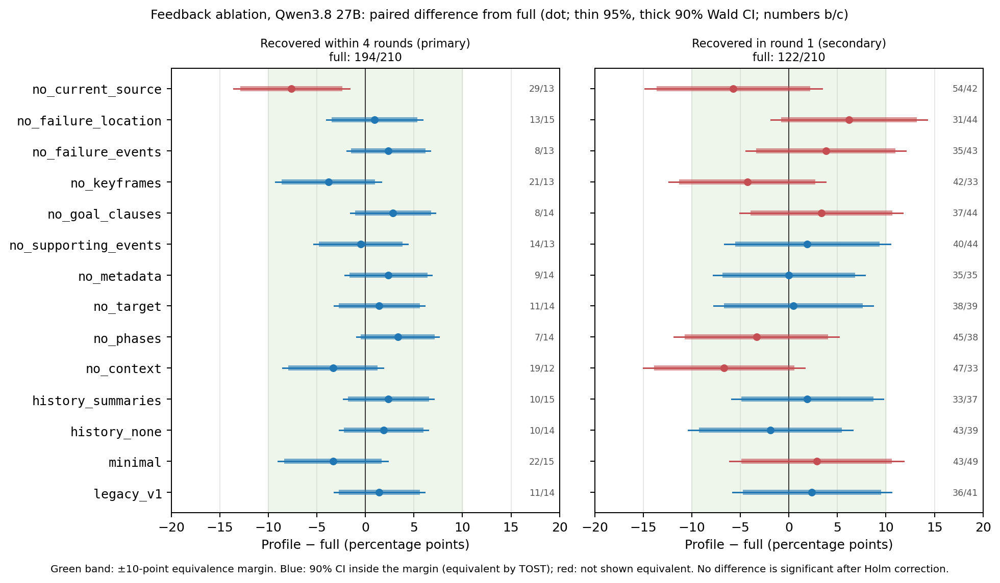
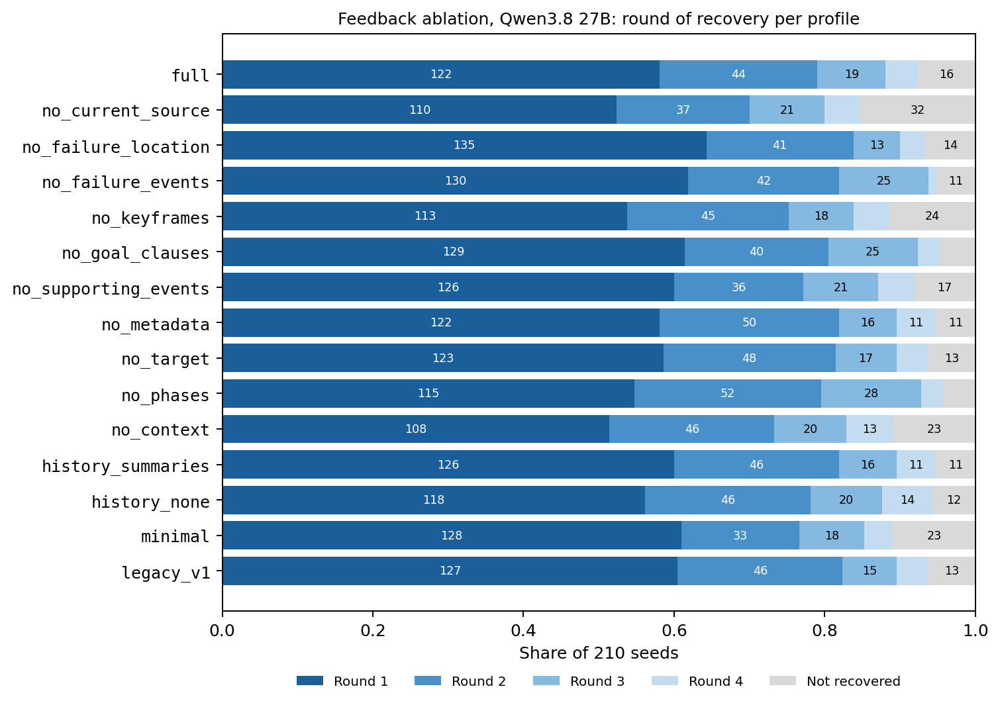
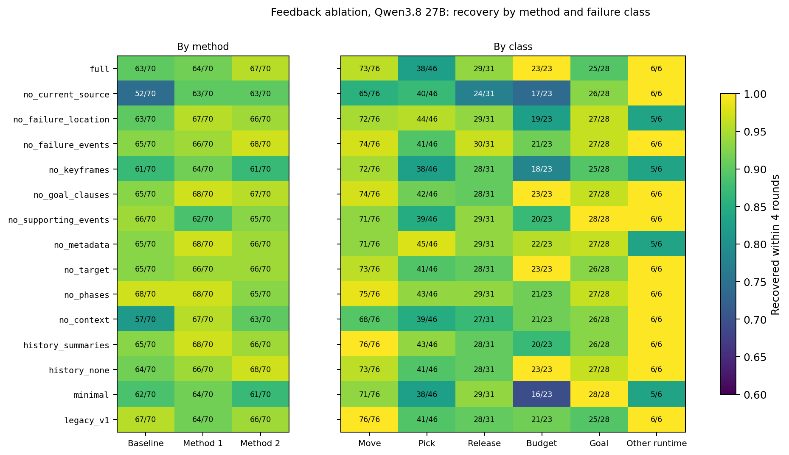
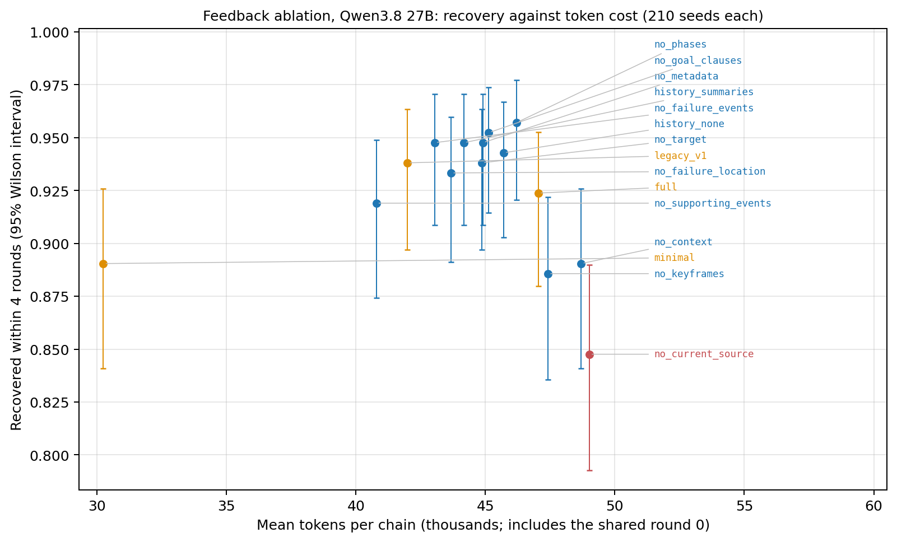

# Revision 4.3: experiment report

**Status: both studies completed.** Prompt factorial: selected prompt set `p0001` (motion-planning limits only, Section 1.5.4). Feedback ablation: no feedback item has a detected effect after multiplicity correction (Section 2.5).

- **Prompt factorial:** [plan](revision_4_3_prompt_ablation_plan.md). Full 2⁴ factorial over the four primitive prompt blocks; 50 trials per cell × 16 cells × 3 methods × 2 models = 4,800 trials.
- **Feedback ablation:** [plan](revision_4_3_ablation_experiment_plan.md). Runs after the prompt study, with the selected prompt set fixed.
- **Implementation under test:** [Revision 4.3 design and validation](revision_4_3_configurable_feedback_and_full_policy_history.md).
- **Inference backend:** [Revision 4.3.1: inference backend optimization](revision_4_3_1_inference_backend_optimization.md) records serving, scheduling and failure-handling changes.

## 1. Prompt factorial

### 1.1 Configuration

| Item | Qwen3.8 27B | Qwen3.5 9B |
| --- | --- | --- |
| Checkpoint | `Qwen/Qwen3.8-27B-FP8` @ `017b9c7a` (official FP8) | `Qwen/Qwen3.5-9B` @ `c2022362` (official BF16) |
| Serving | vLLM 0.32.0 on GPU 6, port 8106 | vLLM 0.32.0 on GPU 7, behind a local least-in-flight balancer (port 8117). A second instance on GPU 6 is added after the 27B batch finishes. |
| Chat template | `enable_thinking=true`, `reasoning_effort=medium` | `enable_thinking=true`; the template has no effort option |
| Batch | `runs/cap-revision43/20261022b-prompt-factorial-qwen38-27b` (32 workers) | `runs/cap-revision43/20261022b-prompt-factorial-qwen35-9b` (64 workers) |

Shared settings:

- **Task:** Stack, three blocks, the saved initial scene, `dsl_only`, `typed_v3`.
- **Recovery:** on, with Revision 4 default feedback (`cap-recovery-v1`, primitive enrichments off).
- **Sampling:** checkpoint `generation_config` defaults (temperature 1.0, top_p 0.95, top_k 20 for the 27B checkpoint).
- **Output cap:** 32,768 tokens; no thinking-token budget.
- **Token budgets:** 100k initial, 200k per recovery round, 900k per trial.
- **Time budgets:** request timeout 2,400 s, 3,600 s per round, 18,000 s per trial. These are raised because local decoding runs at roughly 25–75 tokens/s per request.
- **Call limits:** unchanged.
- **Code:** launcher [revision43_prompt_experiment.py](../revision43_prompt_experiment.py), run from a pinned worktree at commit `b1a6ea9`. Both contain the Revision 4.2 runtime code (`45d6f98`), unaffected by the concurrent Revision 4.3 implementation.

### 1.2 Pre-run findings

- **27B reasoning effort.** The Qwen3.8 chat template defaults to `reasoning_effort=xhigh`, which adds the system instruction "think carefully … validate key assumptions, consider plausible alternatives".
  - In the first smoke run, all three 27B round-0 requests reasoned for 118k–121k characters, hit the 32,768-token cap and produced no code.
  - The text was not looping: about 82–87% of lines were unique.
  - With `reasoning_effort=medium`, which adds no instruction, four requests on the same real round-0 prompt finished with 5,791–11,937 reasoning tokens. This matches the OpenRouter Qwen3.8 27B batch (median 7,049, p90 10,978).
  - A vLLM `thinking_token_budget` was tested and works, but is not used: effort control changes how long the model reasons without truncating it.
- **OpenRouter reasoning effort.**
  - Per OpenRouter's documentation, `effort` maps to a hard reasoning budget only for budget-based models (Anthropic: `max_tokens × ratio`, medium 0.5). For Qwen, support "varies by model".
  - Recorded OpenRouter Qwen usage shows no hard 50% cap: 29 of 89 calls exceeded 8,192 reasoning tokens, and 3 stopped at the 16,384 output cap.
- **9B smoke.** All 14 calls finished (3k–28k output tokens). The three trials ended in a goal or runtime failure, execution-budget exhaustion, and primitive nonconvergence.
- **Smoke artifacts:** `runs/cap-revision43-validation/` (excluded from all results).
- **Aborted first launch.**
  - The first full launch (`20261022-prompt-factorial-*`, about 15 minutes, 24 finished 27B trials) was stopped and relaunched in full.
  - Cause: the GPU scheduler caps each device at the smallest `slot_limit` among live reservations, so the two batches shared 16 worker slots per GPU. LLM concurrency was too low (27B: 17 requests, 440 tokens/s).
  - The relaunch shares 48 slots per GPU with 128 MiB per worker (commit `b1a6ea9`). Throughput rose to 886 tokens/s (27B, 32 requests) and 2,352 tokens/s (9B, 67 requests).
  - The aborted directories are kept, each with an `ABORTED.md` note, and are excluded from all analyses.
  - Expected completion: about 13 hours for the 27B batch, about 16 hours for the 9B batch including the GPU 6 handover.

### 1.3 Qwen3.5 9B stopped (2026-10-22)

- **Decision:** stop the 9B batch and move its GPU to the 27B. The 9B is also dropped from the feedback ablation ([plan, Section 6](revision_4_3_ablation_experiment_plan.md#6-model-and-local-serving)).
- **Reason: floor effect.** Over 291 completed trials:
  - round-0 success in 1 trial, so the primary outcome cannot separate the 16 cells;
  - 20 of 290 initially failed trials recovered (about 7%);
  - 96 trials stopped with `preparation_failure_no_rollout`.
- **State of the batch:** 291 trials completed, 56 were running when the launcher was stopped, and 2,053 were never started. The batch is not resumed, and its data are excluded from prompt selection. They are kept as a descriptive record.
- **27B move to two GPUs.**
  - The 27B batch was drained, not interrupted. A placeholder reservation in the shared GPU ledger lowered the slot limit on GPUs 6 and 7 to 1, so no new trials were dispatched while running ones finished.
  - Port 8106 then becomes a least-in-flight balancer over two 27B instances (GPU 6 on port 8126, GPU 7 on port 8127), with identical checkpoint, template and server flags.
  - The batch resumes with 64 concurrent trials, using a resume-time override that each session records in `execution_metadata.json`. Trial definitions are unchanged.
  - Outcome: the drain ended without interrupted trials, and the batch resumed at 22:29 EDT. In the first hour on two GPUs it completed 225 trials, compared with 114 per hour on one GPU. Expected completion is about 07:00 EDT on 2026-10-23.

### 1.4 Server failure and rerun (2026-10-23)

- **Failure.** At 06:08:16 EDT, both 27B vLLM instances (GPUs 6 and 7) stopped in the same second with `CUDA error: unspecified launch failure`.
  - The simultaneous failure on two independent processes points to a host-level GPU fault. Kernel logs are not readable to us, so the cause is not confirmed.
  - The batch then kept dispatching, and every new request failed with `TransportError: Model HTTP status 503: no backend available`. It finished at 06:29.
- **Affected trials: 192 of 2,400.** These are all trials that ended after the failure.
  - 161 lost round 0 itself.
  - 31 had a valid round-0 failure, but their recovery was cut off.
  - No transport errors occurred before the failure.
- **Treatment.** All 192 trials are excluded, and their exact job definitions are rerun as fresh trials in `runs/cap-revision43/20261023-prompt-factorial-qwen38-27b-rerun`, with the same identifiers, cells and methods.
  - All 192 are excluded because trials in flight at the failure are biased toward slow, mostly failing trials. Keeping only the 31 with a valid round 0 would bias the estimate.
  - Every trial in the rerun batch is a complete draw under the same configuration. The analysis combines the 2,208 unaffected trials with the rerun.
  - This is a documented infrastructure replacement, not a replacement of model failures.
- **Serving for the rerun.** Six 27B instances (GPUs 0, 1, 2, 3, 6, 7; ports 8120–8123, 8126, 8127) with identical checkpoint, template and flags, all behind the balancer on port 8106. The rerun uses 96 concurrent trials.
- **Safeguard.** Dispatch now checks the model endpoint (`GET /v1/models`) every 10 seconds. If the endpoint fails, the batch stops dispatching and pauses, so pending trials are not consumed (commit `bcd80f5`).

### 1.5 Results

**Data:** 2,400 trials (Qwen3.8 27B): the 2,208 unaffected trials of the main batch plus the 192 reruns (Section 1.4). Every cell × method has exactly 50 trials, and no rerun trial had a transport error. Primary outcome: round-0 task success. Analysis: logistic regression with method as a covariate.

#### 1.5.1 Prompt blocks under test

Each block is a fixed text in [`prompts/primitive_v1.json`](../prompts/primitive_v1.json). It is appended after the header "Additional primitive contract explanations:" to the initial and recovery prompts of all methods. Each example below is the actual round-0 prompt of a Baseline trial in the cell where only that block is on; the block starts at the linked line. Prompt files live under `runs/`, which git ignores, so these links work only in a checkout that has the run folders.

| Block (switch) | Content | Text | Example prompt |
| --- | --- | --- | --- |
| Target offsets (`explain_target_offsets`) | Offset = desired gripper coordinate − reference coordinate; carried-block compensation; numeric example (X 1.30 → 1.40 needs dx = 0.10, not 1.40) | [line 5](../prompts/primitive_v1.json#L5) | [p1000 Baseline trial 1, round 0](../../../runs/cap-revision43/20261022b-prompt-factorial-qwen38-27b/trials/cap_google_baseline-dsl_only-001-recovery-on-p1000/cap/20261022-212230-b1a6ea9-cap_google_baseline-recovery-95c7aa74/attempts/round_000/cap/20261022-212234-b1a6ea9-cap_google_baseline-stack-2110d9fd/artifacts/trial_001/lmp/call_0001/prompt.txt#L107) |
| Convergence criteria (`explain_convergence_criteria`) | Pick/Move/Release phase-completion tests, tolerances, the shared 50-step budget | [line 6](../prompts/primitive_v1.json#L6) | [p0100 Baseline trial 1, round 0](../../../runs/cap-revision43/20261022b-prompt-factorial-qwen38-27b/trials/cap_google_baseline-dsl_only-001-recovery-on-p0100/cap/20261022-212231-b1a6ea9-cap_google_baseline-recovery-3446aaaf/attempts/round_000/cap/20261022-212235-b1a6ea9-cap_google_baseline-stack-52aaf61a/artifacts/trial_001/lmp/call_0001/prompt.txt#L107) |
| Partial execution (`explain_partial_execution`) | A primitive may change the scene before it fails; nothing is rolled back; later statements do not run | [line 7](../prompts/primitive_v1.json#L7) | [p0010 Baseline trial 1, round 0](../../../runs/cap-revision43/20261022b-prompt-factorial-qwen38-27b/trials/cap_google_baseline-dsl_only-001-recovery-on-p0010/cap/20261022-212842-b1a6ea9-cap_google_baseline-recovery-75223e0f/attempts/round_000/cap/20261022-212844-b1a6ea9-cap_google_baseline-stack-e1ecbe9a/artifacts/trial_001/lmp/call_0001/prompt.txt#L107) |
| Motion-planning limits (`explain_motion_planning_limits`) | Move has no obstacle avoidance or inserted waypoints; lift, transfer and descent must be explicit; no universal safe height | [line 8](../prompts/primitive_v1.json#L8) | [p0001 Baseline trial 1, round 0](../../../runs/cap-revision43/20261022b-prompt-factorial-qwen38-27b/trials/cap_google_baseline-dsl_only-001-recovery-on-p0001/cap/20261022-212231-b1a6ea9-cap_google_baseline-recovery-b7347428/attempts/round_000/cap/20261022-212236-b1a6ea9-cap_google_baseline-stack-29c36dad/artifacts/trial_001/lmp/call_0001/prompt.txt#L107) |
| All four blocks | — | — | [p1111 Baseline trial 1, round 0](../../../runs/cap-revision43/20261022b-prompt-factorial-qwen38-27b/trials/cap_google_baseline-dsl_only-001-recovery-on-p1111/cap/20261022-212229-b1a6ea9-cap_google_baseline-recovery-3cd90c78/attempts/round_000/cap/20261022-212234-b1a6ea9-cap_google_baseline-stack-62a84497/artifacts/trial_001/lmp/call_0001/prompt.txt#L107) |

#### 1.5.2 Main effects

| Block | Round-0 success off → on | Odds ratio (95% CI) | p | Final success off → on |
| --- | --- | --- | --- | --- |
| Target offsets | 51.2% → 52.3% | 1.05 (0.88–1.25) | 0.56 | 84.0% → 83.7% |
| Convergence criteria | 51.8% → 51.8% | 1.00 (0.84–1.20) | 0.97 | 84.8% → 82.8% |
| Partial execution | 52.4% → 51.2% | 0.94 (0.79–1.12) | 0.51 | 83.8% → 83.8% |
| **Motion-planning limits** | **32.1% → 71.5%** | **5.32 (4.47–6.33)** | **< 0.001** | **74.3% → 93.3%** |

- **Block × block interactions:** none (likelihood-ratio test p = 0.50 for round-0 success, 0.82 for final success; the smallest single term is P:M, p = 0.09).
- **Block × method:** significant for round-0 success (p = 0.039), and entirely due to the size of the motion-planning effect (M × method p = 0.007; the other three blocks p ≥ 0.17).
  - Its odds ratio is about 3.7 for Baseline, 5.6 for Method 1 and 7.4 for Method 2. It is strongly positive in every method.
  - Round-0 success without → with the block: Baseline 36.2% → 68.0%, Method 1 32.5% → 72.8%, Method 2 27.5% → 73.8%.
  - Final success shows no block × method interaction (p = 0.70).
- **The other three blocks show no effect,** whether the motion-planning block is on or off. Among the 1,200 trials with it on, their odds ratios are 0.95–1.10, all p ≥ 0.44.

#### 1.5.3 Secondary outcomes (motion-planning block off → on)

- **Caveat for final success.** The factorial ran before the reasoning-termination guard ([Revision 4.3.1, Section 10](revision_4_3_1_inference_backend_optimization.md#10-empty-answers-reasoning-that-ends-the-turn-2026-10-23)). About 10% of recovery calls ended with an empty answer, cutting the recovery chain short. This affected 183 of 815 initially failed trials without the motion-planning block and 57 of 342 with it, so final success is understated in both groups, more so without the block. Round-0 success, which decided the selection, was affected in 11 of 2,400 trials.

- **Round-0 primitive nonconvergence:** 49.2% → 19.1% of trials. By primitive, Move 314 → 105, Pick 155 → 69, Release 121 → 55 trials.
- **Round-0 execution-budget exhaustion:** 12.4% → 2.4%.
- **Preparation stops** (`preparation_failure_no_rollout`, any round): 15.6% → 5.0% of trials.
- **Median tokens per trial:** 31.0k → 11.8k, mainly because fewer recovery rounds are needed.

#### 1.5.4 Selected prompt set

Under the [selection rule](revision_4_3_prompt_ablation_plan.md#5-selection-rule-fixed-before-the-run), the selected set is **`p0001`**: only `explain_motion_planning_limits` on.

- **Rule 1:** keep motion-planning limits. Its pooled effect is positive, and its confidence interval excludes harm.
- **Rule 2:** drop target offsets, convergence criteria and partial execution. Their effects are near zero, and dropping them gives a shorter prompt.
- **Rule 3:** does not apply; no block × block interaction is significant.
- **Rule 4:** one set for all methods. The method interaction changes only the size of the motion-planning benefit, not its direction, so no exception is needed.
- For reference, round-0 success by method (Baseline / M1 / M2): `p0000` 34 / 32 / 32%, `p0001` 70 / 64 / 76%, `p1111` 72 / 78 / 76%. The extra three blocks in `p1111` have no significant effect when motion-planning limits is on (Section 1.5.2).

**Limitation:** one model, one task and one initial scene (see the plan).

### 1.6 Cell table (round-0 and final success, 150 trials per cell)

- **Bars:** round-0 (orange) and final (blue) task success per cell, with 95% Wilson intervals; 150 trials per cell, three methods pooled.
- **Order:** cells are grouped by the motion-planning block (green band: on). Within each group they are sorted by round-0 success. Letters mark the blocks that are on (T target offsets, C convergence criteria, P partial execution, M motion-planning limits).
- **Reading:** the two groups separate cleanly on both measures, while the other three blocks do not order the cells within a group (Section 1.5.2).
- **Source:** generated by `synthesis.cap.revision43_prompt_report` from the main batch, with the 192 rerun trials replacing their originals (Section 1.4).

#### 1.6.1 Per method (50 trials per cell)

Same layout, one figure per method. Rows keep the pooled cell order above, so the three figures compare row by row.

- **The motion-planning split holds in every method.** Round-0 success off → on: Baseline 36.2% → 68.0%, Method 1 32.5% → 72.8%, Method 2 27.5% → 73.8%. Final success: 76.5% → 92.5%, 75.5% → 93.0%, 71.0% → 94.5%.
- **The gap widens from Baseline to Method 2.** This is the block × method interaction in Section 1.5.2.
- **Single cells are noisy at this size.** With 50 trials per cell, a cell's 95% interval spans roughly ±12–14 points, so differences between cells within one group are not interpretable.

| Cell (T C P M) | Round 0 | Final |
| --- | ---: | ---: |
| p1111 | 75.3% | 94.0% |
| p0011 | 74.0% | 92.7% |
| p0111 | 72.0% | 93.3% |
| p0101 | 72.0% | 93.3% |
| p1101 | 70.7% | 94.0% |
| p0001 | 70.0% | 92.7% |
| p1001 | 69.3% | 94.7% |
| p1011 | 68.7% | 92.0% |
| p1000 | 38.0% | 74.0% |
| p0100 | 34.0% | 70.7% |
| p0000 | 32.7% | 78.0% |
| p1010 | 32.7% | 76.7% |
| p1100 | 32.7% | 73.3% |
| p1110 | 31.3% | 70.7% |
| p0010 | 28.7% | 78.0% |
| p0110 | 26.7% | 73.3% |

## 2. Feedback ablation

**Status: completed (Stage B 2026-10-23 13:19 to 20:24 EDT; results in Section 2.5).** Prompt set `p0001`, Qwen3.8 27B with the reasoning-termination guard, 70 seeds per method.

### 2.1 Profile definitions that differ from a single-item removal

- **`no_current_source`** removes the latest executed program and sets history to `summaries`.
  - The configuration rejects `executed_programs` without the current source, because the history registry also holds the latest program's bodies.
  - This profile therefore measures the value of all program source in the request (latest and earlier) relative to `full`, with earlier failures still listed as one-line summaries.
  - It is not a test of the latest source alone. (Decided 2026-10-22.)
- **`minimal`** keeps the always-on core: latest outcome, missing-field markers, scene metadata and DSL diagnostics. It adds the current source and uses history `none`.

### 2.2 Seeded-branch validation (2026-10-22)

End-to-end check of the Stage B path on spare capacity of GPU 0, with requests served by the 9B balancer. Artifacts: `runs/cap-revision43-validation/20261022-seeded-check` (excluded from all results).

- **Design:** 6 round-0 failures from 9B cell `p1100` (two per method: four goal failures, one Move nonconvergence, one execution-budget exhaustion) × profiles `full`, `no_current_source`, `minimal` = 18 chains.
- **Mechanics: passed.** All 18 chains completed and the audit reported no issues. Round 0 is identical across the branches of each seed. Item delivery and history mode match each profile:
  - `full`: every applicable item, history `executed_programs` with the source registry;
  - `no_current_source`: current source disabled, history `summaries`;
  - `minimal`: current source only, history `none` (about 1.8 KB per feedback, against 2.9–24 KB for the other two).
- **Outcomes:** 0 of 18 chains recovered.
  - 12 chains used all four rounds.
  - 6 stopped with `preparation_failure_no_rollout`: three responses hit the 32,768-token output cap, two raised SyntaxErrors, and one raised a KeyError. These stops occurred under all three profiles.
  - With six seeds, this does not compare profiles.

### 2.3 Pilot (2026-10-23)

- **Stage A:** 30 round-0 attempts per method (`runs/cap-revision43/20261023b-feedback-pilot-stage-a`). The first launch was aborted after 2 minutes because the request limit capped concurrency at 14 ([Revision 4.3.1, Section 7](revision_4_3_1_inference_backend_optimization.md#7-failure-handling)).
- **Stage B:** 3 seeds per method × 15 profiles = 135 chains, run twice.

  | Run | Empty-answer calls | Chains ended by them | Recovered within 4 rounds | Audit issues |
  | --- | --- | --- | --- | --- |
  | Without guard (`…-pilot-stage-b`) | 20 / 219 | 25 | 113 / 135 | 0 |
  | With guard (`…-pilot-stage-b-guarded`) | 0 / 270 | 0 | 127 / 135 | 0 |

- **Ceiling.** With the guard, 94% of chains recover within four rounds, which leaves little room for differences between profiles. Rounds to recovery spread more: round 1: 73, round 2: 30, round 3: 17, round 4: 7, not recovered: 8. Making "recovered in round 1" a primary outcome is proposed and awaiting a decision.
- **The pilot is excluded from all analyses.** With 9 chains per profile, it says nothing about profile differences.

### 2.4 Stage A and seeds

- **Stage A:** 250 round-0 attempts per method (`runs/cap-revision43/20261023-feedback-stage-a`), with the guard and prompt set `p0001`. All 750 completed, and no call returned an empty answer.
- **Seed pool:** Stage A plus the `p0001` cells of the prompt factorial and its rerun, about 304 round-0 attempts per method. Round-0 success was 206–217 per method; 3–6 per method were preparation failures, which are excluded.
- **Seeds:** `runs/cap-revision43/20261023-feedback-seeds-70.json`, 70 per method. There were no no-witness failures, and Methods 1 and 2 had no other-runtime failures; these shortfalls were refilled proportionally from the other classes.

  | Method | Move | Pick | Release | Budget | No-witness | Goal | Other runtime |
  | --- | --- | --- | --- | --- | --- | --- | --- |
  | Quota | 21 | 11 | 11 | 8 | 7 | 6 | 6 |
  | Baseline | 24 | 14 | 10 | 9 | 0 | 7 | 6 |
  | Method 1 | 24 | 16 | 9 | 8 | 0 | 13 | 0 |
  | Method 2 | 28 | 16 | 12 | 6 | 0 | 8 | 0 |

  Sources: Stage A 177 seeds, prompt factorial 30, rerun 3.
- **Stage B:** `runs/cap-revision43/20261023-feedback-stage-b`, 210 seeds × 15 profiles = 3,150 chains. It uses 120 concurrent trials, six serving GPUs, and worker GPUs 6 and 7.

### 2.5 Results

**Run.**
- All 3,150 chains finished (2026-10-23 13:19 to 20:24 EDT); the batch process then rendered deferred videos until 2026-10-24 03:59.
- **Audit: no issues.** All branches of each seed share one round-0 attempt and initial state, profile settings match, and every enabled item was delivered complete.
- **Serving:** 5,773 recovery calls; none returned an empty answer, and one reached the 32,768-token output cap. The dispatch limit was lowered to 32 for about 1.5 minutes during a cancelled GPU release (`dispatch_limit_events.jsonl`).
- **Code:** trials record `git_sha` `b61c5d0`, `e713c83`, `8d404f7` or `f74a9c9`. These commits differ only in documentation, so every chain ran the same code.
- **Analysis artifacts:** `runs/cap-revision43/20261023-feedback-stage-b/analysis/` (`branches.csv`, one row per chain; `analysis.json`; the scripts). The batch's own `stage_b_summary.json` gives the same counts and McNemar p-values.
- **Figures:** generated by `synthesis.cap.revision43_feedback_report` from the batch directory. The module recomputes the paired counts and intervals, and they match the tables.

**Outcomes.**
- **Primary (pre-registered): recovered within four rounds.**
- **Secondary: recovered in round 1.** Proposed after the pilot (Section 2.3) because of the ceiling; it was not pre-registered and is reported as secondary.

#### 2.5.1 Profiles against `full` (210 paired seeds)

- Δ is the profile minus `full`, in percentage points, with a Wald 95% CI for paired proportions.
- *b*: seeds recovered under `full` only; *c*: under the profile only.
- *p*: exact McNemar; Holm: corrected over the 14 contrasts.
- Equivalent (±10): TOST at a 10-point margin (90% CI inside ±10 points), the margin fixed in the [plan](revision_4_3_ablation_experiment_plan.md#8-decided-details).

| Profile | Within 4 rounds | Δ [95% CI] | *b* / *c* | *p* | Holm | Equivalent (±10) | Round 1 | Δ round 1 [95% CI] |
| --- | ---: | --- | ---: | ---: | ---: | --- | ---: | --- |
| `full` | 194 (92.4%) | — | — | — | — | — | 122 (58.1%) | — |
| `no_current_source` | 178 (84.8%) | −7.6 [−13.6, −1.7] | 29 / 13 | 0.020 | 0.27 | no | 110 (52.4%) | −5.7 [−14.8, +3.4] |
| `no_failure_location` | 196 (93.3%) | +1.0 [−4.0, +5.9] | 13 / 15 | 0.85 | 1 | yes | 135 (64.3%) | +6.2 [−1.8, +14.2] |
| `no_failure_events` | 199 (94.8%) | +2.4 [−1.9, +6.6] | 8 / 13 | 0.38 | 1 | yes | 130 (61.9%) | +3.8 [−4.4, +12.0] |
| `no_keyframes` | 186 (88.6%) | −3.8 [−9.2, +1.6] | 21 / 13 | 0.23 | 1 | yes | 113 (53.8%) | −4.3 [−12.3, +3.8] |
| `no_goal_clauses` | 200 (95.2%) | +2.9 [−1.5, +7.2] | 8 / 14 | 0.29 | 1 | yes | 129 (61.4%) | +3.3 [−5.1, +11.7] |
| `no_supporting_events` | 193 (91.9%) | −0.5 [−5.3, +4.4] | 14 / 13 | 1.00 | 1 | yes | 126 (60.0%) | +1.9 [−6.6, +10.5] |
| `no_metadata` | 199 (94.8%) | +2.4 [−2.1, +6.8] | 9 / 14 | 0.41 | 1 | yes | 122 (58.1%) | 0.0 [−7.8, +7.8] |
| `no_target` | 197 (93.8%) | +1.4 [−3.2, +6.1] | 11 / 14 | 0.69 | 1 | yes | 123 (58.6%) | +0.5 [−7.7, +8.7] |
| `no_phases` | 201 (95.7%) | +3.3 [−0.9, +7.6] | 7 / 14 | 0.19 | 1 | yes | 115 (54.8%) | −3.3 [−11.8, +5.2] |
| `no_context` | 187 (89.0%) | −3.3 [−8.5, +1.8] | 19 / 12 | 0.28 | 1 | yes | 108 (51.4%) | −6.7 [−15.0, +1.6] |
| `history_summaries` | 199 (94.8%) | +2.4 [−2.3, +7.0] | 10 / 15 | 0.42 | 1 | yes | 126 (60.0%) | +1.9 [−5.9, +9.7] |
| `history_none` | 198 (94.3%) | +1.9 [−2.7, +6.5] | 10 / 14 | 0.54 | 1 | yes | 118 (56.2%) | −1.9 [−10.4, +6.5] |
| `minimal` | 187 (89.0%) | −3.3 [−9.0, +2.3] | 22 / 15 | 0.32 | 1 | yes | 128 (61.0%) | +2.9 [−6.1, +11.8] |
| `legacy_v1` | 197 (93.8%) | +1.4 [−3.2, +6.1] | 11 / 14 | 0.69 | 1 | yes | 127 (60.5%) | +2.4 [−5.8, +10.6] |

- **No profile differs from `full` after Holm correction**, for either outcome.
- **Within four rounds, 13 of 14 profiles are equivalent to `full` at the 10-point margin.**
  - This includes `minimal` (−3.3 points; 90% CI −8.1 to +1.4).
  - It also includes `legacy_v1`, the Revision 4 item set.
- **`no_current_source` is the only candidate effect.**
  - Point estimate −7.6 points; unadjusted *p* = 0.020; not significant after Holm.
  - Equivalence is not shown: its 90% CI is −12.6 to −2.6.
  - The profile removes all program source, latest and earlier (Section 2.1). `history_summaries`, which removes only the earlier programs, is +2.4 points. The evidence therefore points at the latest executed source, not at the history.
- **Round 1 does not separate the profiles either.**
  - Discordance is high: 70–96 of 210 seeds per contrast.
  - It is nearly symmetric. For example, `no_metadata` has 35 / 35 and the Δ is exactly 0.
  - That pattern indicates large chain-to-chain variation at a fixed seed, rather than profile effects. Round-1 equivalence holds for only 6 profiles, because the wider intervals cross ±10.
- **Seed structure:** 80 of 210 seeds recover under all 15 profiles, and none fails under all 15. Every seed is therefore recoverable by some profile.

- **Forest plot:** the table's Δ for both outcomes. Thin lines are 95% intervals and thick lines 90% intervals; the green band is the ±10-point margin.
- **Colour:** blue where the 90% interval lies inside the margin (equivalent); red where equivalence is not shown. Numbers at the right are *b* / *c*.

- **Rounds to recovery** per profile, as a share of the 210 seeds. Unlabelled segments are below 5%.

#### 2.5.2 Pooled models

`recovered ~ profile + method + failure_class`, with seed as the cluster. Odds ratios are against `full`, Baseline and execution-budget failures.

| Term | GEE OR [95% CI], *p* | Mixed model OR [95% CI] |
| --- | --- | --- |
| `no_current_source` | 0.45 [0.24, 0.85], 0.014 | 0.45 [0.30, 0.66] |
| `no_keyframes` | 0.63 [0.33, 1.22], 0.17 | 0.64 [0.41, 0.99] |
| `no_context` | 0.67 [0.35, 1.26], 0.21 | 0.67 [0.43, 1.05] |
| `minimal` | 0.67 [0.33, 1.34], 0.25 | 0.67 [0.43, 1.05] |
| `no_phases` | 1.86 [0.83, 4.13], 0.13 | 1.97 [1.01, 3.85] |
| Other profiles | 0.93–1.66, all *p* ≥ 0.20 | 0.96–1.76, all CIs include 1 |
| Method 1 | 1.73 [1.17, 2.57], 0.006 | 1.81 [1.40, 2.34] |
| Method 2 | 1.54 [1.06, 2.24], 0.025 | 1.62 [1.26, 2.07] |
| Move nonconvergence | 2.29 [1.39, 3.77], 0.001 | 2.41 [1.83, 3.17] |
| Goal failure | 2.01 [1.13, 3.56], 0.018 | 1.98 [1.29, 3.04] |
| Other runtime | 3.51 [1.68, 7.32], <0.001 | 3.60 [1.37, 9.45] |
| Pick / Release nonconvergence | 0.93 / 1.21, *p* ≥ 0.48 | 0.90 / 1.20, CIs include 1 |

- **Models.**
  - *GEE:* logit, exchangeable working correlation (0.02).
  - *Mixed model:* the pre-registered `(1 | seed)` random intercept, fitted by variational Bayes (statsmodels `BinomialBayesMixedGLM`); the posterior seed SD is 0.59.
- **The variational intervals are narrower than the GEE intervals and are not multiplicity-corrected.** The profile terms whose mixed-model interval excludes 1 (`no_current_source`, `no_keyframes`, `no_phases`) are therefore not claimed as effects beyond Section 2.5.1. Only `no_current_source` excludes 1 under GEE.
- **Method and failure class matter more than any feedback item.**
  - Methods 1 and 2 recover more often than Baseline.
  - Move nonconvergence, goal failures and other runtime errors recover more often than budget, Pick or Release failures.
- In the round-1 GEE model, no profile term has *p* < 0.1 (ORs 0.75–1.31; seed correlation 0.13).

#### 2.5.3 By method and by failure class

Recovered within four rounds, of 70 seeds per method:

| Profile | Baseline | Method 1 | Method 2 |
| --- | ---: | ---: | ---: |
| `full` | 63 | 64 | 67 |
| `no_current_source` | 52 | 63 | 63 |
| `no_keyframes` | 61 | 64 | 61 |
| `no_context` | 57 | 67 | 63 |
| `minimal` | 62 | 64 | 61 |
| Other 10 profiles (range) | 63–68 | 62–68 | 65–68 |

- **The `no_current_source` deficit comes mostly from Baseline.** Its *b* / *c* are 16 / 5 for Baseline, against 6 / 5 for Method 1 and 7 / 3 for Method 2. Per-method results are descriptive: 70 seeds detect only differences of about 20 points.

By failure class (descriptive):

| Class | Seeds | Within 4 rounds, all profiles | Round 1, all profiles | `full` | `minimal` | `no_current_source` |
| --- | ---: | ---: | ---: | ---: | ---: | ---: |
| Move nonconvergence | 76 | 95.1% | 71.0% | 73 / 76 | 71 / 76 | 65 / 76 |
| Pick nonconvergence | 46 | 88.8% | 47.7% | 38 / 46 | 38 / 46 | 40 / 46 |
| Release nonconvergence | 31 | 91.0% | 49.7% | 29 / 31 | 29 / 31 | 24 / 31 |
| Execution budget | 23 | 89.3% | 49.9% | 23 / 23 | 16 / 23 | 17 / 23 |
| Goal failure | 28 | 94.5% | 55.0% | 25 / 28 | 28 / 28 | 26 / 28 |
| Other runtime | 6 | 95.6% | 66.7% | 6 / 6 | 5 / 6 | 6 / 6 |

- **Budget failures are the one class where `full` clearly leads `minimal`** (23 vs 16 of 23). With 23 seeds, this is a lead for a follow-up, not a result.

- **Heat maps** of the primary outcome per profile × method and profile × failure class, with counts in each cell. The colour scale starts at 60%.

#### 2.5.4 Cost

| Profile | Mean tokens per chain | Median | Mean calls | Mean rounds when recovered |
| --- | ---: | ---: | ---: | ---: |
| `full` | 47,044 | 33,570 | 2.86 | 1.56 |
| `minimal` | 30,246 | 24,892 | 2.90 | 1.50 |
| `legacy_v1` | 41,991 | 32,285 | 2.76 | 1.52 |
| `no_supporting_events` | 40,785 | 31,317 | 2.90 | 1.56 |
| `no_current_source` | 49,015 | 36,610 | 3.37 | 1.61 |
| Other profiles (range) | 43,038–48,700 | 33,595–38,602 | 2.73–2.99 | 1.45–1.67 |

- **Token counts include the seed's round-0 usage, which is charged identically to every branch.**
- **`minimal` uses 36% fewer tokens than `full`, at an equivalent recovery rate** (Section 2.5.1).

- **Recovery against mean tokens per chain**, with 95% Wilson intervals. Orange marks the anchors (`full`, `minimal`, `legacy_v1`) and red marks `no_current_source`.
- Recovery stops other than success:
  - exhausting the four rounds: 9–29 chains per profile;
  - `preparation_failure_no_rollout`: 0–4 chains per profile.

#### 2.5.5 Interpretation and limits

- **Ceiling.** With prompt set `p0001` and the guard, 92% of failed round-0 attempts recover within four rounds under `full` and 89% under `minimal`. Feedback content beyond the latest outcome and source changes recovery by at most a few points: within ±10 points for 13 of 14 profiles.
- **Latest executed source** is the only item with a candidate effect (Section 2.5.1). It is not significant after correction.
- **Sampling variance dominates.**
  - The near-symmetric discordance shows that a single chain per seed × profile is noisy.
  - The design has no replicate chains, so this variance cannot be separated from profile effects at the seed level. The pooled paired comparisons remain valid.
- **Scope:** one model (Qwen3.8 27B, FP8, guarded, `reasoning_effort=medium`), one task (Stack), natural round-0 failures sampled by class quota. No-witness `get` failures did not occur, and other runtime errors exist only for Baseline (6 seeds).
