# Revision 4: configurable shared failure recovery

- **Status:** design under discussion; not implemented.
- **Goal:** use failed execution trajectories to debug the current policy through a shared interface usable by Baseline, Method 1, and Method 2.
- **Agreed direction:** recovery is configurable, with enable/disable settings. Every revised policy rolls out from an initial state; failed trajectories provide debugging evidence, not a continuation state.
- **Current behavior:** primitives raise on nonconvergence; Method 1/2 repairs use static DSL diagnostics only. No runtime failure feedback is currently injected into synthesis.

## 1. Shared API and configuration

- Place recovery orchestration and feedback construction outside the three generators, following the separation used by the [shared DSL checker](SHARED-DSL-CHECKER.md).
  - A common collector creates a structured failure record from environment/recording data and execution artifacts.
  - A common serializer builds bounded, versioned feedback for synthesis.
  - A small method adapter supplies this feedback to the corresponding generation workflow.
  - The common orchestrator manages recovery rounds, initial-state restoration, and attempt records.
- **Disabled:** preserve current generation, prompts, execution, and evaluation behavior.
- **Enabled:** identify the variant explicitly, for example `Google baseline + recovery`, and retain the original baseline as the disabled reference.
  - Sharing recovery does not imply adding a pre-execution DSL gate to the Google baseline.
  - Method 1/2 continue using their existing static checks before execution.
- Proposed configuration concepts; names and limits remain to be finalized:

| Setting | Purpose | Design status |
| --- | --- | --- |
| Recovery enabled | Switch the feature on/off for any of the three methods | Agreed; recommend default off |
| Maximum recovery rounds | Bound how many revised candidates can be evaluated | Proposed; value undecided |
| Feedback profile and token limit | Control what evidence reaches synthesis and its size | Proposed; profile undecided |
| Recoverable failure classes | Select execution failures eligible for debugging | Proposed; classes undecided |
| Shared effort limits | Account for generation, static repair, recovery, reset, and rollouts | Proposed; cumulative trial limits must remain explicit |
| Recovery prompt/schema version | Preserve reproducibility and future ablations | Proposed |

The conceptual interface is framework-independent; these functions are not implemented:

```python
record = collect_failure(task, executed_bundle, rollout_artifacts, environment_snapshot)
feedback = build_feedback(record, feedback_profile, token_limit)
request = synthesis_request(task, contract, current_policy, recovery_feedback=feedback)
revised_candidate = method.synthesize(request)
```

- Raw collection and model-visible feedback are separate layers. Collecting a field for host debugging does not automatically authorize adding it to the prompt or policy API.
- Missing fields must be explicit. Different logging capabilities must not be interpreted as different observed outcomes.

## 2. Information to collect

### 2.1 Environment and recorded-state evidence

| Information | Source | Proposed use | Current availability / required work |
| --- | --- | --- | --- |
| Saved initial full simulator state and object bindings | Recorder/snapshot machinery | Restore the same start for each revised candidate | Already recorded; keep full simulator internals host-side |
| Initial, pre-action, post-action, and failure gripper/block XYZ | Environment observations or saved trajectory states | Explain how the scene changed; provide compact debugging keyframes | Already available in trajectories; add deterministic selection and serialization |
| Relevant DSL predicate values at those states | Existing predicate evaluator on captured scenes | Explain selection/guard failures and task progress | Queried predicates are logged; additional derived relations must be labeled and bounded |
| Terminal task result and failed goal clauses, where available | Host evaluator plus shared task specification | Diagnose normal completion without achieving the goal | Success/postcondition flags exist; task-specific clause explanations need work |
| Primitive reference positions and resolved target at invocation | Adapter/controller boundary | Compare intended motion with the achieved state | Arguments and states exist, but explicit fixed target capture is needed for reliable attribution |
| Full step trajectory, simulator actions, and video | Recorder | Detailed offline diagnosis; optional richer feedback later | Already recorded; do not include the entire stream in the initial text feedback profile |

- Preserve world frame, units, predicate tolerances, and object identities across the evidence.
- Move targets are gripper targets sampled from references at invocation. Do not reconstruct them using reference positions after the motion.
- Proximity between gripper and block is not proof of a successful grasp. Do not manufacture a `held`/contact diagnosis from a distance threshold alone.
- Images, contacts, velocities, and other simulator internals are not proposed default LLM inputs. Adding them would be an explicit information-access variant.

### 2.2 Code, controller results, and logs

| Information | Source | Proposed use | Current availability / required work |
| --- | --- | --- | --- |
| Executed policy, helpers, actual bindings, checkpoint IDs and hashes | Checkpoints, final-output capture, execution source paths | Identify the code that actually failed | Mostly available; use execution-time source identity, not only the last generated helper text |
| Exception type/message and failure location | Runner traceback and timeline | Locate the failing statement and distinguish failure classes | Already recorded; normalize source unit, helper/call stack, and line mapping |
| Primitive name, arguments, convergence, steps and residual error | Adapter events and controller result | Diagnose primitive failure | Most fields are logged; controller phase exists but is not currently included in the primitive-end event |
| Selection/condition expression and query result | Query/condition events, source mapping | Explain no-witness selection or unexpected control flow | Successful query results exist; failed `get` needs an explicit structured failure record and bounded candidate evidence |
| Loop/branch progress and recent action sequence | Runtime events / baseline Python trace | Explain repeated states, nontermination, and premature completion | Richer branch/assignment events exist in checked methods; define a comparable common summary for baseline |
| Model calls, tokens, runtime ticks, simulation steps, wall time, exhausted resource | Budget/timing records | Distinguish a policy failure from a hard effort limit | Already recorded; recovery attempts need cumulative and per-attempt accounting |
| Static DSL diagnostics and contract identity | Shared checker records | Keep source compliance separate from physical failure | Already available; Method 1/2 retain their existing static repair flow; baseline audit feedback is a separate design decision |

- Environment data describes what happened physically; logs connect those observations to code, decisions, and resource use. Controller outcomes originate in execution and are accessed through structured logs.
- Preserve observed facts separately from explanations inferred by a debugger or LLM. A failure label such as Move nonconvergence does not establish its root cause.
- The failure bundle may retain execution-time binding evidence for debugging. This does not redefine the existing final-output-only DSL compliance metric.

## 3. Proposed first feedback profile

- Start with text-only structured feedback shared across all three methods:
  - Task, primitive/predicate contract, condition mode, and current executable source bundle.
  - Failure category, exception, source location, and a bounded call/statement context.
  - Recent primitive calls with arguments, targets where recorded, convergence, step counts, and residual error.
  - Initial state, the state before the failed operation, and the failure/terminal state, restricted to gripper/block positions and selected DSL relations.
  - Relevant query/guard evidence and terminal goal result, where available.
  - Remaining recovery budget and the instruction to produce a complete policy that starts from the saved initial state.
- Prefer deterministic keyframe/event selection over sending entire logs. Keep the failure point and its preceding operation; report any truncation or missing fields.
- Use stable diagnostic object labels with a recorded mapping across attempts. Diagnostic labels do not automatically become new policy-visible variables or APIs.
- Controller residuals, terminal success, and failure trajectories are additional synthesis-time feedback. They do not become new runtime observation APIs, and the enabled/disabled comparison must record this information difference.
- The evidence review in Section 9 supports text-only feedback as the first version. Field selection, controller/goal detail, and token limits still need to be finalized; missing structured fields must be instrumented before claiming complete feedback coverage.

## 4. Injection into the synthesis stage

```mermaid
flowchart LR
    S0["Saved initial state"] -->|"restore before every rollout"| RESET["Restore initial state"]
    subgraph SYN["Synthesis stage"]
        G["Method-specific generation / revision"] -->|"candidate source + helpers"| PREP["Method-specific preparation"]
    end
    PREP -->|"candidate ready"| RESET
    subgraph RUN["Execution stage"]
        RESET -->|"fresh execution context"| EXEC["Run policy from entry point"]
        EXEC -->|"primitive actions / queries"| ENV["Environment"]
        ENV -->|"observations / call results"| EXEC
        EXEC -->|"outcome + source/event references"| RESULT["Attempt record"]
    end
    RESULT -->|"eligible failure; recovery enabled"| COLLECT["Shared evidence collector"]
    COLLECT -->|"structured failure record"| FEEDBACK["Shared feedback serializer"]
    FEEDBACK -->|"policy + failure evidence + task/contract"| G
    RESULT -->|"success / disabled / exhausted budget"| STOP["Final result"]
    style SYN fill:none,stroke:#64748b,stroke-dasharray:6 4
    style RUN fill:none,stroke:#64748b,stroke-dasharray:6 4
```



| Method | Proposed feedback entry point | Behavior retained |
| --- | --- | --- |
| Google baseline | An explicit recovery request to its policy LMP, containing the failed policy and shared feedback | Upstream recursive helper generation and Python execution; no new pre-execution DSL gate |
| Method 1 | A root-policy revision request with shared feedback, then recursive helper preparation | Local helper checks/repairs and the complete pre-execution check |
| Method 2 | A whole-candidate revision request with shared feedback | Complete candidate checking and whole-candidate static repair |

- Keep runtime recovery feedback distinct from static DSL repair diagnostics. Introduce an explicit request role/template; do not silently rewrite frozen prompt versions.
- Feedback is injected between rollouts, not as per-step LLM replanning within the failed execution.
- The revised program is a complete candidate. Avoid retaining stale executable helpers, globals, or object handles from the failed attempt; any reuse must be explicit and captured.
- Baseline source/binding behavior requires its own adapter, but evidence selection, feedback schema, reset protocol, and recovery accounting remain shared.

## 5. Rollout protocol and reporting

- Failed trajectories are debugging input, not continuation states for a revised policy.
- Every complete policy rollout starts from an initial state. Each revised candidate is invoked from its entry point after restoring the same trial's full initial simulator snapshot.
- For multiple scenes, restore each scene's own initial snapshot for every policy version. Recreating a scene from its seed does not replace exact snapshot restoration.
- Retain each candidate, feedback payload, prompt, source bindings, trajectory, compliance verdict, physical result, and resource cost under a separate attempt identity.
  - The current recorder uses `rollout_001`; multi-attempt naming and lifecycle handling require implementation to avoid overwriting artifacts.
  - Report first-attempt success and success within the recovery budget separately. Recovery attempts are not additional independent trials and failed attempts are not discarded.
- A hard overall trial-budget exhaustion stops recovery. Recovering from a per-rollout limit requires explicitly allocated remaining trial resources, not an automatic fresh budget.
- Transport failures and checker-internal errors should not automatically become policy-repair evidence; eligibility and handling remain to be specified.

## 6. Discussion items before implementation

- Which failure classes should trigger the first version: primitive nonconvergence, no-witness queries, normal completion with goal failure, and/or nontermination?
- What is the minimum shared feedback profile: code/errors/action summaries only, or also position keyframes and predicate/goal diagnostics?
- Should a shared debugger propose a full replacement policy, or should each method's existing generator interpret the common feedback? The current proposal uses method adapters and a shared evidence/schema layer.
- How many recovery rounds and how much total model/execution budget should be allocated?
- Whether baseline post-hoc DSL failure is itself a recovery trigger is separate from execution-failure recovery; preserve the disabled original baseline and label any enabled variant explicitly.
- No recovery code, new observation APIs, or recovery experiments are implemented by this document.

## 7. Token budgets for recovery

- **Per-response output cap:** keep the current experiment setting of 16,384 initially. Injecting failure evidence increases input tokens, not this output allowance; it is not by itself a reason to raise the output cap.
- **Input/context budget:** explicitly budget the task/API text, policy/helper source, and feedback together, with room reserved for the output within the selected model route's context window.
  - Proposed initial feedback allowance: about 2,000–4,000 tokens, separate from required policy/API source. Measure actual request sizes before selecting the final value.
  - Reduce repeated history and sampled trajectory detail first. Do not silently remove the failure point, essential helper definitions, mode rules, or reset requirement.
- **Total trial tokens:** the completed comparison batches used 50,000 reported input/output tokens across all calls. Additional recovery, helper, and static-repair requests consume this same accounting unless a new explicit budget is configured.
  - For illustration, three policy requests with 8k input and 16k output allowances can require about 72k tokens before helper/static-repair calls. A 50k trial cap does not guarantee that allocation.
  - Recovery therefore needs an explicit trial-level allowance/reservation, alongside model-call and execution limits. The exact total and round limit remain undecided.
  - Current accounting checks returned usage after a response, so it can detect a token-budget overrun only after consumption. Proposed recovery scheduling should reserve estimated input/output costs before dispatch and still record actual usage and any discrepancy.
- Output truncation due to reasoning consuming the response allowance is a separate generation issue. Increasing input feedback does not solve it, and there may be no policy to debug.
- Compare recovery-on/off with declared common limits where possible; report actual usage and first-attempt success as well as success within the recovery budget. Separate the effect of feedback from the effect of additional computation in later controls.

## 8. Proposed recovery prompt

- Use a versioned recovery template with a common evidence section and method-specific output/preparation instructions.
- Preserve the API contract and condition mode. Recovery feedback does not authorize extra primitives, numeric guards in DSL-only mode, or new observation APIs.
- Request a complete candidate invoked from its entry point. For Baseline and Method 1, retain their helper-resolution workflows; Method 2 must include every helper in its whole-candidate output.
- Keep observed facts separate from inferred explanations. Do not tell the model that nonconvergence proves a collision, bad grasp, or framework bug.

```text
Revise the current policy to complete the task using the supplied API.

TASK AND CONTRACT
{task_instruction}
{versioned_api_description_and_condition_mode_rules}
{allowed_runtime_bindings}

CURRENT EXECUTABLE POLICY
{policy_source_and_helper_sources}
{execution_time_binding_and_source_mapping}

OBSERVED FAILURE
{failure_category_exception_and_source_location}
{recent_primitive_calls_arguments_fixed_targets_and_results}
{relevant_query_guard_and_progress_evidence}
{initial_pre_failure_and_failure_or_terminal_state_keyframes}
{terminal_goal_result_and_available_clause_evidence}
{missing_or_truncated_evidence}

ROLLOUT PROTOCOL
The failed trajectory is debugging evidence only.
The revised policy will run from its entry point after restoring the saved
initial state. It will not resume from the failure state.
Diagnostic object labels are not new executable variable bindings.

REVISION REQUEST
Address the failure while preserving the complete task and API contract.
Do not assume an unobserved cause is established fact.
Output replacement Python policy code only, including its top-level invocation.
{method_specific_helper_and_output_requirements}
```

- Keep failed runtime attempts separate from static-check repair messages and transport retries in artifacts and token accounting.
- The first version should use deterministic structured summaries; adding an LLM summarizer would introduce another request/cost and should be separately configured.
- The prompt is a draft, not an implemented template or a promise that the revised program will succeed.

## 9. Coverage of observed failures

- Reviewed the two typed_v3 Revision 2 batches (60 trials) and the later legacy_v1 Haiku supplement (20 trials).
  - Typed batches: 36 failures = 20 generation truncations + 15 primitive failures + 1 no-witness query.
  - Legacy supplement: 19 failures, adding execution/query-budget, goal, object-reference, and helper-arity failures.
  - Combined: 55 failures, of which 35 occurred after generation during execution/task evaluation. These heterogeneous batches are a failure inventory, not a pooled success-rate comparison.
- Sources: [DeepSeek typed report](../../../runs/cap-revision2-deepseek/20261018-215345/report.md), [Haiku typed report](../../../runs/cap-revision2-haiku55/20261019-021933/report.md), [Haiku legacy supplement](../../../runs/cap-haiku55-legacy-supplement/20261019-153234/report.md), and [per-trial evidence review](../../../runs/cap-recovery-evidence-review/20261019-211731/README.md).

| Observed failure | DeepSeek typed | Haiku typed | Haiku legacy | Text evidence and coverage |
| --- | ---: | ---: | ---: | --- |
| Generation output limit / empty code | 20 | 0 | 0 | Response finish reason and usage identify the failure. No executed policy or failure trajectory to debug; use a separate generation-retry/configuration path |
| Move nonconvergence | 4 | 6 | 7 | Existing arguments, positions, step counts and residuals support diagnosis; explicitly record the invocation-time target and controller phase |
| Pick nonconvergence | 0 | 2 | 2 | Existing trajectories and residuals support diagnosis; add phase/target details and do not infer successful grasp from proximity |
| Release nonconvergence | 1 | 2 | 1 | Existing trajectories and residuals support diagnosis; include retreat target, phase, and relevant before/after positions |
| No-witness get | 0 | 1 | 1 | Existing source/predicate events identify the failure; add structured failed-query and bounded candidate-evaluation evidence |
| Execution/query tick budget | 0 | 0 | 4 | Existing traces and exhausted-budget field identify it; summarize repeated statements/queries and physical progress. Recovery requires remaining overall budget |
| Normal completion with goal failure | 0 | 0 | 2 | Both terminal success and DSL-postcondition flags are false; provide final state and goal-clause evidence, not an invented exception location |
| Invalid object reference | 0 | 0 | 1 | Exception, code, actual bindings and argument values/types support diagnosis; distinguish None/numeric values from stale handles |
| Helper arity | 0 | 0 | 1 | Exception, actual helper definition/binding and call-site arguments support diagnosis |

- All 35 execution/task failures have recorded trajectories and source-location events. Exception failures have tracebacks; the two goal failures correctly do not.
- All 25 primitive-failure records contain convergence, step count and position error. Explicit fixed targets and controller phase are absent from the current primitive-end events and need reliable capture/association.
- Neither no-witness case has a dedicated structured failed-query event. The relevant information is distributed across source and predicate/trace events.
- Baseline helper bindings matter: the earlier Haiku no-witness trial executed a generated helper that differed from the inline definition. Using only the visible final policy text can misdiagnose it.
- The Revision 2 query-lambda capture defect and the checker defects fixed in Revision 3 are framework issues, not additional physical trial-failure categories. Do not ask an LLM to repair correct policy code based on a known false diagnostic.
- **Conclusion:** text-only is an appropriate initial channel for representing the observed failures. The current artifacts provide most evidence, but structured packaging and the identified instrumentation gaps still require implementation. This establishes diagnostic coverage by failure class, not complete root-cause identification or successful recovery; no recovery trials have been run.

## Existing implementation references

- [Environment/primitive adapter](../adapter.py), [trajectory recorder](../recording.py), [source checkpoints](../checkpoints.py), [baseline final-output capture](../final_output.py), [failure handling and evaluation](../runner.py), [controller result](../../api/control.py).
