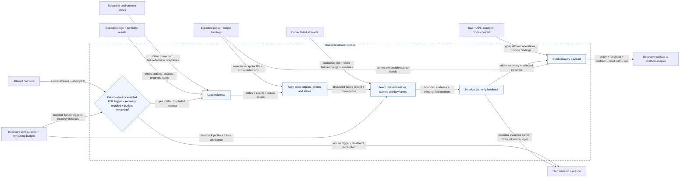

# Revision 4: configurable shared failure recovery

- **Status:** implemented as `cap-recovery-v1`; configurable shared recovery, deterministic text feedback, exact initial-state replay, per-round/cumulative budgets, and recovery-aware batch reports are available.
- **Goal:** use failed execution trajectories to debug the current policy through a shared interface usable by Baseline, Method 1, and Method 2.
- **Agreed direction:** recovery is configurable for all three methods, with up to four recovery rounds and five total rollouts. Any policy rollout that fails to achieve the task postcondition triggers recovery evaluation, regardless of its failure category. Each revised policy starts from the saved initial state; history accumulates, and repeated candidates may run again with explicit logging.
- **Current behavior:** runtime/task failures can trigger a new synthesis request in all three methods. Method 1/2 retain static checking and repair; Baseline retains its original execution path and post-hoc audit. Recovery defaults off.

## 1. Shared API and configuration

- Place recovery orchestration and feedback construction outside the three generators, following the separation used by the [shared DSL checker](SHARED-DSL-CHECKER.md).
  - A common collector creates a structured failure record from environment/recording data and execution artifacts.
  - A common serializer builds bounded, versioned feedback for synthesis.
  - A small method adapter supplies this feedback to the corresponding generation workflow.
  - The common orchestrator manages recovery rounds, initial-state restoration, and attempt records.
- **Disabled:** preserve current generation, prompts, execution, and evaluation behavior.
- **Enabled:** identify the variant explicitly, for example `Google baseline + recovery`, and retain the original baseline as the disabled reference.
  - Baseline uses the same configurable recovery mechanism and task-failure trigger as the other methods. Sharing recovery does not add a pre-execution DSL gate to the Google baseline.
  - Method 1/2 continue using their existing static checks before execution.
- Configuration decisions and recommended defaults; names are conceptual until implementation:

| Setting | Purpose | Decision / recommendation |
| --- | --- | --- |
| `recovery.enabled` | Enable/disable recovery independently for any method | Agreed; recommend default off |
| `recovery.max_rounds` | Additional candidate-revision rounds | **4**, giving at most **5 rollouts** including the initial attempt |
| Task-failure trigger | Failed rollout/postcondition outcome | All causes; no failure-category allowlist |
| `recovery.on_dsl_noncompliance` | Optional additional trigger when a post-hoc audit fails despite task success | Configurable separately from task failure; recommend default off. The same option is available across method adapters; baseline remains free of a pre-execution gate |
| Feedback profile and limit | Latest failure plus accumulated older summaries | Text-only, deterministic rules; recommend an 8,192-token feedback cap |
| History policy | Preserve earlier failed attempts | Latest failure in detail; all earlier failures as short summaries |
| Duplicate-candidate policy | Permit another rollout of unchanged code | Allow; record exact and normalized identity matches and the previous matching attempt |
| Per-round and trial budgets | Bound each recovery and total effort | Use both layers; recommended values in Section 8 |
| Recovery prompt/schema version | Reproduce feedback and future ablations | Version the schema, selector, and templates |


The conceptual interface is framework-independent; the concrete implementation is in [recovery.py](../recovery.py):

```python
record = collect_failure(task, executed_bundle, rollout_artifacts, environment_snapshot)
feedback = build_feedback(record, feedback_profile, token_limit)
request = synthesis_request(task, contract, current_policy, recovery_feedback=feedback)
revised_candidate = method.synthesize(request)
```

- Raw collection and model-visible feedback are separate layers. Collecting a field for host debugging does not automatically authorize adding it to the prompt or policy API.
- Missing fields must be explicit. Different logging capabilities must not be interpreted as different observed outcomes.

### 1.1 Trigger semantics

- For every attempted policy rollout, evaluate the task postcondition at its terminal/failure state. If the rollout does not achieve the task postcondition, recovery is triggered whenever enabled, irrespective of the exception or failure label.
  - This includes primitive nonconvergence, no-witness queries, goal failure, invalid arguments, helper-call errors, per-rollout resource exhaustion, and previously unseen execution failures.
  - Failure categories select evidence; they do not determine whether an unsuccessful rollout is eligible.
- Preserve the existing requirement for normal policy completion: a transiently successful state or an exception after reaching a goal is not silently relabeled as a successful complete rollout.
- Use the shared task evaluator, not an LLM judgment. Record the logical postcondition and physical environment criterion separately; where both define the task, require their agreement with success.
  - Represent an unavailable evaluation as `unknown`, not a fabricated false predicate value. The attempt is unsuccessful and enters recovery evaluation if reliable debugging evidence and the initial snapshot remain available.
- Triggering recovery does not guarantee another model call. Disabled recovery, four consumed recovery rounds, an exhausted overall budget, or unavailable essential source/reset evidence can still stop the process with a recorded reason.
- Baseline uses the same rules and master switch as Method 1/2. A post-hoc DSL audit can additionally trigger baseline recovery through the separate configurable option above; it does not change execution into a checked interpreter.
- Generation/transport failures before a policy rollout have no failed execution trajectory. Keep their handling separate; any such failures inside an already started recovery round consume its call/token/time allowance and are recorded as preparation failures.


## 2. Information to collect

### 2.1 Environment and recorded-state evidence

| Information | Source | Proposed use | Availability at the design review / required implementation |
| --- | --- | --- | --- |
| Saved initial full simulator state and object bindings | Recorder/snapshot machinery | Restore the same start for each revised candidate | Already recorded; keep full simulator internals host-side |
| Initial, pre-action, post-action, and failure gripper/block XYZ | Environment observations or saved trajectory states | Explain how the scene changed; provide compact debugging keyframes | Already available in trajectories; add deterministic selection and serialization |
| Relevant DSL predicate values at those states | Existing predicate evaluator on captured scenes | Explain selection/guard failures and task progress | Queried predicates are logged; additional derived relations must be labeled and bounded |
| Terminal task result and failed goal clauses, where available | Host evaluator plus shared task specification | Diagnose normal completion without achieving the goal | Success/postcondition flags exist; task-specific clause explanations need work |
| Primitive reference positions and resolved target at invocation | Adapter/controller boundary | Compare intended motion with the achieved state | Arguments and states exist, but explicit fixed target capture is needed for reliable attribution |
| Full step trajectory, simulator actions, and video | Recorder | Detailed offline diagnosis; optional richer feedback later | Already recorded; do not include the entire stream in the initial text feedback profile |

- Preserve world frame, units, predicate tolerances, and object identities across the evidence.
- Move targets are gripper targets sampled from references at invocation. Do not reconstruct them using reference positions after the motion.
- Proximity between gripper and block is not proof of a successful grasp. Do not manufacture a `held`/contact diagnosis from a distance threshold alone.
- Images, contacts, velocities, and other simulator internals are not proposed default LLM inputs. Adding them would be an explicit information-access variant.

### 2.2 Code, controller results, and logs

| Information | Source | Proposed use | Availability at the design review / required implementation |
| --- | --- | --- | --- |
| Executed policy, helpers, actual bindings, checkpoint IDs and hashes | Checkpoints, final-output capture, execution source paths | Identify the code that actually failed | Mostly available; use execution-time source identity, not only the last generated helper text |
| Exception type/message and failure location | Runner traceback and timeline | Locate the failing statement and distinguish failure classes | Already recorded; normalize source unit, helper/call stack, and line mapping |
| Primitive name, arguments, convergence, steps and residual error | Adapter events and controller result | Diagnose primitive failure | Most fields are logged; controller phase exists but is not currently included in the primitive-end event |
| Selection/condition expression and query result | Query/condition events, source mapping | Explain no-witness selection or unexpected control flow | Successful query results exist; failed `get` needs an explicit structured failure record and bounded candidate evidence |
| Loop/branch progress and recent action sequence | Runtime events / baseline Python trace | Explain repeated states, nontermination, and premature completion | Richer branch/assignment events exist in checked methods; define a comparable common summary for baseline |
| Model calls, tokens, runtime ticks, simulation steps, wall time, exhausted resource | Budget/timing records | Distinguish a policy failure from a hard effort limit | Already recorded; recovery attempts need cumulative and per-attempt accounting |
| Static DSL diagnostics and contract identity | Shared checker records | Keep source compliance separate from physical failure | Already available; Method 1/2 retain static repair. Post-hoc DSL-triggered recovery is an additional configurable option, including for baseline |

- Environment data describes what happened physically; logs connect those observations to code, decisions, and resource use. Controller outcomes originate in execution and are accessed through structured logs.
- Preserve observed facts separately from explanations inferred by a debugger or LLM. A failure label such as Move nonconvergence does not establish its root cause.
- The failure bundle may retain execution-time binding evidence for debugging. This does not redefine the existing final-output-only DSL compliance metric.

## 3. First feedback profile: text only

- Use text-only structured feedback for the first version, shared across all three methods:
  - Task, primitive/predicate contract, condition mode, and current executable source bundle.
  - Failure category, exception, source location, and a bounded call/statement context.
  - Recent primitive calls with arguments, targets where recorded, convergence, step counts, and residual error.
  - Initial state, the state before the failed operation, and the failure/terminal state, restricted to gripper/block positions and selected DSL relations.
  - Relevant query/guard evidence and terminal goal result, where available.
  - Short summaries of all earlier failed attempts, with their candidate IDs, observed failure, and attempted changes.
  - Remaining recovery budget and the instruction to produce a complete policy that starts from the saved initial state.
- Accumulate history across rounds: retain the latest failed attempt's necessary evidence in detail and a short summary of every older failure. Do not append all previous full prompts or trajectories.
  - Each summary contains attempt/candidate identity, failure outcome, relevant attempted changes, and whether the same candidate/failure has appeared before.
  - Preserve the full older artifacts even when only their summaries enter the prompt. Count every included summary within the feedback token limit.
- Prefer deterministic keyframe/event selection over sending entire logs. Keep the failure point and its preceding operation; report any truncation or missing fields.
- Use stable diagnostic object labels with a recorded mapping across attempts. Diagnostic labels do not automatically become new policy-visible variables or APIs.
- Controller residuals, terminal success, and failure trajectories are additional synthesis-time feedback. They do not become new runtime observation APIs, and the enabled/disabled comparison must record this information difference.
- The evidence review in Section 10 supports text-only feedback as the first version. Field selection, controller/goal detail, and token limits still need to be finalized; missing structured fields must be instrumented before claiming complete feedback coverage.

## 4. Shared feedback module

- This module is shared by all three methods. It returns either a recovery payload or an explicit stop decision.
- It applies the shared failure trigger and configuration/budget checks, aligns failed-execution evidence, and builds bounded text-only feedback with accumulated history.
- It does not generate policy code, execute a policy, or restore the environment. The method adapter handles synthesis, and the rollout controller restores the initial snapshot before execution.



High-level pseudocode (the implementation keeps these responsibilities separate):

```python
def shared_feedback(attempt, task, contract, config, budget):
    # Check outcome, enable/disable, failure eligibility, and remaining resources.
    decision = assess_recovery(attempt, config, budget)
    if not decision.allowed:
        return record_result(attempt, Stop(decision.reason))

    states = load_recorded_states(attempt)
    logs = load_execution_logs(attempt)
    program = load_executed_policy_and_bindings(attempt)
    history = load_earlier_failed_attempts(attempt.trial_id)
    evidence = align_evidence(states, logs, program)

    selected = select_relevant_evidence(
        evidence,
        profile=config.feedback_profile,
        token_limit=config.feedback_token_limit,
        earlier_failures=history,
        preserve_failure_context=True,
        mark_missing_information=True,
    )
    if not selected.ready:
        return record_result(attempt, Stop(selected.reason))
    feedback_text = serialize_text(selected)
    payload = RecoveryPayload(
        task=task,
        contract=contract,
        current_policy=program,
        feedback=feedback_text,
        reset_rule="Restore initial snapshot; run policy from its entry point",
    )

    # Include the required source/API context and reserve response capacity.
    if not fits_feedback_and_request_budgets(payload, config, budget):
        return record_result(attempt, Stop("Insufficient feedback/request budget"))

    return record_result(attempt, Ready(payload))
```

- `assess_recovery` applies the common task-failure trigger and optional DSL trigger, and stops when no trigger applies, recovery is disabled, four recovery rounds are consumed, or overall resources are exhausted.
- `record_result` preserves either the feedback payload or the stop reason. Generation, initial-state restoration, and policy execution remain outside this module.

| Module step | Responsibility |
| --- | --- |
| Recovery gate | Apply the common failure trigger, enable/disable switch, maximum rounds, and remaining resources |
| Load and align evidence | Associate recorded states, source/helper bindings, action calls, and failure locations using explicit IDs |
| Select evidence | Retain the failure point and relevant preceding actions/queries; bound trajectory/history size and mark missing information |
| Serialize feedback | Produce the same versioned text schema for all methods; preserve observed facts and provenance without inventing a root cause |
| Build payload | Include the current policy, task/API/mode context, evidence, and the requirement to restart from the saved initial state |
| Return result | Supply a recovery payload or a stop reason; retain the feedback and decision as attempt artifacts |

- State collection uses saved observations/snapshots; log collection uses structured events and source artifacts. Neither source alone replaces the other.
- The module keeps full reset snapshots host-side and passes only the selected textual representation to synthesis.
- The serializer is deterministic in the first design. No additional LLM summarization request is introduced.
- The simplified shared block in Section 5 represents this entire module, including its internal eligibility decision. Section 5 retains each method's distinct synthesis/checking workflow.

### 4.1 Deterministic evidence selection

- **First-version decision:** `select_relevant_evidence` uses deterministic program rules, not an LLM.
  - Rules depend on the failure category and the evidence schema, not on a particular trial ID or a hand-written solution to its task.
  - The LLM receives the selected evidence and revises the policy; evidence selection adds no separate model request.
  - Given the same artifacts, selector/profile version, tokenizer, and limits, selection should produce the same ordered output.
- Divide the evidence into **required** failure context and **optional** supporting context.
  - Required context preserves the observed failure, its source/operation identity, and the facts necessary to interpret it. Goal failure has no exception location, so retain its terminal state and goal result instead.
  - Optional context provides earlier actions, additional relevant relations, and sampled intermediate trajectory states.
  - Source excerpts and references should point to the actual executable bundle already included in the payload rather than duplicating all code in the feedback.

| Failure category | Required context | Optional supporting context |
| --- | --- | --- |
| Primitive nonconvergence | Failed primitive and arguments; invocation-time target and phase where available; pre/post positions; convergence, steps and residual; source location | Earlier approach actions and sampled positions within the failed motion |
| No-witness get | Failed query; actual referenced helper definition/binding; no-match outcome and available candidate/predicate evidence; state at the query | Earlier successful selections and state changes relevant to the same objects |
| Execution/query budget | Exhausted resource; repeated code/query locations and counts; recent state/progress summary | Representative earlier iterations and additional action history |
| Goal failure | Terminal state; goal result and available unsatisfied clauses; last relevant actions | Earlier states showing when the missing goal relation was lost or never established |
| Argument type/arity failure | Failed call, actual argument values/types, expected signature, actual helper binding, exception/source location | Immediate assignments and calls that produced the invalid arguments |
| Other/unclassified rollout failure | Shared task result, available exception, actual source/bindings, last reliable state, and missing-field markers | Recent action/query history and reproducible state differences |

- Unknown failure categories use the generic fallback profile above. They still trigger recovery evaluation when the rollout is unsuccessful; classification is not an allowlist.
- Required fields that were not recorded must be explicitly marked unavailable. Do not reconstruct them by guessing or infer a physical root cause from the error label.
  - The profile should distinguish fields whose absence prevents reliable attribution from fields that can remain explicitly unknown.
  - If essential attribution cannot be established, return a stop reason instead of silently using an unrelated helper or state.
- Use stable priority tiers for optional evidence, followed by deterministic tie-breaking such as distance from the failure event and event ID.
  - Prefer nearby, relevant evidence over long unrelated history.
  - Represent repetition using counts and representative events; sample motion states using a fixed rule.
  - Keep the rule/profile and sampling parameters versioned and shared across all three methods.

High-level selection pseudocode:

```python
def select_relevant_evidence(evidence, profile, token_limit, earlier_failures,
                             preserve_failure_context=True,
                             mark_missing_information=True):
    failure_type = classify_observed_failure(evidence)
    required = select_failure_context(failure_type, evidence, profile)
    optional = select_supporting_context(failure_type, evidence, profile)
    required = label_missing_fields(required)
    summaries = summarize_earlier_failures(earlier_failures, profile)

    if not essential_attribution_available(required, profile):
        return CannotSelect("Essential failure/source evidence unavailable")

    selected = combine_latest_evidence_and_history(required, summaries)
    if serialized_tokens(selected, profile) > token_limit:
        return CannotSelect("Required failure context/history exceeds feedback budget")

    omitted = []
    for item in deterministic_priority_order(optional, profile):
        candidate = append_evidence(selected, item)
        if fits_with_omission_metadata(candidate, omitted, token_limit, profile):
            selected = candidate
        else:
            omitted.append(evidence_reference(item))

    return finalize_with_omission_metadata(selected, omitted, token_limit, profile)
```

- Budget fitting reduces optional material first. Keep a bounded summary for every earlier failure and never silently truncate required facts. If required context and history cannot fit, record a feedback-budget stop.
- Omission metadata identifies what was excluded, how much was sampled, and why. Its token cost is part of the feedback limit; finalization may remove lower-priority optional evidence to make room for a bounded omission summary.
- The outer module separately checks the complete request, including API/source context and reserved output capacity. A feedback-only fit does not guarantee that the full request fits.
- Save selected/omitted event IDs, keyframe indices, selector/profile version, token-counting method, and the serialized feedback alongside the attempt.
- An LLM-based selector could be a later configurable ablation, such as `rules` versus `llm`; it is not part of the first implementation plan.
- These diagrams describe the implemented recovery flow; the source references and validation evidence are listed below.

## 5. Injection into the synthesis stage

- The diagrams extend the three workflows in the [progress report](progress_report_Oct15-19.md#2-implementation-and-generation-workflows).
  - Dashed boxes separate synthesis and execution. The single shared feedback block is expanded in [Section 4](#4-shared-feedback-module).
  - Blue blocks show the shared feedback module and per-attempt restoration.
  - The environment loop returns observations to the executing program. The recovery loop sends a text summary back to synthesis only after a failed attempt.
  - The shared feedback module applies the enable/disable, shared failure-trigger and remaining-budget checks internally. It returns either a recovery payload or a stop decision.
  - Every path from a newly prepared candidate to execution passes through restoration of the trial's initial snapshot and creation of a fresh execution context.
- Pre-rollout output truncation without a policy and checker-internal errors remain distinct preparation failures; they do not fabricate an executed trajectory. All unsuccessful attempted rollouts, including new error categories, use the shared task-failure trigger.

### 5.1 Google baseline with configurable recovery

```mermaid
flowchart LR
    subgraph SYN["Synthesis stage"]
        direction TB
        I["Task + API / mode prompt"] -->|"generation request"| G["Google LMP + recursive LMPFGen"]
    end
    subgraph RUN["Execution stage"]
        direction TB
        RESET["Restore initial snapshot + fresh execution context"] -->|"invoke policy entry point"| E
        E["Execute generated policy + helpers"] -->|"primitive actions / observation queries"| ENV["Shared adapter + MuJoCo environment"]
        ENV -->|"query results / primitive completion"| E
        E -->|"normal completion / failure"| R["Physical evaluation + recording"]
        ENV -->|"trajectory + terminal state"| R
    end
    G -->|"policy source + bound helpers"| RESET
    E -.->|"final source + bindings after attempt"| C["Shared DSL checker: post-hoc"]
    C -->|"compliance + diagnostics"| A["Separate audit result"]
    style SYN fill:none,stroke:#64748b,stroke-width:1.5px,stroke-dasharray:6 4
    style RUN fill:none,stroke:#64748b,stroke-width:1.5px,stroke-dasharray:6 4
    S0["Saved initial state for this scene"] -->|"same full snapshot for every attempt"| RESET
    R -->|"outcome + policy/log/state references"| FEEDBACK
    FEEDBACK["Shared feedback module - Section 4"]
    FEEDBACK -->|"stop: no trigger / disabled / exhausted"| FIN["Final result + retained attempt records"]
    FEEDBACK -->|"root-policy recovery request + failed source + text evidence"| G
    classDef recovery fill:#eff6ff,stroke:#2563eb,color:#0f172a
    class RESET,FEEDBACK recovery
```



- Recovery feedback enters the policy LMP as a new root-policy request, followed by Google's recursive helper generation.
- Clear stale executable globals/helper caches and implicit LMP execution history between attempts. Preserve the explicit accumulated failure summaries, and include the latest failed source and its actual helper bindings as debugging evidence.
- The shared DSL checker remains a separate post-hoc audit for each attempt. Its verdict is never a pre-execution gate; it can be an additional recovery trigger when `recovery.on_dsl_noncompliance` is enabled.
- With recovery disabled, the attempt ends after ordinary execution/evaluation and its separate audit.

### 5.2 Method 1 with configurable recovery

```mermaid
flowchart LR
    subgraph SYN["Synthesis stage"]
        direction TB
        I["Task + API / mode prompt"] -->|"policy request"| G["Generate policy or helper"]
        G -->|"unit source"| L["Local DSL check"]
        L -->|"violation diagnostics"| R["Repair current unit"]
        R -->|"revised source"| L
        L -->|"unresolved helper signature + role"| H["Recursively prepare helper"]
        H -->|"checked helper definitions"| C["Complete bundle check"]
        L -->|"locally valid unit; no missing helpers"| C
        C -->|"diagnostics"| R
    end
    subgraph RUN["Execution stage"]
        direction TB
        RESET["Restore initial snapshot + fresh execution context"] -->|"invoke policy entry point"| E
        E["Execute checked policy + helpers"] -->|"primitive actions / observation queries"| ENV["Shared adapter + MuJoCo environment"]
        ENV -->|"query results / primitive completion"| E
        E -->|"normal completion / failure"| OUT["Physical evaluation + recording"]
        ENV -->|"trajectory + terminal state"| OUT
    end
    C -->|"complete pass + policy/helpers"| RESET
    style SYN fill:none,stroke:#64748b,stroke-width:1.5px,stroke-dasharray:6 4
    style RUN fill:none,stroke:#64748b,stroke-width:1.5px,stroke-dasharray:6 4
    S0["Saved initial state for this scene"] -->|"same full snapshot for every attempt"| RESET
    OUT -->|"outcome + policy/log/state references"| FEEDBACK
    FEEDBACK["Shared feedback module - Section 4"]
    FEEDBACK -->|"stop: no trigger / disabled / exhausted"| FIN["Final result + retained attempt records"]
    FEEDBACK -->|"root-policy recovery request + failed source + text evidence"| G
    classDef recovery fill:#eff6ff,stroke:#2563eb,color:#0f172a
    class RESET,FEEDBACK recovery
```



- Recovery feedback enters a root-policy revision request. The generated candidate then goes through recursive helper preparation, local checking/repair, and the complete bundle check.
- Local static repair remains inside synthesis and uses checker diagnostics. Runtime recovery is the outer loop and uses failed-execution evidence.
- A local helper pass cannot authorize execution; each revised complete candidate must pass before initial-state restoration and rollout.

### 5.3 Method 2 with configurable recovery

```mermaid
flowchart LR
    subgraph SYN["Synthesis stage"]
        direction TB
        I["Task + API / mode prompt"] -->|"complete-program request"| G["Generate policy + all helpers"]
        G -->|"candidate source"| C["Complete shared DSL check"]
        C -->|"violations + candidate source"| R["Repair whole candidate"]
        R -->|"revised complete source"| C
        C -->|"analysis error / exhausted attempts"| F["Explicit failure"]
    end
    subgraph RUN["Execution stage"]
        direction TB
        RESET["Restore initial snapshot + fresh execution context"] -->|"invoke policy entry point"| E
        E["Execute checked policy + helpers"] -->|"primitive actions / observation queries"| ENV["Shared adapter + MuJoCo environment"]
        ENV -->|"query results / primitive completion"| E
        E -->|"normal completion / failure"| OUT["Physical evaluation + recording"]
        ENV -->|"trajectory + terminal state"| OUT
    end
    C -->|"complete pass + candidate source"| RESET
    style SYN fill:none,stroke:#64748b,stroke-width:1.5px,stroke-dasharray:6 4
    style RUN fill:none,stroke:#64748b,stroke-width:1.5px,stroke-dasharray:6 4
    S0["Saved initial state for this scene"] -->|"same full snapshot for every attempt"| RESET
    OUT -->|"outcome + policy/log/state references"| FEEDBACK
    FEEDBACK["Shared feedback module - Section 4"]
    FEEDBACK -->|"stop: no trigger / disabled / exhausted"| FIN["Final result + retained attempt records"]
    FEEDBACK -->|"whole-candidate recovery request + failed source + text evidence"| G
    classDef recovery fill:#eff6ff,stroke:#2563eb,color:#0f172a
    class RESET,FEEDBACK recovery
    F -->|"static generation/checking failure"| FIN
```



- Recovery feedback enters whole-candidate generation/revision, requesting the complete policy and all helper definitions.
- Static whole-candidate repair and runtime recovery use different feedback sources. Both remain subject to the recorded shared resource limits.
- Each recovery candidate passes the complete checker before initial-state restoration and execution. Static analysis errors or exhausted static attempts terminate without a new rollout.

- Use an explicit recovery request role/template rather than overwriting frozen initial-generation or static-repair templates.
- The three method adapters share evidence selection, text schema, reset protocol, and recovery accounting; their generation/checking strategies remain distinct.

## 6. Rollout protocol, history, and logging

- Failed trajectories are debugging input, not continuation states for a revised policy.
- Every complete policy rollout starts from an initial state. Invoke each candidate from its entry point after restoring the same trial's full initial simulator snapshot and fresh execution context.
- For multiple scenes, restore each scene's own initial snapshot for every candidate. Recreating a scene from its seed does not replace exact restoration.
- Number the initial attempt as round 0 and recovery rounds as 1–4. At most five policy rollouts are allowed.
  - Every started recovery round consumes one of the four rounds, even if candidate preparation fails before rollout. Record that no rollout occurred; do not invent a failure trajectory.
  - Helper generation and static repairs within a round consume that round's and the trial's budgets. They are not extra recovery rounds or independent trials.
- Accumulate the latest failure's detailed evidence and older failed-attempt summaries. Preserve full artifacts for every attempt.
- Repeated candidates may execute again from the initial snapshot. Do not reject, skip, or stop solely because the candidate matches an earlier version.
  - Record source/binding hashes, normalized candidate identity, the earlier matching attempt, and whether the new outcome repeats or differs.
  - Repetition consumes the normal round and rollout budgets.
- A hard overall trial-budget exhaustion stops further recovery. Reaching a per-rollout limit ends that attempt, but a recovery may proceed if round and overall resources remain.
- Report first-attempt success and success within four recovery rounds separately. Retain failed attempts and actual total cost; recovery rollouts are not additional independent trials.

### 6.1 Recovery-aware logger

| Event / artifact | Required information |
| --- | --- |
| Recovery decision | Trial/attempt ID, enabled flags, postcondition/environment outcome, termination status, trigger, remaining rounds/budgets, continue/stop reason |
| Recovery round start/end | Round index, parent failed attempt, preparation/rollout status, timestamps and exclusive phase durations |
| Failure evidence | Error/category, actual source/helper bindings, action/query IDs, relevant state indices, fixed targets/controller phase, missing fields |
| Evidence selection | Selector/profile version, selected/omitted event IDs and keyframes, history summaries, token-counting method and size |
| Feedback and model request | Exact serialized feedback, accumulated-history IDs, prompt/schema version and hashes, request role, model settings and usage |
| Candidate identity | Source and binding hashes, normalized identity, parent candidate, changes, duplicate flag and earlier matching attempt |
| Initial-state restoration | Reference snapshot hash, restored-state comparison, object-binding mapping and rollout ID |
| Rollout result | Normal completion or exception, task postcondition, physical goal result, separate DSL compliance, trajectory/video/source references |
| Resource accounting | Per-request, per-round and cumulative calls/tokens/ticks/simulation steps/time; reservations, actual usage, missing usage and exhaustion reason |
| Final result | Number of rounds/rollouts, first-attempt success, final recovery outcome, total resources, and complete artifact index |

- Use unique per-round/per-rollout artifact paths. The current fixed `rollout_001` layout must be extended so new attempts cannot overwrite earlier data.
- Keep static repair, runtime recovery, and transport retry roles distinguishable. Count provider-reported reasoning tokens once inside completion usage.
- Preserve failed evaluations as `unknown` when appropriate, with their evaluator error; never convert missing evidence into a claim that a specific predicate was false.
- `recovery.enabled=false` retains current policy-generation/execution behavior. Logging the disabled setting must not add a feedback request or change its prompt.

## 7. Remaining implementation details

- Core behavior is settled: all unsuccessful rollouts trigger recovery evaluation; all three methods use configurable recovery; four recovery rounds are allowed; history accumulates; repeated candidates may execute; essential evidence must be attributable; logging covers every attempt.
- Finalize the concrete configuration/schema names, deterministic keyframe and predicate-summary rules, and per-method source/binding adapters.
- The budget values below are the comparison configuration. Recovery defaults are implemented; initial-attempt limits remain configurable through RunConfig. Multiple limits may bind before every allowance is consumed.
- Shared feedback remains a deterministic evidence/schema layer; each method's own synthesis stage revises its candidate.
- Recovery is implemented; no new policy observation API is added. See the implementation and validation section below.

## 8. Recommended layered budgets

Use **per-request, per-round, and whole-trial limits together**. A per-recovery limit prevents one round from consuming all resources; cumulative limits prevent recovery from repeatedly resetting the trial allowance.

### 8.1 Recommended initial configuration

| Resource | Initial attempt, round 0 | Each recovery round, rounds 1–4 | Whole recovery-enabled trial |
| --- | ---: | ---: | ---: |
| Policy rollouts | At most 1 | At most 1 | **At most 5** |
| Response output tokens, including reasoning | 16,384 per request | **16,384 per request** | Account for every response; no separate reasoning-token addition |
| Feedback tokens, excluding task/API/current source | None | **8,192** including accumulated history | Each prompt's input contributes to cumulative usage |
| Reported input + output tokens | **50,000** | **100,000** | **450,000** |
| Model calls, including helper/static-repair/transport attempts | **12** | **16** | **76** |
| Execution/query ticks | **10,000 per rollout** | **10,000 per rollout** | **50,000** |
| Policy simulation steps | **10,000 per rollout** | **10,000 per rollout** | **50,000** |
| Active time, including preparation, execution and finalization | **600 s** | **600 s** | **3,000 s (50 min maximum)** |
| Helper/dependency depth | **12** | **12** | Per invocation; not cumulative |

- These are recommendations for Stack and tasks without a stricter existing cap. **Unstack retains its 60-second end-to-end cap for the entire trial, including all recovery rounds.** Recovery never multiplies that limit.
- The initial attempt retains the earlier experiment's effort limits, allowing first-attempt comparisons with recovery disabled. The cumulative caps are 50k + 4×100k tokens, 12 + 4×16 calls, and 5×600 seconds; actual usage can be much lower.
- Every request/operation must fit both the current round and the remaining overall limits. Exhausting a round does not erase its usage from the trial ledger.
- The round count is an upper bound: success, insufficient evidence, or an exhausted hard trial budget can stop earlier. Multiple limits can bind; 16 calls are not promised if the round's token/time limit is reached first.
- Keep the per-primitive 50-step control limit and existing controller tolerances unchanged. The policy simulation-step allowance is a different quantity.

### 8.2 Feedback accumulation and input limits

- Increase the earlier 4k feedback proposal to **8k** so history can accumulate without crowding out the latest failure:
  - Up to **6,144 tokens** for the latest failure's required/relevant evidence.
  - Up to **512 tokens per earlier failure**, at most three earlier failures in the fourth recovery request: **1,536 tokens** total.
  - Reserve approximately **512 tokens** for identifiers, missing/omission markers, and history structure.
- These partitions are recommended selection targets. The 8,192-token total remains the cap; required context that cannot fit must produce an explicit feedback-budget stop rather than silent deletion.
- Task/API text and the current executable source bundle are counted separately when checking the full request. Do not duplicate all older source bundles or complete trajectories; retain summaries, IDs, and full host-side artifacts.
- Check total input plus reserved output against the selected model route's context window. Use an appropriate tokenizer/provider count when available; record any conservative estimate and reconcile it with returned usage.

### 8.3 Why retain the 16k response cap?

- Accumulated failure evidence primarily increases **input** tokens. It is not itself a reason to increase each response's output cap.
- The Haiku typed and legacy batches had no response-length failures at 16k. Start with that observed setting and make the output cap configurable; increase it in a separately recorded experiment if recovery responses actually truncate.
- DeepSeek's reasoning-only truncations are a separate generation issue, not evidence that longer trajectory feedback will help.
- Before dispatch, reserve estimated input and permitted output costs against both round and trial budgets. Existing accounting observes usage after the response; recovery implementation must add pre-dispatch allocation and log any estimation/actual-usage discrepancy.
- Recovery-on/off experiments should report first-attempt results, recovery success, all budget limits and actual cumulative cost. Later controls can compare feedback-based recovery with additional independent generations under matched total effort.

## 9. Proposed recovery prompt

- Use a versioned recovery template with a common evidence section and method-specific output/preparation instructions.
- Preserve the API contract and condition mode. Recovery feedback does not authorize extra primitives, numeric guards in DSL-only mode, or new observation APIs.
- Request a complete candidate invoked from its entry point. For Baseline and Method 1, retain their helper-resolution workflows; Method 2 must include every helper in its whole-candidate output.
- Keep observed facts separate from inferred explanations. Do not tell the model that nonconvergence proves a collision, bad grasp, or framework bug.

```text
Revise the current policy to complete the task using the supplied API.

TASK AND CONTRACT
{task_instruction}
{versioned_api_description_and_condition_mode_rules}
{allowed_runtime_bindings}

CURRENT EXECUTABLE POLICY
{policy_source_and_helper_sources}
{execution_time_binding_and_source_mapping}

OBSERVED FAILURE
{failure_category_exception_and_source_location}
{recent_primitive_calls_arguments_fixed_targets_and_results}
{relevant_query_guard_and_progress_evidence}
{initial_pre_failure_and_failure_or_terminal_state_keyframes}
{terminal_goal_result_and_available_clause_evidence}
{missing_or_truncated_evidence}

EARLIER FAILED ATTEMPTS
{short_summary_of_each_earlier_failed_attempt}
{candidate_changes_and_duplicate_candidate_history}

ROLLOUT PROTOCOL
The failed trajectory is debugging evidence only.
The revised policy will run from its entry point after restoring the saved
initial state. It will not resume from the failure state.
Diagnostic object labels are not new executable variable bindings.

REVISION REQUEST
Address the failure while preserving the complete task and API contract.
Do not assume an unobserved cause is established fact.
Output replacement Python policy code only, including its top-level invocation.
{method_specific_helper_and_output_requirements}
```

- Keep failed runtime attempts separate from static-check repair messages and transport retries in artifacts and token accounting.
- The first version should use deterministic structured summaries; adding an LLM summarizer would introduce another request/cost and should be separately configured.
- `recovery_prompt` implements this structure as a versioned supplement to the frozen initial prompt. It accumulates bounded earlier-failure summaries rather than replaying all prior messages.

## 10. Coverage of observed failures

- Reviewed the two typed_v3 Revision 2 batches (60 trials) and the later legacy_v1 Haiku supplement (20 trials).
  - Typed batches: 36 failures = 20 generation truncations + 15 primitive failures + 1 no-witness query.
  - Legacy supplement: 19 failures, adding execution/query-budget, goal, object-reference, and helper-arity failures.
  - Combined: 55 failures, of which 35 occurred after generation during execution/task evaluation. These heterogeneous batches are a failure inventory, not a pooled success-rate comparison.
- Sources: [DeepSeek typed report](../../../runs/cap-revision2-deepseek/20261018-215345/report.md), [Haiku typed report](../../../runs/cap-revision2-haiku55/20261019-021933/report.md), [Haiku legacy supplement](../../../runs/cap-haiku55-legacy-supplement/20261019-153234/report.md), and [per-trial evidence review](../../../runs/cap-recovery-evidence-review/20261019-211731/README.md).

| Observed failure | DeepSeek typed | Haiku typed | Haiku legacy | Text evidence and coverage |
| --- | ---: | ---: | ---: | --- |
| Generation output limit / empty code | 20 | 0 | 0 | Response finish reason and usage identify the failure. No executed policy or failure trajectory to debug; use a separate generation-retry/configuration path |
| Move nonconvergence | 4 | 6 | 7 | Existing arguments, positions, step counts and residuals support diagnosis; explicitly record the invocation-time target and controller phase |
| Pick nonconvergence | 0 | 2 | 2 | Existing trajectories and residuals support diagnosis; add phase/target details and do not infer successful grasp from proximity |
| Release nonconvergence | 1 | 2 | 1 | Existing trajectories and residuals support diagnosis; include retreat target, phase, and relevant before/after positions |
| No-witness get | 0 | 1 | 1 | Existing source/predicate events identify the failure; add structured failed-query and bounded candidate-evaluation evidence |
| Execution/query tick budget | 0 | 0 | 4 | Existing traces and exhausted-budget field identify it; summarize repeated statements/queries and physical progress. Recovery requires remaining overall budget |
| Normal completion with goal failure | 0 | 0 | 2 | Both terminal success and DSL-postcondition flags are false; provide final state and goal-clause evidence, not an invented exception location |
| Invalid object reference | 0 | 0 | 1 | Exception, code, actual bindings and argument values/types support diagnosis; distinguish None/numeric values from stale handles |
| Helper arity | 0 | 0 | 1 | Exception, actual helper definition/binding and call-site arguments support diagnosis |

- All 35 execution/task failures have recorded trajectories and source-location events. Exception failures have tracebacks; the two goal failures correctly do not.
- All 25 primitive-failure records contain convergence, step count and position error. Explicit fixed targets and controller phase are absent from the current primitive-end events and need reliable capture/association.
- Neither no-witness case has a dedicated structured failed-query event. The relevant information is distributed across source and predicate/trace events.
- Baseline helper bindings matter: the earlier Haiku no-witness trial executed a generated helper that differed from the inline definition. Using only the visible final policy text can misdiagnose it.
- The Revision 2 query-lambda capture defect and the checker defects fixed in Revision 3 are framework issues, not additional physical trial-failure categories. Do not ask an LLM to repair correct policy code based on a known false diagnostic.
- **Conclusion:** text-only is an appropriate initial channel for representing the observed failures. The historical artifacts provided most evidence; this revision adds structured packaging and the identified instrumentation. The historical review establishes diagnostic coverage by failure class, not complete root-cause identification or measured model recovery effectiveness.

## Existing implementation references

- [Environment/primitive adapter](../adapter.py), [trajectory recorder](../recording.py), [source checkpoints](../checkpoints.py), [baseline final-output capture](../final_output.py), [failure handling and evaluation](../runner.py), [controller result](../../api/control.py).

## Implementation and validation

- [RecoveryConfig](../config.py) exposes all switches and limits. Single-run CLI: `--recovery` / `--no-recovery`; `--recovery-config path.json` supplies budget/profile overrides. The batch JSON accepts `recovery_variants: [false, true]` to schedule both settings for every method/trial/mode.
- [recovery.py](../recovery.py) provides `run_recovery`, `collect_failure`, `select_relevant_evidence`, `recovery_prompt`, and `RoundBudget`. Each round uses a fresh method/adapter and an independent immutable attempt directory. The parent run indexes every result and feedback artifact.
- Configuration retains existing initial-attempt limits from `RunConfig`; the comparison uses 50,000 tokens / 12 calls / 600 seconds initially. Recovery defaults follow Section 8. Unstack's entire trial remains limited to 60 seconds.
- Required evidence includes the latest outcome, actual source/binding mapping, initial/pre-operation/terminal XYZ, last operation and source location, and bounded derived goal clauses. Optional recent events are selected deterministically. All older failures are summarized; full artifacts remain available. Essential missing attribution or oversized required feedback produces an explicit stop.
- The first implementation uses a conservative UTF-8 byte bound for feedback/request token reservation, not a provider-specific tokenizer. This can stop earlier than a tokenizer-based estimate; actual returned usage is reconciled, and missing/failed usage retains its reservation. Full source/API context and the reserved response cap also count toward the request/context limit.
- Controller callbacks record actual phase targets before motion, preserving controller behavior. Failed `get` records up to 16 candidate evaluations and an omitted count. Goal clauses use the same predicate semantics and configured tolerance. No grasp/collision inference is presented as an observed fact.
- Recovery-on requires normal completion and agreement of the physical goal and shared logical postcondition for Stack/Unstack. Recovery-off preserves the previous physical-success metric. Both values remain separately visible; the comparison must check for disagreements.
- Preparation failure consumes its started round and stops with `preparation_failure_no_rollout`; there is no automatic trajectory-based recovery without an executed policy. Static repair and transport retry remain separate within an attempt.
- Validation: 116 CaP tests passed before the added six-group batch regression; the subsequent 35-test recovery/batch/controller run passed, including MuJoCo controller tests. The scripted [six-group physical preflight](../../../runs/cap-recovery-preflight/20261019-223951/report.md) forces a no-witness failure, then successfully completes Stack from the exact initial snapshot in all three recovery-enabled methods. Recovery-disabled counterparts stop at the forced failure. These scripted checks are not model success-rate measurements.
- Each parent run saves `rounds/<index>/result.json`, `identity.json`, and `feedback.json`, plus per-attempt checkpoints, prompts, usage, trajectory and video. Batch reports include recovery setting, first-attempt/final success, recovery rounds, calls and total tokens. Repeated candidates are recorded and remain executable.

### CAP-RECOVERY-1: frozen history in delivered feedback

- The first 30-trial live batch at `runs/cap-revision4-haiku55/20261019-224320` is retained as a diagnostic batch, excluded from the corrected comparison.
- Artifact audit found that `earlier_failures` shared the orchestrator's mutable history list. Appending the latest failure after serializing the selection artifact also mutated the in-memory feedback subsequently sent to the model. The latest failure therefore appeared both in detailed evidence and in earlier history; the prepared and delivered payloads differed.
- Fix: copy the earlier summaries when constructing feedback. Regression tests check the exact delivered prompt, require zero earlier failures for the first recovery request and three for the fourth, and compare prepared/delivered feedback objects for equality.
- A complete fresh comparison is required after this correction; no individual failed or successful trial is selectively replaced.

## Completed Haiku 5.5 comparison

- [Accumulated results and interpretation](revision_4_recovery_report.md): 120 corrected Stack trials, twenty per method/recovery setting (the original five plus fifteen additional), `dsl_only`, medium reasoning, 16k response cap, three parallel workers.

| Method | Recovery off | Recovery on: first attempt | Recovery on: final |
| --- | ---: | ---: | ---: |
| Baseline | 9/20 | 8/20 | 19/20 |
| Method 1 | 10/20 | 10/20 | 20/20 |
| Method 2 | 14/20 | 17/20 | 20/20 |

- 24 initially unsuccessful recovery-on trials became successful; 33 additional recovery rounds were used.
- Both included cohorts use the same corrected implementation, prompt/model settings, budgets and full initial snapshot. The earlier CAP-RECOVERY-1 diagnostic batch remains excluded.
- Combined reported usage: 1,422,385 tokens and 197 calls. Per-trial usage, attempt artifacts, cohort-specific results and audit evidence are linked in the report.
