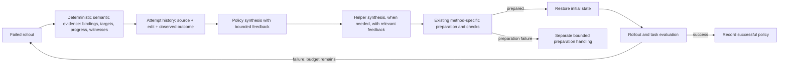

# Revision 4: shared failure recovery — Haiku and MiniMax

- **420 included trials:** 120 Haiku 5.5 trials (20 per setting) and 300 MiniMax M3.1 Flash free trials (50 per setting). Each model has six settings: three methods × recovery off/on.
- Shared setup: Stack, three blocks, the same archived initial scene, `dsl_only`, `typed_v3`, medium reasoning, and a 16,384-token output cap per model request.
- All attempts start from the saved initial state. Recovery permits up to four replacement programs after the initial program, for at most five rollouts.
- Results remain separated by model. No trial was rerun or replaced to produce this merged report; the excluded Haiku diagnostic batch and the MiniMax compatibility probe are outside the 420 trials.

## 1. Results across models

| Model | Method | Recovery off | On: initial program | On: final | Initially failed trials recovered |
| --- | --- | --- | --- | --- | --- |
| Haiku 5.5 | Baseline | 9/20 | 8/20 | 19/20 | 11 |
| Haiku 5.5 | Method 1 | 10/20 | 10/20 | 20/20 | 10 |
| Haiku 5.5 | Method 2 | 14/20 | 17/20 | 20/20 | 3 |
| MiniMax M3.1 Flash free | Baseline | 5/50 | 4/50 | 42/50 | 38 |
| MiniMax M3.1 Flash free | Method 1 | 4/50 | 5/50 | 40/50 | 35 |
| MiniMax M3.1 Flash free | Method 2 | 6/50 | 7/50 | 40/50 | 33 |

- **On: initial program / first attempt** means round 0, before any recovery. **On: final** means the final outcome after zero to four recovery rounds.
- **Tokens off** and **Tokens on** in the detailed tables are the total input plus output tokens across all trials in that model/setting, not averages. On includes the initial attempt and all recovery calls; both include helper generation and static repair where applicable. Reasoning tokens are already included in output usage.
- Off/on groups use independent initial generations. Measure recovery gain within the recovery-on group, from its initial to final success count.
- Model sampling behavior, request timeout, and pacing differ across cohorts. A shared medium-effort label does not equate reasoning-token usage. This is a fixed-scene comparison with extra feedback and budget for recovery, not a matched-cost restart study or a test of layout generalization.

| Model cohort | Trials | Total tokens | Model calls | Known provider cost |
| --- | ---: | ---: | ---: | ---: |
| Haiku 5.5 | 120 | 1,422,385 | 197 | $0.412093 |
| MiniMax M3.1 Flash free | 300 | 5,315,581 | 692 | $0.000000 |

## 2. Haiku 5.5 — 20 trials per setting

- **120 trials:** the original five corrected trials plus fifteen new trials for each of the six settings.
- Stack, three blocks, one shared archived initial scene; `dsl_only`; `typed_v3`; Haiku 5.5 medium reasoning; 16,384 output tokens per request; three parallel workers.
- Both cohorts use the corrected recovery implementation from `df0a42a`. The extension is recorded at `231b368`, whose changes from that implementation are documentation only.
- All failures are retained. The earlier CAP-RECOVERY-1 diagnostic batch is excluded.

### Accumulated results

| Method | Recovery off | On: first attempt | On: final | Initially failed trials recovered | Tokens off | Tokens on | Calls off / on |
| --- | --- | --- | --- | --- | --- | --- | --- |
| Baseline | 9/20 | 8/20 | 19/20 | 11 | 164,348 | 456,633 | 30 / 68 |
| Method 1 | 10/20 | 10/20 | 20/20 | 10 | 120,686 | 258,352 | 20 / 33 |
| Method 2 | 14/20 | 17/20 | 20/20 | 3 | 186,554 | 235,812 | 22 / 24 |

- Recovery benefit is measured from the first attempt to the final outcome within the recovery-on group. Off/on groups use independent model generations; their initial-success difference is not a recovery gain.
- Recovery receives extra failure observations and additional generation/execution budget. This experiment does not compare against independent restarts at matched cost.
- Twenty generations per setting on one fixed scene do not establish generalization across new layouts or tasks.

### Original and additional cohorts

| Method | Setting | Original five | Additional fifteen | Combined twenty | Final DSL pass |
| --- | --- | --- | --- | --- | --- |
| Baseline | Recovery off | 1/5 | 8/15 | 9/20 | 18/20 |
| Baseline | Recovery on | 5/5 | 14/15 | 19/20 | 19/20 |
| Method 1 | Recovery off | 3/5 | 7/15 | 10/20 | 20/20 |
| Method 1 | Recovery on | 5/5 | 15/15 | 20/20 | 20/20 |
| Method 2 | Recovery off | 2/5 | 12/15 | 14/20 | 20/20 |
| Method 2 | Recovery on | 5/5 | 15/15 | 20/20 | 20/20 |

- [Original corrected 30-trial report](../../../runs/cap-revision4-haiku55/20261019-225124/report.md); [historical five-trial analysis](revision_4_recovery_initial5_report.md).
- [Additional 90-trial report](../../../runs/cap-revision4-haiku55/20261020-001210-additional15/report.md). New local trial IDs 1–15 correspond to accumulated trial IDs 6–20.
- [All 120 trials, including each trial’s token usage](../../../runs/cap-revision4-haiku55/20261020-001210-additional15/accumulated/report.md); [all attempt trajectories and videos](../../../runs/cap-revision4-haiku55/20261020-001210-additional15/accumulated/artifacts.md).

### Recovery outcomes

| Method | Initially unsuccessful, recovery on | Recovered | Final failures | Additional rounds used |
| --- | --- | --- | --- | --- |
| Baseline | 12 | 11 | 1 | 16 |
| Method 1 | 10 | 10 | 0 | 13 |
| Method 2 | 3 | 3 | 0 | 4 |

| Recovery stop reason | Trials |
| --- | --- |
| preparation_failure_no_rollout | 1 |
| success | 59 |

#### Unsuccessful recovery-enabled trials

| Method | Accumulated trial | Status | Reason | Artifacts |
| --- | --- | --- | --- | --- |
| Baseline | 12 | failed | SyntaxError: invalid syntax (executed.py, line 1) | [Manifest](../../../runs/cap-revision4-haiku55/20261020-001210-additional15/trials/cap_google_baseline-dsl_only-007-recovery-on/cap/20261020-002049-231b368-cap_google_baseline-recovery-76acf51a/artifacts/trial_001/manifest.json) |

- The helper response included prose and Markdown, so Python compilation failed before rollout. Runtime recovery requires an executed policy trajectory; this preparation failure is recorded and remains in the denominator.

### Resource accounting

| Included batch | Reported tokens | Model calls | Known provider cost |
| --- | --- | --- | --- |
| Original corrected five per setting | 348,076 | 47 | $0.102141 |
| Additional fifteen per setting | 1,074,309 | 150 | $0.309952 |
| **Combined 120 trials** | **1,422,385** | **197** | **$0.412093** |

- 153 prepared attempts, 151 policy rollouts, and 33 additional recovery rounds. Missing provider usage: 0 calls.
- Usage includes policy, helper, static-repair, transport-retry and recovery requests. Reasoning is included in completion tokens and is not added twice.
- Initial attempt: 50,000 tokens, 12 calls, 600 seconds. Each recovery: 100,000 tokens, 16 calls, 600 seconds. Whole trial: 450,000 tokens, 76 calls, 3,000 seconds. At most four recovery rounds; 10,000 execution/query ticks and simulation steps per rollout.
- Feedback limit: 8,192 under the conservative UTF-8 byte bound. Per-request output remains 16,384 tokens. These settings match the original corrected batch.

### Audit and scope

- All 153 attempt starts match the archived full initial snapshot; 151 attempts entered policy rollout. Initial policy prompts match within methods across settings and cohorts. Prepared and delivered recovery feedback match, with correct history counts and serialized bounds. Artifact issues: 0.
- All 153 saved videos match their trajectory frame/state indices, including the initial-state-only recordings for two preparation failures. Calls and token totals reconcile against request/response artifacts.
- All 92 successful final policies passed the DSL checker. Baseline has one failed source audit (recovery-off trial 16, which also failed physical execution) and two incomplete preparation outputs (off trial 6 and on trial 12). No successful-but-DSL-invalid final policy was observed.
- Physical/logical terminal-goal disagreements: 2 across attempts. The physical goal, logical postcondition and source DSL compliance remain separate measurements.
- Recovery-off preserves the original normal-completion/physical-success metric. Recovery-on additionally requires the shared logical postcondition. Source compliance alone does not establish physical task completion or formal verification.
- The implementation previously passed 118 CaP tests, controller regressions and the physical recovery preflight. This extension changes neither the implementation nor the experiment configuration.
- [Machine-readable accumulated results and per-trial audit](../../../runs/cap-revision4-haiku55/20261020-001210-additional15/accumulated/summary.json); [extension configuration and cohort mapping](../../../runs/cap-revision4-haiku55/20261020-001210-additional15/comparison_plan.json); [reproducible artifact-only accumulation script](../../../runs/cap-revision4-haiku55/20261020-001210-additional15/audit_accumulate.py).

### Excluded diagnostic batch

- The 30-trial batch `20261019-224320` remains excluded because of CAP-RECOVERY-1 (the latest failure was duplicated in earlier history). Its results are not included in the 120 trials or usage table above.
- [Diagnostic evidence](../../../runs/cap-revision4-haiku55/20261019-224320/analysis.md) and the [history fix](revision_4_failure_recover.md#cap-recovery-1-frozen-history-in-delivered-feedback) are preserved.

## 3. MiniMax M3.1 Flash free — 50 trials per setting

- **Status: completed; 300/300 planned trials finished.** Target: 50 trials in each of six settings.
- Stack, three blocks, the same full initial snapshot as the Haiku comparison; `dsl_only`; `typed_v3`.
- Model: `minimax/minimax-m3.1-flash:free`; reasoning explicitly `medium`; response cap 16,384 tokens; temperature and top_p omitted.
- Three parallel workers. Request timeout: 300 seconds. Shared request admission interval: 6 seconds. Batch safety threshold: 800 wire requests.
- Runtime recovery and DSL checking are unchanged from the corrected implementation. Commit `29473fe` adds optional pacing and resumable quota admission; all 124 CaP tests pass.

### Results

| Method | Off success / finished | On: initial program / finished | On: final / finished | Recovered | Tokens off | Tokens on | Calls off / on |
| --- | --- | --- | --- | --- | --- | --- | --- |
| Baseline | 5/50 | 4/50 | 42/50 | 38 | 358,675 | 1,560,818 | 65 / 195 |
| Method 1 | 4/50 | 5/50 | 40/50 | 35 | 307,989 | 1,336,328 | 55 / 162 |
| Method 2 | 6/50 | 7/50 | 40/50 | 33 | 366,830 | 1,384,941 | 60 / 155 |

- The initial program is round 0, before any recovery. Final success permits up to four recovery rounds. No failed trial is replaced; pending trials are not failures.
- Off/on initial programs are independent generations. Recovery gain is the initial-to-final improvement within the recovery-on group.
- [Per-trial results and token usage](../../../runs/cap-revision4-minimax31flash/20261020-152924-free-300/analysis.md); [attempt trajectories/videos](../../../runs/cap-revision4-minimax31flash/20261020-152924-free-300/artifacts.md); [machine-readable audit](../../../runs/cap-revision4-minimax31flash/20261020-152924-free-300/experiment_audit.json).

### Included pilot and request budget

- The first five trials per setting (30 total, included in the target) used 72 requests: 2.40 requests per trial. The pilot projection for 300 trials was 720 requests.
- A new trial is admitted only if the batch threshold and current free quota can cover its maximum call allowance and the remaining allowances of active trials. A refusal drains active workers and preserves unstarted jobs as pending.
- Quota checks are account reads, not model generations. A separate compatibility probe used one inference request, 265 tokens and zero reported cost; it is excluded from trial counts.

### Usage and outcomes

- Completed-trial usage: **5,315,581 tokens**, **692 model calls**, known provider cost **$0.000000**. Missing usage: 0 calls.
- Wire requests admitted: 692. Prepared attempts: 592; policy rollouts: 582; recovery rounds: 292.
- Usage includes policy, helper, static-repair, transport and recovery calls. Reasoning tokens are included in completion tokens and are not counted twice.

| Recovery stop reason | Trials |
| --- | --- |
| max_recovery_rounds | 23 |
| preparation_failure_no_rollout | 5 |
| success | 122 |

| Method | Recovery | Final DSL pass / finished |
| --- | --- | --- |
| Baseline | off | 44/50 |
| Baseline | on | 46/50 |
| Method 1 | off | 50/50 |
| Method 1 | on | 50/50 |
| Method 2 | off | 50/50 |
| Method 2 | on | 49/50 |

### Final failure categories

| Method | Recovery | Primitive failed | Execution/resource budget exhausted | Goal failed | Other runtime failure | Generation failed |
| --- | --- | ---: | ---: | ---: | ---: | ---: |
| Baseline | off | 20 | 14 | 3 | 8 | 0 |
| Baseline | on | 3 | 1 | 0 | 3 | 1 |
| Method 1 | off | 35 | 9 | 1 | 1 | 0 |
| Method 1 | on | 6 | 2 | 2 | 0 | 0 |
| Method 2 | off | 23 | 15 | 6 | 0 | 0 |
| Method 2 | on | 7 | 1 | 0 | 1 | 1 |

These are final runner statuses, not independently established root causes. Recovery-on counts describe the last attempt after recovery stopped. Earlier failed attempts remain in the linked per-trial records.

All 137 successful final policies passed the saved DSL audit. This batch contains no physically successful final policy with a non-passing DSL audit; this does not establish that prompting always enforces the DSL.

### Audit and interpretation

- Artifact issues: 0. Exact initial-state matches: 592/592. Verified video/frame mappings: 592.
- Initial prompts match the corresponding Haiku hashes. Every delivered recovery payload is compared with the prepared artifact; history length and serialized feedback bounds are checked.
- Planning and case-study Markdown files were added or edited while the batch was running. Later attempts may record a dirty worktree; the audit checks the documented Markdown changes and verifies that runtime sources remain unchanged. [Documentation provenance](../../../runs/cap-revision4-minimax31flash/20261020-152924-free-300/documentation_provenance.json).
- [Baseline trial 6: all five programs and delivered feedback](case_study/revision_4_failure_recovery_cases/minimax_baseline_dsl_only_trial_006.md).
- Physical/logical terminal-goal disagreements: 12 across attempts. Physical success, the logical postcondition and source DSL compliance are recorded separately.
- Recovery-off retains the original physical-goal/normal-completion metric. Recovery-on additionally requires the shared logical postcondition. Exceptions after reaching a goal are not silently relabeled as normal successful rollouts.
- This is a fixed-scene generation study. Recovery uses extra requests and failure observations; the experiment is not a matched-cost comparison with independent restarts or a generalization test across layouts.
- Model, native sampling behavior, request timeout and request pacing differ from Haiku. The same reasoning-effort label does not imply equal thinking-token usage.
- [Frozen configuration](../../../runs/cap-revision4-minimax31flash/20261020-152924-free-300/comparison_plan.json); [pilot estimate](../../../runs/cap-revision4-minimax31flash/20261020-152924-free-300/pilot_estimate.json); [request ledger](../../../runs/cap-revision4-minimax31flash/20261020-152924-free-300/request_gate.json); [validation logs](../../../runs/cap-revision4-minimax31flash/20261020-152924-free-300/validation/full_cap_suite.txt).

## 4. Analysis of initially failed recovery-on trials

### 4.1 Scope, process, and reproducible data

- Select recovery-on trials whose initial program did not succeed. Exclude recovery-off trials and initially successful recovery-on trials from this analysis. Keep initial preparation failures in the selected denominator, but distinguish them from executed policies.
- **159 selected trials: 130 eventually recovered and 29 did not.** Three never entered their initial rollout. The other 156 supplied an initial failed execution; 130 of these recovered. There are **325 feedback-to-replacement transitions** across the selected trials.
- Haiku uses the corrected original five plus additional fifteen trials per setting; additional-cohort IDs 1–15 map to accumulated IDs 6–20. MiniMax uses its 50-trial-per-setting cohort. The excluded diagnostic batch and compatibility probe remain excluded.
- The [analysis script](../recovery_analysis.py) reads existing artifacts only. It makes no model requests and executes no generated policies or simulations. The recovery implementation and saved experiment outcomes are unchanged.

| Analysis step | Inputs and checks | Output |
| --- | --- | --- |
| Select trials and attempts | Batch summaries, recovery flags, round-0 outcome, parent/attempt identities | Explicit recovered/unrecovered groups; no replacement of failed trials |
| Verify feedback delivery | Prepared feedback, delivered payload, saved policy prompt, actual HTTP request content | Exact source/binding/evidence equality, chronological history length, and request-prompt match |
| Recover attributable source | Execution source paths, active checkpoints, helper versions, baseline binding graph | Full source bundles and recorded function-call locations; never assume the last helper text is the only executed version |
| Compare revisions | Immediate recovery response and next attributable source bundle | Both the first model response and net source diff after any helper/static-repair calls |
| Group observations | Runtime failure class, AST edit tags, selected event kinds, recurrence | Reproducible counts; tags describe syntax and do not establish physical root causes |
| Review mechanisms | Selected source diffs, controller targets, query conditions, and all ten NameError cases | Evidence-linked explanations and explicit limits on causal interpretation |

- **All 325 transitions passed the feedback/source/request consistency checks.** See [machine-readable analysis](../../../runs/cap-recovery-analysis/20261020-history-review/analysis.json), the [159-trial index](../../../runs/cap-recovery-analysis/20261020-history-review/index.md), and [manual case annotations](../../../runs/cap-recovery-analysis/20261020-history-review/case_reviews.json). Every trial page contains each actual feedback excerpt, full-payload/prompt links, immediate model response, net code diff, next outcome, and all attributable source bundles.
- Ten focused tests pass, including duplicate-source normalization, absent responses, failure classification, prompt parsing, and a reproduction of the pinned baseline executor’s namespace behavior. See [tests](../test_recovery_analysis.py).

Reproduce from `roboverify/` using the existing environment; this command writes only derived analysis files:

```bash
.venv/bin/python -m synthesis.cap.recovery_analysis \
  --batch haiku 0 runs/cap-revision4-haiku55/20261019-225124 \
  --batch haiku 5 runs/cap-revision4-haiku55/20261020-001210-additional15 \
  --batch minimax 0 runs/cap-revision4-minimax31flash/20261020-152924-free-300 \
  --output-dir runs/cap-recovery-analysis/20261020-history-review
```

### 4.2 Eventually recovered versus not recovered

| Model | Method | Initially unsuccessful | Eventually recovered | Not recovered | Initial preparation failures | Feedback transitions |
| --- | --- | ---: | ---: | ---: | ---: | ---: |
| Haiku | Baseline | 12 | 11 | 1 | 1 | 16 |
| Haiku | Method 1 | 10 | 10 | 0 | 0 | 13 |
| Haiku | Method 2 | 3 | 3 | 0 | 0 | 4 |
| MiniMax | Baseline | 46 | 38 | 8 | 2 | 85 |
| MiniMax | Method 1 | 45 | 35 | 10 | 0 | 109 |
| MiniMax | Method 2 | 43 | 33 | 10 | 0 | 98 |
| **Total** | | **159** | **130** | **29** | **3** | **325** |

Of the 29 unrecovered trials, **23 used all four recovery rounds** and **six stopped during preparation**. Three preparation stops occurred initially, before any runtime feedback; three occurred after a failed rollout had already produced feedback. Those six are not all examples of a model receiving execution feedback and failing to use it.

| Initial failure class | Selected trials | Eventually recovered | Not recovered |
| --- | ---: | ---: | ---: |
| Move nonconvergence | 75 | 64 | 11 |
| Execution/query budget exhausted | 47 | 38 | 9 |
| Pick nonconvergence | 12 | 10 | 2 |
| Normal completion, goal failed | 11 | 10 | 1 |
| Release nonconvergence | 5 | 3 | 2 |
| NameError | 4 | 4 | 0 |
| Preparation failed before rollout | 3 | 0 | 3 |
| No-witness get | 2 | 1 | 1 |


Successful recovery round (computed as the final attempt index; initial successes are excluded):

| Model | Round 1 | Round 2 | Round 3 | Round 4 | Not recovered |
| --- | ---: | ---: | ---: | ---: | ---: |
| Haiku | 19 | 2 | 2 | 1 | 1 |
| MiniMax | 52 | 29 | 15 | 10 | 28 |

These are conditional repair outcomes on each model’s own initially failed programs. They are not a controlled comparison of repair ability on identical failures, and repeated attempts within a trial are not independent samples.

### 4.3 What each feedback supplied, and what it omitted

| Observed feedback family | Transitions | Next candidate succeeded | Next candidate did not succeed | What the actual feedback supplied |
| --- | ---: | ---: | ---: | --- |
| Move nonconvergence | 129 | 71 | 58 | 129/129 include primitive arguments, fixed target, controller residual, keyframes, and goal clauses. |
| Execution/query budget exhausted | 92 | 25 | 67 | 92/92 include the exhausted-budget reason and goal/keyframe evidence; only 32 include any loop_iteration event. |
| Normal completion, goal failed | 34 | 15 | 19 | 34/34 include goal clauses and keyframes; all 34 have an empty reason string. |
| Pick nonconvergence | 29 | 12 | 17 | 29/29 include primitive arguments, phase target, residual, keyframes, and goal clauses. |
| Release nonconvergence | 27 | 6 | 21 | 27/27 include primitive arguments, phase target, residual, keyframes, and goal clauses. |
| NameError | 10 | 1 | 9 | 10/10 include the exception, source location, keyframes, and goal clauses; no explicit locals-versus-globals diagnosis. |
| No-witness get | 4 | 0 | 4 | 4/4 include candidate failure records, source location, keyframes, and goal clauses. |

- **Basic motion evidence is present:** all 185 primitive-failure feedbacks contain arguments, a controller target, and a residual. Their continued failures cannot generally be explained as missing the exception or target. However, the model must reconstruct reference coordinates, offsets, carried-block/gripper geometry, and the implications of the observed motion from separate fields.
- **Loop progress is poorly summarized:** among 92 execution-budget feedbacks, 61 underlying logs contain multiple `loop_iteration` events, but **0/92 feedbacks contain more than one**. Baseline records Python events instead of this checked-interpreter event, so its repeated loops need separate normalization. The current error/event counts do not summarize which object was repeatedly selected or whether goal relations improved across iterations. None of these feedback JSON objects includes an explicit `execution_ticks`, `max_execution_ticks`, or `budget_exhausted_by` field.
- **Old programs are missing:** 169 feedbacks contain older-failure summaries; none includes the corresponding older program bodies. All requests contain the latest attributable source bundle. This supports the [deferred historical-program proposal](revision_4_unimplemented.md#14-historical-programs-and-the-editoutcome-ledger), but does not establish that history alone will fix the observed failures.
- **Feedback reaches policy generation but not all downstream generation:** 59 additional helper calls occur in 42 replacement rounds, all in Baseline. None contains the structured runtime-feedback block. Helpers still receive their normal API/helper prompts. Three additional static-repair calls also occur and remain distinguishable from runtime recovery.
- **The evidence bound is almost full:** serialized feedback ranges from 1,750 to 8,192 under the UTF-8 byte bound, with median 8,051. This is a conservative accounting bound, not actual provider input tokens. Merely appending more raw events will often displace other evidence; semantic summaries and less repeated event metadata are preferable.
- **An empty goal-failure reason is not zero feedback:** failed clauses and coordinates are already present. The missing improvement is an explicit explanation of the observed task deficits, including physical-goal details when they differ from logical ON* clauses.

### 4.4 How code changed after feedback

Across 325 transitions, 130 next candidates succeeded and 195 did not. Three replacements failed before rollout. The following tags describe changes in saved source bundles, not a causal attribution to one edit; tags overlap and identifiers/formatting can affect textual organization. Missing responses are marked separately rather than interpreted as deleting all actions.

| Source-edit group | Transitions | Next candidate succeeded | Next candidate did not succeed |
| --- | ---: | ---: | ---: |
| Move call/reference/argument expression changed | 288 | 128 | 160 |
| Static primitive call sequence/count changed | 214 | 117 | 97 |
| Release call/reference/argument expression changed | 176 | 73 | 103 |
| if/while/lambda condition syntax changed | 176 | 73 | 103 |
| Assignment syntax changed | 276 | 114 | 162 |
| Helper definition changed | 165 | 72 | 93 |
| Only numeric literals changed in normalized source AST | 10 | 0 | 10 |
| Same normalized source AST | 1 | 0 | 1 |
| Contains syntactically invalid source | 2 | 0 | 2 |
| No attributable replacement source | 1 | 0 | 1 |

- 128 of the 130 immediately successful replacements changed a Move call, and 117 changed the static primitive call structure. This is consistent with motion planning/parameter repair being central in these examples, but broad rewrites often also change selection or helpers.
- Ten numeric-literal-only revisions produced no immediate success in this sample. This does not show that parameter tuning is intrinsically ineffective; it shows why failure evidence should distinguish a parameter problem from a wrong reference frame, missing waypoint, selection error, or namespace mismatch.
- A failure class repeats across **67 transitions**, but only **one** repeats the same normalized source bundle: [MiniMax Baseline trial 17, round 0 → 1](../../../runs/cap-recovery-analysis/20261020-history-review/trials/minimax-cap_google_baseline-017.md). Both rounds raise `NameError: base`. A shared label such as Move nonconvergence does not prove a repeated underlying defect.

### 4.5 Successful repair mechanisms: reviewed examples

These examples connect observed evidence to concrete edits. Success is established by the next recorded rollout; most edits are not isolated interventions, so the report does not claim that a single changed line alone caused success.

| Repair family | Feedback and code change | Outcome and evidence |
| --- | --- | --- |
| Add transport stages | After Move nonconvergence, add a lift at the source, a high transfer toward the base, and a final descent toward the top. | Haiku Method 1 trial 4, round 0 → 1, succeeds. [Trace](../../../runs/cap-recovery-analysis/20261020-history-review/trials/haiku-cap_method_1-004.md) |
| Correct absolute-coordinate / relative-offset confusion | Failed Move received offsets `(1.302395, 0.899981, 0.624050)`, producing fixed target `(2.604309, 1.800790, 1.048942)` and residual 1.408670 m. Replacement subtracts reference coordinates before supplying offsets and reselects the top before picking. | MiniMax Method 1 trial 37, round 1 → 2, succeeds. [Trace](../../../runs/cap-recovery-analysis/20261020-history-review/trials/minimax-cap_method_1-037.md) |
| Correct Release reference and retreat target | A Release retreat target has Z 0.977465 and ends with residual 0.013373 m. Replace `Release(top, 0.08)` with `Release(candidate, gripper_z - carried_z + 0.02)`. | MiniMax Baseline trial 48, round 1 → 2, succeeds. [Trace](../../../runs/cap-recovery-analysis/20261020-history-review/trials/minimax-cap_google_baseline-048.md) |
| Restore useful clearance after unsuccessful revisions | Several changes alternate between loop-budget failure and Move failure; the last replacement restores higher source/transfer waypoints and a positive Release retreat. | MiniMax Baseline trial 3 succeeds at round 4. [Trace](../../../runs/cap-recovery-analysis/20261020-history-review/trials/minimax-cap_google_baseline-003.md) |
| Make the intended code execute | Earlier policy bodies contain a different `place_next_block` from the generated helper actually called. At round 2 the latter is invoked 116 times and picks/moves/releases the selected block relative to itself. Final policy puts the intended placement operations directly in its loop and succeeds. | Haiku Baseline trial 5 succeeds at round 3. Full paths and binding records distinguish the source versions. [Trace](../../../runs/cap-recovery-analysis/20261020-history-review/trials/haiku-cap_google_baseline-005.md) |

For the staged-transport example, the relevant edit is:

```python
# Before: one direct transport to the final placement height.
Move(b0, b0, last, [0.0, 0.0, 0.055])

# After: source lift, high transfer, then placement approach.
Move(cand, cand, b0, [0.0, 0.0, 0.2])
Move(b0, b0, b0, [0.0, 0.0, 0.2])
Move(b0, b0, top, [0.0, 0.0, 0.055])
```

Controller convergence and scene changes support the need to inspect transport geometry. These logs do not by themselves identify every contacting body or prove that the old target was globally unreachable.

#### 4.5.1 Existing feedback can support targeted repair: Haiku Method 1 trial 4

- **Outcome:** the initial policy failed on Move nonconvergence; the first recovery produced a successful policy. There were two model calls and two rollouts, with no additional helper or static-repair requests.
- **Input verification:** the saved initial/recovery prompts match the actual HTTP request contents. Both requests contain text only. Recovery supplies selected observations and execution records, not the video or full trajectory.
- **Evidence:** [full trial trace](../../../runs/cap-recovery-analysis/20261020-history-review/trials/haiku-cap_method_1-004.md), [delivered recovery prompt](../../../runs/cap-revision4-haiku55/20261019-225124/trials/cap_method_1-dsl_only-004-recovery-on/cap/20261019-225454-df0a42a-cap_method_1-recovery-94c86119/attempts/round_001/cap/20261019-225512-df0a42a-cap_method_1-stack-13d9419f/artifacts/trial_001/lmp/call_0001/prompt.txt), and [prepared feedback](../../../runs/cap-revision4-haiku55/20261019-225124/trials/cap_method_1-dsl_only-004-recovery-on/cap/20261019-225454-df0a42a-cap_method_1-recovery-94c86119/artifacts/trial_001/rounds/000/feedback.json).

| Information delivered for recovery | Specific evidence in this trial |
| --- | --- |
| Original task and interface | Stack the three blocks into a tower rooted at b0; retain the API, DSL-only condition rules, 50-step primitive limit, and stated Move tolerance |
| Complete failed source and failure location | Policy line 5: `Move(b0, b0, last, [0.0, 0.0, 0.055])` |
| Failed controller result | Target `(1.319731, 1.315961, 0.480121)` m; 50 steps; final position error 0.020949 m, exceeding the 0.002 m tolerance |
| Three state snapshots | Gripper/block coordinates at entry, immediately before the failing Move, and at failure; b0's Y changes from 0.900809 to 1.395398 m over the failed rollout |
| Recent execution and task state | Preceding Release and Pick results, selection/assignment events, an event count of five loop iterations, and false `ON_star(block_1,block_0)` / `ON_star(block_2,block_0)` clauses |
| Replacement execution contract | Restore the same saved initial state and use a fresh execution context; failure-state coordinates are debugging evidence |
| Older failures | None: this is the first recovery request |

The observable repair strategy is to separate source lift, high transfer, and final descent, as shown in the code comparison above. The previous program used one direct Move after Pick, which does not itself lift the block. The replacement adds two Move calls before the existing placement approach. It retains the selection/loop condition, the 0.055 m placement offset, and `Release(cand, 0.1)`; `last` is renamed `top`. Feedback does not supply this replacement sequence as a code patch.

| Execution check | Initial policy | First recovery policy |
| --- | ---: | ---: |
| While-body iterations | 5; the fifth fails | 2; normal termination |
| Converged / failed primitive calls | 13 / 1 | 10 / 0 |
| Simulation steps | 155 | 83 |
| Environment task success | False | True |
| DSL postcondition | False | True |
| DSL compliance | Pass | Pass |

The first four iterations' primitives converge without completing the task; only the fifth iteration's Move exhausts its 50-step budget. The replacement's six Move calls use 8, 11, 6, 8, 5, and 5 steps and all satisfy the unchanged tolerance. Both rollouts have the same verified initial-state hash. Recovery does not resume from the failure state, increase primitive budgets, or weaken the success criteria.

| Interpretation | What this case supports |
| --- | --- |
| Existing feedback can support a targeted failure hypothesis and useful repair | Supported by the supplied source/state/controller evidence, the targeted path change, and success on the same restored start |
| The LLM correctly identified the exact physical root cause | Not established: no contact-level or reachability diagnosis identifies a particular collision or joint limit |
| Feedback caused the improvement compared with simply generating another program | Not isolated: there is no matched failure-only or independent-regeneration control for this candidate |
| The same feedback will reliably recover other failures | Not established; unrecovered primitive-failure cases remain, including the example linked in Section 4.6 |

This is a high-level account of observable feedback, source edits, and execution results, not a reconstruction of private model reasoning. It motivates improving the **reliability and efficiency** of already useful feedback, rather than assuming current feedback cannot support reasoning. A controlled follow-up should branch from the same failed policy and initial state, compare failure-notification-only, current feedback, and revised feedback under matched settings, and report success alongside calls, tokens, time, and budget stops. No new experiment was run for this subsection.

### 4.6 Remaining failures and recurring defects

| Final unrecovered outcome | Trials |
| --- | ---: |
| Move nonconvergence | 9 |
| Preparation failed before rollout | 6 |
| Pick nonconvergence | 5 |
| Execution/query budget exhausted | 4 |
| Release nonconvergence | 2 |
| Normal completion, goal failed | 2 |
| No-witness get | 1 |

A concrete **unrecovered primitive-failure example** is [MiniMax Method 1 trial 18](../../../runs/cap-recovery-analysis/20261020-history-review/trials/minimax-cap_method_1-018.md), with [original parent artifacts](../../../runs/cap-revision4-minimax31flash/20261020-152924-free-300/trials/cap_method_1-dsl_only-018-recovery-on/cap/20261020-170025-29473fe-cap_method_1-recovery-7e945f9d). The [detailed case study](case_study/revision_4_failure_recovery_cases/minimax_method_1_dsl_only_trial_018.md) includes every round’s delivered feedback, a high-level summary of the saved API reasoning, full policy source, code changes, and verified execution results. All five policies pass the DSL check, but every rollout ends in primitive nonconvergence:

| Round | Failing primitive | Primitive steps | Final position error |
| --- | --- | ---: | ---: |
| 0: initial policy | Move | 50 | 1.438950 m |
| 1: first recovery | Move | 50 | 0.021080 m |
| 2: second recovery | Move | 50 | 0.039724 m |
| 3: third recovery | Release | 50 | 0.013029 m |
| 4: fourth recovery | Move | 50 | 1.407469 m |

The stop reason is `max_recovery_rounds`, with final success false. The detailed review identifies a repaired-and-reintroduced reference-coordinate error (rounds 0 → 1 → 4), a round-2 selection change that actually picks b0, and a round-3 failure in retreat after the gripper has opened. Model explanations, source behavior, and retrospective diagnoses are kept separate. The linked trace includes each delivered feedback, replacement source/diff, and next outcome. This demonstrates that recovery with the current feedback does not guarantee success, even for DSL-compliant candidates. It does not establish one common physical cause across the attempts or isolate a feedback defect. Because this example uses MiniMax and Section 4.5.1 uses Haiku, the two are illustrative cases, not a matched model/feedback comparison. Section 4.6 D also links Baseline trial 6, whose final two attempts fail on Move.

#### A. Namespace errors need an execution-context diagnosis

All ten NameError feedbacks were manually reviewed. **Eight involve a variable already assigned at policy top level but unavailable inside a lambda; two genuinely omit initialization before the failing use.** The pinned Google CaP executor calls `exec(code, globals, locals)` with distinct dictionaries. Top-level assignments enter locals, while a lambda resolves a nonlocal name through globals. This is a Baseline execution compatibility limitation, not simply eight instances of the model forgetting an assignment. The recorded framework behavior is preserved in this analysis.

```python
# MiniMax Baseline trial 17: base is assigned, but the lambda cannot see it.
base = b0
while exists(lambda x: not eq(x, base) and not ON_star(x, base)):
    ...
```

Trial 17 repeats this program after feedback, then removes lambda references to `base` in favor of the globally supplied `b0`. The NameError disappears; a later motion repair completes the task. Trial 18 initially renames `top` to `tower_top`, which leaves the visibility problem unchanged. See [trial 17](../../../runs/cap-recovery-analysis/20261020-history-review/trials/minimax-cap_google_baseline-017.md), [trial 18](../../../runs/cap-recovery-analysis/20261020-history-review/trials/minimax-cap_google_baseline-018.md), and the [all-ten-case review](../../../runs/cap-recovery-analysis/20261020-history-review/case_reviews.json). A test against the pinned executor reproduces the error and verifies that a function-local lexical closure behaves differently.

Feedback should distinguish “never initialized” from “assigned in exec locals but referenced from a lambda/function global scope.” Adding historical source without this execution context may simply repeat a program that looks valid under ordinary module execution.

#### B. A query can remain impossible after being rewritten

[MiniMax Method 2 trial 26](../../../runs/cap-recovery-analysis/20261020-history-review/trials/minimax-cap_method_2-026.md) ends with no-witness failures in rounds 3 and 4. The model changes the universal condition, but both versions fail for the self-binding `t = s`:

```python
# Round 3: not eq(s, s) is false.
forall(lambda t: not eq(t, s) and ON_star(t, b0) and not Higher(t, s))

# Round 4: both disjuncts are false when t = s because ON_star is reflexive.
forall(lambda t: not eq(t, s) or not ON_star(t, s))
```

The feedback contains failed candidate records, but does not explicitly explain which quantified binding and subexpression falsifies the condition. A small, factual witness explanation would be more targeted than repeating the generic no-witness exception. This query defect is demonstrable from the API semantics; it does not require a physical-collision hypothesis.

#### C. Stopping the loop is not the same as completing the task

[MiniMax Method 1 trial 29](../../../runs/cap-recovery-analysis/20261020-history-review/trials/minimax-cap_method_1-029.md) executes 264, 267, 261, and 253 completed primitive calls in rounds 0–3 before execution-budget exhaustion. Changes flip coordinate-offset signs, alter Release arguments, and later mostly rename variables. Round 4 replaces the loop with two explicit placement sequences: only six primitives complete, but the final task goal remains false. The budget error disappears without a successful repair.

Feedback should show progress in task relations and the repeatedly selected object, alongside the exhausted resource. A candidate that terminates earlier but leaves goal clauses false must not be presented as repaired.

#### D. The same controller error can result from different bad targets

[MiniMax Baseline trial 6](../../../runs/cap-recovery-analysis/20261020-history-review/trials/minimax-cap_google_baseline-006.md) changes from an impossible query to an uninitialized variable, then a failed goal, then two Move failures. The last two attempts request Z targets 0.333521 and 0.998942 because of different reference/offset formulas. Both exhaust the primitive budget. See the [detailed case study](case_study/revision_4_failure_recovery_cases/minimax_baseline_dsl_only_trial_006.md). Count these as repeated Move-failure labels, not an established identical physical cause.

#### E. Preparation failures need a separate handling path

| Trial | Failing round | Observed preparation failure | Runtime feedback before this attempt? |
| --- | ---: | --- | --- |
| [haiku-cap_google_baseline-012](../../../runs/cap-recovery-analysis/20261020-history-review/trials/haiku-cap_google_baseline-012.md) | 0 | Helper response contains non-Python prose/Markdown; SyntaxError. | No |
| [minimax-cap_google_baseline-027](../../../runs/cap-recovery-analysis/20261020-history-review/trials/minimax-cap_google_baseline-027.md) | 0 | Incomplete model response; finish_reason=length. | No |
| [minimax-cap_google_baseline-029](../../../runs/cap-recovery-analysis/20261020-history-review/trials/minimax-cap_google_baseline-029.md) | 0 | Policy SyntaxError. | No |
| [minimax-cap_method_2-041](../../../runs/cap-recovery-analysis/20261020-history-review/trials/minimax-cap_method_2-041.md) | 1 | Incomplete model response; finish_reason=error. | Yes |
| [minimax-cap_google_baseline-016](../../../runs/cap-recovery-analysis/20261020-history-review/trials/minimax-cap_google_baseline-016.md) | 2 | Generated helper contains invalid and(...) syntax; SyntaxError. | Yes |
| [minimax-cap_google_baseline-019](../../../runs/cap-recovery-analysis/20261020-history-review/trials/minimax-cap_google_baseline-019.md) | 2 | Replacement policy SyntaxError. | Yes |

All six stop as `preparation_failure_no_rollout`; they do not provide another failed execution trajectory. Separate syntax/format handling and transport/incomplete-output handling from runtime repair, keep their budgets and counts explicit, and do not add a pre-execution DSL gate to Baseline as an incidental recovery change.

### 4.7 Recommended feedback and pipeline improvements

These are proposals supported by the review, not implemented changes. The active [Revision 4.2 plan](revision_4_2_fix_primitive_noncovergence.md) focuses on primitive nonconvergence. Historical-program inclusion and the other proposals are retained in the [deferred backlog](revision_4_unimplemented.md), including its [history mode](revision_4_unimplemented.md#14-historical-programs-and-the-editoutcome-ledger). The table preserves the review findings; it is not a plan to implement all mechanisms together. Each later version should address and test one focused problem.

| Priority | Change | Evidence motivating it | Proposed feedback or behavior |
| --- | --- | --- | --- |
| P0 | Explain execution-time names and helper bindings | Eight of ten NameErrors are namespace-visibility failures; baseline helper versions can differ from the policy text. | Report whether the name exists in policy locals/globals, the referencing scope, and actual caller → helper source identity. Serialize only relevant generated-program bindings. Preserve the upstream executor; make its constraints explicit. |
| P0 | Summarize loop progress | 92 budget feedbacks; no multi-iteration sample despite multiple recorded loop events in 61 cases. | Include the exhausted resource and limit, loop source, iteration count, repeated witness IDs, and first/recent iteration goal-relation changes. Normalize checked-interpreter events and Baseline Python traces into the same summary. |
| P0 | Present action target derivation compactly | Reference/offset confusion and incomplete transport plans recur even with targets/residuals present. | For each relevant action show reference block IDs/coordinates, supplied offsets, resulting fixed gripper target, before/after gripper-carried-block displacement, tolerance, and residual. Include the last successful approach/transport step when it explains the failure. Do not invent an intended target or assert collision from nonconvergence alone. |
| P1 | Include historical executed programs plus an edit/outcome ledger | 169 requests retain earlier summaries without source; failed revisions sometimes remove useful waypoints. | Preserve full attributable source/bindings with deduplicated inline bodies, round-associated failure evidence, and a compact deterministic diff/outcome summary. Reuse the proposed configurable history profile. |
| P1 | Propagate relevant runtime feedback to helper synthesis | 59 helper calls in 42 replacement rounds have no structured runtime-feedback block. | Pass the relevant failure/source slice to a helper request as well as the policy request; record which context each model call received. Keep method-specific generation/checking workflows and input budgets explicit. |
| P1 | Explain failed query witnesses and goal deficits | Four no-witness feedbacks; rewritten self-contradictory quantifiers; 34 goal failures with empty reason strings. | Record failing quantified bindings and subpredicate results when available; summarize unsatisfied task clauses and physical-goal deficits. Distinguish observed facts from diagnoses, and logical ON* truth from physical task success. |
| P1 | Compress repeated metadata before adding more raw context | Feedback-bound median 8,051 of 8,192. | Keep a small event/source registry and semantic summaries; retain paths/IDs for audit without repeating them in every prompt event. Count source, evidence, and reserved output against real request limits. |
| P2 | Handle preparation failures independently | Six final stops, three before any initial rollout and three after earlier feedback. | Configurable bounded format/syntax or incomplete-response handling, with separate records and no fabricated trajectory. Preserve Baseline’s absence of a DSL checker. |

A proposed shared flow is:



Helper generation can occur during execution in the original Baseline; the diagram expresses context propagation, not a requirement to move every helper call ahead of rollout. Any implementation must preserve those method boundaries. Earlier failures remain debugging evidence; replacements always restart from the saved initial state.

### 4.8 How to evaluate the proposed changes

- Branch candidate feedback profiles from the **same archived failed initial program and initial state**. Otherwise, independently generated initial programs confound the recovery comparison.
- Compare the existing summary profile with historical-source inclusion, semantic diagnostics, helper-context propagation, and their combination as separate configurations. Keep model/effort, condition mode, output cap, maximum recovery count, and reported resource limits fixed; report extra input/calls/time and any new budget stops.
- Measure eventual success, rounds to success, recurrence of a reviewed defect, repeated source candidates, regressions after removing useful edits, preparation stops, and DSL/task outcomes separately. Repeated exception labels alone are not a defect-recurrence metric.
- Test deterministic collection and attribution with scripted model responses before live trials. Use the namespace reproduction, the impossible self-quantifier, the duplicated-coordinate Move target, and helper-version cases as focused regressions. Do not treat the nine reviewed examples as exhaustive causal labels for all 325 transitions.
- The evidence supports improving text feedback first. It does not establish that text alone identifies every contact/grasp failure, or that adding more history guarantees recovery. No proposed feedback changes or new experimental rollouts were run for this analysis.
