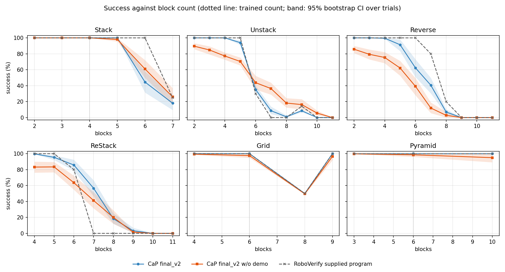
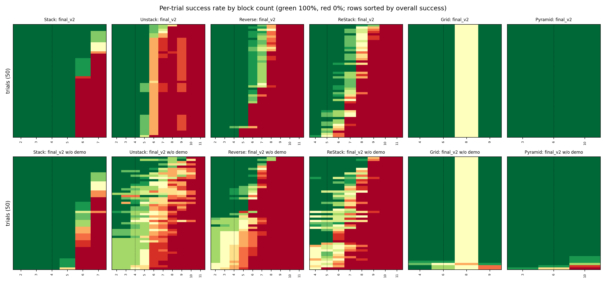
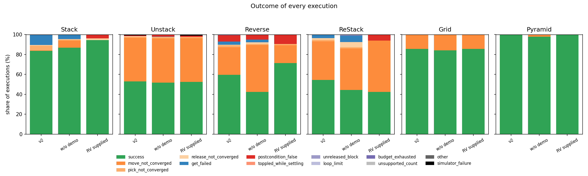
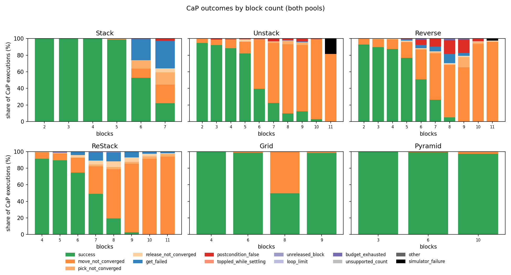
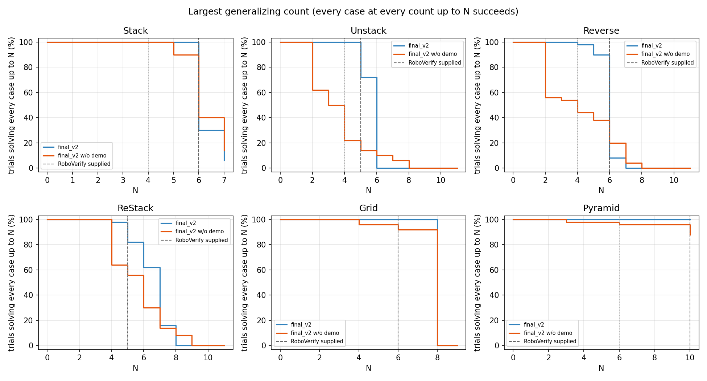
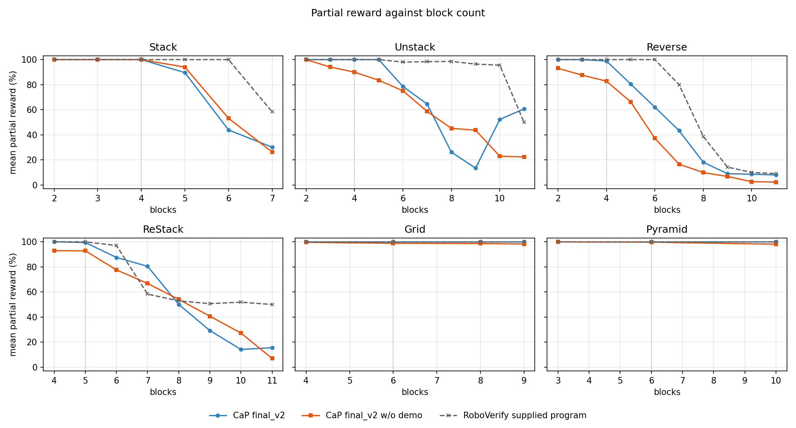
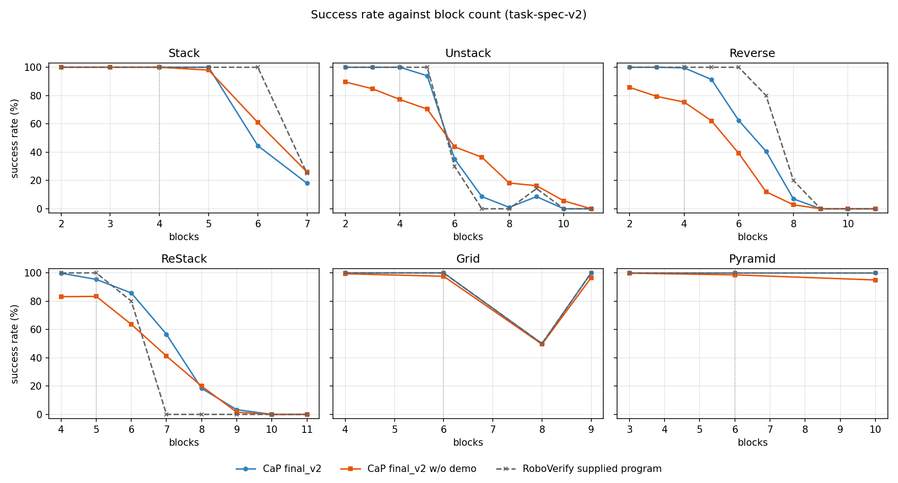

# Revision 9.1 report: block-count generalization on `unrelaxed_v1`

- **Date:** 2026-10-31. This repeats the
  [Revision 9 evaluation](revision_9_report.md) with one change, the
  test-case set: `unrelaxed_v1`
  ([test cases](revision_9_1_test_cases_unrelaxed.md)) replaces
  `relaxed_v2`. Programs, execution, budgets, success criterion and report
  code are unchanged.
- **Question:** each CaP policy was generated and scored at one block count
  (Stack, Unstack, Reverse 4; ReStack 5; Grid 3 × 2 = 6; Pyramid 3-2-1 = 6)
  on the task's default reset. How do the final programs behave at other
  counts when the scenes come from the same default resets?
- **Test cases:** the 388 cases of `unrelaxed_v1`: each task's own reset
  (`relax_boundaries_for_generalization_test` off), seeds 0–9, every
  `relaxed_v2` layout the default reset can build and serve within the
  50-step reach. Counts: Stack 2–7, Unstack and Reverse 2–11, ReStack
  4–11 with 2 loose blocks, Grid 4–9 cells (7 shapes), Pyramid k = 2–4.
  Every trained count has all 10 seeds.
- **Programs:** the same as Revision 9:
  - CaP final_v2 (Opus 5.5, with demonstrations): 300 trials, 252 distinct
    programs;
  - CaP final_v2 w/o demo: 300 trials, 300 distinct programs;
  - RoboVerify: the supplied program of every task. RoboVerify synthesis
    produced no program in Revision 9 (Section 5 there) and was not rerun.
- **Execution:** each distinct program runs unchanged on every case of its
  task (CaP: scripted round-0 response, recovery and video off;
  RoboVerify: `record_execution` from the case snapshot, with the
  2026-10-31 root-cause reporting of non-converged primitives). Success is
  judged after 50 settling steps (`task-spec-v2`; CaP also
  `final-release-v1`). Tick and simulation-step budgets scale with N
  (Revision 9, Section 5.4); 67 of 36,864 CaP executions (0.2%) exhausted
  them. The CaP executions took 44 CPU-hours (median 3.2 s), 29 minutes on
  100 workers.
- **Simulator failures:** 44 executions (0.1%; 37 CaP and 1 RoboVerify
  Unstack, 5 CaP Reverse, 1 CaP ReStack, all at 10–11 blocks) overflowed
  MuJoCo's default contact buffer (`nconmax` 100) when a tall tower fell.
  The default environment keeps that buffer (relaxed scenes use 1000), so
  these are environment failures, not policy failures.
- **Run directory:** `runs/cap-generalization/20261031-unrelaxed-eval/`
  (Section 9; example videos in Section 10).

## 1. Summary

1. **On the default resets the trained count is solved, and generalization
   still fails above it.** Every CaP final_v2 trial solves all ten Stack,
   Unstack and Grid cases at its trained count (Revision 9: 32/50 Stack),
   and the supplied programs succeed on all trained-count cases of every
   task. Above the trained count, success falls as in Revision 9:

   | Task (trained N) | final_v2 at N / N+2 / N+4 | w/o demo at N / N+2 / N+4 | RoboVerify supplied at N / N+2 / N+4 |
   | --- | --- | --- | --- |
   | Stack (4) | 100% / 44.6% / — | 100% / 61.0% / — | 100% / 100% / — |
   | Unstack (4) | 100% / 35.2% / 1.0% | 77.2% / 43.8% / 18.2% | 100% / 30% / 0% |
   | Reverse (4) | 99.6% / 62.4% / 7.0% | 75.4% / 39.2% / 2.8% | 100% / 100% / 20% |
   | ReStack (5) | 95.4% / 56.6% / 3.3% | 83.4% / 41.2% / 1.6% | 100% / 0% / 0% |
   | Grid (6) | 100% / 50.0% (8) / 100% (9) | 97.6% / 49.6% / 96.6% | 100% / 50% / 100% |
   | Pyramid (6) | 100% / 100% (10) / — | 98.6% / 95.0% / — | 100% / 100% / — |

   "—": the default reset has no case at that count (Stack stops at 7,
   Pyramid at k = 4). Grid and Pyramid columns are the next layout sizes.
2. **No program generalizes to every count in the tower tasks.** No CaP
   trial and no supplied program solves every Unstack, Reverse or ReStack
   case; every program fails all 11-block cases. Stack (up to 7 blocks) is
   solved completely by 3/50 final_v2 and 7/50 w/o demo trials, and
   Pyramid (up to k = 4) by 50/50 and 44/50.
3. **The relaxed layouts caused most of Revision 9's failures at small
   counts, but not the drop above the trained count.** At the counts both
   sets share, the default resets raise success for Stack (final_v2 at 5
   blocks: 57.6% → 100%), ReStack (final_v2 at 5: 68.0% → 95.4%; supplied
   60% → 100%) and Pyramid (k = 4: 70% → 100%). The supplied Stack program
   now stacks 6 blocks on all 10 seeds (Revision 9: 60%). Unstack and
   Reverse are lower at 6–8 blocks, because the default tower sits farther
   from the base (Section 7).
4. **Why policies fail** (Section 3): a 50-step Move that does not converge
   remains the main failure at larger counts. Transport targets that grow
   with N (parking offsets, carry clearances, lifts above the tallest
   column) leave one Move's reach. Grid 2 × 4 fails in every execution
   (910 of 910); the supplied program fails at the hover above a goal
   cell. Stack still fails by placement
   drift from 6–7 blocks.
5. **Demonstrations make CaP copy the supplied program.** final_v2's
   per-case outcomes agree with the supplied program on 100% of Grid and
   Pyramid cases (50/50 programs identical in outcome) and 96.9% of
   Unstack cases.

## 2. Success against block count



The curves average, at each count, every trial's success rate over the
count's cases; bands are 95% bootstrap intervals over trials. The supplied
RoboVerify program is one program (no band).

| Task | Cases | Arm | Policies (distinct) | Success, all cases [95% CI] | Distinct programs | Trained count | All cases solved | Trained count solved |
| --- | ---: | --- | ---: | ---: | ---: | ---: | ---: | ---: |
| Stack | 54 | final_v2 | 50 (46) | 83.7% [80.8%, 86.7%] | 84.0% | 100.0% | 3/50 | 50/50 |
| Stack | 54 | final_v2 w/o demo | 50 (50) | 86.9% [84.1%, 89.7%] | 86.9% | 100.0% | 7/50 | 50/50 |
| Stack | 54 | RoboVerify supplied | 1 (1) | 94.4% [94.4%, 94.4%] | 94.4% | 100.0% | 0/1 | 1/1 |
| Unstack | 84 | final_v2 | 50 (50) | 53.0% [51.8%, 54.3%] | 53.0% | 100.0% | 0/50 | 50/50 |
| Unstack | 84 | final_v2 w/o demo | 50 (50) | 51.7% [47.4%, 55.9%] | 51.7% | 77.2% | 0/50 | 11/50 |
| Unstack | 84 | RoboVerify supplied | 1 (1) | 52.4% [52.4%, 52.4%] | 52.4% | 100.0% | 0/1 | 1/1 |
| Reverse | 84 | final_v2 | 50 (50) | 59.6% [56.5%, 62.5%] | 59.6% | 99.6% | 0/50 | 49/50 |
| Reverse | 84 | final_v2 w/o demo | 50 (50) | 42.5% [37.7%, 47.1%] | 42.5% | 75.4% | 0/50 | 22/50 |
| Reverse | 84 | RoboVerify supplied | 1 (1) | 71.4% [71.4%, 71.4%] | 71.4% | 100.0% | 0/1 | 1/1 |
| ReStack | 66 | final_v2 | 50 (50) | 54.4% [50.8%, 57.9%] | 54.4% | 95.4% | 0/50 | 41/50 |
| ReStack | 66 | final_v2 w/o demo | 50 (50) | 44.4% [39.6%, 49.4%] | 44.4% | 83.4% | 0/50 | 29/50 |
| ReStack | 66 | RoboVerify supplied | 1 (1) | 42.4% [42.4%, 42.4%] | 42.4% | 100.0% | 0/1 | 1/1 |
| Grid | 70 | final_v2 | 50 (40) | 85.7% [85.7%, 85.7%] | 85.7% | 100.0% | 0/50 | 50/50 |
| Grid | 70 | final_v2 w/o demo | 50 (50) | 84.3% [82.6%, 85.6%] | 84.3% | 97.6% | 0/50 | 46/50 |
| Grid | 70 | RoboVerify supplied | 1 (1) | 85.7% [85.7%, 85.7%] | 85.7% | 100.0% | 0/1 | 1/1 |
| Pyramid | 30 | final_v2 | 50 (16) | 100.0% [100.0%, 100.0%] | 100.0% | 100.0% | 50/50 | 50/50 |
| Pyramid | 30 | final_v2 w/o demo | 50 (50) | 97.8% [95.0%, 99.8%] | 97.8% | 98.6% | 44/50 | 48/50 |
| Pyramid | 30 | RoboVerify supplied | 1 (1) | 100.0% [100.0%, 100.0%] | 100.0% | 100.0% | 1/1 | 1/1 |

"All cases solved" counts trials that succeed on all cases of the task.
"Trained count solved" counts trials that succeed on every case at the
trained count.



Each row is one trial (its program's success rate at each count).

**Agreement with RoboVerify's supplied program** (per-case success equal; trials whose every case agrees)

| Task | final_v2 agreement | final_v2 identical | w/o demo agreement | w/o demo identical |
| --- | ---: | ---: | ---: | ---: |
| Stack | 87.1% | 1/50 | 89.5% | 2/50 |
| Unstack | 96.9% | 10/50 | 78.5% | 0/50 |
| Reverse | 87.1% | 0/50 | 70.2% | 0/50 |
| ReStack | 83.7% | 0/50 | 79.5% | 0/50 |
| Grid | 100.0% | 50/50 | 98.5% | 46/50 |
| Pyramid | 100.0% | 50/50 | 97.8% | 44/50 |

## 3. Why policies fail





**Failure kinds** (share of all executions of the arm)

| Task | Arm | success | move_not_converged | pick_not_converged | release_not_converged | get_failed | postcondition_false | toppled_while_settling | unreleased_block | loop_limit | budget_exhausted | unsupported_count | other | simulator_failure |
| --- | --- | ---: | ---: | ---: | ---: | ---: | ---: | ---: | ---: | ---: | ---: | ---: | ---: | ---: |
| Stack | final_v2 | 83.7% | 0.6% | 4.7% | 0.6% | 10.1% | 0.3% | 0.0% | 0.0% | 0.0% | 0.0% | 0.0% | 0.0% | 0.0% |
| Stack | final_v2 w/o demo | 86.9% | 7.0% | 1.1% | 0.4% | 4.4% | 0.0% | 0.0% | 0.0% | 0.0% | 0.2% | 0.0% | 0.0% | 0.0% |
| Stack | RoboVerify supplied | 94.4% | 0.0% | 0.0% | 1.9% | 0.0% | 3.7% | 0.0% | 0.0% | 0.0% | 0.0% | 0.0% | 0.0% | 0.0% |
| Unstack | final_v2 | 53.0% | 43.9% | 0.8% | 0.7% | 0.0% | 0.6% | 0.0% | 0.0% | 0.0% | 0.0% | 0.0% | 0.0% | 0.9% |
| Unstack | final_v2 w/o demo | 51.7% | 44.5% | 1.2% | 0.1% | 0.4% | 1.8% | 0.1% | 0.0% | 0.0% | 0.1% | 0.0% | 0.0% | 0.0% |
| Unstack | RoboVerify supplied | 52.4% | 44.0% | 1.2% | 0.0% | 0.0% | 1.2% | 0.0% | 0.0% | 0.0% | 0.0% | 0.0% | 0.0% | 1.2% |
| Reverse | final_v2 | 59.6% | 27.8% | 2.0% | 0.3% | 3.3% | 6.2% | 0.0% | 0.0% | 0.0% | 0.6% | 0.0% | 0.0% | 0.1% |
| Reverse | final_v2 w/o demo | 42.5% | 47.0% | 1.1% | 1.7% | 2.8% | 4.6% | 0.0% | 0.0% | 0.0% | 0.3% | 0.0% | 0.0% | 0.0% |
| Reverse | RoboVerify supplied | 71.4% | 17.9% | 1.2% | 0.0% | 0.0% | 9.5% | 0.0% | 0.0% | 0.0% | 0.0% | 0.0% | 0.0% | 0.0% |
| ReStack | final_v2 | 54.4% | 38.9% | 1.3% | 1.9% | 3.4% | 0.0% | 0.0% | 0.0% | 0.0% | 0.1% | 0.0% | 0.0% | 0.0% |
| ReStack | final_v2 w/o demo | 44.4% | 41.7% | 1.4% | 5.1% | 6.4% | 0.0% | 0.0% | 0.4% | 0.0% | 0.6% | 0.0% | 0.0% | 0.0% |
| ReStack | RoboVerify supplied | 42.4% | 51.5% | 0.0% | 0.0% | 0.0% | 6.1% | 0.0% | 0.0% | 0.0% | 0.0% | 0.0% | 0.0% | 0.0% |
| Grid | final_v2 | 85.7% | 14.3% | 0.0% | 0.0% | 0.0% | 0.0% | 0.0% | 0.0% | 0.0% | 0.0% | 0.0% | 0.0% | 0.0% |
| Grid | final_v2 w/o demo | 84.3% | 15.7% | 0.0% | 0.0% | 0.0% | 0.0% | 0.0% | 0.0% | 0.0% | 0.0% | 0.0% | 0.0% | 0.0% |
| Grid | RoboVerify supplied | 85.7% | 14.3% | 0.0% | 0.0% | 0.0% | 0.0% | 0.0% | 0.0% | 0.0% | 0.0% | 0.0% | 0.0% | 0.0% |
| Pyramid | final_v2 | 100.0% | 0.0% | 0.0% | 0.0% | 0.0% | 0.0% | 0.0% | 0.0% | 0.0% | 0.0% | 0.0% | 0.0% | 0.0% |
| Pyramid | final_v2 w/o demo | 97.8% | 2.2% | 0.0% | 0.0% | 0.0% | 0.0% | 0.0% | 0.0% | 0.0% | 0.0% | 0.0% | 0.0% | 0.0% |
| Pyramid | RoboVerify supplied | 100.0% | 0.0% | 0.0% | 0.0% | 0.0% | 0.0% | 0.0% | 0.0% | 0.0% | 0.0% | 0.0% | 0.0% | 0.0% |


- **`move_not_converged`** (CaP: 0–47% of a task's executions). A Move
  that does not reach its target within 50 steps:
  - Unstack: the supplied program parks each block 0.15 m further along −Y
    (`Move(b0, Y_min, gripper, [0, -0.15, 0])`). From the default tower
    (X 0.54–0.70 m ahead of the base, farther than the relaxed X 0.40–0.60)
    that Move fails from 6 blocks (7 of 10 cases at 6, all from 7 except
    one 9-block case). final_v2 copies the pattern (35.2% at 6);
  - Unstack and Reverse w/o demo: 77.2% and 75.4% at the trained count,
    and failures from 2 blocks. The programs choose their own parking and
    destination offsets, some of which are out of reach from the default
    tower sites. These were not diagnosed program by program;
  - Reverse: the supplied program's carry clearance N × 0.05 + 0.10 m
    above the table fails from 7 blocks (first Move of the loop body);
  - ReStack: the supplied program fails every case from 7 blocks. All of
    its Moves carry at N × 0.05 + 0.10 m above the table; the first one
    that fails is the lift above the source tower (path 1.0), the move to
    the parking cell (1.3) or the rebuild loop's lift above a parked block
    (3.0);
  - **Grid 2 × 4:** every program, CaP and supplied, fails all ten cases
    (910 of 910 executions).
    The supplied program's failing Move is the hover 0.15 m above a goal
    cell (`Move(r, r, r, [0, 0, 0.15])`), 7.7 mm short on every seed. The
    test set's 50-step reach check moves to 0.05 m above each column, so
    the cell passes it but is not reachable at the programs' hover height.
    Grid 4 × 2 (the other 8-cell shape) succeeds.
- **`get_failed`** and **`pick_not_converged`** (Stack final_v2 10% and
  5%): the placement-drift failure diagnosed in Revision 9 (placing each
  block on the measured current top lets the tower lean until a block is
  no longer ON* b0, or the tower topples); not re-diagnosed here.
- **`postcondition_false`**: the program ends but the settled goal does
  not hold. Supplied Stack at 7 blocks (2 of 4 cases: the tower drifts
  beyond the 25 mm ON* tolerance while settling), supplied Reverse at 8–9
  blocks (in Revision 9 the tall source tower fell during a transfer; not
  re-diagnosed here), supplied ReStack at 6–7 blocks.
- **`simulator_failure`**: the default contact buffer overflow above.

## 4. Largest generalizing count and partial reward



**Largest generalizing count** (median over trials; share of trials reaching at least the trained count)

| Task | Trained | final_v2 median | final_v2 ≥ trained | w/o demo median | w/o demo ≥ trained | RoboVerify supplied |
| --- | ---: | ---: | ---: | ---: | ---: | ---: |
| Stack | 4 | 5 | 50/50 | 5 | 50/50 | 6 |
| Unstack | 4 | 5 | 50/50 | 3 | 11/50 | 5 |
| Reverse | 4 | 5 | 49/50 | 3 | 22/50 | 6 |
| ReStack | 5 | 6 | 41/50 | 5 | 28/50 | 5 |
| Grid | 6 | 6 | 50/50 | 6 | 46/50 | 6 |
| Pyramid | 6 | 10 | 50/50 | 10 | 48/50 | 10 |

The largest generalizing count is the largest N such that every case at
every count up to N succeeds. Grid stops at 6 cells for every program,
because no program solves Grid 2 × 4.



Partial reward (`partial-reward-v1`, [TASK_PARTIAL_REWARD.md](TASK_PARTIAL_REWARD.md))
degrades more gently than success. RoboVerify's executor continues after a
primitive that does not converge, while CaP stops at the first one, so the
supplied programs' partial reward is not comparable with CaP's.



The same curves with success (`task-spec-v2`, 50 settling steps) on the
vertical axis, without the confidence bands.

## 5. RoboVerify supplied programs

`synthesis.examples.<task>:build_program`, executed on the 388 cases. Only
Stack's is formally verified (`verified_model`; Revision 9, Section 5); the
others are reference programs validated by collection and audit.
- Stack: 100% up to 6 blocks, 1/4 at 7 (two settled drifts beyond the ON*
  tolerance, one Release that does not converge). Revision 9's Stack
  failures at 6 came from the relaxed layout (blocks at the edge of the
  relaxed region or in front of the body);
- Unstack: 100% up to 5 blocks, 30% at 6, then 0% except one 9-block case.
  The `Y_min` parking pattern fails one count earlier than in Revision 9
  (80% at 6 there);
- Reverse: 100% up to 6 blocks, 80% at 7, 20% at 8, 0% from 9;
- ReStack: 100% at 4 and at the trained 5, 80% at 6, 0% from 7;
- Grid: 100% on every shape except 2 × 4 (0%);
- Pyramid: 100% for k = 2–4.

## 6. Per-count tables

**Stack: success by block count** (mean over policies; cases per count in parentheses)

| Arm | 2 (10) | 3 (10) | 4 (10) | 5 (10) | 6 (10) | 7 (4) |
| --- | ---: | ---: | ---: | ---: | ---: | ---: |
| final_v2 | 100.0% | 100.0% | 100.0% | 100.0% | 44.6% | 18.0% |
| final_v2 w/o demo | 100.0% | 100.0% | 100.0% | 98.0% | 61.0% | 26.0% |
| RoboVerify supplied | 100.0% | 100.0% | 100.0% | 100.0% | 100.0% | 25.0% |

**Unstack: success by block count** (mean over policies; cases per count in parentheses)

| Arm | 2 (10) | 3 (10) | 4 (10) | 5 (10) | 6 (10) | 7 (10) | 8 (10) | 9 (7) | 10 (5) | 11 (2) |
| --- | ---: | ---: | ---: | ---: | ---: | ---: | ---: | ---: | ---: | ---: |
| final_v2 | 100.0% | 100.0% | 100.0% | 94.0% | 35.2% | 8.6% | 1.0% | 8.6% | 0.0% | 0.0% |
| final_v2 w/o demo | 89.6% | 84.8% | 77.2% | 70.4% | 43.8% | 36.4% | 18.2% | 16.3% | 5.6% | 0.0% |
| RoboVerify supplied | 100.0% | 100.0% | 100.0% | 100.0% | 30.0% | 0.0% | 0.0% | 14.3% | 0.0% | 0.0% |

**Reverse: success by block count** (mean over policies; cases per count in parentheses)

| Arm | 2 (10) | 3 (10) | 4 (10) | 5 (10) | 6 (10) | 7 (10) | 8 (10) | 9 (7) | 10 (5) | 11 (2) |
| --- | ---: | ---: | ---: | ---: | ---: | ---: | ---: | ---: | ---: | ---: |
| final_v2 | 100.0% | 100.0% | 99.6% | 91.4% | 62.4% | 40.6% | 7.0% | 0.0% | 0.0% | 0.0% |
| final_v2 w/o demo | 85.8% | 79.4% | 75.4% | 62.2% | 39.2% | 12.0% | 2.8% | 0.0% | 0.0% | 0.0% |
| RoboVerify supplied | 100.0% | 100.0% | 100.0% | 100.0% | 100.0% | 80.0% | 20.0% | 0.0% | 0.0% | 0.0% |

**ReStack: success by block count** (mean over policies; cases per count in parentheses)

| Arm | 4 (10) | 5 (10) | 6 (10) | 7 (10) | 8 (10) | 9 (9) | 10 (6) | 11 (1) |
| --- | ---: | ---: | ---: | ---: | ---: | ---: | ---: | ---: |
| final_v2 | 99.8% | 95.4% | 85.8% | 56.6% | 18.4% | 3.3% | 0.0% | 0.0% |
| final_v2 w/o demo | 83.2% | 83.4% | 63.6% | 41.2% | 20.0% | 1.6% | 0.0% | 0.0% |
| RoboVerify supplied | 100.0% | 100.0% | 80.0% | 0.0% | 0.0% | 0.0% | 0.0% | 0.0% |

**Grid: success by block count** (mean over policies; cases per count in parentheses)

| Arm | 4 (20) | 6 (20) | 8 (20) | 9 (10) |
| --- | ---: | ---: | ---: | ---: |
| final_v2 | 100.0% | 100.0% | 50.0% | 100.0% |
| final_v2 w/o demo | 99.4% | 97.6% | 49.6% | 96.6% |
| RoboVerify supplied | 100.0% | 100.0% | 50.0% | 100.0% |

**Pyramid: success by block count** (mean over policies; cases per count in parentheses)

| Arm | 3 (10) | 6 (10) | 10 (10) |
| --- | ---: | ---: | ---: |
| final_v2 | 100.0% | 100.0% | 100.0% |
| final_v2 w/o demo | 99.8% | 98.6% | 95.0% |
| RoboVerify supplied | 100.0% | 100.0% | 100.0% |

## 7. Comparison with Revision 9 (`relaxed_v2`)

Success at the counts both sets contain (Revision 9 → Revision 9.1):

| Task | Count | final_v2 | w/o demo | RoboVerify supplied |
| --- | ---: | --- | --- | --- |
| Stack | 4 | 92.8% → 100% | 98.0% → 100% | 100% → 100% |
| Stack | 5 | 57.6% → 100% | 72.6% → 98.0% | 100% → 100% |
| Stack | 6 | 26.8% → 44.6% | 41.8% → 61.0% | 60% → 100% |
| Stack | 7 | 11.8% → 18.0% | 16.9% → 26.0% | 11.1% → 25% |
| Unstack | 4 | 100% → 100% | 87.2% → 77.2% | 100% → 100% |
| Unstack | 6 | 81.6% → 35.2% | 70.6% → 43.8% | 80% → 30% |
| Unstack | 8 | 1.4% → 1.0% | 35.6% → 18.2% | 0% → 0% |
| Reverse | 4 | 97.0% → 99.6% | 99.6% → 75.4% | 100% → 100% |
| Reverse | 6 | 66.6% → 62.4% | 67.8% → 39.2% | 100% → 100% |
| Reverse | 8 | 18.2% → 7.0% | 5.8% → 2.8% | 30% → 20% |
| ReStack | 4 | 67.0% → 99.8% | 90.4% → 83.2% | 80% → 100% |
| ReStack | 5 | 68.0% → 95.4% | 80.0% → 83.4% | 60% → 100% |
| ReStack | 7 | 27.9% → 56.6% | 26.8% → 41.2% | 0% → 0% |
| Grid | 8 | 97.7% → 50.0% | 81.3% → 49.6% | 100% → 50% |
| Pyramid | 10 (k = 4) | 70.0% → 100% | 68.0% → 95.0% | 70% → 100% |

- **Layouts that help:** Stack blocks stay within 0.70 m of the base, and
  ReStack's loose blocks stay in one narrow strip (Y 0.15–0.25 m). The
  edge-of-region Picks and lifts that failed in Revision 9 do not occur,
  so Stack and ReStack improve at every shared count. Pyramid's default
  goals are centred on the initial gripper rather than the midline.
- **Layouts that hurt:** the default Unstack/Reverse tower lies at X
  0.54–0.70 m, up to 0.14 m farther than the relaxed sites, so parking and
  carry Moves leave one Move's reach at smaller counts. Grid's 8-cell
  counts include 2 × 4, which every program fails here; `relaxed_v2`'s
  8-cell shapes are centred on the midline.
- **Shared conclusion:** in both sets success drops above the trained
  count for every tower task and arm, and the dominant failure is a Move
  target beyond one 50-step primitive. The relaxed layouts make the drop
  start earlier for Stack and ReStack; they do not cause it.
- Case ids are shared between the sets, but no scene is (the test-case
  doc, Section 1); the comparison is per count, not per case.

## 8. Caveats

- **Smaller range.** `unrelaxed_v1` stops at Stack 7, Grid 3 × 3 and
  Pyramid k = 4, and has only 2 loose ReStack blocks; partial counts (Stack
  7, towers 9–11) have fewer than 10 seeds. Generalization far above the
  trained count is measured only by `relaxed_v2`.
- **Reach check height.** The test set's 50-step reach check serves each
  column at 0.05 m above its top; programs that hover higher (Grid 2 × 4)
  can still fail at a feasible case. Such failures count against the
  policy, as in Revision 9.
- **Trial weighting, partial reward:** as in Revision 9, Section 7.

## 9. Files

`runs/cap-generalization/20261031-unrelaxed-eval/`:
- `programs.json`: every trial's program (identical to Revision 9's);
  `jobs.json`: the jobs, each naming `testset: unrelaxed_v1`;
- `results/cap/<task>/<program>-<chunk>.jsonl`,
  `results/roboverify/<task>/supplied-*.jsonl`: one row per execution;
- `cap_runs/<task>/<program>/<case>.result.json`: the CaP run results;
- `revision9_1_data.json`, `revision9_1_tables.md`: this report's numbers;
- `scripts/`: job preparation, the environment script and
  `render_examples.py` (Revision 9's script with this run and test set);
  `launch.log`;
- `videos/<task>/<arm>/nNN-{success,failure}-<case>.mp4`: the Section 10
  example videos, each with a `.json` of the original and re-executed
  outcome; `videos/examples.json` lists the selection, `videos/table.md`
  is the Section 10 table; `example_runs/`: the CaP run directories of the
  re-executions.

Reproduce (from `roboverify/`, simulator environment configured):

```bash
python runs/cap-generalization/20261031-unrelaxed-eval/scripts/prepare_jobs.py \
    --roboverify runs/cap-generalization/20261031-unrelaxed-eval/roboverify_supplied.jsonl
R9_LOCAL_RUN_ROOT=/tmp/r9u python -m synthesis.cap.experiments.revision9_generalization \
    run --out runs/cap-generalization/20261031-unrelaxed-eval \
    --jobs runs/cap-generalization/20261031-unrelaxed-eval/jobs.json --workers 100
python -m synthesis.cap.reports.generalization_report runs/cap-generalization/20261031-unrelaxed-eval \
    --testset unrelaxed_v1 --output runs/cap-generalization/20261031-unrelaxed-eval \
    --plots synthesis/cap/docs/plots --prefix revision9_1
python runs/cap-generalization/20261031-unrelaxed-eval/scripts/render_examples.py select
python runs/cap-generalization/20261031-unrelaxed-eval/scripts/render_examples.py render --workers 32
python runs/cap-generalization/20261031-unrelaxed-eval/scripts/render_examples.py table \
    > runs/cap-generalization/20261031-unrelaxed-eval/videos/table.md
```

## 10. Example videos

Selected as in Revision 9, Section 9: one example per outcome at every
point of the success-rate figure (Section 4). A point whose executions all
succeed links one success, one whose executions all fail one failure, and a
mixed point one of each. For the CaP arms an execution is one distinct
program on one case; the failure shown has the point's most common failure
kind (Section 3), and both examples are the first such execution in case
and program order. Each example was re-executed from its case snapshot with
video on (CaP: the same scripted replay with `video_mode="inline"`;
RoboVerify: `record_execution` with a video path). 180 of the 181
re-executions reproduced the original outcome. The exception, marked †, is
the Reverse final_v2 success at 8 blocks (`reverse-n8-s0`, a point at 7%):
replayed without video it succeeds again (twice), but with inline video it
ends `goal_failed` both times, so its video shows a failure. The
percentage is the plotted success rate. The videos are in the ignored run
directory, so the links work only in a checkout that has it.

**Stack**

| Blocks | final_v2 | final_v2 w/o demo | RoboVerify supplied |
| ---: | --- | --- | --- |
| 2 | 100.0%<br>[success](../../../runs/cap-generalization/20261031-unrelaxed-eval/videos/stack/final_v2/n02-success-stack-n2-s0.mp4) | 100.0%<br>[success](../../../runs/cap-generalization/20261031-unrelaxed-eval/videos/stack/final_v2_wo_demo/n02-success-stack-n2-s0.mp4) | 100.0%<br>[success](../../../runs/cap-generalization/20261031-unrelaxed-eval/videos/stack/rv_supplied/n02-success-stack-n2-s0.mp4) |
| 3 | 100.0%<br>[success](../../../runs/cap-generalization/20261031-unrelaxed-eval/videos/stack/final_v2/n03-success-stack-n3-s0.mp4) | 100.0%<br>[success](../../../runs/cap-generalization/20261031-unrelaxed-eval/videos/stack/final_v2_wo_demo/n03-success-stack-n3-s0.mp4) | 100.0%<br>[success](../../../runs/cap-generalization/20261031-unrelaxed-eval/videos/stack/rv_supplied/n03-success-stack-n3-s0.mp4) |
| 4 | 100.0%<br>[success](../../../runs/cap-generalization/20261031-unrelaxed-eval/videos/stack/final_v2/n04-success-stack-n4-s0.mp4) | 100.0%<br>[success](../../../runs/cap-generalization/20261031-unrelaxed-eval/videos/stack/final_v2_wo_demo/n04-success-stack-n4-s0.mp4) | 100.0%<br>[success](../../../runs/cap-generalization/20261031-unrelaxed-eval/videos/stack/rv_supplied/n04-success-stack-n4-s0.mp4) |
| 5 | 100.0%<br>[success](../../../runs/cap-generalization/20261031-unrelaxed-eval/videos/stack/final_v2/n05-success-stack-n5-s0.mp4) | 98.0%<br>[success](../../../runs/cap-generalization/20261031-unrelaxed-eval/videos/stack/final_v2_wo_demo/n05-success-stack-n5-s0.mp4)<br>[move_not_converged](../../../runs/cap-generalization/20261031-unrelaxed-eval/videos/stack/final_v2_wo_demo/n05-failure-stack-n5-s1.mp4) | 100.0%<br>[success](../../../runs/cap-generalization/20261031-unrelaxed-eval/videos/stack/rv_supplied/n05-success-stack-n5-s0.mp4) |
| 6 | 44.6%<br>[success](../../../runs/cap-generalization/20261031-unrelaxed-eval/videos/stack/final_v2/n06-success-stack-n6-s0.mp4)<br>[get_failed](../../../runs/cap-generalization/20261031-unrelaxed-eval/videos/stack/final_v2/n06-failure-stack-n6-s0.mp4) | 61.0%<br>[success](../../../runs/cap-generalization/20261031-unrelaxed-eval/videos/stack/final_v2_wo_demo/n06-success-stack-n6-s0.mp4)<br>[move_not_converged](../../../runs/cap-generalization/20261031-unrelaxed-eval/videos/stack/final_v2_wo_demo/n06-failure-stack-n6-s0.mp4) | 100.0%<br>[success](../../../runs/cap-generalization/20261031-unrelaxed-eval/videos/stack/rv_supplied/n06-success-stack-n6-s0.mp4) |
| 7 | 18.0%<br>[success](../../../runs/cap-generalization/20261031-unrelaxed-eval/videos/stack/final_v2/n07-success-stack-n7-s0.mp4)<br>[get_failed](../../../runs/cap-generalization/20261031-unrelaxed-eval/videos/stack/final_v2/n07-failure-stack-n7-s0.mp4) | 26.0%<br>[success](../../../runs/cap-generalization/20261031-unrelaxed-eval/videos/stack/final_v2_wo_demo/n07-success-stack-n7-s0.mp4)<br>[move_not_converged](../../../runs/cap-generalization/20261031-unrelaxed-eval/videos/stack/final_v2_wo_demo/n07-failure-stack-n7-s0.mp4) | 25.0%<br>[success](../../../runs/cap-generalization/20261031-unrelaxed-eval/videos/stack/rv_supplied/n07-success-stack-n7-s5.mp4)<br>[postcondition_false](../../../runs/cap-generalization/20261031-unrelaxed-eval/videos/stack/rv_supplied/n07-failure-stack-n7-s0.mp4) |

**Unstack**

| Blocks | final_v2 | final_v2 w/o demo | RoboVerify supplied |
| ---: | --- | --- | --- |
| 2 | 100.0%<br>[success](../../../runs/cap-generalization/20261031-unrelaxed-eval/videos/unstack/final_v2/n02-success-unstack-n2-s0.mp4) | 89.6%<br>[success](../../../runs/cap-generalization/20261031-unrelaxed-eval/videos/unstack/final_v2_wo_demo/n02-success-unstack-n2-s0.mp4)<br>[move_not_converged](../../../runs/cap-generalization/20261031-unrelaxed-eval/videos/unstack/final_v2_wo_demo/n02-failure-unstack-n2-s4.mp4) | 100.0%<br>[success](../../../runs/cap-generalization/20261031-unrelaxed-eval/videos/unstack/rv_supplied/n02-success-unstack-n2-s0.mp4) |
| 3 | 100.0%<br>[success](../../../runs/cap-generalization/20261031-unrelaxed-eval/videos/unstack/final_v2/n03-success-unstack-n3-s0.mp4) | 84.8%<br>[success](../../../runs/cap-generalization/20261031-unrelaxed-eval/videos/unstack/final_v2_wo_demo/n03-success-unstack-n3-s0.mp4)<br>[move_not_converged](../../../runs/cap-generalization/20261031-unrelaxed-eval/videos/unstack/final_v2_wo_demo/n03-failure-unstack-n3-s2.mp4) | 100.0%<br>[success](../../../runs/cap-generalization/20261031-unrelaxed-eval/videos/unstack/rv_supplied/n03-success-unstack-n3-s0.mp4) |
| 4 | 100.0%<br>[success](../../../runs/cap-generalization/20261031-unrelaxed-eval/videos/unstack/final_v2/n04-success-unstack-n4-s0.mp4) | 77.2%<br>[success](../../../runs/cap-generalization/20261031-unrelaxed-eval/videos/unstack/final_v2_wo_demo/n04-success-unstack-n4-s0.mp4)<br>[move_not_converged](../../../runs/cap-generalization/20261031-unrelaxed-eval/videos/unstack/final_v2_wo_demo/n04-failure-unstack-n4-s0.mp4) | 100.0%<br>[success](../../../runs/cap-generalization/20261031-unrelaxed-eval/videos/unstack/rv_supplied/n04-success-unstack-n4-s0.mp4) |
| 5 | 94.0%<br>[success](../../../runs/cap-generalization/20261031-unrelaxed-eval/videos/unstack/final_v2/n05-success-unstack-n5-s0.mp4)<br>[release_not_converged](../../../runs/cap-generalization/20261031-unrelaxed-eval/videos/unstack/final_v2/n05-failure-unstack-n5-s4.mp4) | 70.4%<br>[success](../../../runs/cap-generalization/20261031-unrelaxed-eval/videos/unstack/final_v2_wo_demo/n05-success-unstack-n5-s0.mp4)<br>[move_not_converged](../../../runs/cap-generalization/20261031-unrelaxed-eval/videos/unstack/final_v2_wo_demo/n05-failure-unstack-n5-s0.mp4) | 100.0%<br>[success](../../../runs/cap-generalization/20261031-unrelaxed-eval/videos/unstack/rv_supplied/n05-success-unstack-n5-s0.mp4) |
| 6 | 35.2%<br>[success](../../../runs/cap-generalization/20261031-unrelaxed-eval/videos/unstack/final_v2/n06-success-unstack-n6-s0.mp4)<br>[move_not_converged](../../../runs/cap-generalization/20261031-unrelaxed-eval/videos/unstack/final_v2/n06-failure-unstack-n6-s0.mp4) | 43.8%<br>[success](../../../runs/cap-generalization/20261031-unrelaxed-eval/videos/unstack/final_v2_wo_demo/n06-success-unstack-n6-s0.mp4)<br>[move_not_converged](../../../runs/cap-generalization/20261031-unrelaxed-eval/videos/unstack/final_v2_wo_demo/n06-failure-unstack-n6-s0.mp4) | 30.0%<br>[success](../../../runs/cap-generalization/20261031-unrelaxed-eval/videos/unstack/rv_supplied/n06-success-unstack-n6-s5.mp4)<br>[move_not_converged](../../../runs/cap-generalization/20261031-unrelaxed-eval/videos/unstack/rv_supplied/n06-failure-unstack-n6-s0.mp4) |
| 7 | 8.6%<br>[success](../../../runs/cap-generalization/20261031-unrelaxed-eval/videos/unstack/final_v2/n07-success-unstack-n7-s0.mp4)<br>[move_not_converged](../../../runs/cap-generalization/20261031-unrelaxed-eval/videos/unstack/final_v2/n07-failure-unstack-n7-s0.mp4) | 36.4%<br>[success](../../../runs/cap-generalization/20261031-unrelaxed-eval/videos/unstack/final_v2_wo_demo/n07-success-unstack-n7-s0.mp4)<br>[move_not_converged](../../../runs/cap-generalization/20261031-unrelaxed-eval/videos/unstack/final_v2_wo_demo/n07-failure-unstack-n7-s0.mp4) | 0.0%<br>[move_not_converged](../../../runs/cap-generalization/20261031-unrelaxed-eval/videos/unstack/rv_supplied/n07-failure-unstack-n7-s0.mp4) |
| 8 | 1.0%<br>[success](../../../runs/cap-generalization/20261031-unrelaxed-eval/videos/unstack/final_v2/n08-success-unstack-n8-s1.mp4)<br>[move_not_converged](../../../runs/cap-generalization/20261031-unrelaxed-eval/videos/unstack/final_v2/n08-failure-unstack-n8-s0.mp4) | 18.2%<br>[success](../../../runs/cap-generalization/20261031-unrelaxed-eval/videos/unstack/final_v2_wo_demo/n08-success-unstack-n8-s0.mp4)<br>[move_not_converged](../../../runs/cap-generalization/20261031-unrelaxed-eval/videos/unstack/final_v2_wo_demo/n08-failure-unstack-n8-s0.mp4) | 0.0%<br>[move_not_converged](../../../runs/cap-generalization/20261031-unrelaxed-eval/videos/unstack/rv_supplied/n08-failure-unstack-n8-s0.mp4) |
| 9 | 8.6%<br>[success](../../../runs/cap-generalization/20261031-unrelaxed-eval/videos/unstack/final_v2/n09-success-unstack-n9-s9.mp4)<br>[move_not_converged](../../../runs/cap-generalization/20261031-unrelaxed-eval/videos/unstack/final_v2/n09-failure-unstack-n9-s0.mp4) | 16.3%<br>[success](../../../runs/cap-generalization/20261031-unrelaxed-eval/videos/unstack/final_v2_wo_demo/n09-success-unstack-n9-s0.mp4)<br>[move_not_converged](../../../runs/cap-generalization/20261031-unrelaxed-eval/videos/unstack/final_v2_wo_demo/n09-failure-unstack-n9-s0.mp4) | 14.3%<br>[success](../../../runs/cap-generalization/20261031-unrelaxed-eval/videos/unstack/rv_supplied/n09-success-unstack-n9-s9.mp4)<br>[move_not_converged](../../../runs/cap-generalization/20261031-unrelaxed-eval/videos/unstack/rv_supplied/n09-failure-unstack-n9-s0.mp4) |
| 10 | 0.0%<br>[move_not_converged](../../../runs/cap-generalization/20261031-unrelaxed-eval/videos/unstack/final_v2/n10-failure-unstack-n10-s1.mp4) | 5.6%<br>[success](../../../runs/cap-generalization/20261031-unrelaxed-eval/videos/unstack/final_v2_wo_demo/n10-success-unstack-n10-s7.mp4)<br>[move_not_converged](../../../runs/cap-generalization/20261031-unrelaxed-eval/videos/unstack/final_v2_wo_demo/n10-failure-unstack-n10-s1.mp4) | 0.0%<br>[move_not_converged](../../../runs/cap-generalization/20261031-unrelaxed-eval/videos/unstack/rv_supplied/n10-failure-unstack-n10-s1.mp4) |
| 11 | 0.0%<br>[move_not_converged](../../../runs/cap-generalization/20261031-unrelaxed-eval/videos/unstack/final_v2/n11-failure-unstack-n11-s7.mp4) | 0.0%<br>[move_not_converged](../../../runs/cap-generalization/20261031-unrelaxed-eval/videos/unstack/final_v2_wo_demo/n11-failure-unstack-n11-s7.mp4) | 0.0%<br>[move_not_converged](../../../runs/cap-generalization/20261031-unrelaxed-eval/videos/unstack/rv_supplied/n11-failure-unstack-n11-s7.mp4) |

**Reverse**

| Blocks | final_v2 | final_v2 w/o demo | RoboVerify supplied |
| ---: | --- | --- | --- |
| 2 | 100.0%<br>[success](../../../runs/cap-generalization/20261031-unrelaxed-eval/videos/reverse/final_v2/n02-success-reverse-n2-s0.mp4) | 85.8%<br>[success](../../../runs/cap-generalization/20261031-unrelaxed-eval/videos/reverse/final_v2_wo_demo/n02-success-reverse-n2-s0.mp4)<br>[move_not_converged](../../../runs/cap-generalization/20261031-unrelaxed-eval/videos/reverse/final_v2_wo_demo/n02-failure-reverse-n2-s0.mp4) | 100.0%<br>[success](../../../runs/cap-generalization/20261031-unrelaxed-eval/videos/reverse/rv_supplied/n02-success-reverse-n2-s0.mp4) |
| 3 | 100.0%<br>[success](../../../runs/cap-generalization/20261031-unrelaxed-eval/videos/reverse/final_v2/n03-success-reverse-n3-s0.mp4) | 79.4%<br>[success](../../../runs/cap-generalization/20261031-unrelaxed-eval/videos/reverse/final_v2_wo_demo/n03-success-reverse-n3-s0.mp4)<br>[move_not_converged](../../../runs/cap-generalization/20261031-unrelaxed-eval/videos/reverse/final_v2_wo_demo/n03-failure-reverse-n3-s0.mp4) | 100.0%<br>[success](../../../runs/cap-generalization/20261031-unrelaxed-eval/videos/reverse/rv_supplied/n03-success-reverse-n3-s0.mp4) |
| 4 | 99.6%<br>[success](../../../runs/cap-generalization/20261031-unrelaxed-eval/videos/reverse/final_v2/n04-success-reverse-n4-s0.mp4)<br>[move_not_converged](../../../runs/cap-generalization/20261031-unrelaxed-eval/videos/reverse/final_v2/n04-failure-reverse-n4-s4.mp4) | 75.4%<br>[success](../../../runs/cap-generalization/20261031-unrelaxed-eval/videos/reverse/final_v2_wo_demo/n04-success-reverse-n4-s0.mp4)<br>[move_not_converged](../../../runs/cap-generalization/20261031-unrelaxed-eval/videos/reverse/final_v2_wo_demo/n04-failure-reverse-n4-s0.mp4) | 100.0%<br>[success](../../../runs/cap-generalization/20261031-unrelaxed-eval/videos/reverse/rv_supplied/n04-success-reverse-n4-s0.mp4) |
| 5 | 91.4%<br>[success](../../../runs/cap-generalization/20261031-unrelaxed-eval/videos/reverse/final_v2/n05-success-reverse-n5-s0.mp4)<br>[move_not_converged](../../../runs/cap-generalization/20261031-unrelaxed-eval/videos/reverse/final_v2/n05-failure-reverse-n5-s0.mp4) | 62.2%<br>[success](../../../runs/cap-generalization/20261031-unrelaxed-eval/videos/reverse/final_v2_wo_demo/n05-success-reverse-n5-s0.mp4)<br>[move_not_converged](../../../runs/cap-generalization/20261031-unrelaxed-eval/videos/reverse/final_v2_wo_demo/n05-failure-reverse-n5-s0.mp4) | 100.0%<br>[success](../../../runs/cap-generalization/20261031-unrelaxed-eval/videos/reverse/rv_supplied/n05-success-reverse-n5-s0.mp4) |
| 6 | 62.4%<br>[success](../../../runs/cap-generalization/20261031-unrelaxed-eval/videos/reverse/final_v2/n06-success-reverse-n6-s0.mp4)<br>[move_not_converged](../../../runs/cap-generalization/20261031-unrelaxed-eval/videos/reverse/final_v2/n06-failure-reverse-n6-s0.mp4) | 39.2%<br>[success](../../../runs/cap-generalization/20261031-unrelaxed-eval/videos/reverse/final_v2_wo_demo/n06-success-reverse-n6-s0.mp4)<br>[move_not_converged](../../../runs/cap-generalization/20261031-unrelaxed-eval/videos/reverse/final_v2_wo_demo/n06-failure-reverse-n6-s0.mp4) | 100.0%<br>[success](../../../runs/cap-generalization/20261031-unrelaxed-eval/videos/reverse/rv_supplied/n06-success-reverse-n6-s0.mp4) |
| 7 | 40.6%<br>[success](../../../runs/cap-generalization/20261031-unrelaxed-eval/videos/reverse/final_v2/n07-success-reverse-n7-s0.mp4)<br>[move_not_converged](../../../runs/cap-generalization/20261031-unrelaxed-eval/videos/reverse/final_v2/n07-failure-reverse-n7-s0.mp4) | 12.0%<br>[success](../../../runs/cap-generalization/20261031-unrelaxed-eval/videos/reverse/final_v2_wo_demo/n07-success-reverse-n7-s0.mp4)<br>[move_not_converged](../../../runs/cap-generalization/20261031-unrelaxed-eval/videos/reverse/final_v2_wo_demo/n07-failure-reverse-n7-s0.mp4) | 80.0%<br>[success](../../../runs/cap-generalization/20261031-unrelaxed-eval/videos/reverse/rv_supplied/n07-success-reverse-n7-s0.mp4)<br>[move_not_converged](../../../runs/cap-generalization/20261031-unrelaxed-eval/videos/reverse/rv_supplied/n07-failure-reverse-n7-s4.mp4) |
| 8 | 7.0%<br>[success](../../../runs/cap-generalization/20261031-unrelaxed-eval/videos/reverse/final_v2/n08-success-reverse-n8-s0.mp4) †<br>[move_not_converged](../../../runs/cap-generalization/20261031-unrelaxed-eval/videos/reverse/final_v2/n08-failure-reverse-n8-s0.mp4) | 2.8%<br>[success](../../../runs/cap-generalization/20261031-unrelaxed-eval/videos/reverse/final_v2_wo_demo/n08-success-reverse-n8-s0.mp4)<br>[move_not_converged](../../../runs/cap-generalization/20261031-unrelaxed-eval/videos/reverse/final_v2_wo_demo/n08-failure-reverse-n8-s0.mp4) | 20.0%<br>[success](../../../runs/cap-generalization/20261031-unrelaxed-eval/videos/reverse/rv_supplied/n08-success-reverse-n8-s0.mp4)<br>[postcondition_false](../../../runs/cap-generalization/20261031-unrelaxed-eval/videos/reverse/rv_supplied/n08-failure-reverse-n8-s1.mp4) |
| 9 | 0.0%<br>[move_not_converged](../../../runs/cap-generalization/20261031-unrelaxed-eval/videos/reverse/final_v2/n09-failure-reverse-n9-s0.mp4) | 0.0%<br>[move_not_converged](../../../runs/cap-generalization/20261031-unrelaxed-eval/videos/reverse/final_v2_wo_demo/n09-failure-reverse-n9-s0.mp4) | 0.0%<br>[move_not_converged](../../../runs/cap-generalization/20261031-unrelaxed-eval/videos/reverse/rv_supplied/n09-failure-reverse-n9-s0.mp4) |
| 10 | 0.0%<br>[move_not_converged](../../../runs/cap-generalization/20261031-unrelaxed-eval/videos/reverse/final_v2/n10-failure-reverse-n10-s1.mp4) | 0.0%<br>[move_not_converged](../../../runs/cap-generalization/20261031-unrelaxed-eval/videos/reverse/final_v2_wo_demo/n10-failure-reverse-n10-s1.mp4) | 0.0%<br>[move_not_converged](../../../runs/cap-generalization/20261031-unrelaxed-eval/videos/reverse/rv_supplied/n10-failure-reverse-n10-s1.mp4) |
| 11 | 0.0%<br>[move_not_converged](../../../runs/cap-generalization/20261031-unrelaxed-eval/videos/reverse/final_v2/n11-failure-reverse-n11-s7.mp4) | 0.0%<br>[move_not_converged](../../../runs/cap-generalization/20261031-unrelaxed-eval/videos/reverse/final_v2_wo_demo/n11-failure-reverse-n11-s7.mp4) | 0.0%<br>[move_not_converged](../../../runs/cap-generalization/20261031-unrelaxed-eval/videos/reverse/rv_supplied/n11-failure-reverse-n11-s7.mp4) |

**ReStack**

| Blocks | final_v2 | final_v2 w/o demo | RoboVerify supplied |
| ---: | --- | --- | --- |
| 4 | 99.8%<br>[success](../../../runs/cap-generalization/20261031-unrelaxed-eval/videos/restack/final_v2/n04-success-restack-n4-t2-s0.mp4)<br>[move_not_converged](../../../runs/cap-generalization/20261031-unrelaxed-eval/videos/restack/final_v2/n04-failure-restack-n4-t2-s1.mp4) | 83.2%<br>[success](../../../runs/cap-generalization/20261031-unrelaxed-eval/videos/restack/final_v2_wo_demo/n04-success-restack-n4-t2-s0.mp4)<br>[move_not_converged](../../../runs/cap-generalization/20261031-unrelaxed-eval/videos/restack/final_v2_wo_demo/n04-failure-restack-n4-t2-s0.mp4) | 100.0%<br>[success](../../../runs/cap-generalization/20261031-unrelaxed-eval/videos/restack/rv_supplied/n04-success-restack-n4-t2-s0.mp4) |
| 5 | 95.4%<br>[success](../../../runs/cap-generalization/20261031-unrelaxed-eval/videos/restack/final_v2/n05-success-restack-n5-t3-s0.mp4)<br>[move_not_converged](../../../runs/cap-generalization/20261031-unrelaxed-eval/videos/restack/final_v2/n05-failure-restack-n5-t3-s3.mp4) | 83.4%<br>[success](../../../runs/cap-generalization/20261031-unrelaxed-eval/videos/restack/final_v2_wo_demo/n05-success-restack-n5-t3-s0.mp4)<br>[move_not_converged](../../../runs/cap-generalization/20261031-unrelaxed-eval/videos/restack/final_v2_wo_demo/n05-failure-restack-n5-t3-s0.mp4) | 100.0%<br>[success](../../../runs/cap-generalization/20261031-unrelaxed-eval/videos/restack/rv_supplied/n05-success-restack-n5-t3-s0.mp4) |
| 6 | 85.8%<br>[success](../../../runs/cap-generalization/20261031-unrelaxed-eval/videos/restack/final_v2/n06-success-restack-n6-t4-s0.mp4)<br>[move_not_converged](../../../runs/cap-generalization/20261031-unrelaxed-eval/videos/restack/final_v2/n06-failure-restack-n6-t4-s0.mp4) | 63.6%<br>[success](../../../runs/cap-generalization/20261031-unrelaxed-eval/videos/restack/final_v2_wo_demo/n06-success-restack-n6-t4-s0.mp4)<br>[move_not_converged](../../../runs/cap-generalization/20261031-unrelaxed-eval/videos/restack/final_v2_wo_demo/n06-failure-restack-n6-t4-s0.mp4) | 80.0%<br>[success](../../../runs/cap-generalization/20261031-unrelaxed-eval/videos/restack/rv_supplied/n06-success-restack-n6-t4-s0.mp4)<br>[postcondition_false](../../../runs/cap-generalization/20261031-unrelaxed-eval/videos/restack/rv_supplied/n06-failure-restack-n6-t4-s5.mp4) |
| 7 | 56.6%<br>[success](../../../runs/cap-generalization/20261031-unrelaxed-eval/videos/restack/final_v2/n07-success-restack-n7-t5-s0.mp4)<br>[move_not_converged](../../../runs/cap-generalization/20261031-unrelaxed-eval/videos/restack/final_v2/n07-failure-restack-n7-t5-s0.mp4) | 41.2%<br>[success](../../../runs/cap-generalization/20261031-unrelaxed-eval/videos/restack/final_v2_wo_demo/n07-success-restack-n7-t5-s0.mp4)<br>[move_not_converged](../../../runs/cap-generalization/20261031-unrelaxed-eval/videos/restack/final_v2_wo_demo/n07-failure-restack-n7-t5-s0.mp4) | 0.0%<br>[move_not_converged](../../../runs/cap-generalization/20261031-unrelaxed-eval/videos/restack/rv_supplied/n07-failure-restack-n7-t5-s0.mp4) |
| 8 | 18.4%<br>[success](../../../runs/cap-generalization/20261031-unrelaxed-eval/videos/restack/final_v2/n08-success-restack-n8-t6-s0.mp4)<br>[move_not_converged](../../../runs/cap-generalization/20261031-unrelaxed-eval/videos/restack/final_v2/n08-failure-restack-n8-t6-s0.mp4) | 20.0%<br>[success](../../../runs/cap-generalization/20261031-unrelaxed-eval/videos/restack/final_v2_wo_demo/n08-success-restack-n8-t6-s0.mp4)<br>[move_not_converged](../../../runs/cap-generalization/20261031-unrelaxed-eval/videos/restack/final_v2_wo_demo/n08-failure-restack-n8-t6-s0.mp4) | 0.0%<br>[move_not_converged](../../../runs/cap-generalization/20261031-unrelaxed-eval/videos/restack/rv_supplied/n08-failure-restack-n8-t6-s0.mp4) |
| 9 | 3.3%<br>[success](../../../runs/cap-generalization/20261031-unrelaxed-eval/videos/restack/final_v2/n09-success-restack-n9-t7-s0.mp4)<br>[move_not_converged](../../../runs/cap-generalization/20261031-unrelaxed-eval/videos/restack/final_v2/n09-failure-restack-n9-t7-s0.mp4) | 1.6%<br>[success](../../../runs/cap-generalization/20261031-unrelaxed-eval/videos/restack/final_v2_wo_demo/n09-success-restack-n9-t7-s0.mp4)<br>[move_not_converged](../../../runs/cap-generalization/20261031-unrelaxed-eval/videos/restack/final_v2_wo_demo/n09-failure-restack-n9-t7-s0.mp4) | 0.0%<br>[move_not_converged](../../../runs/cap-generalization/20261031-unrelaxed-eval/videos/restack/rv_supplied/n09-failure-restack-n9-t7-s0.mp4) |
| 10 | 0.0%<br>[move_not_converged](../../../runs/cap-generalization/20261031-unrelaxed-eval/videos/restack/final_v2/n10-failure-restack-n10-t8-s1.mp4) | 0.0%<br>[move_not_converged](../../../runs/cap-generalization/20261031-unrelaxed-eval/videos/restack/final_v2_wo_demo/n10-failure-restack-n10-t8-s1.mp4) | 0.0%<br>[move_not_converged](../../../runs/cap-generalization/20261031-unrelaxed-eval/videos/restack/rv_supplied/n10-failure-restack-n10-t8-s1.mp4) |
| 11 | 0.0%<br>[move_not_converged](../../../runs/cap-generalization/20261031-unrelaxed-eval/videos/restack/final_v2/n11-failure-restack-n11-t9-s4.mp4) | 0.0%<br>[move_not_converged](../../../runs/cap-generalization/20261031-unrelaxed-eval/videos/restack/final_v2_wo_demo/n11-failure-restack-n11-t9-s4.mp4) | 0.0%<br>[move_not_converged](../../../runs/cap-generalization/20261031-unrelaxed-eval/videos/restack/rv_supplied/n11-failure-restack-n11-t9-s4.mp4) |

**Grid**

| Blocks | final_v2 | final_v2 w/o demo | RoboVerify supplied |
| ---: | --- | --- | --- |
| 4 | 100.0%<br>[success](../../../runs/cap-generalization/20261031-unrelaxed-eval/videos/grid/final_v2/n04-success-grid-n4-2x2-s0.mp4) | 99.4%<br>[success](../../../runs/cap-generalization/20261031-unrelaxed-eval/videos/grid/final_v2_wo_demo/n04-success-grid-n4-2x2-s0.mp4)<br>[move_not_converged](../../../runs/cap-generalization/20261031-unrelaxed-eval/videos/grid/final_v2_wo_demo/n04-failure-grid-n4-2x2-s4.mp4) | 100.0%<br>[success](../../../runs/cap-generalization/20261031-unrelaxed-eval/videos/grid/rv_supplied/n04-success-grid-n4-2x2-s0.mp4) |
| 6 | 100.0%<br>[success](../../../runs/cap-generalization/20261031-unrelaxed-eval/videos/grid/final_v2/n06-success-grid-n6-2x3-s0.mp4) | 97.6%<br>[success](../../../runs/cap-generalization/20261031-unrelaxed-eval/videos/grid/final_v2_wo_demo/n06-success-grid-n6-2x3-s0.mp4)<br>[move_not_converged](../../../runs/cap-generalization/20261031-unrelaxed-eval/videos/grid/final_v2_wo_demo/n06-failure-grid-n6-2x3-s0.mp4) | 100.0%<br>[success](../../../runs/cap-generalization/20261031-unrelaxed-eval/videos/grid/rv_supplied/n06-success-grid-n6-2x3-s0.mp4) |
| 8 | 50.0%<br>[success](../../../runs/cap-generalization/20261031-unrelaxed-eval/videos/grid/final_v2/n08-success-grid-n8-4x2-s0.mp4)<br>[move_not_converged](../../../runs/cap-generalization/20261031-unrelaxed-eval/videos/grid/final_v2/n08-failure-grid-n8-2x4-s0.mp4) | 49.6%<br>[success](../../../runs/cap-generalization/20261031-unrelaxed-eval/videos/grid/final_v2_wo_demo/n08-success-grid-n8-4x2-s0.mp4)<br>[move_not_converged](../../../runs/cap-generalization/20261031-unrelaxed-eval/videos/grid/final_v2_wo_demo/n08-failure-grid-n8-2x4-s0.mp4) | 50.0%<br>[success](../../../runs/cap-generalization/20261031-unrelaxed-eval/videos/grid/rv_supplied/n08-success-grid-n8-4x2-s0.mp4)<br>[move_not_converged](../../../runs/cap-generalization/20261031-unrelaxed-eval/videos/grid/rv_supplied/n08-failure-grid-n8-2x4-s0.mp4) |
| 9 | 100.0%<br>[success](../../../runs/cap-generalization/20261031-unrelaxed-eval/videos/grid/final_v2/n09-success-grid-n9-3x3-s0.mp4) | 96.6%<br>[success](../../../runs/cap-generalization/20261031-unrelaxed-eval/videos/grid/final_v2_wo_demo/n09-success-grid-n9-3x3-s0.mp4)<br>[move_not_converged](../../../runs/cap-generalization/20261031-unrelaxed-eval/videos/grid/final_v2_wo_demo/n09-failure-grid-n9-3x3-s0.mp4) | 100.0%<br>[success](../../../runs/cap-generalization/20261031-unrelaxed-eval/videos/grid/rv_supplied/n09-success-grid-n9-3x3-s0.mp4) |

**Pyramid**

| Blocks | final_v2 | final_v2 w/o demo | RoboVerify supplied |
| ---: | --- | --- | --- |
| 3 | 100.0%<br>[success](../../../runs/cap-generalization/20261031-unrelaxed-eval/videos/pyramid/final_v2/n03-success-pyramid-n3-k2-s0.mp4) | 99.8%<br>[success](../../../runs/cap-generalization/20261031-unrelaxed-eval/videos/pyramid/final_v2_wo_demo/n03-success-pyramid-n3-k2-s0.mp4)<br>[move_not_converged](../../../runs/cap-generalization/20261031-unrelaxed-eval/videos/pyramid/final_v2_wo_demo/n03-failure-pyramid-n3-k2-s9.mp4) | 100.0%<br>[success](../../../runs/cap-generalization/20261031-unrelaxed-eval/videos/pyramid/rv_supplied/n03-success-pyramid-n3-k2-s0.mp4) |
| 6 | 100.0%<br>[success](../../../runs/cap-generalization/20261031-unrelaxed-eval/videos/pyramid/final_v2/n06-success-pyramid-n6-k3-s0.mp4) | 98.6%<br>[success](../../../runs/cap-generalization/20261031-unrelaxed-eval/videos/pyramid/final_v2_wo_demo/n06-success-pyramid-n6-k3-s0.mp4)<br>[move_not_converged](../../../runs/cap-generalization/20261031-unrelaxed-eval/videos/pyramid/final_v2_wo_demo/n06-failure-pyramid-n6-k3-s0.mp4) | 100.0%<br>[success](../../../runs/cap-generalization/20261031-unrelaxed-eval/videos/pyramid/rv_supplied/n06-success-pyramid-n6-k3-s0.mp4) |
| 10 | 100.0%<br>[success](../../../runs/cap-generalization/20261031-unrelaxed-eval/videos/pyramid/final_v2/n10-success-pyramid-n10-k4-s0.mp4) | 95.0%<br>[success](../../../runs/cap-generalization/20261031-unrelaxed-eval/videos/pyramid/final_v2_wo_demo/n10-success-pyramid-n10-k4-s0.mp4)<br>[move_not_converged](../../../runs/cap-generalization/20261031-unrelaxed-eval/videos/pyramid/final_v2_wo_demo/n10-failure-pyramid-n10-k4-s0.mp4) | 100.0%<br>[success](../../../runs/cap-generalization/20261031-unrelaxed-eval/videos/pyramid/rv_supplied/n10-success-pyramid-n10-k4-s0.mp4) |
