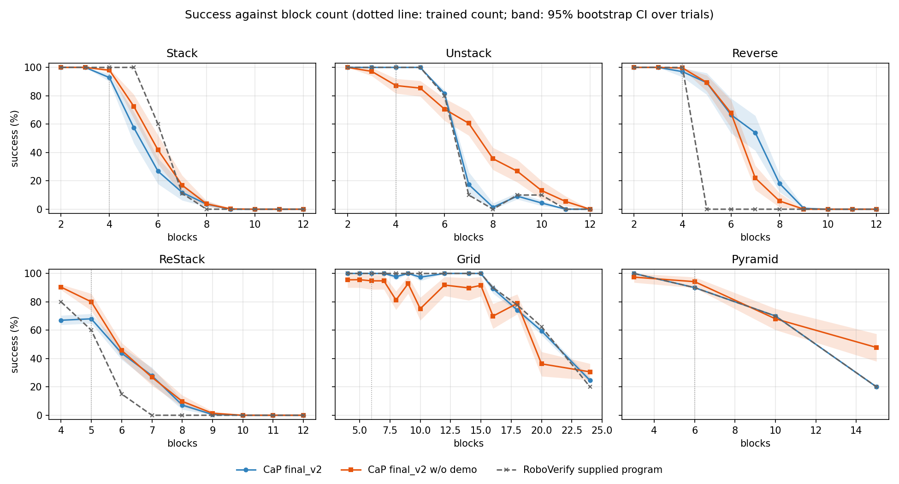
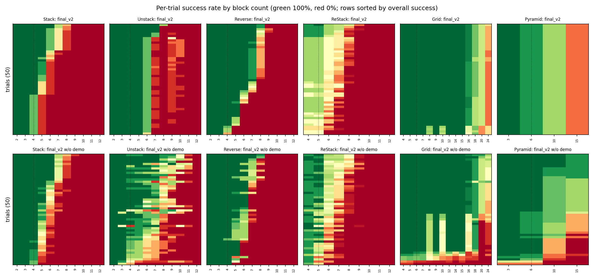
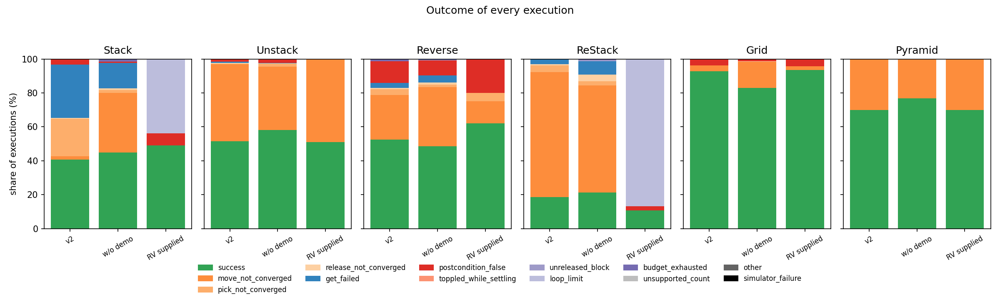
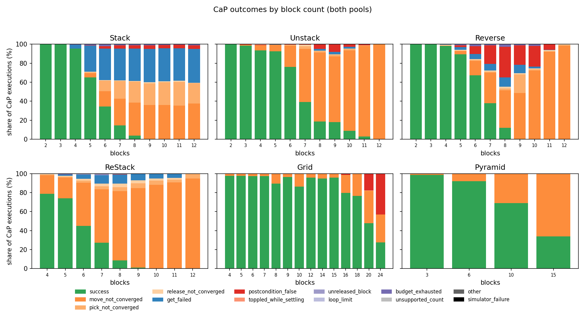
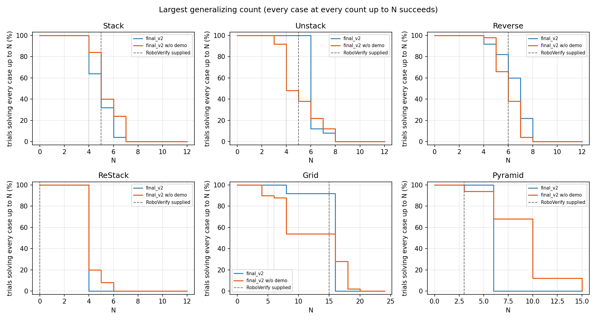
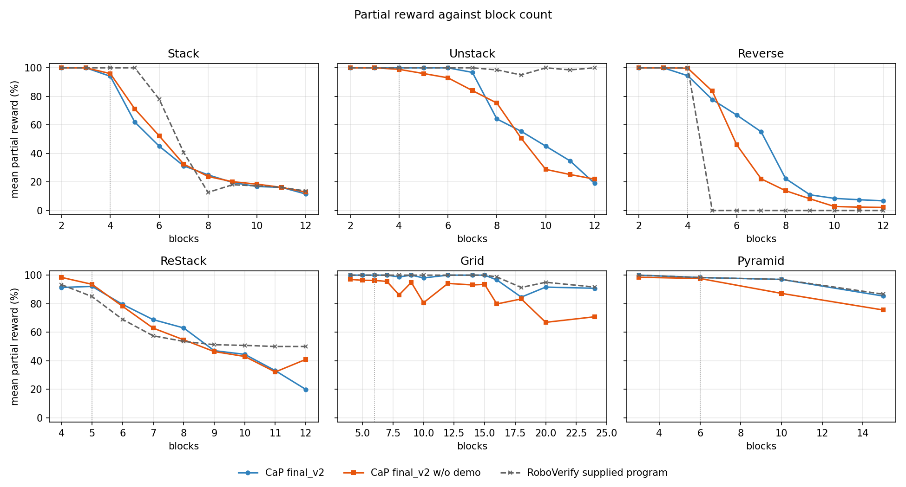

# Revision 9 report: block-count generalization on `relaxed_v2`

- **Date:** 2026-10-29. Plan and method:
  [revision_9_generalization_checker.md](revision_9_generalization_checker.md).
- **Question:** each CaP policy was generated and scored at one block count
  (Stack, Unstack, Reverse 4; ReStack 5; Grid 3 × 2 = 6; Pyramid 3-2-1 = 6).
  The task instructions say the count is not given, so a correct policy must
  work at every count. How do the final programs behave on every physically
  feasible count, and how does RoboVerify compare on the same scenes?
- **Test cases:** the 721 cases of `relaxed_v2`
  ([Revision 9, Section 3.6](revision_9_generalization_checker.md#36-test-case-set-relaxed_v2)):
  the relaxed environment, counts 2–12 for the tower tasks, 23 Grid shapes up
  to 6 × 4, Pyramid k = 2–5, seeds 0–9 where feasible. Every case is
  physically feasible, including a 50-step reach of every initial and goal
  column, so **every failure below is a policy failure**; no simulator
  failure occurred.
- **Programs:**
  - CaP final_v2 (Opus 5.5, with demonstrations): 300 trials, 252 distinct
    programs after alpha-renamed AST deduplication;
  - CaP final_v2 w/o demo: 300 trials, 300 distinct programs;
  - RoboVerify: 50 full syntheses each for Stack and Unstack, and the
    supplied program of every task (Section 5).
- **Execution:** each distinct program runs unchanged on every case of its
  task (CaP: scripted round-0 response, recovery and video off; RoboVerify:
  `record_execution` from the case snapshot). Success is judged after 50
  settling steps (`task-spec-v2`; CaP also `final-release-v1`). Tick and
  simulation-step budgets scale with N (Revision 9, Section 5.4); 228 of
  68,086 CaP executions (0.3%) exhausted them. The 68,086 CaP executions took
  207 CPU-hours (median 6.7 s), about 2.2 hours on up to 100 workers.
- **Run directory:** `runs/cap-generalization/20261029-full-eval/` (file
  list in Section 8). Code: commits `96c08dc` and `d17817d`.

## 1. Summary

1. **No program generalizes to every feasible count, in either CaP pool or
   from RoboVerify.** No policy succeeds on every case of its task; every
   tower-task policy fails all 12-block cases. Success falls steeply above
   the trained count:

   | Task (trained N) | final_v2 at N / N+2 / N+4 | w/o demo at N / N+2 / N+4 | RoboVerify supplied at N / N+2 / N+4 |
   | --- | --- | --- | --- |
   | Stack (4) | 92.8% / 26.8% / 3.6% | 98.0% / 41.8% / 3.8% | 100% / 60% / 0% |
   | Unstack (4) | 100% / 81.6% / 1.4% | 87.2% / 70.6% / 35.6% | 100% / 80% / 0% |
   | Reverse (4) | 97.0% / 66.6% / 18.2% | 99.6% / 67.8% / 5.8% | 100% / 0% / 0% |
   | ReStack (5) | 68.0% / 27.9% / 0.5% | 80.0% / 26.8% / 1.4% | 60% / 0% / 0% |
   | Grid (6) | 100% / 97.7% (8) / 97.4% (10) | 94.8% / 81.3% / 75.1% | 100% / 100% / 100% |
   | Pyramid (6) | 90.0% / 70.0% (10) / 20.0% (15) | 94.2% / 68.0% / 47.8% | 90% / 70% / 20% |

   Grid and Pyramid columns are the next layout sizes (8, 10 cells; k = 4, 5).
   Small counts (2, 3) are solved by nearly every program.
2. **The trained count is not fully solved in the relaxed scenes either.**
   Every CaP trial succeeded on its own training scene, but on the ten relaxed
   scenes at the trained count only 1/50 (final_v2) and 18/50 (w/o demo)
   ReStack programs, and 32/50 and 42/50 Stack programs, succeed on all ten.
   The relaxed layout (towers nearer the base, blocks anywhere reachable) is
   itself a generalization test.
3. **Demonstrations make CaP copy the supplied program, including its
   limits.** final_v2's per-case outcomes agree with RoboVerify's supplied
   program on 100% of Pyramid cases (all 50 programs identical in outcome),
   98.5% of Grid and 96.8% of Unstack cases. Without demonstrations the
   agreement drops to 82%, 86% and 79%, and the programs behave more
   variously: w/o demo is better on tall Unstack and on Pyramid k = 5, worse
   on Grid.
4. **Why policies fail** (Section 3): non-convergence of a 50-step Move is the
   most common failure at larger counts, from transport targets beyond one
   Move (fixed offsets that grow with N, lifts above the tallest column);
   Stack additionally fails by **placement drift**: placing each block on the
   measured current top accumulates about 12 mm per level, so at 5 blocks
   the top is outside the 25 mm ON* tolerance of b0 and the program's own
   tower-top query has no witness, or the leaning tower falls.
5. **RoboVerify synthesized no program** (Section 5). All 50 Stack syntheses
   (`synthesize_cfg --mode full --quotient`, default budget, 29–108 min each)
   ended `budget_exhausted` (45) or `no_separator` (5) with unresolved CFG
   regions. Four further Stack runs with four times the search budget
   (5.1–7.1 h each) stopped the same way. All 50 Unstack syntheses stopped
   at the 60-second Unstack limit.
   Reverse, ReStack, Grid and Pyramid have no RoboVerify synthesis
   (README task table). The RoboVerify column is therefore the supplied,
   hand-written programs; only Stack's is formally verified.
6. **Verification did not give generalization.** The verified Stack program
   succeeds on all cases up to 5 blocks, then fails like the CaP programs
   (60% at 6, 0% from 8), mostly ending in `loop_limit` (its loop still has
   a witness after 200 iterations). The verified motion model has no reach
   or settling limit (smoke test,
   `runs/cap-generalization/20261029-smoke/report.md`).

## 2. Success against block count



The curves average, at each count, every trial's success rate over the
count's cases; bands are 95% bootstrap intervals over trials. The supplied
RoboVerify program is one program (no band).

| Task | Cases | Arm | Policies (distinct) | Success, all cases [95% CI] | Distinct programs | Trained count | All cases solved | Trained count solved |
| --- | ---: | --- | ---: | ---: | ---: | ---: | ---: | ---: |
| Stack | 96 | final_v2 | 50 (46) | 40.7% [38.1%, 43.5%] | 40.9% | 92.8% | 0/50 | 32/50 |
| Stack | 96 | final_v2 w/o demo | 50 (50) | 44.9% [42.4%, 47.6%] | 44.9% | 98.0% | 0/50 | 42/50 |
| Stack | 96 | RoboVerify supplied | 1 (1) | 49.0% [49.0%, 49.0%] | 49.0% | 100.0% | 0/1 | 1/1 |
| Unstack | 100 | final_v2 | 50 (50) | 51.4% [50.4%, 52.6%] | 51.4% | 100.0% | 0/50 | 50/50 |
| Unstack | 100 | final_v2 w/o demo | 50 (50) | 58.0% [54.4%, 61.5%] | 58.0% | 87.2% | 0/50 | 25/50 |
| Unstack | 100 | RoboVerify supplied | 1 (1) | 51.0% [51.0%, 51.0%] | 51.0% | 100.0% | 0/1 | 1/1 |
| Reverse | 100 | final_v2 | 50 (50) | 52.6% [48.9%, 55.9%] | 52.6% | 97.0% | 0/50 | 46/50 |
| Reverse | 100 | final_v2 w/o demo | 50 (50) | 48.5% [46.4%, 50.5%] | 48.5% | 99.6% | 0/50 | 49/50 |
| Reverse | 100 | RoboVerify supplied | 1 (1) | 30.0% [30.0%, 30.0%] | 30.0% | 100.0% | 0/1 | 1/1 |
| ReStack | 158 | final_v2 | 50 (50) | 18.6% [16.8%, 20.4%] | 18.6% | 68.0% | 0/50 | 1/50 |
| ReStack | 158 | final_v2 w/o demo | 50 (50) | 21.4% [19.5%, 23.4%] | 21.4% | 80.0% | 0/50 | 18/50 |
| ReStack | 158 | RoboVerify supplied | 1 (1) | 10.8% [10.8%, 10.8%] | 10.8% | 60.0% | 0/1 | 0/1 |
| Grid | 227 | final_v2 | 50 (40) | 92.8% [91.8%, 93.5%] | 92.6% | 100.0% | 0/50 | 50/50 |
| Grid | 227 | final_v2 w/o demo | 50 (50) | 82.9% [76.6%, 88.0%] | 82.9% | 94.8% | 0/50 | 44/50 |
| Grid | 227 | RoboVerify supplied | 1 (1) | 93.4% [93.4%, 93.4%] | 93.4% | 100.0% | 0/1 | 1/1 |
| Pyramid | 40 | final_v2 | 50 (16) | 70.0% [70.0%, 70.0%] | 70.0% | 90.0% | 0/50 | 0/50 |
| Pyramid | 40 | final_v2 w/o demo | 50 (50) | 76.9% [71.3%, 81.8%] | 76.9% | 94.2% | 0/50 | 34/50 |
| Pyramid | 40 | RoboVerify supplied | 1 (1) | 70.0% [70.0%, 70.0%] | 70.0% | 90.0% | 0/1 | 0/1 |

"All cases solved" counts trials that succeed on all cases of the task; it is
0 everywhere because no program reaches the tallest towers or the largest
grids. "Trained count solved" counts trials that succeed on every relaxed case
at the trained count.



Each row is one trial (its program's success rate at each count). final_v2
Pyramid rows are identical; final_v2 Unstack rows share the supplied
program's cliff at 7 blocks.

## 3. Why policies fail





**Failure kinds** (share of all executions of the arm)

| Task | Arm | success | move_not_converged | pick_not_converged | release_not_converged | get_failed | postcondition_false | toppled_while_settling | unreleased_block | loop_limit | budget_exhausted | unsupported_count | other | simulator_failure |
| --- | --- | ---: | ---: | ---: | ---: | ---: | ---: | ---: | ---: | ---: | ---: | ---: | ---: | ---: |
| Stack | final_v2 | 40.7% | 2.0% | 22.2% | 0.3% | 31.4% | 3.2% | 0.0% | 0.0% | 0.0% | 0.1% | 0.0% | 0.0% | 0.0% |
| Stack | final_v2 w/o demo | 44.9% | 35.1% | 1.8% | 0.9% | 15.0% | 0.8% | 0.0% | 0.0% | 0.0% | 1.5% | 0.0% | 0.0% | 0.0% |
| Stack | RoboVerify supplied | 49.0% | 0.0% | 0.0% | 0.0% | 0.0% | 7.3% | 0.0% | 0.0% | 43.8% | 0.0% | 0.0% | 0.0% | 0.0% |
| Unstack | final_v2 | 51.4% | 45.5% | 0.2% | 0.4% | 0.8% | 1.6% | 0.0% | 0.0% | 0.0% | 0.0% | 0.0% | 0.0% | 0.0% |
| Unstack | final_v2 w/o demo | 58.0% | 37.5% | 1.6% | 0.1% | 0.4% | 2.0% | 0.2% | 0.0% | 0.0% | 0.1% | 0.0% | 0.0% | 0.0% |
| Unstack | RoboVerify supplied | 51.0% | 49.0% | 0.0% | 0.0% | 0.0% | 0.0% | 0.0% | 0.0% | 0.0% | 0.0% | 0.0% | 0.0% | 0.0% |
| Reverse | final_v2 | 52.6% | 26.1% | 3.6% | 0.7% | 3.0% | 12.7% | 0.0% | 0.0% | 0.0% | 1.3% | 0.0% | 0.0% | 0.0% |
| Reverse | final_v2 w/o demo | 48.5% | 35.1% | 1.3% | 1.3% | 4.1% | 9.0% | 0.0% | 0.0% | 0.0% | 0.7% | 0.0% | 0.0% | 0.0% |
| Reverse | RoboVerify supplied | 30.0% | 0.0% | 0.0% | 0.0% | 0.0% | 0.0% | 0.0% | 0.0% | 0.0% | 0.0% | 70.0% | 0.0% | 0.0% |
| ReStack | final_v2 | 18.6% | 73.6% | 4.1% | 0.6% | 3.1% | 0.0% | 0.0% | 0.0% | 0.0% | 0.1% | 0.0% | 0.0% | 0.0% |
| ReStack | final_v2 w/o demo | 21.4% | 62.9% | 2.4% | 4.1% | 7.8% | 0.0% | 0.0% | 0.7% | 0.0% | 0.5% | 0.0% | 0.0% | 0.0% |
| ReStack | RoboVerify supplied | 10.8% | 0.0% | 0.0% | 0.0% | 0.0% | 2.5% | 0.0% | 0.0% | 86.7% | 0.0% | 0.0% | 0.0% | 0.0% |
| Grid | final_v2 | 92.8% | 3.4% | 0.0% | 0.0% | 0.0% | 3.8% | 0.0% | 0.0% | 0.0% | 0.0% | 0.0% | 0.0% | 0.0% |
| Grid | final_v2 w/o demo | 82.9% | 15.6% | 0.0% | 0.1% | 0.0% | 1.4% | 0.0% | 0.0% | 0.0% | 0.0% | 0.0% | 0.0% | 0.0% |
| Grid | RoboVerify supplied | 93.4% | 2.2% | 0.0% | 0.0% | 0.0% | 4.4% | 0.0% | 0.0% | 0.0% | 0.0% | 0.0% | 0.0% | 0.0% |
| Pyramid | final_v2 | 70.0% | 30.0% | 0.0% | 0.0% | 0.0% | 0.0% | 0.0% | 0.0% | 0.0% | 0.0% | 0.0% | 0.0% | 0.0% |
| Pyramid | final_v2 w/o demo | 76.8% | 22.9% | 0.0% | 0.2% | 0.0% | 0.1% | 0.0% | 0.0% | 0.0% | 0.0% | 0.0% | 0.0% | 0.0% |
| Pyramid | RoboVerify supplied | 70.0% | 30.0% | 0.0% | 0.0% | 0.0% | 0.0% | 0.0% | 0.0% | 0.0% | 0.0% | 0.0% | 0.0% | 0.0% |

- **`move_not_converged`** (CaP: 2–74% of a task's executions). A Move that
  does not reach its target within 50 steps. Every case's columns are
  reachable by one Move, so the target is the program's choice:
  - final_v2 Unstack places each block 0.15 m further along −Y than the
    previous one (`Move(b0, last, b0, [0, -0.15, ...])`), the supplied
    program's `Y_min` pattern from the demonstrations; from 7 blocks the
    target leaves the reachable region (the supplied program fails the same
    way: 34 mm short at 7 blocks);
  - Reverse programs carry blocks at a clearance that grows with the tower
    (for example `safe = (top − b0 height) + 0.05 + 0.12` m), which leaves
    one Move's reach (about 1.0 m) as the tower grows;
  - ReStack fails this way from its smallest count in the relaxed
    loose-block layout, and Grid 6 × 4 and Pyramid k = 5 at their largest
    layouts; these were not diagnosed program by program.
- **`get_failed`** and **`pick_not_converged`** (Stack, 22–31% in final_v2):
  placement drift. In `stack-n5-s0`, a final_v2 program places each block
  with `Move(top, top, top, ...)` on the measured current top; the tower
  leans 4, 22, 37 and 49 mm from b0. The fifth block is ON its support but
  not ON* b0, so `get(... ON_star(t, b0) and not exists(c: ON(c, t)))` has
  no witness. Other runs topple: the tower ends lying in a row of blocks
  about 6 cm apart, and `Pick` on a tilted block does not converge.
- **`postcondition_false`** (Reverse 9–13%, Grid 1–4%): the program ends
  without error but the settled goal does not hold.
- **`budget_exhausted`** (0.3%): loops without progress under the scaled
  budgets.
- RoboVerify's supplied programs: `loop_limit` (Stack 44%, ReStack 87%; a
  `While` still has a guard witness after its iteration bound, 200 for
  Stack and the program's own 10 for ReStack's loop 3), `unsupported_count`
  (Reverse refuses more than 4 blocks by design) and `move_not_converged`
  (Unstack, the `Y_min` pattern above).

## 4. Largest generalizing count and partial reward



**Largest generalizing count** (median over trials; share of trials reaching at least the trained count)

| Task | Trained | final_v2 median | final_v2 ≥ trained | w/o demo median | w/o demo ≥ trained | RoboVerify supplied |
| --- | ---: | ---: | ---: | ---: | ---: | ---: |
| Stack | 4 | 4 | 32/50 | 4 | 42/50 | 5 |
| Unstack | 4 | 5 | 50/50 | 3 | 24/50 | 5 |
| Reverse | 4 | 6 | 46/50 | 5 | 49/50 | 4 |
| ReStack | 5 | 0 | 0/50 | 0 | 4/50 | 0 |
| Grid | 6 | 15 | 50/50 | 15 | 44/50 | 15 |
| Pyramid | 6 | 3 | 0/50 | 6 | 34/50 | 3 |

The largest generalizing count is the largest N such that every case at
every count up to N succeeds. ReStack's median is 0 because most programs
fail some 4-block case (the smallest ReStack count), mostly by Move
non-convergence in the relaxed loose-block layout. Pyramid final_v2 stops at
3 blocks because every final_v2 program, like the supplied program, fails
`pyramid-n6-k3-s9` (a Move does not converge).



Partial reward (`partial-reward-v1`, [TASK_PARTIAL_REWARD.md](TASK_PARTIAL_REWARD.md))
degrades more gently than success. RoboVerify's executor continues after a
primitive that does not converge, while CaP stops at the first one, so the
supplied programs' partial reward is not comparable with CaP's: the supplied
Unstack program, for example, still releases every block on the table (about
100% partial reward) although it fails from 7 blocks.

## 5. RoboVerify

**Synthesis.** RoboVerify's integrated synthesizer
(`synthesize_cfg`) accepts only `--task stack|unstack`; the README lists
Reverse and ReStack as "not integrated" and Grid and Pyramid as "not
supported" (nested goal loops; quotienting is flat-loop only). For Stack and
Unstack, 50 independent syntheses were run, each from its own five
four-block demonstrations (seeds 5k … 5k+4) and synthesis seed k, with the
verification configuration of the supplied Stack proof
([VERIFICATION.md](../../cfg/VERIFICATION.md#provided-stack-verification)) and
`--post-settling-steps 50`:

**RoboVerify synthesis attempts**

| Group | Attempts | Statuses | With a program | verified_model | Median synthesis wall (s) |
| --- | ---: | --- | ---: | ---: | ---: |
| stack | 50 | budget_exhausted 45, no_separator 5 | 0 | 0 | 3508 |
| stack_big | 4 | budget_exhausted 4 | 0 | 0 | 20899 |
| unstack | 50 | budget_exhausted 29, killed_after_120s 21 | 0 | 0 | 60 |

- Stack: in the inspected runs the straight-line search ended each block
  with `PostScore` 0 (no candidate in the near-best pool reaches the
  postcondition) and refined it; every run stopped with unresolved CFG
  regions (`Cannot lower an unresolved region`), so no executable program
  existed to evaluate.
- Stack, larger budget (`stack_big`, demonstrations of runs 0–3): four runs
  with four times the search budget (`--iterations 80 --cem-iterations 4
  --cem-samples 16 --refinements 10`) took 5.1–7.1 h and ended exactly as
  the default runs did. Each searched three blocks (v0, v0.0, v0.0.0), all
  with `PostScore` 0; the first two refinements found separators and the
  third ended `budget_exhausted`, after 2 of the 10 allowed refinements.
  Most default-budget runs stop at the same third refinement. The stop is
  the predicate enumerator's own bound (`synthesis/predicates`, 5 s by
  default via `--predicate-seconds`), which these options do not change; the
  refinement limit is not reached.
- Unstack: the 60-second Unstack limit ends synthesis during the first
  search block. In 21 runs `synthesize_cfg`'s own alarm did not stop the
  process, and the outer 120-second guard ended it.

**Supplied programs.** `synthesis.examples.<task>:build_program`, executed on
the same 721 cases. Only Stack's is verified (`verified_model`, smoke test
above); the others are reference programs validated by collection
and audit. They generalize no better than CaP:
- Stack: 100% up to 5 blocks, 60% at 6, 0% from 8. In the smoke test the
  7-block tower drifted beyond the ON* tolerance while settling, and from 10
  blocks the lift to 0.10 m above the tower exceeded one Move; most failures
  end in `loop_limit`;
- Unstack: 100% up to 5, then the `Y_min` parking pattern leaves the reachable
  region (10% at 7, 0–10% beyond);
- Reverse: the program accepts 2–4 blocks only (0% from 5);
- ReStack: 80% at 4, 60% at the trained 5, 0% from 7;
- Grid: 100% up to 15 cells, 20% at 6 × 4;
- Pyramid: 100%, 90%, 70%, 20% for k = 2–5.

## 6. Per-count tables

**Stack: success by block count** (mean over policies; cases per count in parentheses)

| Arm | 2 (10) | 3 (10) | 4 (10) | 5 (10) | 6 (10) | 7 (9) | 8 (9) | 9 (9) | 10 (9) | 11 (8) | 12 (2) |
| --- | ---: | ---: | ---: | ---: | ---: | ---: | ---: | ---: | ---: | ---: | ---: |
| final_v2 | 100.0% | 100.0% | 92.8% | 57.6% | 26.8% | 11.8% | 3.6% | 0.0% | 0.0% | 0.0% | 0.0% |
| final_v2 w/o demo | 100.0% | 100.0% | 98.0% | 72.6% | 41.8% | 16.9% | 3.8% | 0.2% | 0.0% | 0.0% | 0.0% |
| RoboVerify supplied | 100.0% | 100.0% | 100.0% | 100.0% | 60.0% | 11.1% | 0.0% | 0.0% | 0.0% | 0.0% | 0.0% |

**Unstack: success by block count** (mean over policies; cases per count in parentheses)

| Arm | 2 (10) | 3 (10) | 4 (10) | 5 (10) | 6 (10) | 7 (10) | 8 (10) | 9 (10) | 10 (10) | 11 (7) | 12 (3) |
| --- | ---: | ---: | ---: | ---: | ---: | ---: | ---: | ---: | ---: | ---: | ---: |
| final_v2 | 100.0% | 100.0% | 100.0% | 100.0% | 81.6% | 17.4% | 1.4% | 9.2% | 4.4% | 0.0% | 0.0% |
| final_v2 w/o demo | 100.0% | 97.2% | 87.2% | 85.4% | 70.6% | 60.6% | 35.6% | 26.8% | 13.2% | 5.4% | 0.0% |
| RoboVerify supplied | 100.0% | 100.0% | 100.0% | 100.0% | 80.0% | 10.0% | 0.0% | 10.0% | 10.0% | 0.0% | 0.0% |

**Reverse: success by block count** (mean over policies; cases per count in parentheses)

| Arm | 2 (10) | 3 (10) | 4 (10) | 5 (10) | 6 (10) | 7 (10) | 8 (10) | 9 (10) | 10 (10) | 11 (7) | 12 (3) |
| --- | ---: | ---: | ---: | ---: | ---: | ---: | ---: | ---: | ---: | ---: | ---: |
| final_v2 | 100.0% | 100.0% | 97.0% | 89.2% | 66.6% | 54.0% | 18.2% | 0.6% | 0.0% | 0.0% | 0.0% |
| final_v2 w/o demo | 100.0% | 100.0% | 99.6% | 89.4% | 67.8% | 22.0% | 5.8% | 0.0% | 0.0% | 0.0% | 0.0% |
| RoboVerify supplied | 100.0% | 100.0% | 100.0% | 0.0% | 0.0% | 0.0% | 0.0% | 0.0% | 0.0% | 0.0% | 0.0% |

**ReStack: success by block count** (mean over policies; cases per count in parentheses)

| Arm | 4 (10) | 5 (10) | 6 (20) | 7 (20) | 8 (20) | 9 (20) | 10 (29) | 11 (28) | 12 (1) |
| --- | ---: | ---: | ---: | ---: | ---: | ---: | ---: | ---: | ---: |
| final_v2 | 67.0% | 68.0% | 43.8% | 27.9% | 7.2% | 0.5% | 0.0% | 0.0% | 0.0% |
| final_v2 w/o demo | 90.4% | 80.0% | 45.8% | 26.8% | 9.8% | 1.4% | 0.0% | 0.0% | 0.0% |
| RoboVerify supplied | 80.0% | 60.0% | 15.0% | 0.0% | 0.0% | 0.0% | 0.0% | 0.0% | 0.0% |

**Grid: success by block count** (mean over policies; cases per count in parentheses)

| Arm | 4 (20) | 5 (10) | 6 (30) | 7 (10) | 8 (30) | 9 (20) | 10 (20) | 12 (20) | 14 (10) | 15 (10) | 16 (20) | 18 (9) | 20 (8) | 24 (10) |
| --- | ---: | ---: | ---: | ---: | ---: | ---: | ---: | ---: | ---: | ---: | ---: | ---: | ---: | ---: |
| final_v2 | 100.0% | 100.0% | 100.0% | 100.0% | 97.7% | 100.0% | 97.4% | 100.0% | 100.0% | 100.0% | 89.3% | 74.2% | 59.5% | 24.6% |
| final_v2 w/o demo | 95.5% | 95.6% | 94.8% | 94.8% | 81.3% | 92.8% | 75.1% | 91.8% | 89.8% | 91.6% | 69.9% | 78.9% | 36.2% | 30.6% |
| RoboVerify supplied | 100.0% | 100.0% | 100.0% | 100.0% | 100.0% | 100.0% | 100.0% | 100.0% | 100.0% | 100.0% | 90.0% | 77.8% | 62.5% | 20.0% |

**Pyramid: success by block count** (mean over policies; cases per count in parentheses)

| Arm | 3 (10) | 6 (10) | 10 (10) | 15 (10) |
| --- | ---: | ---: | ---: | ---: |
| final_v2 | 100.0% | 90.0% | 70.0% | 20.0% |
| final_v2 w/o demo | 97.4% | 94.2% | 68.0% | 47.8% |
| RoboVerify supplied | 100.0% | 90.0% | 70.0% | 20.0% |

## 7. Caveats

- **Relaxed scenes.** The relaxed reset differs from the training layouts even
  at the trained count (Revision 9, Section 7); compare curves with their own
  trained-count value, not with the 100% training success.
- **Trial weighting.** CaP numbers weight each trial by its program; the
  "distinct programs" column counts each program once. Bootstrap intervals
  resample trials and do not capture case-to-case variation.
- **Partial reward** depends on whether the executor stops at the first
  unconverged primitive (CaP) or continues (RoboVerify).
- **RoboVerify synthesis budget.** Only the default budget and one
  four-times-larger search budget were tried (Section 5). The predicate
  enumerator bound was left at its default, so this report does not show
  that Stack synthesis fails for every budget.

## 8. Files

`runs/cap-generalization/20261029-full-eval/`:
- `programs.json`: every trial's program (pool, task, trial, seed, round,
  source, hashes); `jobs.json`, `jobs_roboverify.json`: the jobs;
- `results/cap/<task>/<program>-<chunk>.jsonl`,
  `results/roboverify/<task>/supplied-*.jsonl`: one row per execution;
- `cap_runs/<task>/<program>/<case>.result.json`: the CaP run results (jobs
  started before `R9_LOCAL_RUN_ROOT` was set kept full run directories under
  `cap_runs/<task>/<program>/cap/`);
- `roboverify_synthesis/{stack,unstack,stack_big}/synth_NN/`: demonstrations,
  CFG runs and `synthesis.json` of every RoboVerify synthesis;
  `quarantine_unstack_misrouted/`: six Unstack attempts that were first
  launched into Stack folders by a path error, moved aside and rerun;
- `revision9_data.json`, `revision9_tables.md`: the report's numbers;
- `scripts/`: job preparation, the RoboVerify synthesis wrappers and launchers.

Reproduce (from `roboverify/`, simulator environment configured):

```bash
python runs/cap-generalization/20261029-full-eval/scripts/prepare_jobs.py
R9_LOCAL_RUN_ROOT=/tmp/r9 python -m synthesis.cap.experiments.revision9_generalization \
    run --out runs/cap-generalization/20261029-full-eval \
    --jobs runs/cap-generalization/20261029-full-eval/jobs.json --workers 100
python -m synthesis.cap.reports.generalization_report runs/cap-generalization/20261029-full-eval \
    --output runs/cap-generalization/20261029-full-eval --plots synthesis/cap/docs/plots --prefix revision9
```
